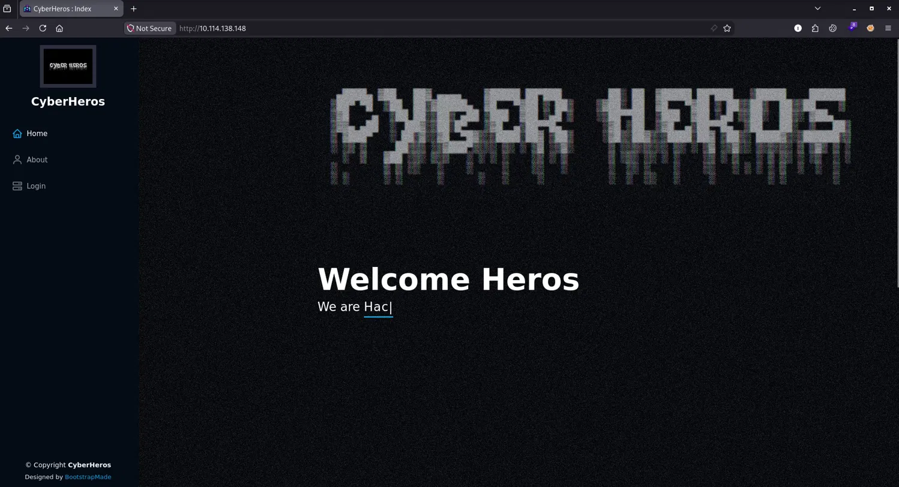
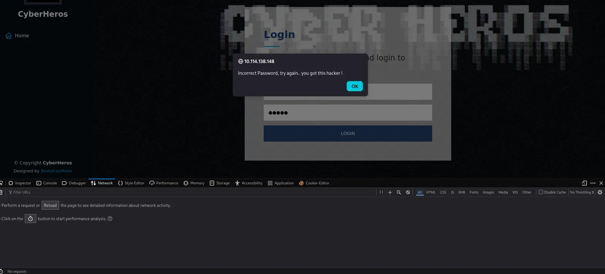
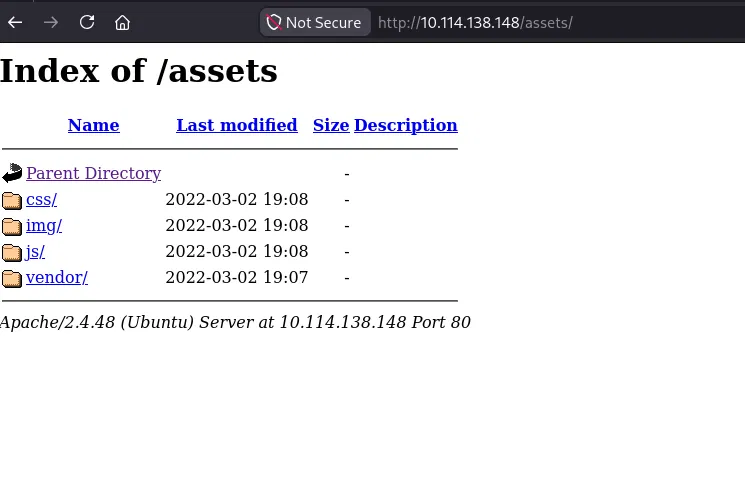
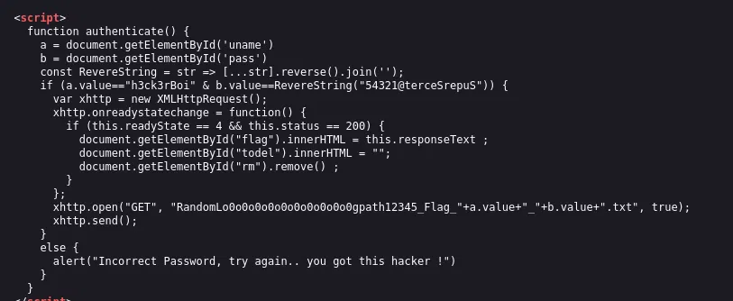
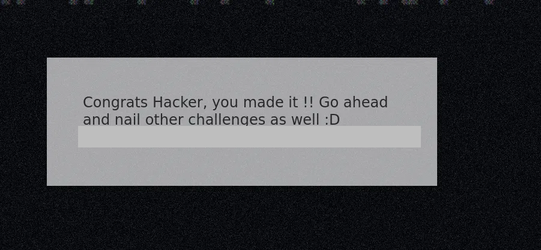
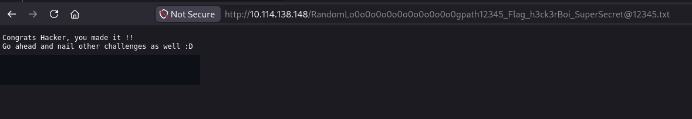

## Scenario

> Want to be a part of the elite club of CyberHeroes? Prove your merit by finding a way to log in!

Access via: `http://10.114.138.148`

## Initial Look

Navigated to the URL and got the CyberHeros landing page, with Home, About and Login in the sidebar.



Looked at the page source, but nothing stood out to me at a very cursory scan.

> **Why it matters:** That cursory scan missed the whole solution, which was sitting in the login page's source. More on that below.

## Login Attempt

Went to the login page and tried `admin:admin`, which got me a browser alert: "Incorrect Password, try again.. you got this hacker !"

Had the dev tools Network tab open while submitting, and no request showed up at all.



Dead end: default credentials were a reasonable first guess for a login form, but they were rejected. The empty Network tab was the real clue here: the rejection happened without the browser ever talking to the server, so the check had to be running client-side. Didn't put that together at the time.

## Directory Fuzzing

Started `ffuf` to look for hidden directories.

```shell
┌──(—REDACTED—㉿kali)-[~]
└─$ ffuf -u http://10.114.138.148/FUZZ -w /usr/share/wordlists/dirbuster/directory-list-2.3-medium.txt:FUZZ -ic -c -recursion 


        /'___\  /'___\           /'___\       
       /\ \__/ /\ \__/  __  __  /\ \__/       
       \ \ ,__\\ \ ,__\/\ \/\ \ \ \ ,__\      
        \ \ \_/ \ \ \_/\ \ \_\ \ \ \ \_/      
         \ \_\   \ \_\  \ \____/  \ \_\       
          \/_/    \/_/   \/___/    \/_/       

       v2.3.0
________________________________________________

 :: Method           : GET
 :: URL              : http://10.114.138.148/FUZZ
 :: Wordlist         : FUZZ: /usr/share/wordlists/dirbuster/directory-list-2.3-medium.txt
 :: Follow redirects : false
 :: Calibration      : false
 :: Timeout          : 10
 :: Threads          : 40
 :: Matcher          : Response status: 200-299,301,302,307,401,403,405,500
________________________________________________

                        [Status: 200, Size: 6568, Words: 1076, Lines: 151, Duration: 44ms]
assets                  [Status: 301, Size: 317, Words: 20, Lines: 10, Duration: 36ms]
```

**Breakdown:**

- `ffuf` is a fast web fuzzer: it substitutes each word from a wordlist into a request and reports which ones get a meaningful response
- `-u http://10.114.138.148/FUZZ` sets the target URL, with `FUZZ` marking the spot where each wordlist entry is inserted
- `-w /usr/share/wordlists/dirbuster/directory-list-2.3-medium.txt:FUZZ` sets the wordlist, and the `:FUZZ` suffix binds it to the `FUZZ` keyword in the URL
- `-ic` ignores comment lines in the wordlist (the DirBuster lists open with a commented header that would otherwise be sent as requests)
- `-c` colourises the output
- `-recursion` makes `ffuf` start a new scan inside every directory it finds, which requires `FUZZ` to sit at the end of the URL

Together, this brute-forces directory names at the web root and digs into any directories it finds. The blank-named `200` hit is the site root itself (the index page, at 6568 bytes), and `assets` came back as a `301` redirect to `/assets/`.

Browsing to `/assets/` showed that directory listing is enabled on the Apache server.



Dead end: directory listing is a misconfiguration worth noting, but `/assets/` only held the site's static CSS, images, JavaScript and vendor files, with nothing leading towards the login.

## Port Scanning

While that ran, scanned every TCP port to see what else was exposed.

```shell
┌──(—REDACTED—㉿kali)-[~]
└─$ sudo nmap -p- 10.114.138.148                  
[sudo] password for —REDACTED—: 
Starting Nmap 7.991 ( https://nmap.org ) at 2026-10-31 22:00 +0200
Nmap scan report for 10.114.138.148
Host is up (0.037s latency).
Not shown: 65533 closed tcp ports (reset)
PORT   STATE SERVICE
22/tcp open  ssh
80/tcp open  http

Nmap done: 1 IP address (1 host up) scanned in 22.25 seconds
```

**Breakdown:**

- `sudo` runs `nmap` as root, which lets it use a SYN scan (sending raw half-open TCP packets); without root it falls back to a slower full-connect scan
- `nmap` is the network scanner
- `-p-` scans all 65,535 TCP ports instead of the default top 1,000
- `10.114.138.148` is the target

This found two open ports: SSH on 22 and HTTP on 80. Then ran service detection and default scripts against just those two.

```shell
┌──(—REDACTED—㉿kali)-[~]
└─$ sudo nmap -p22,80 10.114.138.148 -sV -sC 
Starting Nmap 7.991 ( https://nmap.org ) at 2026-10-31 22:01 +0200
Nmap scan report for 10.114.138.148
Host is up (0.048s latency).

PORT   STATE SERVICE VERSION
22/tcp open  ssh     OpenSSH 8.2p1 Ubuntu 4ubuntu0.4 (Ubuntu Linux; protocol 2.0)
| ssh-hostkey: 
|   3072 05:e5:8a:34:be:a1:4f:2b:8f:b4:a3:18:32:1f:4a:ea (RSA)
|   256 5a:73:b2:21:f2:d6:e3:d6:d7:9a:31:54:d6:7b:8e:36 (ECDSA)
|_  256 c6:53:2b:e8:3a:cc:51:82:6a:3e:fc:a7:35:03:31:7b (ED25519)
80/tcp open  http    Apache httpd 2.4.48 ((Ubuntu))
|_http-title: CyberHeros : Index
|_http-server-header: Apache/2.4.48 (Ubuntu)
Service Info: OS: Linux; CPE: cpe:/o:linux:linux_kernel

Service detection performed. Please report any incorrect results at https://nmap.org/submit/ .
Nmap done: 1 IP address (1 host up) scanned in 9.57 seconds
```

**Breakdown:**

- `sudo` runs the scan as root, as above
- `-p22,80` limits the scan to the two ports found open
- `10.114.138.148` is the target
- `-sV` probes each open port to identify the service and its version
- `-sC` runs Nmap's default NSE script set (here, grabbing the SSH host keys, the HTTP page title and the server header)

Dead end: Nmap didn't get anything useful. OpenSSH 8.2p1 and Apache 2.4.48 on Ubuntu are a standard setup, and the challenge asks for a login on the website, so neither service pointed anywhere new.

## Back to the Source

Rechecked the login page's source, this time a bit more carefully, and found something that was there all along.



```html
  <script>
    function authenticate() {
      a = document.getElementById('uname')
      b = document.getElementById('pass')
      const RevereString = str => [...str].reverse().join('');
      if (a.value=="h3ck3rBoi" & b.value==RevereString("54321@terceSrepuS")) { 
        var xhttp = new XMLHttpRequest();
        xhttp.onreadystatechange = function() {
          if (this.readyState == 4 && this.status == 200) {
            document.getElementById("flag").innerHTML = this.responseText ;
            document.getElementById("todel").innerHTML = "";
            document.getElementById("rm").remove() ;
          }
        };
        xhttp.open("GET", "RandomLo0o0o0o0o0o0o0o0o0o0gpath12345_Flag_"+a.value+"_"+b.value+".txt", true);
        xhttp.send();
      }
      else {
        alert("Incorrect Password, try again.. you got this hacker !")
      }
    }
  </script>
```

**Breakdown:**

- `function authenticate()` is the function the login button calls; the whole credential check lives inside it, in the browser
- `a = document.getElementById('uname')` grabs the username input field
- `b = document.getElementById('pass')` grabs the password input field
- `const RevereString = str => [...str].reverse().join('')` defines a small arrow function (the "Revere" typo is the developer's): `[...str]` splits the string into an array of characters, `.reverse()` flips their order, and `.join('')` glues them back into a string
- `a.value=="h3ck3rBoi"` checks the username against a hard-coded value
- `b.value==RevereString("54321@terceSrepuS")` checks the password against a hard-coded string, reversed at runtime as light obfuscation
- `&` combines the two checks; it is the bitwise AND operator, which still works here because `true` and `false` become `1` and `0`
- `new XMLHttpRequest()` creates an object for making an HTTP request from the page
- `onreadystatechange` is a callback that fires as the request progresses
- `this.readyState == 4 && this.status == 200` means the request has finished and the server answered `200 OK`
- `document.getElementById("flag").innerHTML = this.responseText` writes the server's response (the flag) into the page
- `document.getElementById("todel").innerHTML = ""` and `document.getElementById("rm").remove()` clear away the login form elements
- `xhttp.open("GET", "RandomLo0o...gpath12345_Flag_"+a.value+"_"+b.value+".txt", true)` sets up an asynchronous `GET` for a text file whose name is built from the entered username and password
- `xhttp.send()` sends the request
- `alert("Incorrect Password, ...")` is the popup I got on the wrong credentials

As a whole, the login is entirely client-side: the browser compares the input to hard-coded credentials and only contacts the server once they match, to fetch the flag file. That explains the empty Network tab earlier.

It should've been my thought to search the client-side code, given that no requests showed up in the dev tools when I submitted my credentials. Lesson learned.

## Reversing the Password

```shell
┌──(—REDACTED—㉿kali)-[~]
└─$ echo '54321@terceSrepuS' | rev                
SuperSecret@12345
```

**Breakdown:**

- `echo '54321@terceSrepuS'` prints the obfuscated string; the single quotes pass it to `echo` literally, with no shell interpretation
- `|` pipes that output into the next command
- `rev` reverses the characters of each line it receives

This undoes the `RevereString` call and gives the real password.

So the creds are: `h3ck3rBoi:SuperSecret@12345`

## Logging In

Logged in with those credentials, and the page replaced the form with the flag.



Since the flag file's name is built only from the two credentials, it sits at a fixed path (`RandomLo0o0o0o0o0o0o0o0o0o0gpath12345_Flag_h3ck3rBoi_SuperSecret@12345.txt`) that could also be requested directly, skipping the login form entirely.



**Flag:** `—REDACTED—`
