## Exercises

### Question 1 — What username and password combination indicates a successful login attempt? The answer format is "username:password".

I started by loading the Administration Login page and submitting it with placeholder credentials (`test`/`test`) while Burp's intercept was active, just to capture a request with the right shape:

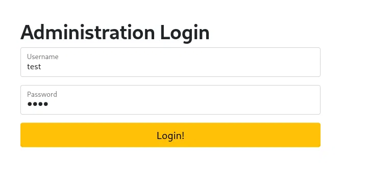

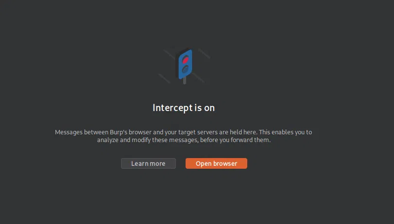

Captured the login and noticed both a `loginToken` hidden field in the body and a `session` cookie on the request — the CSRF token and session cookie the task warned about. I sent the captured request to Intruder:

```http
POST /admin/login/ HTTP/1.1
Host: 10.112.160.134
Content-Type: application/x-www-form-urlencoded
Content-Length: 71
Origin: http://10.112.160.134
Referer: http://10.112.160.134/admin/login/
Cookie: session=eyJTdXBwb3JOQXVOaCI6IlRydWUiLCJTdXBwb3JOSUQiOjMsInRva2VuSUQiOiJlZWFiOGM5YWNmMGNjNTEwYWEwNGQzM2FkNjJlkYTYwYyJ9.avy-MA.rkahF-7d_6JOdJg17WvBuV6j5P8

username=test&password=test&loginToken=cf171e38d0b549877bc28c42e6d12a65
```

**Breakdown:**

- `POST /admin/login/ HTTP/1.1` submits the admin login form
- `Cookie: session=...` is the session cookie set by the server on this particular page load — it changes on every fresh request
- `username=test&password=test&loginToken=cf171e38d0b549877bc28c42e6d12a65` is the body. `loginToken` is the CSRF token embedded as a hidden field, tied to this specific session

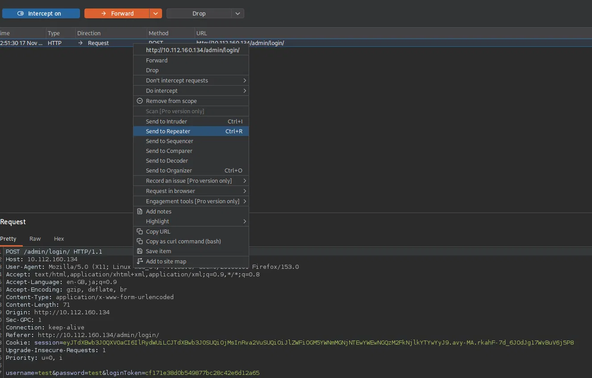

In Intruder's Positions tab, I switched the attack type to **Pitchfork** and selected only the `username` and `password` values as payload positions, leaving `loginToken` untouched since that would need to come from the macro rather than a wordlist:

```http
POST /admin/login/ HTTP/1.1
Host: 10.112.160.134

username=§test§&password=§test§&loginToken=cf171e38d0b549877bc28c42e6d12a65
```

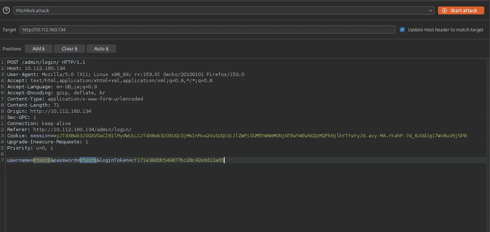

Loaded `usernames.txt` into payload position 1 and `passwords.txt` into payload position 2, same as the earlier support-login attack, 100 entries each:

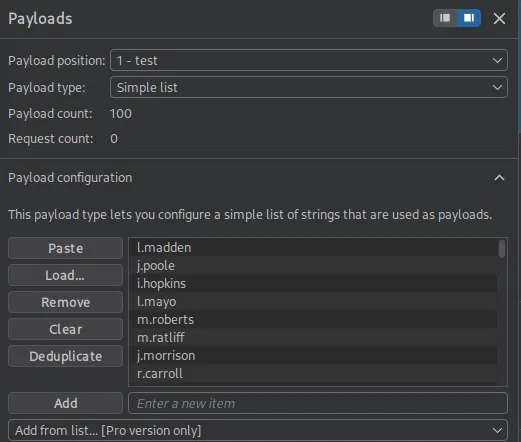

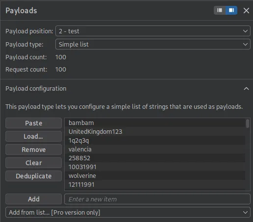

With the positions and payloads set, the next step was getting Burp to refresh the CSRF token and session cookie before every request, since the loaded wordlists alone couldn't account for either changing on each attempt. I went to **Settings > Sessions**, where the Macros section sat empty at this point:

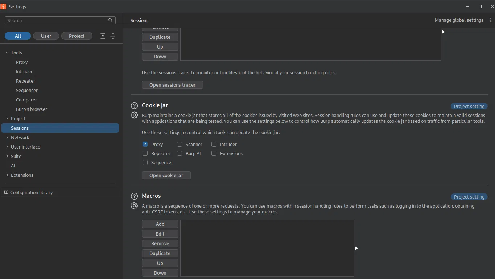

Clicking **Add** brought up the request picker. I selected the `GET /admin/login/` request from the history (status 200, length 4383) rather than the captured `POST`, since the macro just needs to fetch a fresh page, not submit one:

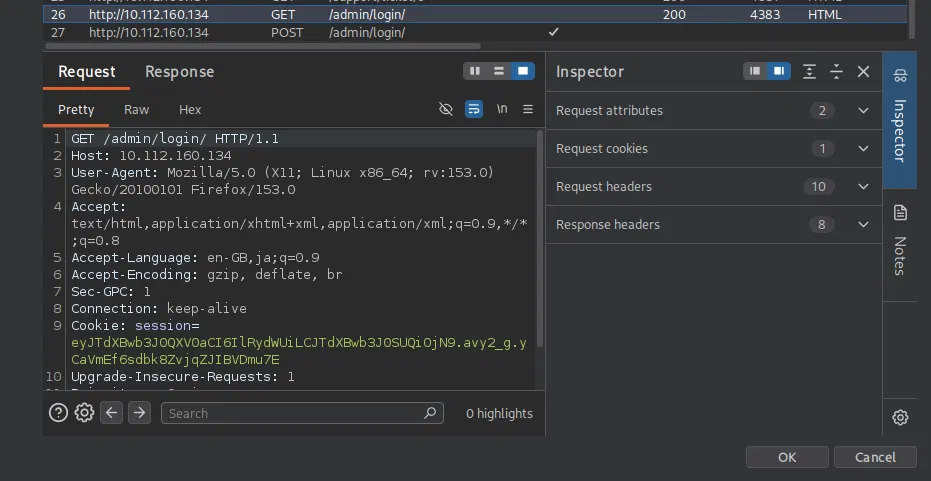

This created the macro, named "Grab CSRF token", shown in the Macro Editor with its one item — the `GET /admin/login/` request, confirmed as returning status 200 and a `session` cookie:

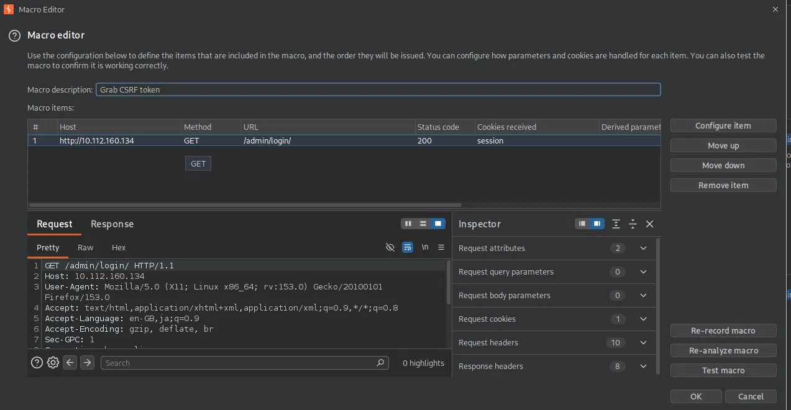

With the macro defined, I added a Session Handling Rule to use it. On the **Details** tab, I added the macro as a rule action:

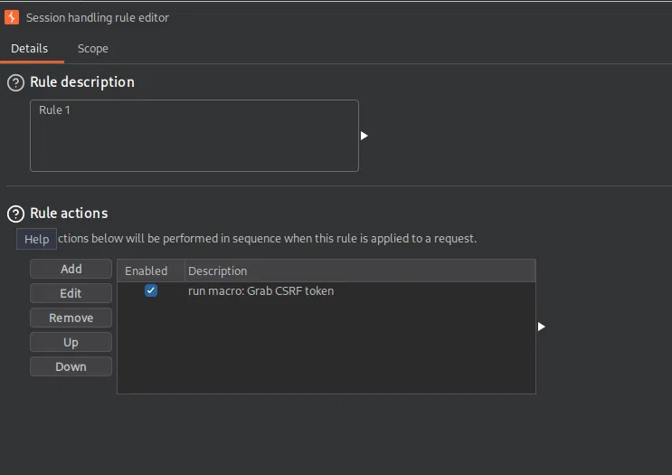

On the **Scope** tab, I restricted the rule's **Tools Scope** to Intruder only, and set **URL Scope** to **Use suite scope**:

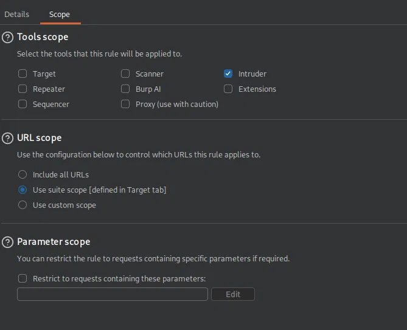

By default the macro would overwrite every parameter and cookie with whatever it fetched, which would also stomp on the `username`/`password` payloads Intruder was meant to be substituting. To stop that, I restricted the rule to only touch `loginToken` among the parameters, and `session` among the cookies — adding `loginToken` via the parameter edit list first:

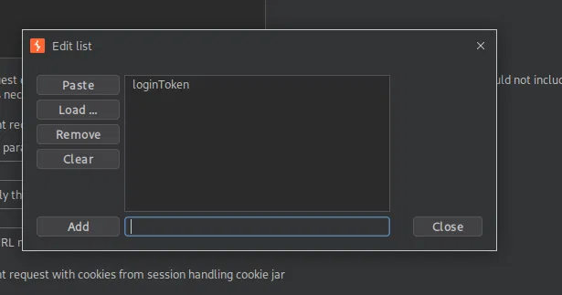

Then confirmed both restrictions together — updating only `loginToken` from the macro's response, and only the `session` cookie from the session handling cookie jar:

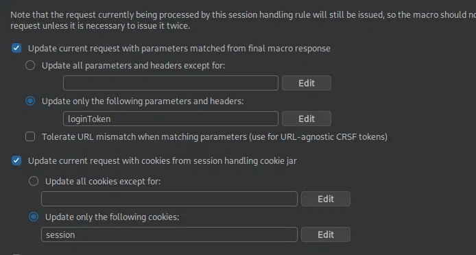

With the macro and rule configured, I ran the attack. Sorting the results by response length surfaced one clear outlier against the rest — request 35, username `—REDACTED—`, password `—REDACTED—`, at length `662`, noticeably shorter than the `759`–`760` range most other rows settled around:

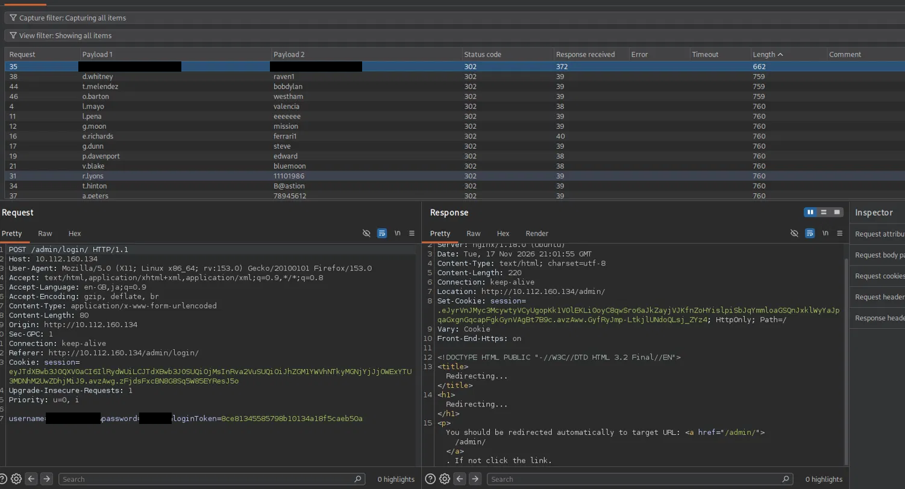

Looking at that request directly confirmed it: the body shows `username=—REDACTED—&password=—REDACTED—&loginToken=8ce8134585798b10134a18f5caeb50a` (with the period in the username URL-encoded as `%2e`), and the response is a `302` redirecting specifically to `/admin/` — the authenticated area — with a fresh `Set-Cookie: session=...` issued alongside it, rather than bouncing back to the login page.

Still running, but already caught the correct credentials by that point.

**Answer:** `—REDACTED—:—REDACTED—`