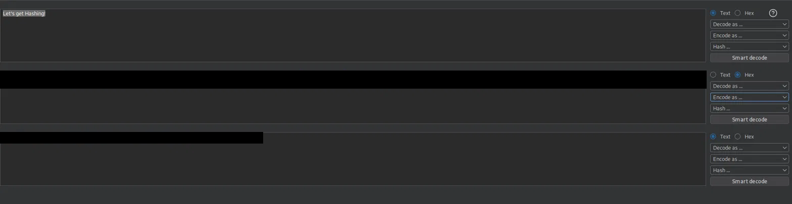
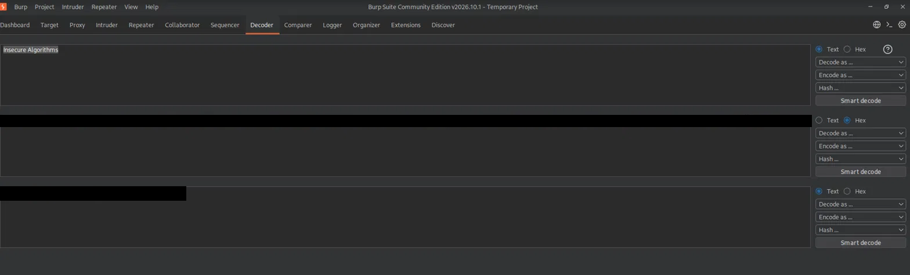
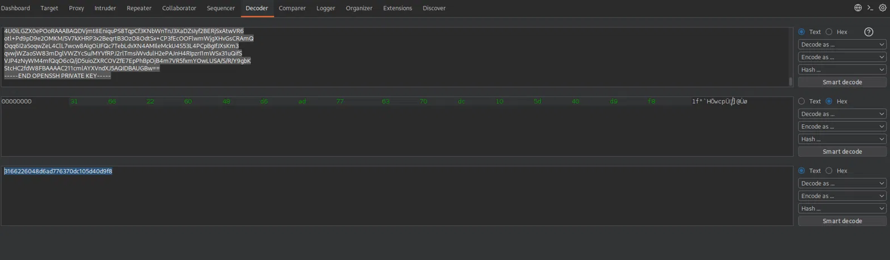

## Exercises

### Question 1 — Using Decoder, what is the SHA-256 hashsum of the phrase: Let's get Hashing!? Convert this into an ASCII Hex string for the answer to this question.

I entered `Let's get Hashing!` into Decoder's input pane and applied **SHA-256** from the Hash dropdown. As with the MD5 example, the output switched automatically to Hex view, showing the raw hash bytes:

```
—REDACTED—
```

With the hash's 32 raw bytes in the hex pane, I applied **Encode as > ASCII Hex** to turn them into the readable hex string:

```
—REDACTED—
```



**Answer:** `—REDACTED—`

### Question 2 — Generate an MD4 hashsum of the phrase: Insecure Algorithms. Encode this as base64 (not ASCII Hex) before submitting.

I entered `Insecure Algorithms` into Decoder's input pane and applied **MD4** from the Hash dropdown, which switched the output to Hex view with MD4's 16-byte (128-bit) result:

```
—REDACTED—
```

This time, instead of ASCII Hex, I applied **Encode as > Base64** directly to the raw hash bytes:

```
—REDACTED—
```

**Answer:** `—REDACTED—`



### Question 3 — What is the correct key name?

#### Scenario 

> Let's look at an in-context example:  
> 
> First, download the file attached to this task.
> 
> **Note:** This file can also be downloaded from the deployed VM with `wget http://10.113.179.205:9999/AlteredKeys.zip` — you may find this helpful if you are using the AttackBox.
> 
> Now read the problem specification below:  
> 
> "Some joker has messed with my SSH key! There are four keys in the directory, and I have no idea which is the real one. The MD5 hashsum for my key is `3166226048d6ad776370dc105d40d9f8` — could you find it for me?"



**Answer:** `—REDACTED—`