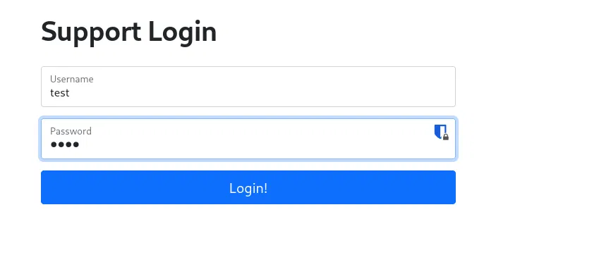
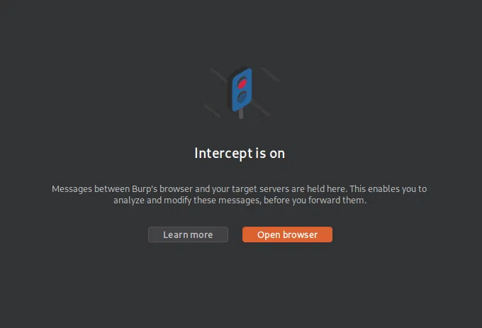
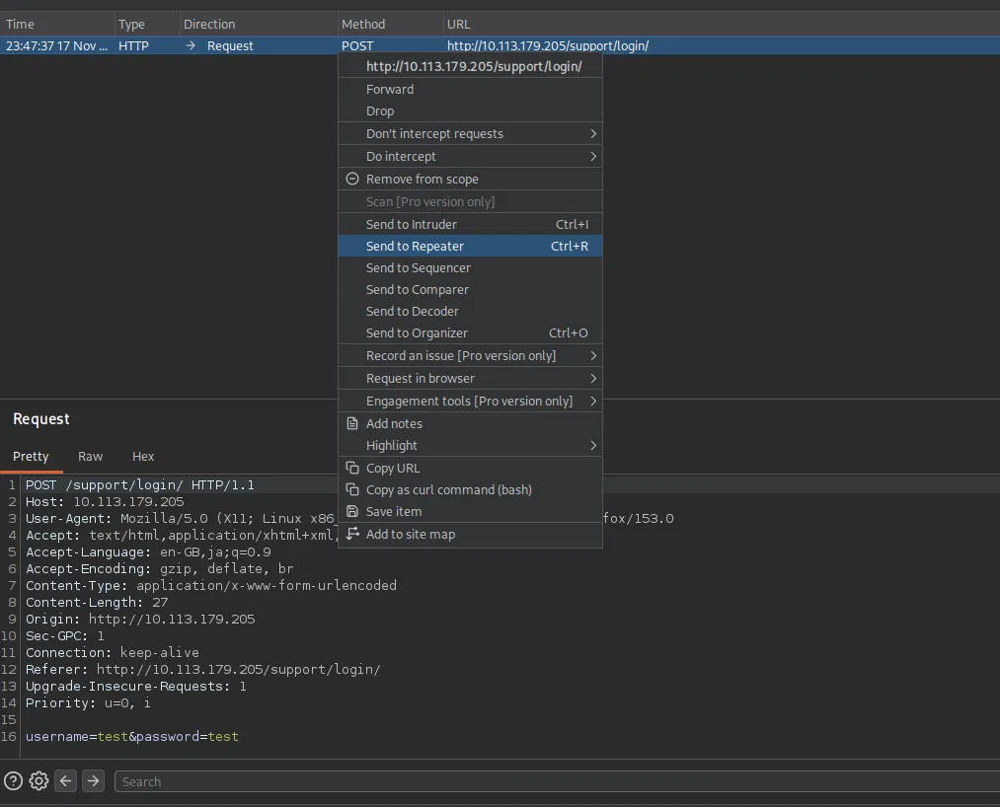
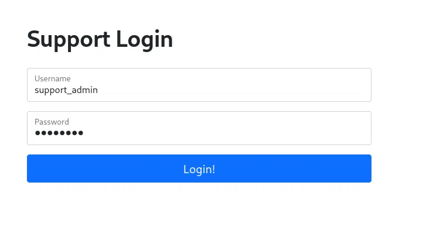
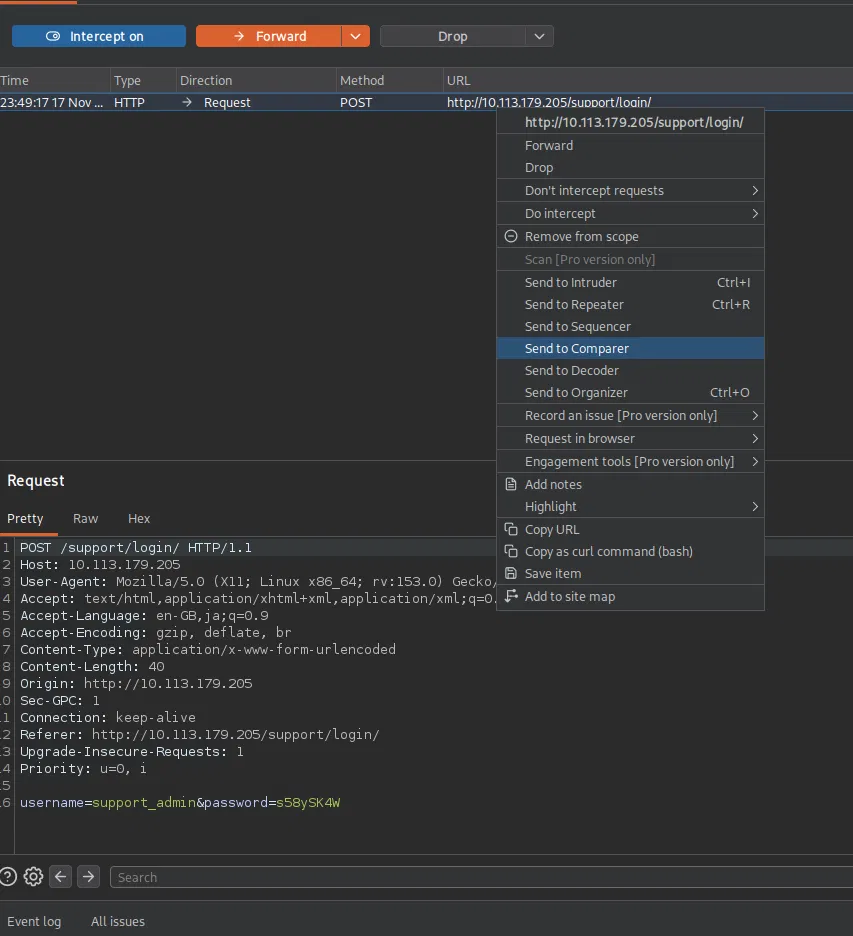
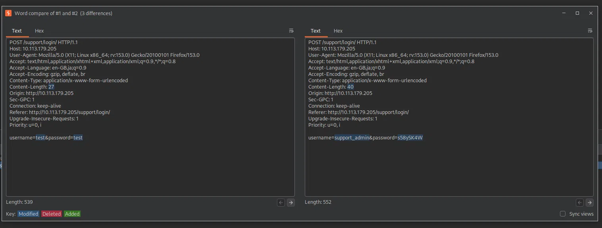

## Exercises

### Question 1 — Compare the two responses by word. Can you identify the main differences?

I went to `http://10.113.179.205/support/login` and submitted an invalid login first, with intercept on in the Burp Proxy:





Burp held the request, which I sent to Repeater:

```http
POST /support/login/ HTTP/1.1
Host: 10.113.179.205
Content-Type: application/x-www-form-urlencoded
Content-Length: 27
Origin: http://10.113.179.205
Referer: http://10.113.179.205/support/login/

username=test&password=test
```



From there, this request became item #1 in Comparer.

I then tried a second login, this time with the credentials given in the task:



I captured this second request too, and this time sent it straight to Comparer from the Proxy intercept queue as item #2:

```http
POST /support/login/ HTTP/1.1
Host: 10.113.179.205
Content-Type: application/x-www-form-urlencoded
Content-Length: 40
Origin: http://10.113.179.205
Referer: http://10.113.179.205/support/login/

username=support_admin&password=s58ySK4W
```



With both items loaded, I ran a word compare on them. The comparison window reported 3 differences between the two, with item #1 at length 539 and item #2 at length 552:



The highlighted differences were:

- `Content-Length`: `27` in the first request versus `40` in the second, reflecting the longer body of the second login attempt
- `username`: `test` versus `support_admin`
- `password`: `test` versus `s58ySK4W`

Since the two items compared here ended up being the two login requests rather than their responses, these differences just confirm the two attempts used different credentials and body lengths, rather than showing how the server's response changed between a failed and a successful login — that comparison would need the two response bodies loaded into Comparer instead.

**Answer:** `No answer needed`