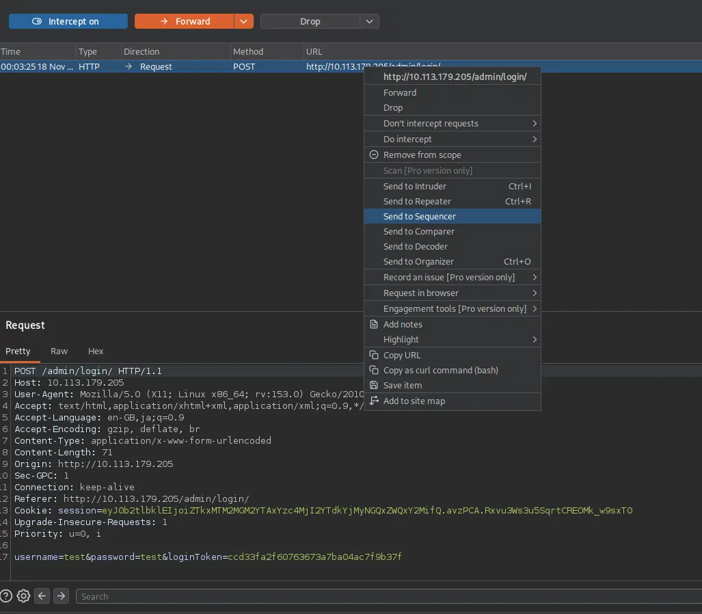
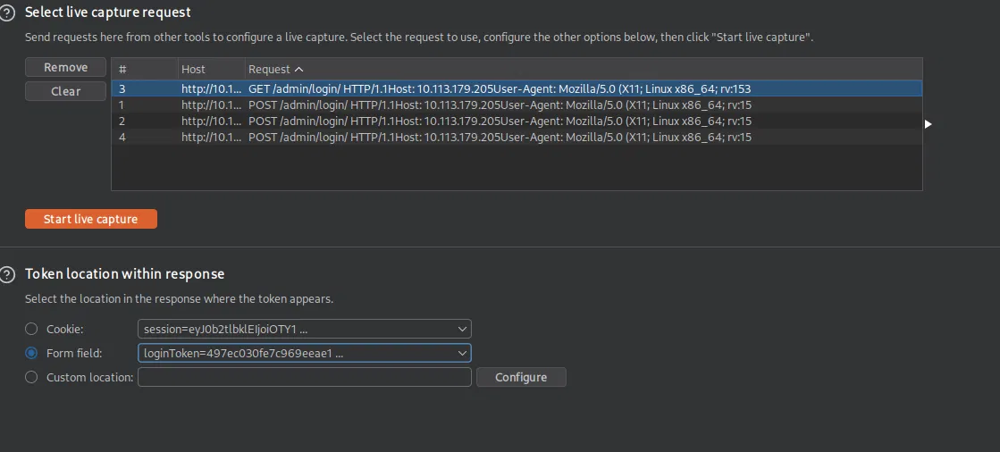
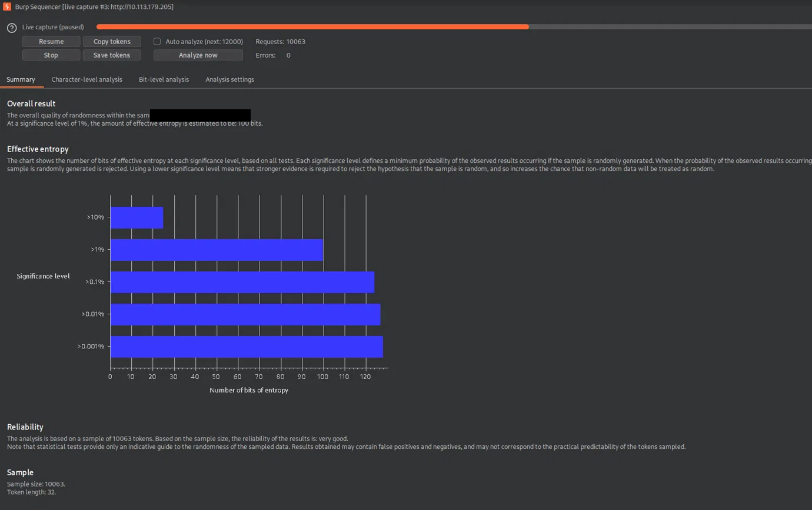

## Exercises

### Question 1 — What is the overall quality of randomness estimated to be?

I turned on Proxy intercept and loaded the admin login page, then captured the request that came through and sent it to Sequencer.

I'd grabbed the POST request from actually submitting the login form, and I was confused for a bit why that didn't work. I realised Live Capture repeats the same request many times to build up a sample of fresh tokens, which only makes sense against the page load rather than a one-off form submission — so I needed the GET request to `/admin/login/`, not the POST.

With the GET request selected and the token location set to **Form field**, pointing at `loginToken`, the configuration was correct.

I clicked **Start live capture** and let it run, waiting until it reached around 10,000 tokens captured.

Once it hit roughly 10k, I clicked **Pause** and then **Analyze now**.

The report confirmed it: overall quality of randomness estimated as —REDACTED—, with 100 bits of effective entropy at a 1% significance level, and a sample reliability of "very good" off 10,063 tokens at a length of 32 characters each.

**Answer:** `—REDACTED—`