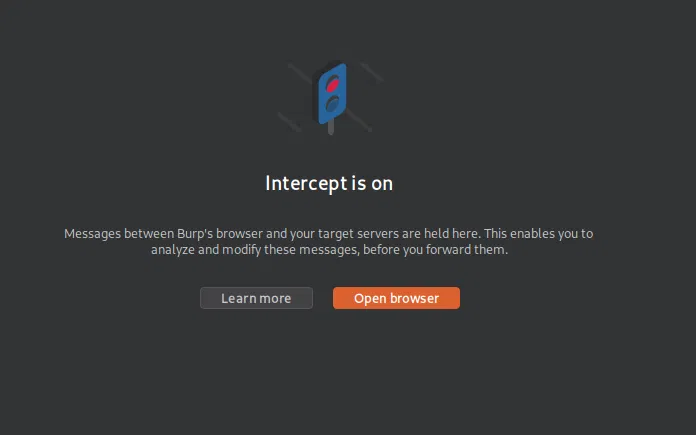
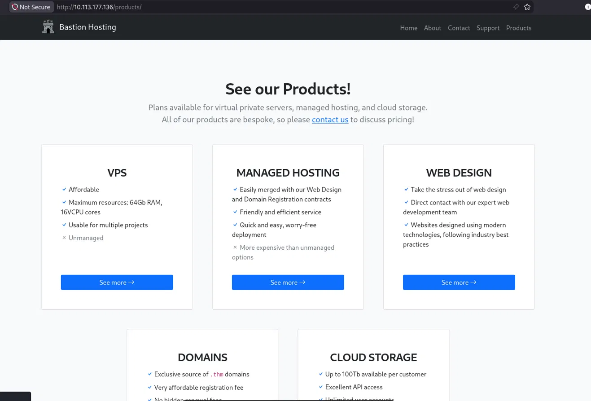
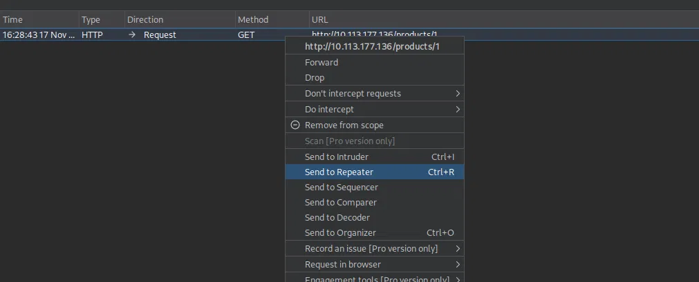
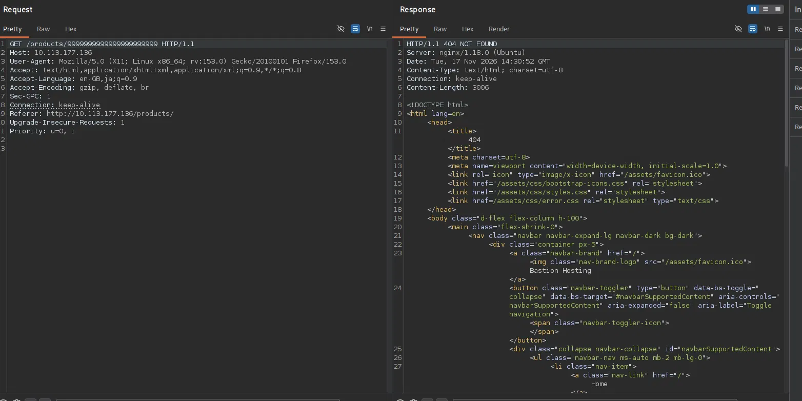
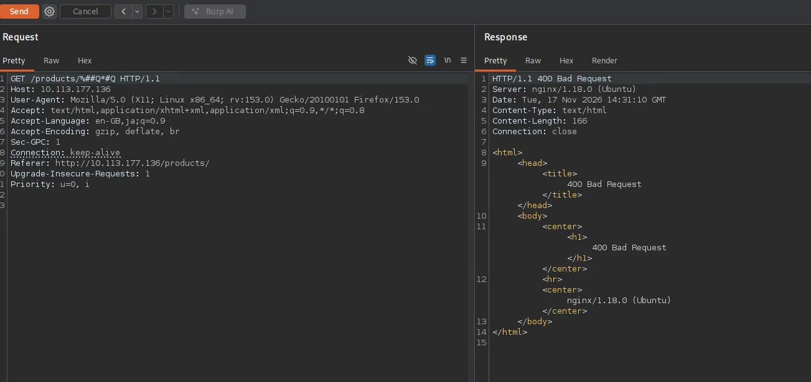
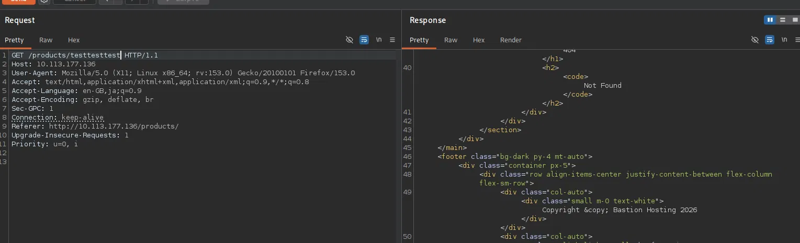
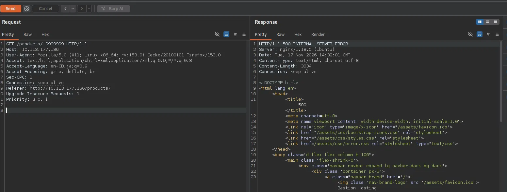

## Exercises

### Question 1 — Enable intercept again and capture a request to one of the numeric products endpoints in the Proxy module, then forward it to Repeater.

I turned intercept on in the Proxy tab. It showed "Intercept is on" with nothing queued yet.



Then I opened `http://10.113.177.136/products/` in the browser. It's a Bastion Hosting page with product cards (VPS, Managed Hosting, Web Design, Domains, Cloud Storage), each with a See more button. Clicking one sends the browser to a numeric endpoint such as `/products/1`.



With intercept on, the request to `/products/1` was held in the Proxy. I right-clicked it and chose **Send to Repeater** (`Ctrl+R` is the shortcut shown next to it in the menu).



**Answer:** `No answer needed`

### Question 2 — See if you can get the server to error out with a "500 Internal Server Error" code by changing the number at the end of the request to extreme inputs.

In Repeater I edited the number at the end of the request line and clicked **Send** for each attempt, reading the status line of the response. Three attempts got no 500, and the fourth did.

#### Attempt 1: A Very Large Number

I replaced the number with a long run of 9s.

```http
GET /products/99999999999999999999 HTTP/1.1
```

**Breakdown:**

- `GET` is the HTTP method, which asks the server to return the resource at the path
- `/products/99999999999999999999` is the path. `/products/` is the endpoint and the long run of 9s is the product number I put in the place of the real ID
- `HTTP/1.1` is the protocol version

This sends a normal product request with an oversized ID.

The server answered `HTTP/1.1 404 NOT FOUND` (served by `nginx/1.18.0 (Ubuntu)`), so the huge number was treated as a product that doesn't exist.



#### Attempt 2: Special Characters

Next I tried junk characters in place of the number.

```http
GET /products/%##Q*#Q HTTP/1.1
```

**Breakdown:**

- `GET` is the HTTP method
- `/products/%##Q*#Q` is the path. `/products/` is the endpoint and `%##Q*#Q` is the malformed value I put where the ID goes, which contains a bare `%` that isn't followed by a valid hex pair
- `HTTP/1.1` is the protocol version

This sends a request whose ID is not a number and does not form a valid URL encoding.

The server answered `HTTP/1.1 400 Bad Request` with a `Connection: close` header and a short nginx error page, so the malformed path was rejected at the web server before it reached the product page.



#### Attempt 3: Plain Text

Then I put in a plain string with no special characters.

```http
GET /products/testtesttest HTTP/1.1
```

**Breakdown:**

- `GET` is the HTTP method
- `/products/testtesttest` is the path. `/products/` is the endpoint and `testtesttest` is a valid-looking string that is not a number
- `HTTP/1.1` is the protocol version

This checks how the endpoint handles an ID that is text.

The response was another 404. The page body showed a "Not Found" heading inside an `<h2><code>` element, which I noted because the 500 page later has the same element.



#### Attempt 4: A Negative Number

Last, I tried a large negative number.

```http
GET /products/-9999999 HTTP/1.1
```

**Breakdown:**

- `GET` is the HTTP method
- `/products/-9999999` is the path. `/products/` is the endpoint and `-9999999` is a negative integer in the position of the product ID
- `HTTP/1.1` is the protocol version

This asks for a product with an ID that can't exist as a normal record number.

The response was `HTTP/1.1 500 INTERNAL SERVER ERROR` with a `Content-Length` of `3034`. That's the error the task asked for.



**Answer:** `No answer needed`

### Question 3 — What is the flag you receive when you cause a 500 error in the endpoint?

The flag was in the body of the 500 response. It sits in the `<h2><code>` element, the same place the 404 page shows "Not Found" (see Attempt 3 in Question 2).


**Answer:** `—REDACTED—`