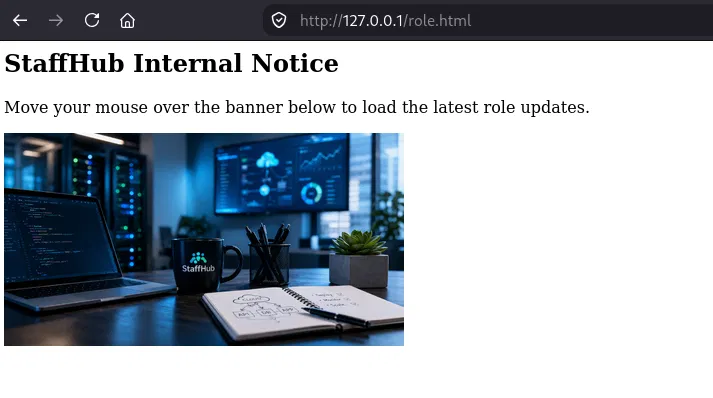
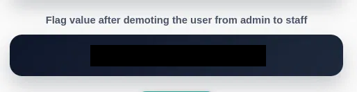

## Exercises

### Question 1 — What is the flag value after demoting the user from admin to staff? Visit the dashboard page to get the flag.

```html
<html>
<body>

<h2>StaffHub Internal Notice</h2>
<p>Move your mouse over the banner below to load the latest role updates.</p>


</body>
</html>
```

An `onmouseover` handler on the image that redirects the browser to `update_role.php` with `role=staff` and the reversed `csrf_token` value of `YWRtaW4=` (the encoded form of `admin`, which was derived from the page's DOM).

```shell
┌──(—REDACTED—㉿kali)-[/var/www/html]
└─$ sudo systemctl start apache2
```

```
http://127.0.0.1/role.html
```



Opening this address and hovering over the banner image fires the `onmouseover` handler, which sends the forged request and demotes the logged-in user from `admin` to `staff`.



**Answer:** `—REDACTED—`

### Question 2 — In the above example, what is the name of the encoding scheme used by the developer for encoding CSRF tokens?

**Answer:** `—REDACTED—`