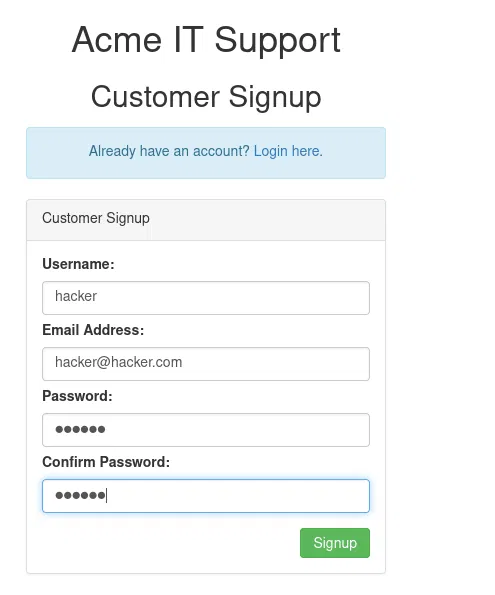
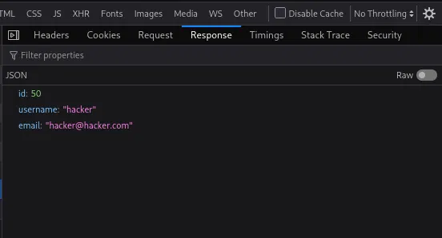
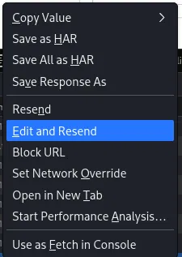
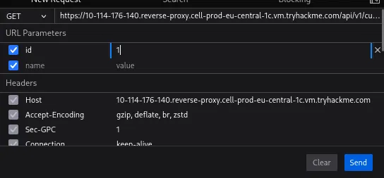
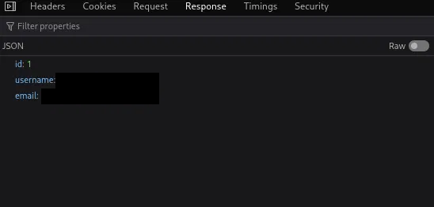
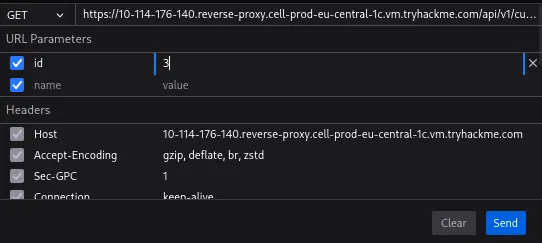
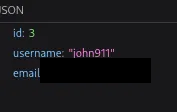

## Exercises

### Question 1 — What is the username for user id 1?

I started the lab machine and opened the app at `https://10-114-176-140.reverse-proxy.cell-prod-eu-central-1c.vm.tryhackme.com`. In the Customers section I signed up with a throwaway username, email and password.

Once logged in I opened the Your Account tab, then opened developer tools, switched to the Network tab, and refreshed the page. A request to `/api/v1/customer?id=50` showed up, and its response was my own account's JSON record.

So `id` was the only thing deciding which record came back, and nothing in the response suggested the server had checked that `50` belonged to my session. I right-clicked the request and chose Edit and Resend to test that.

In the Edit and Resend panel I changed the `id` parameter from `50` to `1` and sent the request.

The response came back with a different user's data, not mine:

**Answer:** `—REDACTED—`

### Question 2 — What is the email address for user id 3?

With the endpoint confirmed vulnerable, I repeated the same edit, this time setting `id` to `3`.

The response returned yet another account that wasn't mine, which settled it: the endpoint has no authorisation check at all — it hands back whatever record the `id` parameter names, regardless of who is logged in.

**Answer:** `—REDACTED—`