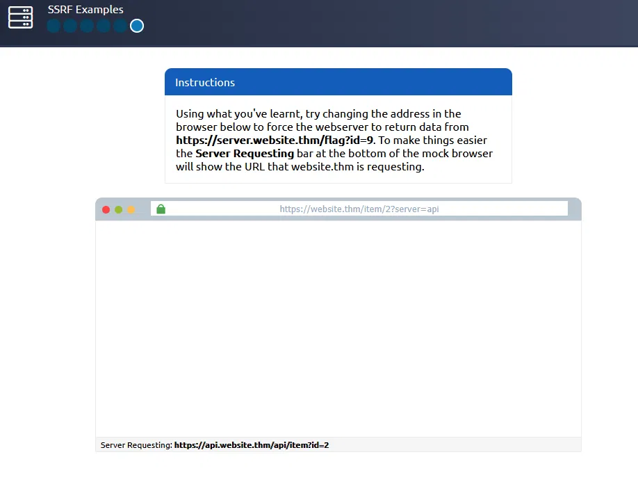
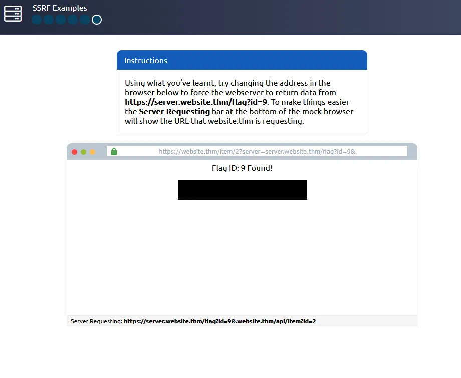

## Exercises

### Question 1 — What is the flag from the SSRF Examples site?

I opened the site and got a mock browser showing `https://website.thm/item/2?server=api`. The Server Requesting bar underneath read `https://api.website.thm/api/item?id=2`, so the value of `server` was being used as the hostname part of the request the back end makes.



The target was `https://server.website.thm/flag?id=9`, so I replaced `api` with a value that points at that path:

```txt
https://website.thm/item/2?server=server.website.thm/flag?id=9&
```

**Breakdown:**

- `server=` is the parameter that feeds the hostname of the back-end request.
- `server.website.thm/flag?id=9` is the host, path and query string I wanted the server to fetch.
- `&` ends that query string and starts a new parameter, so whatever the application appends afterwards is read as a parameter name.

The Server Requesting bar then showed `https://server.website.thm/flag?id=9&.website.thm/api/item?id=2`. The text the application appends (`.website.thm/api/item?id=2`) sat after the `&`, where it no longer changed the path I was requesting. The page returned "Flag ID: 9 Found!" with the flag.



**Answer:** `—REDACTED—`
