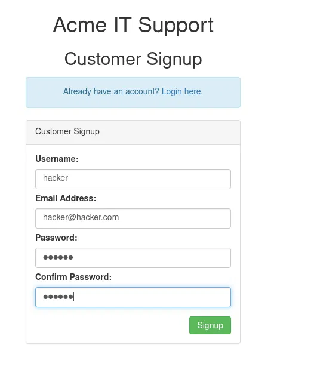
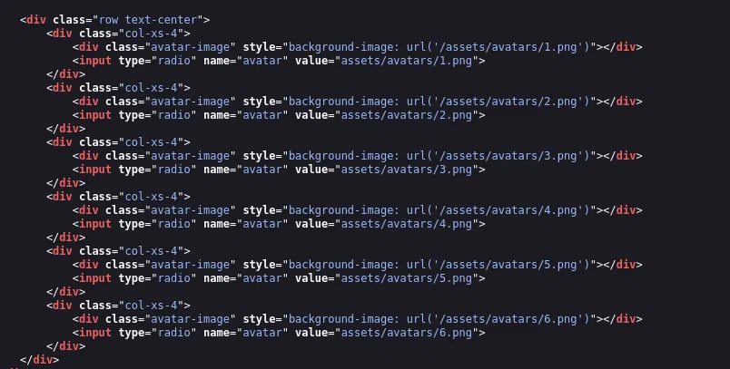
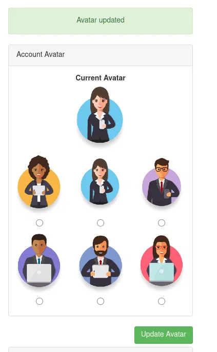
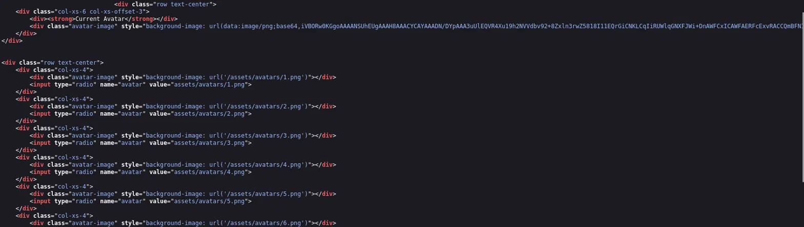
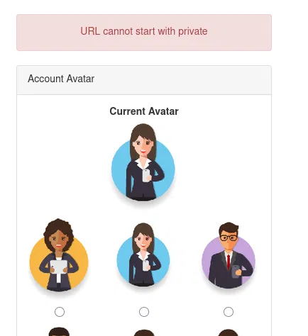
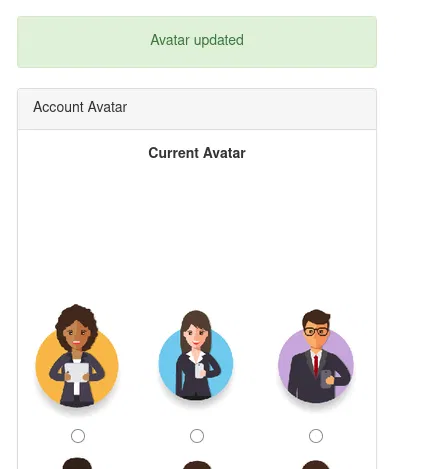

## Scenario

> In this task, you will exploit an SSRF vulnerability on the Acme IT Support website. The attack combines a hidden form field vector with a deny list bypass using directory traversal.
> 
> During a content discovery exercise against the Acme IT Support website, two endpoints have been identified:
> 
> |Endpoint|Behaviour|
> |---|---|
> |`/private`|Returns an error stating the contents cannot be viewed from your IP address. Access is restricted based on the source IP of the request.|
> |`/customers/new-account-page`|A newer version of the customer account page. Includes a feature for selecting a profile avatar.|
> 
> The `/private` endpoint is the target. It contains restricted content that is only accessible to requests originating from the server itself. The avatar feature on `/customers/new-account-page` is the attack vector.

Access via: `https://10-112-143-160.reverse-proxy.cell-prod-eu-central-1a.vm.tryhackme.com`

## Locating the Avatar Feature

I followed the room's step-by-step guide for this one. First I created a customer account on the site and signed in.



Then I navigated to `/customers/new-account-page` and found the Account Avatar panel, showing six avatar options as radio buttons.


Viewing the page source showed each avatar option as a `<div>` with a `background-image` CSS property, paired with a radio button whose `value` attribute holds the same path:



```html
<div class="row text-center">
    <div class="col-xs-4">
        <div class="avatar-image" style="background-image: url('/assets/avatars/1.png')"></div>
        <input type="radio" name="avatar" value="assets/avatars/1.png">
    </div>
    <div class="col-xs-4">
        <div class="avatar-image" style="background-image: url('/assets/avatars/2.png')"></div>
        <input type="radio" name="avatar" value="assets/avatars/2.png">
    </div>

—SNIP—
```

Each radio button's `value` is a server-relative path to an image file. That told me the server uses whatever is in this field to fetch the resource, so if the value isn't validated, it should be possible to redirect it to any path on the server.

## Observing How the Server Handles the Request

I selected the second avatar and clicked Update Avatar. The page confirmed the update and displayed the new avatar.



Checking the page source again showed the avatar was no longer referenced by path. Instead, the ``-equivalent `<div>`'s `background-image` now held a `data:` URI with the image content base64-encoded directly in the `url()`:


```html
<div class="row text-center">
    <div class="col-xs-6 col-xs-offset-3">
        <div><strong>Current Avatar</strong></div>
        <div class="avatar-image" style="background-image: url(data:image/png;base64,iVBORw0KGgoAAAANSUhEUgAAAH8AAACYCAYAAADN/DYpAAA3uUlEQVR4Xu19h2NVdbv92ZXadbW5rwqI11HO7FsCbq9W...

—SNIP—
```

This confirmed the behaviour the guide pointed at: the server fetches the resource at the path given in the form field, reads the response, and encodes it into the page as base64. If I could get the server to fetch `/private` instead of an image, its contents would show up the same way, as base64 data in the page source.

## Attempting Direct Access to `/private`

I right-clicked one of the avatar radio buttons and selected Inspect to open the element in dev tools.



The selected element showed its original value:

```html
<input type="radio" name="avatar" value="assets/avatars/2.png">
```

I edited the `value` attribute directly in dev tools, changing it from the image path to `private`:

```html
<input type="radio" name="avatar" value="private">
```

I then selected that modified radio button and clicked Update Avatar. The application rejected it outright, returning an error that the path cannot start with `private`:



We can assume that the application has a deny list blocking any request where the path begins with `/private`.

## Bypassing the Deny List

The deny list performs a string match against the start of the path, checking the raw input before the web server resolves it. Directory traversal bypasses this kind of check because the deny list and the web server interpret the path at different stages: the deny list sees the raw string `x/../private`, which does not begin with `private`, so the check passes; the web server then resolves `x/../private` by entering directory `x` and moving up one level with `../`, arriving at `/private`.

I edited the radio button's `value` attribute again, this time to:

```html
<input type="radio" name="avatar" value="x/../private">
```

I selected the modified radio button and clicked Update Avatar. This time the request succeeded, with the application showing "Avatar updated" again, though the avatar images themselves now failed to render as images:



## Decoding the Flag

Viewing the page source confirmed the avatar's `background-image` now held base64-encoded data representing the contents of `/private`, rather than an image file:

```html
<div class="row text-center">
    <div class="col-xs-6 col-xs-offset-3">
        <div><strong>Current Avatar</strong></div>
        <div class="avatar-image" style="background-image: url(data:image/png;base64,—REDACTED—)"></div>
    </div>
</div>

—SNIP—
```

I copied the base64 string and decoded it:

```shell
┌──(—REDACTED—㉿kali)-[~]
└─$ echo '—REDACTED—' | base64 -d

—REDACTED—
```

The decoded output was the flag.

**Answer:** `—REDACTED—`